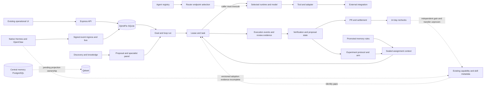

# Capability inventory and dependency graph

Use the retained machine inventories for individual identities, versions and implementation references: [routes/APIs](route-api-inventory.json), runtime-db-evidence results.agents/capabilities/models/registry_agents/skills, [canonical packages](skills-canonical.json), remote skills JSON, [schemas/counts](schema-counts.json), PostgreSQL schemas/evidence and mesh source hashes. These are inventory evidence, not blanket capability certification. State mapping: REGISTERED=file/row only; AVAILABLE=admitted/contract-ready; OPERATIONAL=observed real execution; VERIFIED=independent named criterion; DEGRADED/BROKEN=observed failure within scope; UNUSED=no recorded use in stated instrumentation/window; RETIRED=explicit lifecycle; UNKNOWN=missing evidence. Do not auto-promote a component's state across these levels.

| Capability family | Implementation/config/runtime | Observed state / value / limits |
|---|---|---|
| Goal/loop orchestration | LoopService, loop catalog, leases/tasks, runtime contracts; VPS SQLite | OPERATIONAL recorded maker/reviewer activity; verified gates/settlement are narrower than general task success |
| Specialist deliberation | specialist-panel-service, specialist_reviews, panel consensus; model_calls | OPERATIONAL reviews; default/unreviewed consensus and oracle authorization have different authority |
| Native delegation | subagent service/executors, spawn/parent IDs, Hermes/OpenClaw runtimes | Historical OPERATIONAL; present cross-agent transfer advantage UNKNOWN |
| Capability registry | swarm_capabilities511 rows, contracts/actions/evidence/removal fields |477RETIRED/deprecated,34REGISTERED candidates; only11 lease-linked historically/0seven-day. Missing linkage prevents global UNUSED claim |
| File skills | SkillLoaderService + manifest/admission guard, envdir/allowlist | Current DjimitFlo file execution DISABLED_BY_POLICY;0agent_skills. Remote native installations separately REGISTERED/installed |
| Skill outcomes/bandit | skill_outcomes, genome/bandit services | OPERATIONAL role fitness recording; not all rows identify executable packages; version0/1394 |
| Distillation | skill-distillation candidate cards; shadow flag |106 candidate cards, never injected by design. REGISTERED candidate output, not deployed learning |
| Memory rules | candidate promotion, assignment-context sealed hash, access log, holdout | OPERATIONAL injection/withholding records; causal benefit UNVERIFIED |
| Central/episodic memory | SQLite memory stores; PostgreSQL central memory/runtime; native files; Qdrant projections | Multiple real stores; retrieval/use authority and freshness differ. SQLite relation/vector/proactive counters0 do not invalidate external stores |
| KB/expert knowledge | knowledge pages, expert units/claims, panel retrieval, ACE | OPERATIONAL retrieval/panel hits; low qualifying outcome attribution; effect UNVERIFIED |
| Models/inference |14 model capability rows, llm_model_calls, nativeOllama/cloud executors | Actual calls/outcomes retained; listing≠availability; aliases not always immutable model artifacts |
| Tool execution/MCP | ToolBroker/executor; MCP catalog10servers/148tools baseline | Catalog is not enforcement boundary; invocation outcomes need existing task/tool evidence. No live external tool invoked for audit |
| Router/registry/bus | native Python/FastAPI services + Redis; source hashes in mesh evidence | CONNECTED/health; router selection≠execution. Current ingestion OPERATIONAL records |
| Experiments/verification | experiment registry, frozen protocols, TG/ACE/STE/F2, gym production gates, settlement | OPERATIONAL assignment/evaluation records; insufficient/missing independent labels and verdicts block causal promotion |
| Evolution/governance | genome trials, outcome learning, authority/audit, Realm Gates | Baseline genome onlyactive;0/11strict learning closure; useful gates correctly red/unknown, not proof of universal failure |
| Repo explainers/public Explore | generation/citation/provenance service, public routes | Historical visible publication; current generations/rendering not exhaustively retested |

## Logical dependency graph

Solid arrows describe source wiring plus retained records for the family, not one newly executed end-to-end trace. Dotted arrows mark unproven closure or missing identity. No topology claim relies on a similar name alone.

Cross-component learning requires a stricter path than storage/message exchange: originating execution/evidence→versioned skill change→validation→authorized installation→observed selected version→paired transfer outcome→survival. Current records support fragments, not a complete current example of that chain. Reuse the existing registries, admission metadata and evidence graph to close it; do not add a central “intelligence service.”
