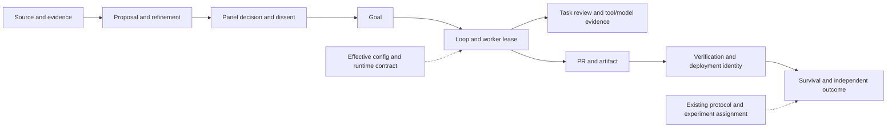

# G. Target experience architecture

The current primary navigation already groups 37 destinations into 20 main+17 Lab and consolidates legacy approvals/compliance/log/cockpit aliases. Keep that structure initially. The main problem is evidence ownership and missing contextual transitions, not the absence of another dashboard.

| Existing area | Smallest change justified by observed use | Context to preserve |
|---|---|---|
| Cockpit |One operational overview; per-section as-of/source health and named refresh scope |Process healthy vs guardrail breached, explicit unmeasured capability gain |
| Decisions |Queue counts/tabs/anchors; paginate high-volume queues; administration link to config |Existing approvals, reasons, labels, requeues and audit identity |
| Goals & Loops / Tasks |Linkable selected run, existing review bundle as diagnostic destination |Goal↔proposal/panel↔loop↔lease↔task↔PR/artifact |
| Agents / Swarm / Catalog |Shared identity/context views over existing registries, not forced physical merge |Registration≠preparation≠available runtime≠active execution≠social connection |
| Improve / Evolution |Contracts at each metric; candidate/experiment details from existing records |Activity→output→verified→survived→causal gain remain separate |
| Knowledge / Frontier / Commons |Source/evidence→recorded use→outcome links; scoped dedupe and attribution |Checked identity≠verified capability; unrecorded use≠worthless |
| Fleet / Usage / services |Join current dependency/probe/history/config in contextual integration view |Policy isolation≠outage, transport ok≠semantic success |
| Observability / Audit / Authority |Coordinate filters and entity links; preserve distinct canonical/authority roles |Review bundles, Interaction Board and provenance DAG already exist |
| Configuration |Extend existing read-only catalog with effective resolution metadata and intent filters |Defaults, process env, DB tuning, per-run overrides, source/activation mode |
| Lab |Keep experimental scope; migrate only proven daily tasks into main navigation |Drafts/mock/incomplete certification remain explicit |

Potential future labels such as Overview, Operations, Agents & Capabilities, Workflows, Evolution, Data & Knowledge, Integrations, Observability and Configuration are organizational options, **not a mandated new nine-section redesign**. First measure which current tasks need extra navigation. There is no evidence for a new workflow service, separate integration platform, universal log store or configuration database.

## Reuse sequence and information model

1. Repair calculations/taxonomy/query scope in their current writers/readers.
2. Extend existing `provenanceDag` and review-bundle output only for missing explicit relationships. Preserve evidence_ref/origin/error/cap semantics. Render links with existing entity IDs and routes; no guessed links.
3. Reuse `useResource` loading/error handling and existing typed statuses. A metric's details should show unit, window, n, as-of, source/query health and exclusions. Shared presentation is justified where the same contract repeats; avoid speculative component framework.
4. Link services→current usage/error/config and experiment→protocol/treatment/verification/survival. An operator follows an entity, without reconstructing joins mentally.
5. Consolidate duplicate Activity/spec and capability views only after unique content and deep links are preserved. Keep redirects for saved links.

The diagram is the target navigable chain, not a claim that all arrows are currently recorded or causally established. Render missing edges as UNKNOWN. Some links exist already; F identifies the gaps.

## Proportionate interaction and security

Routine read/filter/drill-down needs no new approval. Make GET inventory passive and label deliberate probe/sync effects. Preserve masked credentials, authorization, policy isolation, explicit human actor binding and destructive-action boundaries. Show the scope/result/recoverability of an action where it matters; do not add confirmations to ordinary inspection. Production repair/retry/rollback and irreversibly destructive actions retain their existing meaningful checks. An Enabled catalog/policy label must not imply a broader enforcement claim than its actual contract.
