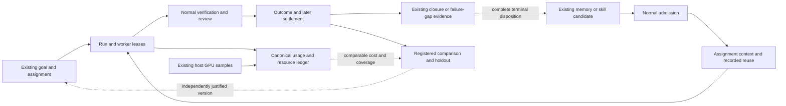

# Three complete loops for every eligible swarm

This is an implementation specification derived from the [live assessment](README.md), not an activated policy. Reuse goals/loops, leases, assignment context, evidence, memory admission, the experiment registry and existing resource/cost ledgers. Existing authorization, protected verification, independent checker/security requirements and frozen experiment surfaces remain authoritative.

## Define what is evolving

An execution is one goal/run and its actual worker attempts. A swarm configuration is a repeatable combination of task class, decomposition/topology, roles, runtime/model versions, allowed tools, context/skill/genome hashes, memory/example selection and policy. An agent registry row, observed mission or one-off proof run is not itself that configuration.

Use existing `goal_id`, `loop_run_id`, lease/parent/spawn-tree IDs, mission ID when present, capability/skill identity, genome/content hashes, assignment event and policy/experiment IDs. Record the actual selected configuration before execution. Prefer a derived configuration fingerprint in existing metadata/read projections if the present IDs cannot distinguish composition; do not create another registry. Never include credentials or mutable unversioned prompt text in a public identity.

Solid arrows identify existing substrates/relationships; dotted arrows are the completion/validation work specified here, not a claim that the full feedback chain already works for every configuration.

Separate typed skill identity from aggregate outcome families such as `loop-maker:<lane>:<runtime>`. The current seven-day production-maker cohort has 69 outcome rows, all with task IDs, 53 with content hashes and 16 with models; none has a semantic skill-version field. A valid immutable hash can identify a composite assignment, but it does not automatically satisfy a catalog skill's attribution/promotion contract. Link the actual admitted skill/version/hash where one was used rather than inventing it retrospectively.

## Loop 1: execute, verify, diagnose and recover

**Trigger:** an eligible goal enters the existing worker pipeline.

1. Select the smallest permitted configuration that can resolve the task. Use deterministic automation for deterministic work; one maker plus the required independent reviewer is a sensible baseline. Add a specialist/parallel maker only for an explicit uncertainty or genuinely independent subproblem.
2. Freeze assignment identity, allowed evidence, resource ceiling, deadline and expected behavioral checks. Decomposition must express actual dependencies; analysis→implementation→verification is not three independent parallel tasks.
3. Record every attempt, delegation, model/tool call, queue interval and result under its existing run/lease. Charge retries, failed siblings and synthesis to the task, not only the winning maker.
4. Use normal verification and independent review. Separate semantic failure, no change, infrastructure failure, unavailable measurement and cancelled work. A completed lease is not an independently verified improvement.
5. Retry/replan only within the current budget and with a changed diagnosis. Repeated identical failure signatures should stop the attempt or create the existing deduplicated knowledge-gap/work item. Preserve an explicit terminal disposition even when recovery fails.

**Existing substrate:** daemon, runtime admission, lease lifecycle, token budgets, evidence/gates, failure-gap producer, bandit, retry and checker paths. Do not replace these with the unimplemented generic session executor.

**Coverage guarantee:** every admitted assignment has one accounted-for terminal or overdue state, measured resource coverage and a reasoned next step. It cannot guarantee task success. A watchdog should surface missing terminal/accounting evidence through existing events/work items; it must not fabricate a pass or rerun a paid agent to fill telemetry.

## Loop 2: terminal outcome to reusable knowledge and measured reuse

**Trigger:** every eligible terminal agent execution, including failed, blocked, cancelled and inconclusive outcomes. Housekeeping/observation-only runs may be explicitly not applicable.

- Keep the existing guarded successful closure for assurance. Add or project a distinct terminal-learning disposition: no reusable lesson; evidence missing; negative finding; diagnostic recipe; test/example; candidate rule/skill. A failure does not need a fake successful closure to be useful.
- A useful lesson says when it applies, the decision/procedure that changed, evidence and exact versions, a counterexample/limitation and when to recheck. “Run closed with score 1.0” remains an assurance receipt.
- Use the existing memory/skill candidate, dedupe, admission and promotion route. Do not issue a proposal for every terminal event or circumvent the current reflection-proposal cap of zero. Existing failure gaps can nominate bounded Commons investigations; conversation conclusions still remain candidates.
- Retrieval/adoption records what was actually read and used. Retain candidate identity/hash and outcome context. Existing engineering-rule seals, capped retrieval, freshness/fitness filtering and memory-access logs are useful and should be preserved.
- Compare reuse against the registered withheld condition on new comparable tasks. Show semantic correctness, harmful advice, time, tokens and energy where measured. Retire or supersede a bad rule through existing lifecycle controls; preserve its negative evidence and affected consumers.
- Return the evaluated result to the originating goal/mission/Commons topic. A UI read join may be sufficient; avoid generating another message/reflection on every projection refresh.

**Coverage guarantee:** every eligible terminal run has an explicit learning disposition or an actionable evidence gap. Promotion and later use are separate states. Some runs correctly produce no new memory.

## Loop 3: compare configurations, select, retain and prune

**Trigger:** recurring consequential failure, regression, unusual resource cost, or a candidate supported by Loop 2. Batch analysis of existing evidence should precede new inference.

1. Choose one intervention and a comparable baseline. First evaluate the registered memory/sibling/context studies; six oracle-goal experiments are already active and two have explicit WIP exceptions. Do not add an overlapping study until one reads out.
2. Preserve task definitions, cases, allowed tools, total budgets, required review, model/adapter versions and concurrent experiment assignments. Analyze clustering by goal/failure family and interference between protocols. Gym success alone cannot justify production promotion; the existing capped gym prior and holdout protections address a real boundary.
3. Measure quality and safety first, resources second. A candidate can be faster but less reliable, or lower power but slower and higher total energy. Report the trade-off/Pareto frontier; do not promise all objectives improve simultaneously.
4. Use registered stopping and promotion rules, practical effect thresholds and uncertainty. Too little evidence means insufficient evidence. Do not promote a favorable point estimate or treat the bandit's 20-outcome exposure threshold as a scientific power calculation.
5. Admit an exact tested version through existing promotion gates. Retain its incumbent and rollback conditions. Check survival after deployment and performance on fresh tasks/another eligible runtime before claiming cumulative transfer.
6. Allocate less R&D to variants with no plausible transfer path after their registered readout; retain bounded exploration. Existing value-allocation and effort records are shadow proposals, not permission to pause services or remove required review.

**Coverage guarantee:** each maintained configuration has a baseline, current evidence state, last evaluation, resource scope, next review/expiry and owner. It may be proven, collecting, unchanged, regressed, retired or insufficient. “Every swarm evolves” should mean it participates in this accountable selection process, not that every variant survives or improves.

## Metric contracts

| Metric | Definition and required denominator | Source/scope and exclusions |
|---|---|---|
| Independent task success | Correct outcome at fixed horizon / all assigned eligible cases | Existing assignments, gates/checker and evaluator; include failed/cancelled/infra assignments in accounting and report reasons. Conditional semantic success is a separate metric |
| Durable outcome | Eligible independently verified change still meeting its criterion at the specified later horizon / outcomes eligible for that recheck | Existing merge/survival/settlement evidence; pending rechecks are censored, not successes. Verification is not automatically causal improvement |
| Task token cost | Sum of recorded input/output/cache/other tokens over all attributable attempts and required orchestration/review | Canonical cost-ledger owners, mirrors and coverage; absent usage null. Keep token categories and provider conventions visible; cross-model token counts are not compute-equivalent |
| Tokens per successful result | Total attributable tokens for all assigned cases / independently successful cases in the same cohort | Includes failed work. Zero successes gives undefined/insufficient, not 0. Report token coverage and uncertainty; account for R&D separately or explicitly amortize it |
| Task energy | Integral of measured device power over attributable execution windows, Wh = integral(W × seconds)/3600 | Existing host samples/exclusive overlap attribution. GPU-only, estimated model and whole-host wall meter are separate scopes; missing intervals never imply zero |
| Wh per successful result | Attributable measured Wh for all assigned comparable cases / independent successes | Same hosts, cohort, horizon and sampling coverage. Whole-ecosystem energy remains unknown when cloud/CPU/other hosts are absent. Include research amortization when claiming lifecycle efficiency |
| Time to verified result | Queue + coordination + execution + all retries/review to verified result or fixed horizon | Existing events/leases/checks; p50/p95 and noncompletion/censoring. Do not sum parallel worker wall times and call it task latency |
| Evolutionary gain | Candidate minus control quality; candidate/control resource ratios under the same declared scope | Registered assignment/control and exact versions, uncertainty, held-out transfer and survival. A before/after mix of tasks or a same-run assurance-score delta is descriptive only |

Use objective, comparable outcomes per task class. Arbitrary “value units” combining verified and survived outcomes may support a transparent internal allocation heuristic, but are not independent business value or causal ROI. Keep its weights/credit rules visible. Do not combine cloud tokens, money and kWh into one hidden score.

## Use existing controls more effectively

The acting bandit currently optimizes outcome success. The shadow effort controller subtracts token cost and a rough local-energy estimate based on 0.3 kW × mean duration; its unset `EFFORT_LAMBDA_KWH` resolves to zero. That model is neither a measured run-energy value nor proof that energy is free. Reuse measured job history for future estimates with declared missingness/confidence, and keep estimates separate from actual measured outcomes. Evaluate an estimator/controller change in isolation after current protocol ownership permits it; preserve the checker, security, deterministic-gate, auth and human-merge floors.

Use the measured gym spend to ask which task tiers/genomes transferred to production, what discriminating evidence is still missing and when each trial must stop. Do not optimize the gym's score or train repeatedly on an exhausted holdout. The recent 200 jobs/5.872 kWh do not establish either positive transfer or waste.

## Target operator experience across the requested pages

- **Agents:** identity/role, actual readiness, recent independent outcomes with n/window, latency and cost/energy scope, plus links to its current swarm/configuration and execution. Keep lifetime reported counters explicitly labeled. Show insufficient evidence for zero-task agents.
- **Swarm:** current execution truth, task/configuration cohort, bottleneck and budget, measured token/energy coverage, outcome and learning dispositions. Replace stale manual-feed dependence with a read projection of existing closures, gaps, admitted rules and settled outcomes; retain old curated notes as their own source.
- **Mission Control:** compare eligible configurations, current experiments and next readout, variant lineage and independently evaluated outcomes, marginal cost of siblings, later survival and pending learning/evidence work. Show whole-registry totals separately from page limits. Keep existing proof truth and contextual evidence links.

One contextual investigation should answer: which swarm ran, why these members, which context/skill versions, what did every attempt cost, what actually passed, what was learned, where it was reused and whether the result survived. No additional disconnected dashboard is needed.

## Readout and rollout order

1. Publish honest read projections and current policy/cohort definitions; no autonomous execution change.
2. Read out memory-holdout at its existing target/stopping rule. The lower rules point estimate is not by itself a retirement decision; assess uncertainty, interference, exclusions, costs and safety under the protocol. Preserve immutable results and make a separate next-study decision.
3. Complete missing terminal-learning dispositions and configuration/resource lineage on one eligible lane in an isolated environment. Use historical unclosed runs to diagnose missing evidence; never backfill a pass or invent versions.
4. Finish current sibling/context/transfer readouts. Then register any necessary resource-aware configuration comparison using existing experiment machinery and WIP rules.
5. Expand only after independent fresh-task benefit, acceptable regression bounds, runtime proof, rollback and later survival. Existing protected promotion/deployment authorization remains required.

Controlled research reinforces task-dependent architecture choice and coordination overhead, not universal swarm superiority. [Kim et al., 260 controlled configurations, v3](https://arxiv.org/abs/2512.08296v3). Device telemetry has a device-specific power scope; NVIDIA's documentation, for example, defines power draw for the board rather than the whole machine. [NVIDIA SMI documentation](https://docs.nvidia.com/deploy/nvidia-smi/index.html). These sources inform the design; they do not establish DjimitFlo's effect sizes.
