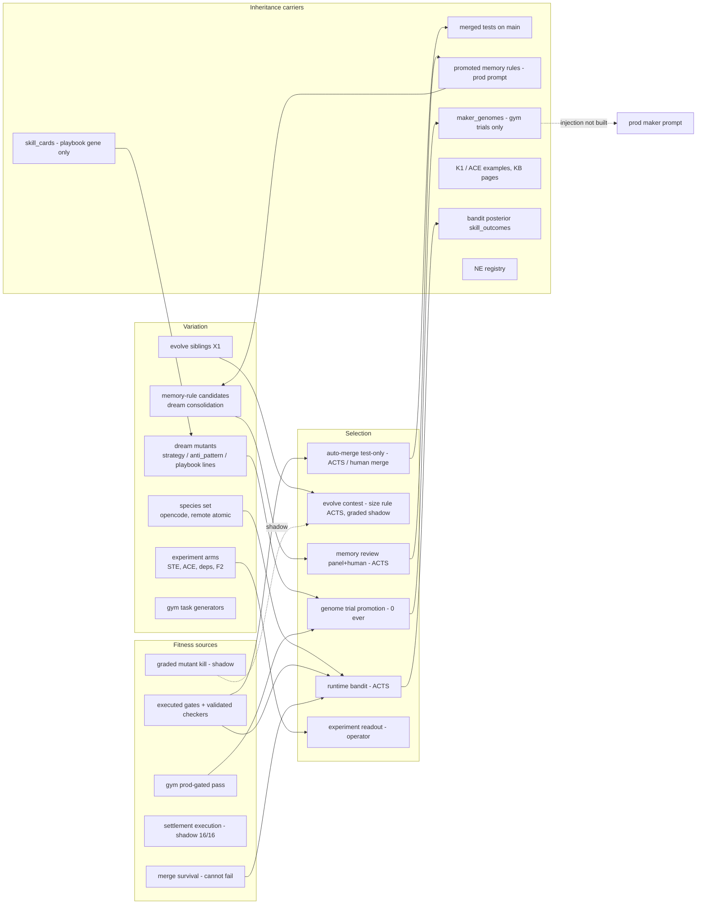

# EVOLUTION-001 · 1 · Evolutionary capability map

Read-only research (operator directive EVOLUTION-001, L3, 22-10-2026). No production write, no flag change, no merge, no
training. This file also holds the conventions and source keys that the other seven files use.

## Conventions

**Tags.** **FACT** = a query result, a code read or a published number, cited. **INFERENCE** = derived from facts.
**HYPOTHESIS** = plausible, untested. **UNKNOWN** = no evidence either way (never read as 0).

**Evidence levels** (unchanged from L3 v2):

| Level | Meaning |
|---|---|
| L0 | Code or config exists; no prod use |
| L1 | It runs (activity only) |
| L2 | It meets its own contract and a consumer reads its output |
| L3 | It acts in prod and an independent oracle or planted-item test validates its outcomes |
| L4 | A controlled comparison shows that feedback improved later performance |

**Classes.** EXISTS / PARTIAL / MISSING / SUPERSEDED / UNKNOWN.

**Rule used throughout.** Code presence, heartbeats, self-reported success, row counts and generated artefacts are never
evidence of effective intelligence. Only executed oracles, planted-item tests, held-out comparisons and settled outcomes
are.

**Snapshot.** Prod image `djimitflo:main-5dfc6cd`, started 2026-10-22 11:26Z. That is origin/main `5dfc6cdb`, the base of this
branch, so code read = code running. Probes ran 19:32–19:45Z.

**Source keys**

| Key | What |
|---|---|
| S0–S6 | Read-only probes in `probes/`, run in `djimitflo-live` with better-sqlite3 `{readonly:true}` (`probes/run.sh`). Outputs stay in the session scratchpad |
| EE | Prod's own compiled `buildEvolutionEvidence(db, env, now, 30)` + `unitEconomics(db)` on a read-only handle (`probes/ee.mjs`), 19:33Z |
| L3v2 | `docs/research/l3-forensics/L3-REPORT-v2-20261021.md` (#946) |
| BEAM | draft #944, `docs/research/beam/` |
| MFR | #959 (branch `exp/mfr-001`), `docs/research/eco/MFR-001_RESULT.md`, `mfr-001/results.json`; **MFR-RA** = my re-analysis of that file |
| SEC | `docs/research/eco/SEC-F1_RESULT.md` (#941) |
| TG | `docs/research/ace/TG-001_PROTOCOL.md` + EE `tg_001` (r2) |
| NE | `docs/research/negative-evidence/NEGATIVE_EVIDENCE.yaml` (NE-001…NE-012 on main; NE-013 on #959) |
| SBX / MCP | #950 `docs/design/sandbox-runner.md` (draft) / #948 `docs/research/mcp-a2a/` |
| PLAN | operator plan `eventual-brewing-cray.md` (Phases Y, D, E, EP, SI, AR, G) |
| PAPER | arXiv:2610.29458v1, "Harness Scaling for Generalizable Agentic RL" (fetched and read 22-10; see file 4) |
| `file:line` | `packages/server/src/services/…` at `5dfc6cdb` |

---

## 1. The evolutionary loop as it is wired today

Dashed edges are shadow or missing. Section 3 lists every edge with its level.

## 2. Map: variation, selection, inheritance and fitness nodes

### 2a. Variation sources

| Node | Carrier | Level | Class | Evidence | Tag |
|---|---|---|---|---|---|
| Dream mutants (strategy / anti-pattern lines) | `maker_genomes` (`dream-evolution.ts:301 dreamOnce`) | L1 | PARTIAL | 18 dream genomes since 01-10: 10 retired, 6 inconclusive, 2 in trial, **0 promoted** (S1). Resumed 22-10 11:26Z | FACT |
| Evidence-cited mutants (`DREAM_EVIDENCE_SOURCES=skills,anti_patterns,knowledge`) | `evidence_sources_json`, `knowledge_refs_json` | L1 | PARTIAL | 1 dream since the flag; `g-a187f81f` cites expert units (S1, EE `genomes.evidence_sources`) | FACT |
| Playbook gene (`DREAM_PLAYBOOK_GENE=on`) | lane playbook from skill cards (`lane-playbook.ts:46`) | L1 | PARTIAL | 1 proposed (`g-d14c1156`, in trial), 0 decided (EE) | FACT |
| Species set (bandit arms) | `LOOP_BANDIT_SPECIES=opencode,remote@workstation/atomic@llama-router` | L2 | EXISTS | 2 arms; claude 0/13, codex 0/5 outside the set (L3v2) | FACT |
| Evolve siblings | `LOOP_EVOLVE_SPECIES`, X1 randomisation | L1 | EXISTS | X1 on 0.727 vs off 0.746, Fisher p 0.83 (EE `effort_x1`) | FACT |
| Template / context / workflow arms | STE-001, ACE-001, MAKER-DEPS-001, F2 | L1 (interim) | EXISTS | interim: STE −0.051, ACE R −0.172, S −0.024, deps +0.043 [−0.196, 0.274] (EE `experiments`) | FACT |
| Memory-rule candidates | dream state consolidation → `memory_candidates` | L1 | EXISTS | dream ledger 82 rows; 22-10 09:42Z "2 new engineering rules" (S1); 235 candidates, 187 promoted (S1) | FACT |
| Retry / requeue | `improvement-requeue.ts`, retry path | L1 | PARTIAL | requeue NOT_MEASURED (EE `learning_ledger`); plain retry 2/9 (PLAN EP) | FACT |
| Feedback retry (MFR) | offline harness only | L0 → **NE-013** | SUPERSEDED (falsified) | feedback 0.325 vs strengthen 0.467 held-out kill, Δ −0.142 [−0.250, −0.033] (MFR) | FACT |
| Gym task generators | mined / mutant tiers 1–6 / failure-derived write_test / spec-gap | L2 | EXISTS | gym 30 d: mined 362 ok / 123 fail; mutant tiers 1–6 (EE `gym`) | FACT |
| Committee / resident genomes | `committee_genomes` (9 seeds) | L0 (off) | PARTIAL | committee off since 19-10, 0/20 decision-grade (EE gate D) | FACT |
| Model swap (Beam etc.) | opencode.json | L0 | MISSING | BEAM: DEFER, no arm run | FACT |

### 2b. Selection points

| Node | What it selects | Acting? | Level | Evidence | Tag |
|---|---|---|---|---|---|
| Runtime bandit (`runtime-bandit.ts:39 chooseSpecies`) | species per maker goal (share 0.8) | yes | L1 for effect | OPE of the fitness-view policy vs logged bandit +0.0018 [−0.0112, 0.0144] (EE `ope`); no bandit-vs-no-bandit estimate (learning ledger NOT_MEASURED) | FACT |
| Evolve contest (`evolve-selection.ts`) | winner among sibling makers | yes (size rule) | L1 | graded contest (shadow) agrees 15/17 (EE `graded.contest`) | FACT |
| Genome trial promotion (`dream-evolution.ts:588`, `genome-promotion.ts`) | strategy genomes on a frozen holdout | yes (rule `both`) | L1 | **0 promotions ever**; 8 recorded trials: 6 `no_headroom`, 2 `blind` (S1) | FACT |
| Memory review (panel + human) | rule promotion | yes | L2 | 187 promoted, 46 rejected (S1); effect not shown (memory holdout, file 5) | FACT |
| Auto-merge test-only (act) / human merge | merged changes | yes | L2 | 25 auto + 50 human merges in 30 d; 22/22 settled survived, 0 auto-merged settled (L3v2) | FACT |
| Arena gate (residents) | resident scheduling | flag on, residents off | L0 | `ARENA_GATE_ENABLED=true` (EE flags), committee off | FACT |
| Value allocator | budget per consumer | no (shadow) | L1 | 31 NO_CONSUMER (L3v2) | FACT |
| Experiment readout | adopt/reject a factor | operator | L1 | loops closed **0/11** (EE `learning_ledger`) | FACT |

### 2c. Inheritance carriers

| Carrier | Reaches prod behaviour? | Level | Class | Evidence | Tag |
|---|---|---|---|---|---|
| Merged loop tests on `main` | yes: later makers and checks run against them | L3 | EXISTS | 73/73 present, 904/904 pass (L3v2 SX); settlement execution 16/16 pass (EE) | FACT |
| Promoted memory rules in the maker prompt | yes (70 % of runs; 30 % held out) | L2 | EXISTS | 937 reads in 30 d over only **19 distinct rules** (S1) | FACT |
| `maker_genomes` lines | **no**: gym trial attempts only; prod injection "not built" (`loop-daemon.ts:617-626`, `genome-registry.ts:273-279`) | L1 | PARTIAL | `GENOME_APPLY_MODE` unset (EE flags) | FACT |
| Skill cards (`skill_cards`) | no: only via the playbook gene in gym trials | L1 | PARTIAL | 102 cards, all `candidate` (S1) | FACT |
| Examples (K1 recency / ACE similarity) | yes | L1 for effect | EXISTS | ACE S interim −0.024 | FACT |
| KB pages (ACE R) | yes, ACE arms only | L1 for effect | EXISTS | ACE R interim −0.172 | FACT |
| Bandit posterior (`skill_outcomes`) | yes, through species choice | L2 | EXISTS | 30 d: opencode 92/235, remote 26/91 maker outcomes (S1) | FACT |
| Negative-evidence registry | humans + `NE_GENERATOR_CHECK_MODE=shadow` | L2 | EXISTS | 13 entries; NE-013 forbids `MFR_001_MODE` | FACT |
| Templates (`MAKER_TEMPLATE_RULES`) | yes | L0 for change | EXISTS | no template change has been adopted (STE running) | FACT |

### 2d. Fitness sources

| Source | Discriminates? | Level | Evidence | Tag |
|---|---|---|---|---|
| Executed gates (tests, lint, type-check, mutation gain, diff/scope) | yes | L3 | oracle lanes 47 % verified (L3v2) | FACT |
| LLM checker / security checker | yes | L3 | F1 AUC 0.95 (14-10); SEC-F1 AUC 0.975, 19/20, 0/26 FR (SEC) | FACT |
| Graded mutant kill (`graded-fitness.ts`, shadow) | yes, within lane | L2 measurement | prod exports mean 0.283, only 9 % full kill (EE `graded`) | FACT |
| Verified label vs graded | **no** | — | verified exports mean graded 0.300 vs not-verified 0.286 (EE `settlement_execution.graded_vs_labels`) | FACT |
| Merge survival (line retention) | **no** (ceiling) | L2 | 22 survived / 0 regressed (EE `merge`) | FACT |
| Settlement execution (re-run at +14 d, shadow) | not yet (0 negatives) | L1 | 16/16 pass; kill share now 0.40 (n 15), 0 paired with maker-time (EE) | FACT |
| Gym prod-gated pass | yes, but the proxy oracle does not transfer | L2 | mined proxy 0.867 vs prod gate 0.311; mutant 0.919 vs 0.395 (EE `gym_prod_gates`) | FACT |
| Outcome attribution | partly | L2 | 82 verified / 25 maker / 40 reviewer / 42 environment; operator-audited CAR 0 (EE `intelligence`) | FACT |
| Forecast skill (Brier) | no forecaster has skill | L1 | 0/20 decision-grade (EE gate D) | FACT |
| Resource ledger | partial | L1 | GPU energy coverage 41.3 %; € known share 0.6 (EE `ue`) | FACT |

## 3. Dependency graph of the evolutionary pathways

Each row is an edge in §1. "Acting" means it changes what happens next in prod.

| Edge | State | Level | Evidence | Tag |
|---|---|---|---|---|
| failures → dream mutant | wired | L1 | dream inputs exclude holdout tasks (#600) | FACT |
| dream mutant → gym trial | wired | L1 | 2 trials open; parent served its epoch-1 holdout first (S2) | FACT |
| gym trial → promotion | wired; **effectively blind on epoch 1** | L0 for effect | deciding set = mutant tiers {2,3} by default; epoch-1 mutants are tiers 3–6 → **10 of 40 tasks decide** (file 6 E0) | FACT |
| promotion → prod maker prompt | **missing** | — | injection not built (`loop-daemon.ts:617`) | FACT |
| skill cards → playbook → genome | wired (gym only) | L1 | `g-d14c1156` in trial | FACT |
| knowledge → genome | wired (gym only) | L1 | 1/18 genomes with knowledge refs (EE `knowledge_links`) | FACT |
| knowledge → proposal | missing | — | 0 proposals with expert refs; discovery `not_linked` (EE `lineage`) | FACT |
| failures → memory rule → prod prompt | wired, acting | L2 | holdout readout 27-10 | FACT |
| maker outcome → bandit → species share | wired, acting | L1 (effect NOT_MEASURED) | EE `learning_ledger` | FACT |
| graded score → selection | shadow only | L1 | `GRADED_CONTEST_MODE=shadow`, `DREAM_PROMOTION_RULE=both` (EE flags) | FACT |
| settlement → learning | broken by ceiling | — | Gate B red: 22/0 (EE gates) | FACT |
| merged test → future repo state | wired | L3 | SX 904/904, settlement execution 16/16 | FACT |
| gym fitness → prod fitness | weak | L1 | gym 37.5 % vs prod 69 % (7 d, different tasks) L3v2; TG-001 r2 A−B +0.158 [−0.128, 0.422] | FACT |

## 4. What this map says (conclusions)

1. **FACT.** Four selection loops act in prod: the bandit, the evolve contest, memory promotion and merges. **None has a
   controlled measurement of its effect** (learning ledger 0/11 closed). The only components with independent validation
   are verifiers (F1, SEC-F1), not learners.
2. **FACT.** The only heritable carrier that both reaches prod behaviour and is independently validated is the merged test
   code itself. That is an artefact the system produces, not a learned disposition of the agents.
3. **FACT.** The Darwin loop (dream → trial → promotion) has never promoted, and a promotion would still not change a
   production maker: the injection step does not exist. Even a perfect trial result is therefore L1 for prod.
4. **INFERENCE.** Variation is plentiful (18 genomes, 6 running factor experiments, 2 species) and selection pressure is
   real only where executed oracles decide (gates, auto-merge). Selection on agents (bandit, genome trials) rests on
   fitness signals that either saturate (verified, survival) or are shadow-only (graded).
5. **INFERENCE.** The pathway most likely to show the first heritable improvement is not the dream loop but the
   **merged-test ratchet plus a graded settlement**. That path already acts and already has an executed oracle; it lacks only a
   discriminating fitness (file 3).
6. **UNKNOWN.** Fleet agents (Hermes, OpenClaw, NanoClaw, DeerFlow) take part in no evolutionary pathway with an outcome
   contract (L3v2 §1c), so they are outside this map.
