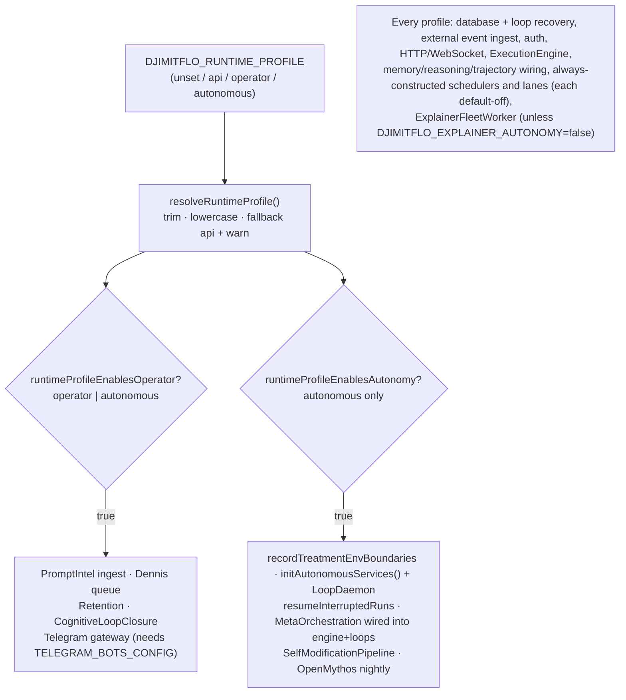

# Runtime Profiles (api / operator / autonomous)

The Djimitflo server boots the same HTTP API, WebSocket gateway, execution engine, and
learning substrate in every deployment, but gates its **background autonomy** behind a
single environment variable, `DJIMITFLO_RUNTIME_PROFILE`. The profile decides which
subsystems are constructed and started during `main()` in `packages/server/src/index.ts`
and its bootstrap modules. It is a startup-only decision: nothing in the profile changes
route registration beyond one constructor-derived flag, and no profile can be switched
without a process restart.

## Resolution

`resolveRuntimeProfile()` in `packages/server/src/config/runtime-profile.ts` reads
`DJIMITFLO_RUNTIME_PROFILE`, trims and lowercases it, and returns one of three values:

| Profile | Operator stack | Autonomy stack |
| --- | --- | --- |
| `api` (default) | no | no |
| `operator` | yes | no |
| `autonomous` | yes | yes |

Two facts matter operationally:

- **Missing or unset variable → `api`.** The default is the smallest, safest footprint.
- **Invalid values warn and fall back to `api`.** A value such as `full-send` logs
  `⚠️ Invalid DJIMITFLO_RUNTIME_PROFILE="full-send", using api` and the server continues
  as `api` rather than crashing or silently escalating capabilities. Case and surrounding
  whitespace are normalized, so `Autonomous` is valid.

Two helpers convert the profile into booleans consumed by `main()`:

- `runtimeProfileEnablesOperator(profile)` is true for `operator` **and** `autonomous`.
- `runtimeProfileEnablesAutonomy(profile)` is true **only** for `autonomous`.

The result is a cumulative model: `autonomous` is a superset of `operator`, never an
alternative to it. There is no way to get the autonomy stack without the operator stack.



*Profile resolution and the major gates in `main()`.*

## Startup sequence and gates

`main()` resolves the profile first, then runs startup in this order:

1. **Database + loop recovery (all profiles).** `initializeDatabase()`, then a shared
   `LoopService` (`recoverySvc`) runs `recoverInterruptedRuns()` to reclaim orphaned
   runs/leases/worktrees. `SelfModelService` is constructed for confidence calibration.
2. **`initExternalEventIngest(db)` runs in every profile.** Despite living in
   `bootstrap/operator-services.ts`, this call in `index.ts` is unconditional: it
   constructs `ExternalEventIngestService`, starts it, and registers it with the
   `lifecycleManager`. It is the one service from the operator bootstrap module that is
   **not** profile-gated.
3. **Operator gate (`operatorRuntime`).** Runs `initOperatorServices(db)` (PromptIntel),
   starts the Dennis governed queue timer (which also drives the DjimitSec repository
   scan tick), and — later, after the WebSocket service exists — starts
   `RetentionService` + `CognitiveLoopClosureService` and the Telegram gateway.
4. **Autonomy gate (`autonomousRuntime`), block 1.** Before any autonomous service is
   constructed, `recordTreatmentEnvBoundaries(db)` logs an experiment period boundary for
   every treatment env flag that changed since the last boot (non-fatal on failure). Then
   `initAutonomousServices(db, recoverySvc)` runs and the `LoopDaemon` is constructed and
   started with the *same* `recoverySvc` instance.
5. **Core stack (all profiles).** Auth, Express app, authenticated WebSocket service,
   `RuntimeGovernanceService`, `ExecutionEngine` (plus interrupted-task reconciliation),
   memory/reasoning/vector/trajectory wiring, `MultiModelIntelligence` seeding, and the
   always-constructed `ProactiveMemoryService` / `ComplianceAuditService` side effects.
6. **Autonomy gate, block 2.** `resumeInterruptedRuns()` re-queues this boot's
   interrupted loop runs through the engine (default off), `MetaOrchestrationService` is
   started and injected into `executionEngine` and `recoverySvc` via
   `setMetaOrchestration(...)`, `SelfModificationPipeline.analyze()` + `autoPlan()` run
   once at boot, and `OpenMythosNightlyService.start()` arms the nightly eval (boolean,
   default-off).
7. **Profile-independent schedulers and lanes.** `ComplianceReportScheduler`,
   `SelfHealingScheduler`, `SelfImprovementAutoReviewScheduler`,
   `FrontierExpertScheduler`, `SpecialistPanelBacklogScheduler`, and
   `MemoryCandidateReviewScheduler` are constructed in every profile, but each `start()`
   returns a boolean and self-disarms unless its own env flag is set — they are
   default-off regardless of profile. The same pattern holds for the return-handle lanes
   wired through `registerRestart`/`noteScheduler`: dependency lane, Ollama
   auto-failover probe, shipped-code scan, skill distillation, content drafts, and
   content-safety retry are all mode-gated and default-off.
8. **Explainer fleet worker (every profile).** See below.

Because `main()` passes `operatorRuntime` into `createRoutes(...)` (consumed by the
`/apex` router), an api-profile process also differs at the HTTP layer, but all other
routes are identical across profiles.

## api profile (default)

The minimal control plane: HTTP API + authenticated WebSocket, execution engine, auth,
learning/memory substrate, external event ingest, the explainer fleet worker, and any
individually-armed default-off schedulers. No Telegram, no retention enforcement, no
Dennis queue, no continuous goals, no self-modification. This is the right profile for a
dashboard- or API-facing instance that should never act on its own.

## operator profile

Everything in `api`, plus the operator-facing automation. The gates are spread across
`bootstrap/operator-services.ts` and inline blocks in `index.ts`:

- **PromptIntel ingestion** (`initOperatorServices`): constructs `PromptIntelService`,
  registers it with the lifecycle manager, and immediately ingests from the pending
  findings file at `PROMPT_INTEL_PENDING` (defaulting to
  `$HOME/.djimit/roborev/paperclip-tasks.pending.jsonl`). Failures are non-fatal.
- **Dennis governed queue** (inline): constructs `DennisAgentService` with the WebSocket
  service, runs `processGovernedQueue()` once at boot and then every 60 s on an unref'd
  timer. The same callback also ticks `DjimitSecTriggerService` (recorded in the
  scheduler registry as `djimitsec_repository_scan`, noted as armed only when
  `operatorRuntime` and `DJIMITSEC_SCAN_TRIGGERS` is `shadow` or `execute`). The timer is
  cleared on SIGTERM.
- **RetentionService** (inline): centralized data-lifecycle enforcement, started under
  the same `operatorRuntime` gate as **CognitiveLoopClosureService**.
- **Telegram gateway** (inline): only when `TELEGRAM_BOTS_CONFIG` is set. The
  `@djimitflo/telegram` package is imported dynamically so the operator gate does not
  hard-depend on it at module load. Each bot config is merged with
  `TELEGRAM_ALLOWED_USERS` / `TELEGRAM_USER_MAP` parsing, the gateway dials the local API
  at `http://127.0.0.1:${PORT}/api` via `TelegramApiService`, and `startAll()` failures
  are warnings. The gateway reference is retained so SIGTERM calls `stopAll()` —
  otherwise restart sees `EEXIST` on long-poll leases and silently skips polling.

## autonomous profile

Everything in `operator`, plus the self-driving stack. `initAutonomousServices(db,
recoverySvc)` in `bootstrap/autonomous-services.ts` constructs the bulk of it; `index.ts`
adds the `LoopDaemon`, meta-orchestration wiring, self-modification, and the OpenMythos
nightly eval.

### From `initAutonomousServices`

Unless noted, construction failures are caught and logged as non-fatal warnings, so one
broken subsystem never blocks the rest of the stack.

- **BoardHandoffService** — `setInterval` reconcile + outbox publish every 60 s, with a
  re-entrancy flag so overlapping ticks are skipped. Own opt-out:
  `DJIMITFLO_BOARD_HANDOFF_AUTONOMY=false`.
- **ContinuousLearningLoop** (+ `TrajectoryStore`) — always-on in this profile; started
  immediately with an initial `runCycle()`.
- **AgentSocialAutopilotService** — Commons residents heartbeat/answer/open rounds
  in-process; skipped when the autopilot config resolves to `runtime === 'off'`.
- **CommonsProposalReviewService** — advisory review of parked self-improvement
  proposals; default off behind `commonsReviewEnabled()`
  (`COMMONS_PROPOSAL_REVIEW_ENABLED=true`).
- **AgentRegistrySyncService** — pull-only agent registry sync; only when
  `registryUrl()` resolves.
- **EventOutboxService** — publishes `djimitflo.work_item/approval/goal` events onto the
  Djimit event bus, with `bridgeGoalEvents(db)` wiring the goal-event bridge; default off
  behind `eventPublishEnabled()`.
- **Proposal / lane sources** (each default-off and wired through `noteScheduler` +
  `registerRestart`): `TestGapSourceService` (`TEST_GAP_SOURCE_ENABLED`, max 2/day),
  `DeadCodeSourceService` (`DEAD_CODE_LANE_ENABLED`, max 2/day), `FindingFixSourceService`
  (`FINDING_FIX_LANE` ≠ `off`, 1 in flight), `AdvisoryExposureService`
  (`ADVISORY_EXPOSURE_MODE` ≠ `off`), auto-requeue (`REQUEUE_AUTO_MODE` ≠ `off`, hourly),
  and `EvolutionGymService` (`EVOLUTION_GYM_ENABLED`, built against `recoverySvc`).
- **DreamStateService** — shadow failure-cause replay every 6 h; default off behind
  `dreamStateEnabled()`.
- **NeedsGroundingTriageService** — reflection-triage-driven way out of
  `needs_grounding`, every 6 h, max 10 per run; default off.
- **DiskGuardService** — one work item + bus event per day at ≥80 % / ≥90 % data-volume
  usage; default off.
- **Feedback and evidence loops** (return-handle starters registered with the lifecycle
  manager when armed): `startInterestFeedback` (`FEEDBACK_INTERESTS_ENABLED`, daily),
  `startEvolutionFeedback` (`EVOLUTION_FEEDBACK_MODE=shadow|on`, daily), evidence room
  (`COMMONS_EVIDENCE_ROOM_MODE=on`, 15 min sweep), Commons investigation outcomes
  (`COMMONS_INVESTIGATION_MODE=shadow|on`), Commons falsifier
  (`COMMONS_FALSIFIER_MODE=shadow`, hourly), settlement execution
  (`SETTLEMENT_EXECUTION_MODE=shadow`, daily, against `recoverySvc`), and fleet repair
  (`FLEET_REPAIR_MODE=shadow`, daily).
- **Value and evolution measurement** (all default-off): value allocator
  (`VALUE_ALLOCATOR_MODE=shadow`, 6-hourly tick producing one daily judgment), dream
  evolution (`DREAM_EVOLUTION_ENABLED`, hourly tick, one dream per day, also carrying the
  `GYM_ORPHAN_SWEEP` sweep), evolution estimators (`EVOLUTION_ESTIMATORS_ENABLED`,
  nightly), benchmark schedule (`BENCHMARK_SCHEDULE_MODE=on`, weekly gym readout /
  monthly SEC-F1 via the operator runner), and committee evolution
  (`COMMITTEE_SWARM_ENABLED`, daily).
- **Loop-PR lifecycle services** (all default-off): merge survival
  (`MERGE_SURVIVAL_ENABLED`, 6-hourly), earned auto-merge for verified test-only loop PRs
  (`LOOP_AUTO_MERGE_TEST_ONLY=shadow|act`, 15 min, self-revoking), draft-PR retry
  (`LOOP_DRAFT_PR_RETRY=shadow|on`, 15 min), and CI watch
  (`LOOP_PR_CI_WATCH=shadow`, record-only).
- **Scheduler watchdog** — `startSchedulerWatchdog(db)` runs armed-but-not-ticking
  detection → bounded restart → quarantine/escalate every 15 min;
  `SCHEDULER_SELF_HEAL_MODE=shadow` (default: diagnose + escalate, no restart) | `act` |
  `off`.
- **Stall watch** — hourly silent-stall detection; a new stall is persisted as a
  `stall` judgment and pushed once through the operator push path;
  `STALL_WATCH_ENABLED=true`.
- **QueueHygieneService** — expires consumer-less work items, stale curiosity claims, and
  unvalidated drafts; default off.
- **KnowledgeMaintenanceService** — scheduled OKF drift / wiki delta / OKF lint checks
  projected into work items; default off.
- **SwarmIntelligenceService + NestedSpawnService** — always constructed here; the nested
  spawn service receives `controlUrl` from `DJIMITFLO_CONTROL_URL` (see below).
- **NegotiationCoordinator** — inter-agent `help_request` protocol, started against the
  shared `recoverySvc`.
- **CapabilityAcquisitionService** — autonomous capability growth.
- **MetaEvolutionService** — periodic self-evaluation + capability pruning.
- **AutonomousGoalGenerator + CuriosityService** — curiosity starts and runs an initial
  `scanForGaps()`; the generator runs after that scan resolves and logs generated
  improvement/security goals. A second always-on (with autonomy) hourly tick,
  `scheduled_proposal_goals`, converts panel-authorised `scheduled` proposals into goals
  without waiting for a restart (`SCHEDULED_PROPOSAL_GOALS_INTERVAL_MS`, default 1 h,
  unref'd and restart-registered).
- **RSI engine trio** — `RsiSafetyGuard`, `ServiceRefactoringAnalyzer`, and
  `EmergentSpecializationService` are constructed for side effects (the refactor /
  safety / specialization engine).
- **ExpertSwarmOrchestrator + WorkerPool + OkfKnowledgeUpdater** — constructed;
  `WorkerPool({ concurrency: 10 })` and the OKF updater are side-effect constructions.

Every interval/timer service is registered with the `lifecycleManager` under a
`serviceName` so shutdown is centralized.

### From `index.ts` under `autonomousRuntime`

- **LoopDaemon** — the continuous goal queue. Critically, it is constructed with the
  *same* `recoverySvc` `LoopService` instance used for boot recovery, so the daemon and
  the API share runtime leases. Poll interval: `GOAL_QUEUE_POLL_MS` (default 5000 ms);
  goal concurrency is bounded by `GOAL_MAX_CONCURRENT` (default 4), each goal gets its
  own swarm/worktree, and per-lease runtime concurrency is separately shaped by the AIMD
  controller.
- **MetaOrchestrationService** — the self-driving optimization layer connecting the
  learning subsystems. Started, then injected into both `executionEngine` and
  `recoverySvc` via `setMetaOrchestration(...)`, and passed into `createRoutes(...)` —
  API routes receive `undefined` for it in the api/operator profiles.
- **SelfModificationPipeline** — runs `analyze()` and `autoPlan()` once at boot inside
  the autonomy gate.
- **OpenMythosNightlyService** — fills the governance leaderboard; `start()` is
  boolean-returning and default-off, armed only in this profile.
- **`recordTreatmentEnvBoundaries`** — before any autonomous service starts, every
  changed treatment env flag is logged as an experiment period boundary, so the process
  that runs the experiments also records when its configuration shifted.

## Profile-independent: the explainer fleet worker

`ExplainerFleetWorker` is constructed and started in **every** profile, including `api`.
The inline comment in `index.ts` records why: an earlier bootstrap-only mount left
explainer jobs idling in api/operator mode (a Codex P1 fix). The worker claims jobs from
`RepoExplainerScheduler`, generates explainer bundles, and runs a slow autonomous drift
check (stale bundles, score regressions, never-published repos) that alerts UAMS.

Two off-switches exist, at different layers:

- **Boot-time opt-out:** `DJIMITFLO_EXPLAINER_AUTONOMY=false` skips construction entirely
  (logged as an info line).
- **Runtime kill-switch:** the scheduler's paused flag is persisted in the `config` table
  under `explainer_scheduler_paused`; `tick()` and `checkDrift()` both consult
  `isPaused()`, so pausing survives restarts and works in every profile. The worker is
  also stopped explicitly in the SIGTERM handler, and the
  `explainer-fleet-worker.test.ts` startup-owner test pins exactly one create site and
  the shutdown stop.

## DJIMITFLO_CONTROL_URL derivation

Before `main()` runs, `index.ts` derives a default nested-spawn control URL when the
operator has not set `DJIMITFLO_CONTROL_URL`:

```
http://<dialHost>:<PORT>/api/swarms/spawns
```

where `dialHost` is `127.0.0.1` whenever `HOST` is `0.0.0.0` or `localhost`, and `HOST`
otherwise. The comment spells out the invariant: **`0.0.0.0` is a bind address, not a
dial address** — a nested-spawned runtime child on the same host must call back over the
loopback to reach `POST /api/swarms/spawns`. Operators override the variable explicitly
for topologies where loopback is wrong (e.g. Docker, where the child needs the
container's reachable address). `initAutonomousServices` passes this value into
`NestedSpawnService`, which writes it into every prepared nested lease so children
inherit it — meaning the derivation happens in all profiles even though nested spawning
itself is an autonomous-profile feature.

## Secondary gates orthogonal to the profile

The profile is a coarse gate; several subsystems require an additional, independent flag:

- **`DJIMITFLO_FRONTIER_EXPERTS_ENABLED`** gates the frontier-experts feature in three
  places: `FrontierExpertScheduler.start()` (which additionally needs
  `FRONTIER_EXPERTS_SCHEDULER_ENABLED=true`), the expert-swarm orchestrator's frontier
  expert selection, and the swarms API (409 `FRONTIER_EXPERTS_DISABLED` when off). The
  scheduler is constructed in every profile but never arms without the base flag.
- The other always-constructed schedulers (compliance reports, self-healing,
  self-improvement auto-review, specialist-panel backlog, memory-candidate review) and
  the profile-independent lanes (dependency lane, shipped-code scan, skill distillation,
  content drafts/safety retry, Ollama failover probe) are likewise default-off and
  individually armed, per their service headers.
- Within the autonomous stack, many services are default-off behind their own
  `*_ENABLED`- or `*_MODE`-style helpers (`eventPublishEnabled`, `dreamStateEnabled`,
  `diskGuardEnabled`, `queueHygieneEnabled`, `maintenanceEnabled`, etc.), so flipping to
  `autonomous` enables the core loop/meta/RSI machinery while the peripheral janitors
  remain opt-in. `scheduled_proposal_goals` is the exception: it is armed whenever
  autonomy is on, with no secondary flag (`noteScheduler` records it as always-on with
  autonomy).

## Failure and lifecycle invariants

- **Non-fatal autonomy bootstrap.** Almost every block in `main()` and
  `initAutonomousServices` wraps construction/start in try/catch and logs a warning; a
  failed scheduler never prevents the HTTP API from coming up. The exceptions are the
  autonomy core (`ContinuousLearningLoop`, `SwarmIntelligenceService`,
  `NestedSpawnService`), which are constructed unguarded.
- **Graceful shutdown.** SIGTERM stops the fleet worker, closes WebSocket clients (with a
  5 s terminate deadline), clears the Dennis queue timer, and calls
  `telegramGateway.stopAll()` so Telegram long-poll leases are released before exit.
- **Focused tests.** `packages/server/src/__tests__/runtime-profile.test.ts` pins the
  resolution contract: default `api`, invalid-value fallback (`full-send` → `api`), and
  the exact operator/autonomy truth table for all three profiles.
