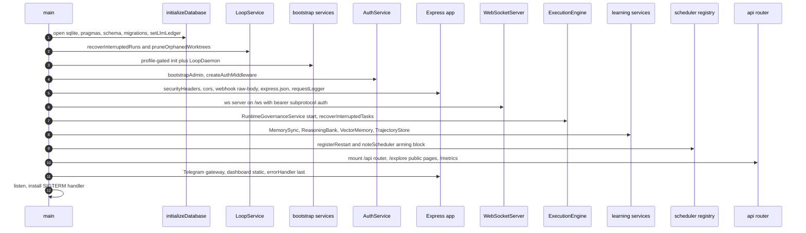
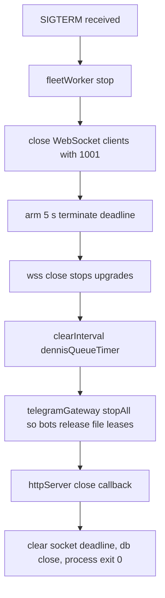

# Server Runtime & Startup Composition

`packages/server/src/index.ts` is the single production entrypoint of the Djimitflo
agent-orchestration control plane (started via `node dist/index.js`; `main()` exits the
process with code 1 on any uncaught boot failure). It performs database initialization
and crash recovery **before** any socket accepts traffic, then wires services,
middleware, routes, and the WebSocket server in a strict order, and finally installs a
SIGTERM handler for graceful shutdown. The whole composition is gated by a three-way
runtime profile resolved from `DJIMITFLO_RUNTIME_PROFILE`.

## Module-level effects before main()

Three adjustments are applied at import time, before `main()` runs:

- **Outbound guard** (line ~62-65): `installOutboundGuard` patches the process-global
  `fetch` so any request to a host in `OUTBOUND_DENY_HOSTS` is refused with
  `OUTBOUND_DENIED` before a socket opens — an operator rule that the server never
  calls the workstation (the workstation only pulls). The guard is installed at module
  scope with a callback wired to `outboundViolationDb`, which is set once the database
  opens (`outboundViolationDb = db`), so once boot completes every refused host is also
  recorded as a shadow `policy_violations` row.
- **Anti-agentic ransomware module banner**: logs its mode at load —
  `RANSOMWARE_MODULE_ENABLED` (default on) and `RANSOMWARE_MODULE_MODE`
  (default `detect`).
- **L1 nested-spawn callback default**: when `DJIMITFLO_CONTROL_URL` is unset it is
  derived as `http://<dialHost>:<PORT>/api/swarms/spawns`, where a `0.0.0.0`/`localhost`
  bind address is rewritten to loopback `127.0.0.1` because a bind address is not a
  dial address. Runtime children spawned on the same host can therefore call back
  without operator config; Docker operators override it explicitly.

## Runtime profiles

`resolveRuntimeProfile()` (packages/server/src/config/runtime-profile.ts) reads
`DJIMITFLO_RUNTIME_PROFILE` and returns `'api'`, `'operator'`, or `'autonomous'`,
defaulting to `'api'` for unset or invalid values. Two predicates partition the boot
work:

- `runtimeProfileEnablesOperator` — true for `operator` and `autonomous`. Gates
  `initOperatorServices` (PromptIntel ingest), the DennisAgent governed-queue 60 s
  timer, the RetentionService and CognitiveLoopClosureService, and the Telegram gateway.
- `runtimeProfileEnablesAutonomy` — true only for `autonomous`. Gates
  `initAutonomousServices(db, recoverySvc)`, the LoopDaemon (poll default
  `GOAL_QUEUE_POLL_MS=5000`), MetaOrchestrationService + SelfModificationPipeline, and
  the OpenMythos nightly eval scheduler.

A handful of services run in **every** profile regardless: external event ingest, the
ExecutionEngine with its startup reconciliation, the learning stores (MemorySync,
ReasoningBank with VectorMemory, TrajectoryStore), ProactiveMemoryService and
ComplianceAuditService (constructed for side effects), MultiModelIntelligence seeding,
all index.ts scheduler arming, and the ExplainerFleetWorker (deliberately moved out of
the autonomous-only branch because explainer jobs idled in api/operator mode; opt out
with `DJIMITFLO_EXPLAINER_AUTONOMY=false`).

## Boot wiring sequence

`main()` wires the process in the following exact order; each step only sees
dependencies constructed earlier:

Exact boot wiring order in `main()` — recovery happens before any route accepts traffic.

1. **Database first.** `initializeDatabase()` applies any staged restore (a
   `restore-pending.json` marker in the backup dir atomically renames a staged DB over
   the target and records a `restore_completed` audit event), opens better-sqlite3 at
   `DB_PATH`/`DJIMITFLO_DB` (default `<monorepo>/.data/djimitflo.sqlite`), sets
   `foreign_keys = ON` and `journal_mode = WAL`, runs pre-schema migrations, the main
   schema, the explainer schema, post-schema migrations, and stamps a persistent
   database instance id (`ensureDatabaseInstanceId`). `setLlmLedger(db)` then points
   the single model-call ledger at the fresh handle (UX-18), and the module-level
   outbound-guard callback gains its db handle for shadow `policy_violations` logging.
2. **Loop crash recovery (non-fatal).** A `LoopService` (`recoverySvc`) is constructed
   and `recoverInterruptedRuns()` is invoked inside try/catch — a failure only logs a
   warning and boot continues. The same instance is shared with `initAutonomousServices`
   and the `LoopDaemon` so daemon and API share runtime leases. The new
   `settledRuns` counter is logged when deploy-restart zombie runs are settled (see
   invariants below). A `SelfModelService` is constructed in the same block for
   calibrated runtime selection.
3. **Profile-gated bootstrap.** `initExternalEventIngest(db)` always runs;
   `initOperatorServices(db)` (PromptIntel ingest) runs for operator-capable profiles;
   `initAutonomousServices(db, recoverySvc)` plus `LoopDaemon.start()` run only for
   `autonomous`. Daemon start failure is non-fatal.
4. **Auth.** `new AuthService(db)`, then `bootstrapAdmin()` — if no users exist and
   `AUTH_BOOTSTRAP_ADMIN_EMAIL`/`AUTH_BOOTSTRAP_ADMIN_PASSWORD` are unset, the process
   **exits(1) in production** but only warns elsewhere. `createAuthMiddleware` produces
   `requireAuth` and `requireAuthOrSpawnToken`.
5. **Express app + middleware chain** (order is security-relevant):
   `trust proxy = 1` (one nginx hop; without it express-rate-limit throws
   `ERR_ERL_UNEXPECTED_X_FORWARDED_FOR`), then `securityHeaders`, then `cors` (origins
   from `CORS_ORIGINS`, default the Vite dev origins, credentials true), then the
   **GitHub webhook router mounted at `/github/webhook` BEFORE `express.json()`** — its
   HMAC signature check must consume the exact raw wire bytes (`express.raw`), never
   reserialized JSON — then `express.json()`, then `requestLogger`. The public `/health`
   liveness endpoint reports `buildProvenance()` build identity including
   `commit_matches_build`.
6. **HTTP + WebSocket server.** `createServer(app)` hosts a `WebSocketServer` on path
   `/ws` whose `handleProtocols` echoes back the client's `bearer.<token>` subprotocol
   per RFC 6455 §4.2.2 (dashboard offers it via
   `packages/dashboard/src/hooks/useWebSocket.ts`). `WebSocketService` authenticates
   every connection against `AuthService.verifyToken`, rejecting with the
   `WS_CLOSE_CODES.AUTH_*` close codes when the token is missing, invalid, expired, or
   for an inactive user.
7. **Governance + execution engine.** A single persistent `RuntimeGovernanceService` is
   constructed and `start()`ed (it subscribes to `swarmEventBus` for behavioral
   monitoring); it is shared by the ExecutionEngine, the dispatch path, and the
   runtime-governance routes. `ExecutionEngine.recoverInterruptedTasks()` runs
   immediately after construction, logging counts of failed mock tasks and held tasks.
   The default-off `/metrics` Prometheus endpoint is registered here with its own
   `metricsRateLimiter` (300 scrapes / 15 min), answering 404 unless `METRICS_TOKEN` is
   set and requiring `Authorization: Bearer <METRICS_TOKEN>`.
8. **Learning services wired into the engine.** `MemorySyncService`,
   `ReasoningBankService` (with `VectorMemoryService` attached for self-learning
   feedback), and `TrajectoryStore` each attach to the engine via a `set...Service`
   call after engine construction. `MultiModelIntelligence` seeds two default models
   (`workstation-litellm/coding`, `ollama-qwen25-14b`) when the registry is empty.
9. **Profile-gated services around schedulers.** Operator profile starts
   `RetentionService` and `CognitiveLoopClosureService` unconditionally. Autonomous
   profile constructs `MetaOrchestrationService` (attached to both the engine and the
   recovery LoopService) and runs `SelfModificationPipeline.analyze()/autoPlan()`;
   `ProactiveMemoryService` and `ComplianceAuditService` are constructed for side
   effects (table setup / event registration); the `OpenMythosNightlyService` default-off
   scheduler is armed only in autonomous mode.
10. **Scheduler-registry arming block (default-off, in-process).** Each boot-armed
    scheduler is constructed, given a `registerRestart(name, …)` bounded self-heal
    re-arm (stop the old timer, start again), and recorded via
    `noteScheduler(name, flag, armed, intervalMs)`: `compliance_report`
    (`COMPLIANCE_REPORT_SCHEDULER_ENABLED`), `self_healing`
    (`SELF_HEALING_SCHEDULER_ENABLED`), `self_improvement_auto_review`
    (`SELF_IMPROVEMENT_AUTO_REVIEW_ENABLED`), `frontier_experts`
    (`FRONTIER_EXPERTS_SCHEDULER_ENABLED`), `specialist_panel_backlog`
    (`SPECIALIST_PANEL_BACKLOG_ENABLED`), `memory_candidate_review`
    (`MEMORY_CANDIDATE_REVIEW_ENABLED`), the `dependency_lane`
    (`DEPENDENCY_LANE_MODE=shadow|act`, every 3 h by default), the
    `inference_failover_probe` (`OLLAMA_AUTO_FAILOVER=on`, every 30 min),
    `shipped_code_scan` (`SHIPPED_CODE_SCAN_MODE=shadow`, daily), and
    `skill_distillation` (`SKILL_DISTILLATION_MODE=shadow`, daily). Every `start()`
    returns false (no-op) unless its enable env var is set.
11. **Route aggregation.** `createRoutes(...)` mounts under `/api`; the unauthenticated
    rate-limited `/explore` pages mount after it (details below).
12. **ExplainerFleetWorker + Telegram gateway.** The ExplainerFleetWorker starts in
    every profile (unless `DJIMITFLO_EXPLAINER_AUTONOMY=false`). For operator profiles
    the `TelegramGatewayService` is dynamically imported from `@djimitflo/telegram` and
    `startAll()`ed only when `TELEGRAM_BOTS_CONFIG` is set, with the instance retained
    so SIGTERM can `stopAll()`. A heartbeat-window log line schedules a random daily
    window.
13. **Dashboard static serving + error handler.** The built dashboard (default
    `packages/dashboard/dist`, overridable with `DASHBOARD_PATH`, disabled with
    `DASHBOARD_SERVE_ENABLED=false` for API-only mode) is served with `express.static`
    plus an SPA fallback that answers `index.html` for GET requests with an
    `Accept: text/html` header that are not under `/api`, `/ws`, or `/health`.
    `errorHandler` is registered **last**.
14. **Listen + SIGTERM.** `httpServer.listen(PORT, HOST)` (defaults `3001` /
    `0.0.0.0`), then the shutdown handler installs.

## Route aggregation (routes/index.ts)

`createRoutes(db, executionEngine, authService, auth, wsService, metaOrchestration,
operatorRuntime, runtimeGovernance)` builds the `/api` router. It **requires** the auth
service and middleware — the constructor throws `AUTH_MIDDLEWARE_REQUIRED` if either is
absent. Module middleware applies, in order: a 1 MB JSON body limit
(`limitBodySize(1_000_000)`), re-applied `securityHeaders`, a 300 req/min
express-rate-limit, and `UsageTelemetry.middleware()` which counts each matched route
pattern once per response into a buffered usage ledger (flushed to SQLite once a
minute). Two telemetry endpoints (`/telemetry/usage`, `/telemetry/pageview`) and a
public `/version` sit above the mount table; a `requireAuth`-gated, separately
rate-limited (100 / 15 min) `openapi.json` is generated from the collected mount table
and cached.

The routes themselves live in a declarative `mounts[]` table where **registration order
matters** (Express matches in registration order). The current mount list (protected
mounts carry `requireAuth`):

- public: `/auth`, `/gym-worker`, `/host-agent`, `/telegram` (self-authenticating),
  `/` (self-authenticating diff routes), `/health`, `/version`, `/openapi.json`
- protected: `/tasks`, `/agents`, `/catalog`, `/mcp`, `/approvals`, `/policies`,
  `/risk`, `/evidence`, `/observability`, `/knowledge`, `/federation`, `/intervention`,
  `/goals`, `/loops`, `/work-items`, `/swarms`, `/repositories`, `/audit`,
  `/authority`, `/discussions`, `/usage`, `/learning`, `/backups`, `/exports`,
  `/memory`, `/skills`, `/openmythos`, `/gym`, `/fleet-hosts`, `/runtime-governance`,
  `/cognitive`, `/models`, `/compliance`, `/retirement`, `/red-team`, `/platform`,
  `/research`, `/apex`, `/swarm-v2`, `/swarm`, `/self-improve`, `/agi`,
  `/intelligence`, `/meta`, `/traceability` (extra 30/min limiter), `/sbom`,
  `/explainer`, `/council`, `/segml/federation`, `/organizations`, `/audit-logs`

Ordering constraints:

- `/swarms/spawns` (accepting a scoped `X-Spawn-Token` for runtime children via
  `requireAuthOrSpawnToken`) is mounted **before** the generic `/swarms` `requireAuth`
  mount so a token-only child can post spawns and poll spawn status.
- `/swarm-v2/social-runtime` signed runtime callbacks carry **no** user-JWT middleware
  and are likewise mounted before the generic `/swarms` surface.
- The self-authenticating diff routes mount at `/` without a mount-level guard so they
  do not intercept later public routes such as the Telegram webhook.

## Scheduler registry: bounded self-heal

`packages/server/src/services/scheduler-registry.ts` is the server's bounded self-heal
mechanism for in-process interval schedulers. It keeps an in-memory-only registry (one
process, rebuilt at boot):

- `noteScheduler(name, flag, armed, intervalMs)` records a scheduler's armed state at
  boot and returns it unchanged, so `if (noteScheduler(...))` is a drop-in for the
  original enable check and wiring it never changes behavior.
- `registerRestart(name, restart)` stores the scheduler's own idempotent re-arm
  function (stop the old timer, start again). Every index.ts-armed scheduler registers
  one.
- `markRun` / `markTick` let a scheduler report ticks; `guardTick` wraps a tick so a
  sync throw or rejected promise becomes the scheduler's `last_error` (status
  `failing`) without killing its timer — schedulers report their own execution
  evidence and can never throw into their interval.
- `SchedulerStatus` derives `off` / `executing` / `failing` / `armed_pending` /
  `armed_not_ticking` / `unknown` / `quarantined`, and `listSchedulers()` rolls these
  up into a `HEALTHY` / `BREACHED` / `UNKNOWN` cockpit health verdict; armed is
  *intent*, not execution.
- `healSchedulers()` implements the recovery invariant: armed-and-not-ticking past its
  SLA (2× interval past the boot grace) ⇒ diagnose ⇒ one bounded restart through the
  scheduler's own registered re-arm ⇒ verify a tick within one interval ⇒ else
  quarantine and escalate as a stall. At most one restart per scheduler per 6 h.
  `SCHEDULER_SELF_HEAL_MODE` selects `shadow` (default: diagnose + escalate, no
  restart), `act`, or `off`.

The watchdog that drives `healSchedulers` is `startSchedulerWatchdog`
(services/stall-watch.ts), started in **autonomous profile only** by
`initAutonomousServices` and registered with the LifecycleManager; it runs every 15 min
and persists each recovery action as a `scheduler_recovery` judgment. `startStallWatch`
(`STALL_WATCH_ENABLED=true`, hourly) and `loop_auto_merge` are armed the same way in
the autonomous block, with their own `registerRestart`/`noteScheduler` entries.

## Startup recovery invariants

### Loop and lease recovery

At boot the process's in-memory lease registry (`RuntimeLeaseRegistry` in
loop-recovery-service.ts) is **empty by construction** — live worker child processes
never survive a restart. `LoopService.recoverInterruptedRuns()` therefore treats
durable state as orphaned (idempotent; safe to call anytime; never dispatches work):

- Every `worker_lease` still `'running'` in the DB whose id is not in the (empty) live
  set is marked `'failed'` with `failed_reason: 'server_restart'`.
- Every `loop_run` in an active status with no live lease is marked `'interrupted'`
  with `interrupted_reason: 'server_restart'` — **except**:
  - runs in `planning` (idle-by-design, never flipped by a restart);
  - runs whose goal is `blocked` awaiting a human approval
    (`awaiting_approval.run_id`) — those are left alone **unless** the restart killed an
    already-approved task (`approvalWaitIsDead`, incident 17-10);
  - runs with a `gym.remote_host` marker — a remote gym run executes on its host, not
    here, so a restart of this server does not touch it.
- Deploy-restart zombie runs (a LOCAL `'running'` run with no live/running lease, no
  pending approval, no remote lease, last activity predating this boot) are
  **settled**: their `prepared` leases are cancelled with `cancellation_reason
  'deploy_restart'`, the run is interrupted with `settled: 'deploy_restart'`, the
  blocked/running goal is failed, and the in-flight proposal is recorded
  `infra_failed` (requeueable; no verdict on the proposal). These show up in the
  logged `settledRuns` count.
- Orphaned on-disk worktrees whose leases are terminal (or absent) and older than the
  `LOOP_WORKTREE_MAX_AGE_HOURS` (24 h) grace are pruned in the same call via
  `pruneOrphanedWorktrees`.
- Interrupted runs can later be resumed explicitly via `resumeInterruptedRun` (bounded
  to 3 attempts before a bounded fail; `operator_paused` runs refuse) or retried via
  `retryLoopRun`.

### ExecutionEngine task recovery — never replays

`ExecutionEngine.recoverInterruptedTasks()` is startup-only reconciliation under the
single-server-per-DB model. Its governing invariant: **lost JavaScript ownership of a
task is not proof the external CLI/container stopped**, so recovery never replays work,
never kills unknown PIDs, and never auto-clears a recovery hold. For each task still
`'running'` in the DB that this new engine instance does not own:

- **Confirmed in-process mock executions** — where task metadata's
  `execution_recovery_attempt` stamp is correlated with the latest engine-authored
  `execution_events` admission record (matching event id, attempt id,
  `executorKind: 'mock'`, `inProcess: true`, `sandboxed: false`) — are marked `failed`
  with outcome `interrupted_in_process`, because an in-process mock cannot survive
  server exit.
- **Everything else** (unknown, external, malformed or user-forged provenance) is
  marked `paused` with `execution_recovery_hold: true` and outcome `unknown`, requiring
  **operator reconciliation before redispatch**: the hold blocks `executeTask` with
  `EXECUTION_RECOVERY_REQUIRED`, and reserved provenance keys are stripped from user
  metadata writes so the hold cannot be forged away.
- Each reconciliation writes an execution event, an audit record
  (`execution_reconciled_after_restart`), an evidence capture, and broadcasts the task
  update over WebSocket — atomically in a transaction — and is idempotent across
  repeated calls.

## Graceful shutdown (SIGTERM)

The SIGTERM handler installed by `main()` at the end of boot (the separate
`LifecycleManager` used by bootstrap-registered services is **not** wired into this
entrypoint's signal path) executes:

SIGTERM path in `main()` — the WebSocket drain has a 5 s deadline before HTTP close.

1. `fleetWorker?.stop()` — stop pulling explainer jobs.
2. **WebSocket drain with a deadline.** Every upgraded client socket receives a
   graceful `close(1001, 'Server shutting down')`, because upgraded sockets otherwise
   keep `httpServer.close()` waiting indefinitely. A 5-second unref'd deadline then
   `terminate()`s any survivors, and `wss.close()` stops new upgrades.
3. `clearInterval(dennisQueueTimer)` — stop the governed-queue poller.
4. `telegramGateway.stopAll()` (fire-and-forget with a warning on rejection) —
   **required so Telegram bots release their file leases**; without it a restart sees
   `EEXIST` and skips polling forever.
5. `httpServer.close(callback)`: once HTTP is drained, clear the socket deadline,
   `db.close()`, and `process.exit(0)`.

There is no SIGINT handler in this entrypoint, and the 5 s deadline covers only the
WebSocket drain — the overall HTTP drain has no timeout here (unlike the standalone
`LifecycleManager`, which force-resolves `server.close` after 10 s).

## Failure posture during boot

Boot is deliberately tolerant of secondary failures: loop recovery, the LoopDaemon, the
ExplainerFleetWorker, Telegram init, and the autonomous-service block each log a
warning and continue on error. By contrast, database initialization, admin bootstrap in
production (no users + no bootstrap credentials → exit 1), route-creation auth
requirements (the `AUTH_MIDDLEWARE_REQUIRED` throw), and `httpServer.listen` are hard
failures — and any uncaught error from `main()` exits with code 1.

## Focused tests

- `src/__tests__/server-startup.test.ts` — database init, core service construction,
  auth middleware, full route tree, and `bootstrapAdmin` all succeed in-process.
- `src/__tests__/e2e-smoke.test.ts` — spawns the real `src/index.ts` under tsx on a
  temp DB and drives login → WebSocket handshake → task creation → mock execution →
  completion over the wire.
- `src/__tests__/task-recovery.test.ts` — the task-recovery contract: idempotent holds
  for unknown/malformed/forged provenance, safe fail only for stamped in-process mocks,
  `EXECUTION_RECOVERY_REQUIRED` redispatch blocking, and metadata forgery resistance.
- `src/__tests__/loop-recovery-service.test.ts` /
  `loop-recovery-awaiting-approval.test.ts` / `loop-recovery-deploy-restart.test.ts` —
  orphaned lease/run re-labeling, the awaiting-approval exemption, and deploy-restart
  settling.
- `src/__tests__/scheduler-self-heal.test.ts` — the bounded self-heal contract:
  diagnose → one bounded restart → verify → quarantine, 6 h cooldown, shadow/act/off.
- `src/__tests__/lifecycle-manager.test.ts` — the standalone LifecycleManager
  SIGTERM/SIGINT shutdown behavior used by bootstrap services.

## Key sources

- `packages/server/src/index.ts` — `main()` boot wiring, scheduler arming, static
  serving, SIGTERM.
- `packages/server/src/database/index.ts`, `path.ts` — staged restore, WAL, schema,
  migrations, instance id, path resolution.
- `packages/server/src/config/runtime-profile.ts` — profile resolution and gating.
- `packages/server/src/bootstrap/operator-services.ts`,
  `bootstrap/autonomous-services.ts` — profile-gated service construction (including
  the scheduler watchdog and stall watch).
- `packages/server/src/services/loop-service.ts`,
  `services/loop-recovery-service.ts` — orphan recovery, deploy-restart settling,
  resume bounds.
- `packages/server/src/execution/execution-engine.ts` — `recoverInterruptedTasks`
  hold/fail semantics and redispatch guard.
- `packages/server/src/routes/index.ts` — declarative mount table and ordering rules.
- `packages/server/src/services/scheduler-registry.ts`, `services/stall-watch.ts` —
  scheduler self-heal registry and watchdog.
- `packages/server/src/services/websocket-service.ts` — bearer-subprotocol
  authentication.
- `packages/server/src/services/lifecycle-manager.ts` — standalone shutdown
  coordinator for registered services.
