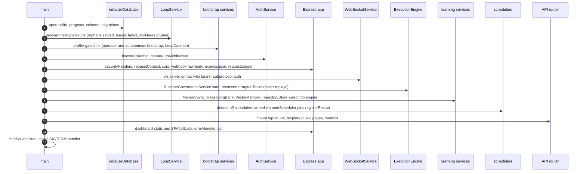

# Server Runtime & Startup Composition

`packages/server/src/index.ts` is the single production entrypoint of the Djimitflo
agent-orchestration control plane (started via `node dist/index.js`; `main()` exits the
process with code 1 on any boot failure). It performs database initialization and
crash recovery **before** any socket accepts traffic, then wires services, middleware,
routes, and the WebSocket server in a strict order, and finally installs a SIGTERM
handler for graceful shutdown. The whole composition is gated by a three-way runtime
profile resolved from `DJIMITFLO_RUNTIME_PROFILE`.

## Runtime profiles

`resolveRuntimeProfile()` (packages/server/src/config/runtime-profile.ts) reads
`DJIMITFLO_RUNTIME_PROFILE` and returns `'api'`, `'operator'`, or `'autonomous'`,
defaulting to `'api'` for unset or invalid values. Two predicates partition the
boot work:

- `runtimeProfileEnablesOperator` — true for `operator` and `autonomous`. Gates
  `initOperatorServices`, the Dennis governed-queue timer, the RetentionService and
  CognitiveLoopClosureService, and the Telegram gateway.
- `runtimeProfileEnablesAutonomy` — true only for `autonomous`. Gates
  `initAutonomousServices`, the LoopDaemon, MetaOrchestrationService +
  SelfModificationPipeline, the OpenMythos nightly scheduler, and the boot-time
  `resumeInterruptedRuns` re-queue.

A handful of services run in **every** profile regardless: external event ingest,
the ExecutionEngine with its startup reconciliation, the learning stores
(MemorySync, ReasoningBank, VectorMemory, TrajectoryStore), ProactiveMemoryService and
ComplianceAuditService, MultiModelIntelligence, and the ExplainerFleetWorker (the
comment at the mount notes it was deliberately moved out of the autonomous-only
branch because explainer jobs idled in api/operator mode; opt out with
`DJIMITFLO_EXPLAINER_AUTONOMY=false`).

Before `main()` runs, two module-level adjustments apply:

- The anti-agentic ransomware module banner logs its mode
  (`RANSOMWARE_MODULE_ENABLED`, default on; `RANSOMWARE_MODULE_MODE`, default `detect`).
- **L1 nested-spawn callback default:** `DJIMITFLO_CONTROL_URL` is derived as
  `http://<dialHost>:<PORT>/api/swarms/spawns`, where a `0.0.0.0`/`localhost` bind
  address is rewritten to loopback `127.0.0.1` because a bind address is not a dial
  address. Runtime children spawned on the same host can therefore call back without
  operator config; Docker operators override it explicitly.

## Boot wiring sequence

`main()` wires the process in the following exact order; each step only sees
dependencies constructed earlier:

Exact boot wiring order in `main()` — recovery happens before any route accepts traffic.

1. **Database first.** `initializeDatabase()` applies any staged restore (a
   `restore-pending.json` marker in the backup dir atomically renames a staged DB
   over the target, records a `restore_completed` audit event), opens better-sqlite3
   at `DB_PATH`/`DJIMITFLO_DB` (default `<monorepo>/.data/djimitflo.sqlite`), sets
   `foreign_keys = ON` and `journal_mode = WAL`, then runs pre-schema migrations,
   the main schema, the explainer schema, post-schema migrations, and stamps a
   persistent database instance id (`ensureDatabaseInstanceId`).
2. **Loop crash recovery (non-fatal).** A `LoopService` is constructed and
   `recoverInterruptedRuns()` is invoked inside try/catch — a failure only logs a
   warning and boot continues. The same `recoverySvc` instance is shared with
   `initAutonomousServices` and the `LoopDaemon` so daemon and API share runtime
   leases. A `SelfModelService` is constructed in the same block for calibrated
   runtime selection.
3. **Profile-gated bootstrap.** `initExternalEventIngest(db)` always runs;
   `initOperatorServices(db)` (PromptIntel ingest) runs for operator-capable
   profiles; `initAutonomousServices(db, recoverySvc)` plus `LoopDaemon.start()`
   run only for `autonomous` (daemon poll default `GOAL_QUEUE_POLL_MS=5000`). Daemon
   start failure is non-fatal.
4. **Auth.** `new AuthService(db)`, then `bootstrapAdmin()` — if no users exist and
   `AUTH_BOOTSTRAP_ADMIN_EMAIL`/`AUTH_BOOTSTRAP_ADMIN_PASSWORD` are unset, the
   process **exits(1) in production** but only warns elsewhere. `createAuthMiddleware`
   produces `requireAuth` and `requireAuthOrSpawnToken`.
5. **Express app + middleware chain** (order is security-relevant):
   `trust proxy = 1` (one nginx hop; without it express-rate-limit throws
   `ERR_ERL_UNEXPECTED_X_FORWARDED_FOR`), then `securityHeaders`, then `requestContext`
   (X-Request-ID on every response), then `cors` (origins from `CORS_ORIGINS`, default
   the Vite dev origins, credentials true), then the **GitHub webhook router mounted at
   `/github/webhook` BEFORE `express.json()`** — its HMAC signature check must consume
   the exact raw wire bytes (`express.raw`), never reserialized JSON — then
   `express.json()`, then `requestLogger`. The public `/health` liveness endpoint
   (which reports build identity and `commit_matches_build`) is registered directly on
   the app.
6. **HTTP + WebSocket server.** `createServer(app)` hosts a `WebSocketServer` on path
   `/ws` whose `handleProtocols` echoes back the client's `bearer.<token>`
   subprotocol per RFC 6455 §4.2.2 (dashboard offers it via
   `packages/dashboard/src/hooks/useWebSocket.ts`). `WebSocketService` authenticates
   every connection against `AuthService.verifyToken`, rejecting with the
   `WS_CLOSE_CODES.AUTH_*` close codes when the token is missing, invalid, expired, or
   for an inactive user.
7. **Governance + execution engine.** A single persistent `RuntimeGovernanceService`
   is constructed and `start()`ed (it subscribes to `swarmEventBus` for behavioral
   monitoring); it is shared by the ExecutionEngine, the dispatch path, and the
   runtime-governance routes. `ExecutionEngine.recoverInterruptedTasks()` runs
   immediately after construction. For autonomous profiles this same block also arms
   the **RIR resume** (`resumeInterruptedRuns()`, gated by `LOOP_RESUME_INTERRUPTED`,
   default off). The operator-profile Dennis governed-queue 60 s timer is installed
   before the governance/engine block, and the token-gated `/metrics` Prometheus
   endpoint is mounted immediately after it.
8. **Learning services wired into the engine.** `MemorySyncService`,
   `ReasoningBankService` (with `VectorMemoryService` attached for self-learning
   feedback), `TrajectoryStore` — each attaches to the engine via a `set...Service`
   call after engine construction. `MultiModelIntelligence` seeds two default models
   if the registry is empty. `MetaOrchestrationService` (autonomous only) attaches to
   both the engine and the recovery LoopService, and triggers a
   `SelfModificationPipeline.analyze()/autoPlan()` pass. `ProactiveMemoryService` and
   `ComplianceAuditService` are constructed for side effects (table setup / event
   registration).
9. **Schedulers (default-off, in-process).** Memory delivery reconcile, compliance
   reports, self-healing, self-improvement auto-review, frontier experts,
   specialist-panel backlog, memory candidate review, dependency lane, inference
   failover probe, shipped-code scan, skill distillation, and content drafts — each
   `start()` returns false (no-op) unless its enable env var is set; the OpenMythos
   nightly scheduler additionally requires the autonomous profile. Every armed
   scheduler is recorded with `noteScheduler(name, flag, armed, intervalMs)` and armed
   with a bounded self-heal `registerRestart(name, ...)`. Operator profiles also start
   `RetentionService` and `CognitiveLoopClosureService` unconditionally, and the Dennis
   governed-queue 60 s timer runs `processDennisQueue()` (also ticking the DjimitSec
   trigger service); RetentionService itself defaults on via `RETENTION_ENABLED !==
   'false'`.
10. **Route aggregation.** `createRoutes(...)` mounts under `/api`. It requires the
    auth service and middleware (throws `AUTH_MIDDLEWARE_REQUIRED` otherwise), limits
    bodies to 1 MB, re-applies `securityHeaders` and a 300-req/min rate limit, also runs
    the local `UsageTelemetry` middleware (dormant-surface counts), serves a public
    `/version`, an authenticated cached `openapi.json` derived from the mount table, and
    a declarative `mounts[]`
    table where **order matters**: `/swarms/spawns` (which accepts a scoped
    `X-Spawn-Token` for runtime children) is mounted before the generic `/swarms`
    `requireAuth` mount, and the self-authenticating diff routes are mounted at `/`
    without a mount-level guard so they don't intercept the Telegram webhook. Signed
    runtime callbacks at `/swarm-v2/social-runtime` carry no user JWT middleware by
    design. Public, unauthenticated but rate-limited `/explore` pages mount after
    `/api`. Then the ExplainerFleetWorker starts (every profile) and, for operator
    profiles, the Telegram gateway is dynamically imported from `@djimitflo/telegram`
    and `startAll()`ed when `TELEGRAM_BOTS_CONFIG` is set.
11. **Dashboard static serving + error handler.** The built dashboard (default
    `packages/dashboard/dist`, overridable with `DASHBOARD_PATH`, disabled with
    `DASHBOARD_SERVE_ENABLED=false` for API-only mode) is served with
    `express.static` plus an SPA fallback that answers `index.html` for GET requests
    with an `Accept: text/html` header that are not under `/api`, `/ws`, or
    `/health`. `errorHandler` is registered **last**; it maps error codes to statuses
    via pattern inference and only includes stack traces outside of production.
12. **Listen + SIGTERM.** `httpServer.listen(PORT, HOST)` (defaults `3001` /
    `0.0.0.0`), then the shutdown handler installs.

## Startup recovery invariants

### Loop and lease recovery

At boot the process's in-memory lease registry (`RuntimeLeaseRegistry` in
loop-recovery-service.ts) is **empty by construction** — live worker child processes
never survive a restart. `LoopService.recoverInterruptedRuns()` delegates to
`LoopRecoveryService.recoverInterruptedRuns()` and then prunes stale orphaned
worktrees in the same call. Recovery therefore treats durable state as orphaned:

- Every `worker_lease` still `'running'` in the DB whose id is not in the (empty)
  live set is marked `'failed'` with `failed_reason: 'server_restart'`.
- Every active `loop_run` with no live lease is settled — **except**:
  - runs in `planning` (idle-by-design, a restart must not flip them),
  - runs whose goal is `blocked` awaiting a human approval
    (`awaiting_approval.run_id`) — a restart must not lose their place in the
    approval flow, **unless** the approval was approved but the restart killed the
    approved task (`approvalWaitIsDead`), in which case the run is settled as a
    deploy-restart zombie,
  - runs whose goal is already re-queued for resume (`goal.status='decomposed'` +
    `metadata.resume_run_id`), which a second restart must not settle or retry, and
  - remote gym runs (`metadata.gym.remote_host`), which execute on their host and
    whose next claim settles them.
- A LOCAL `running` run with no live/running lease, no pending approval on any of
  its tasks, and last activity predating this boot is **settled** via
  `settleDeployRestartRun`: run marked `'interrupted'` with
  `interrupted_reason: 'server_restart'`, its `'prepared'` leases cancelled with
  `cancellation_reason 'deploy_restart'`, its running/blocked goal failed, and its
  in-flight proposal `infra_failed` (requeueable, no verdict on the proposal). Other
  orphaned runs are simply marked `'interrupted'` with
  `interrupted_reason: 'server_restart'`.
- Orphaned on-disk worktrees whose leases are terminal (or absent) and older than
  `LOOP_WORKTREE_MAX_AGE_HOURS` (24 h) grace are pruned in the same call.
- The operation is idempotent and safe to call anytime; interrupted runs can later be
  resumed explicitly via `resumeInterruptedRuns` (bounded to 3 attempts before a
  bounded fail) or retried via `retryLoopRun`. `recoverInterruptedRuns` itself only
  re-labels state; it does not dispatch work.

### ExecutionEngine task recovery — never replays

`ExecutionEngine.recoverInterruptedTasks()` is startup-only reconciliation under the
single-server-per-DB model. Its governing invariant: **lost JavaScript ownership of a
task is not proof the external CLI/container stopped**, so recovery never replays
work, never kills unknown PIDs, and never auto-clears a recovery hold. For each task
still `'running'` in the DB that this new engine instance does not own:

- **Confirmed in-process mock executions** — where task metadata's
  `execution_recovery_attempt` stamp is correlated with the latest engine-authored
  `execution_events` admission record (matching event id, attempt id,
  `executorKind: 'mock'`, `inProcess: true`, `sandboxed: false`) — are marked
  `failed` with outcome `interrupted_in_process`, because an in-process mock cannot
  survive server exit.
- **Everything else** (unknown, external, malformed or user-forged provenance) is
  marked `paused` with `execution_recovery_hold: true` and outcome `unknown`,
  requiring **operator reconciliation before redispatch**: the hold blocks
  `executeTask` with `EXECUTION_RECOVERY_REQUIRED`, and reserved provenance keys are
  stripped from user metadata writes so the hold cannot be forged away.
- Each reconciliation writes an execution event, an audit record
  (`execution_reconciled_after_restart`), an evidence capture, and broadcasts the
  task update over WebSocket — atomically in a transaction — and is idempotent
  across repeated calls.

## Graceful shutdown (SIGTERM)

The SIGTERM handler in `main()` (packages/server/src/index.ts; note the separate
`LifecycleManager` used by bootstrap-registered services is **not** wired into this
entrypoint's signal path) executes:

1. `fleetWorker?.stop()` — stop pulling explainer jobs.
2. **WebSocket drain with a deadline.** Every upgraded client socket receives a
   graceful `close(1001, 'Server shutting down')`, because upgraded sockets
   otherwise keep `httpServer.close()` waiting indefinitely. A 5-second unref'd
   deadline then `terminate()`s any survivors, and `wss.close()` stops new upgrades.
3. `clearInterval(dennisQueueTimer)` — stop the governed-queue poller.
4. `telegramGateway.stopAll()` (fire-and-forget with a warning on rejection) —
   **required so Telegram bots release their file leases**; without it a restart
   sees `EEXIST` and skips polling forever.
5. `httpServer.close(callback)`: once HTTP is drained, clear the socket deadline,
   `db.close()`, and `process.exit(0)`.

There is no SIGINT handler in this entrypoint, and the 5 s deadline covers only the
WebSocket drain — the overall HTTP drain has no timeout here (unlike the standalone
`LifecycleManager`, which force-resolves `server.close` after 10 s).

## Failure posture during boot

Boot is deliberately tolerant of secondary failures: loop recovery, the LoopDaemon,
the ExplainerFleetWorker, Telegram init, and the autonomous-service block each log a
warning and continue on error. By contrast, database initialization, admin bootstrap
in production (no users + no bootstrap credentials → exit 1), route-creation auth
requirements, and `httpServer.listen` are hard failures — and any uncaught error from
`main()` exits with code 1.

## Focused tests

- `src/__tests__/server-startup.test.ts` — database init, core service construction,
  auth middleware, full route tree, and `bootstrapAdmin` all succeed in-process.
- `src/__tests__/e2e-smoke.test.ts` — spawns the real `src/index.ts` under tsx on a
  temp DB and drives login → WebSocket handshake → task creation → mock execution →
  completion over the wire.
- `src/__tests__/task-recovery.test.ts` — the task-recovery contract: idempotent
  holds for unknown/malformed/forged provenance, safe fail only for stamped
  in-process mocks, `EXECUTION_RECOVERY_REQUIRED` redispatch blocking, and metadata
  forgery resistance.
- `src/__tests__/loop-recovery-service.test.ts`,
  `loop-recovery-awaiting-approval.test.ts`, `loop-recovery-deploy-restart.test.ts`,
  and `loop-resume-interrupted.test.ts` — orphaned lease/run re-labeling, the
  awaiting-approval exemption, deploy-restart settle, and the bounded resume path.
- `src/__tests__/lifecycle-manager.test.ts` — the standalone LifecycleManager
  SIGTERM/SIGINT shutdown behavior used by bootstrap services.

## Key sources

- `packages/server/src/index.ts` — `main()` boot wiring, static serving, SIGTERM.
- `packages/server/src/database/index.ts`, `path.ts` — staged restore, WAL, schema,
  migrations, instance id, path resolution.
- `packages/server/src/config/runtime-profile.ts` — profile resolution and gating.
- `packages/server/src/bootstrap/operator-services.ts`,
  `bootstrap/autonomous-services.ts`, `bootstrap/recovery.ts` — profile-gated and
  database/recovery bootstrap.
- `packages/server/src/services/loop-service.ts`,
  `services/loop-recovery-service.ts` — orphan recovery, deploy-restart settle, and
  resume bounds.
- `packages/server/src/execution/execution-engine.ts` — `recoverInterruptedTasks`
  hold/fail semantics and redispatch guard.
- `packages/server/src/routes/index.ts` — declarative mount table and ordering rules.
- `packages/server/src/services/websocket-service.ts` — bearer-subprotocol
  authentication.
- `packages/server/src/services/lifecycle-manager.ts` — standalone shutdown
  coordinator for registered services.
- `packages/server/src/services/scheduler-registry.ts` — `noteScheduler`/`registerRestart`
  scheduler arming and bounded self-heal bookkeeping.
