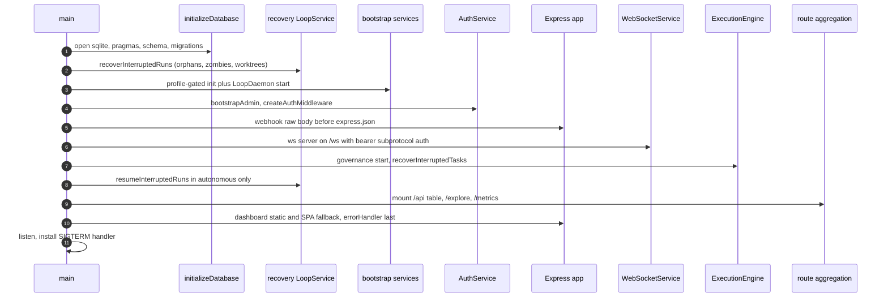

# Server Runtime & Boot Sequence

`packages/server/src/index.ts` is the single production entrypoint of the Djimitflo
agent-orchestration control plane (started via `node dist/index.js`; an uncaught error
from `main()` exits the process with code 1). It installs a process-wide outbound fetch
guard, then initializes the database and runs crash recovery **before** any socket
accepts traffic, wires services, middleware, routes, and the WebSocket server in a
strict order, and finally installs a SIGTERM handler for graceful shutdown. The whole
composition is gated by a three-way runtime profile resolved from
`DJIMITFLO_RUNTIME_PROFILE`.

Two network-safety mechanisms run at module scope, before `main()`:

- **Outbound guard.** `installOutboundGuard` (utils/outbound-guard.ts) wraps
  `globalThis.fetch` so every in-process fetch is checked against
  `OUTBOUND_DENY_HOSTS` (exact, subdomain, and first-label MagicDNS matches) and
  rejected with `OUTBOUND_DENIED` before a socket opens — the operator rule is that
  this server never calls the workstation, which only pulls. Once the database is
  open, `main()` hands the guard the db handle so refusals are also recorded as
  `policy_violations` rows (`outbound_denied`, one per host per hour).
- **Flag hygiene.** `warnUnknownEnvFlags()` names (never values) every flag-shaped
  env var that nothing in this build reads, surfacing typos and retired flags in
  the boot log.

## Runtime profiles

`resolveRuntimeProfile()` (packages/server/src/config/runtime-profile.ts) reads
`DJIMITFLO_RUNTIME_PROFILE` and returns `'api'`, `'operator'`, or `'autonomous'`,
defaulting to `'api'` for unset or invalid values. Two predicates partition the
boot work:

- `runtimeProfileEnablesOperator` — true for `operator` and `autonomous`. Gates
  `initOperatorServices` (PromptIntel ingest), the Dennis governed-queue timer (which
  also ticks the DjimitSec repository-scan triggers), RetentionService, the
  CognitiveLoopClosureService start, and the Telegram gateway.
- `runtimeProfileEnablesAutonomy` — true only for `autonomous`. Gates the
  experiment period-boundary recording, `initAutonomousServices` (a large
  constructor-and-scheduler wiring block registered with the LifecycleManager), the
  `LoopDaemon`, `resumeInterruptedRuns` after engine recovery,
  MetaOrchestrationService + SelfModificationPipeline, and the OpenMythos nightly
  scheduler.

A handful of services run in **every** profile regardless: external event ingest,
the ExecutionEngine with its startup reconciliation, the learning stores
(MemorySync, ReasoningBank, VectorMemory, TrajectoryStore), ProactiveMemoryService and
ComplianceAuditService (constructed for table/event side effects),
MultiModelIntelligence seeding, all the default-off schedulers, and the
ExplainerFleetWorker (deliberately moved out of the autonomous-only branch because
explainer jobs idled in api/operator mode; opt out with
`DJIMITFLO_EXPLAINER_AUTONOMY=false`).

Before `main()` runs, two more module-level adjustments apply:

- The anti-agentic ransomware module banner logs its mode
  (`RANSOMWARE_MODULE_ENABLED`, default on; `RANSOMWARE_MODULE_MODE`, default `detect`).
- **L1 nested-spawn callback default:** `DJIMITFLO_CONTROL_URL` is derived as
  `http://<dialHost>:<PORT>/api/swarms/spawns`, where a `0.0.0.0`/`localhost` bind
  address is rewritten to loopback `127.0.0.1` because a bind address is not a dial
  address. Runtime children spawned on the same host can therefore call back without
  operator config; Docker operators override it explicitly.

## Boot wiring sequence

`main()` wires the process in the following exact order; each step only sees
dependencies constructed earlier:

Boot wiring order in `main()` — recovery runs before any route accepts traffic.

1. **Database first.** `initializeDatabase()` applies any staged restore (a
   `restore-pending.json` marker in the backup dir atomically renames a staged DB
   over the target, records a `restore_completed` audit event), opens better-sqlite3
   at `DB_PATH`/`DJIMITFLO_DB` (default `<monorepo>/.data/djimitflo.sqlite`), sets
   `foreign_keys = ON` and `journal_mode = WAL`, then runs pre-schema migrations,
   the main schema, the explainer schema, post-schema migrations, and stamps a
   persistent database instance id (`ensureDatabaseInstanceId`). The outbound guard
   gets the handle (`outboundViolationDb = db`) and `setLlmLedger(db)` installs one
   model-call ledger for every server-side LLM call.
2. **Loop crash recovery (non-fatal).** A `LoopService` (`recoverySvc`) is
   constructed and `recoverInterruptedRuns()` runs inside try/catch — a failure only
   logs a warning and boot continues. The log line reports interrupted runs, failed
   leases, settled deploy-restart zombie runs, and pruned worktrees. The same
   `recoverySvc` instance is passed to `initAutonomousServices` and to the
   `LoopDaemon` constructor so the daemon, autonomous services, and the API share one
   runtime-lease view. A `SelfModelService` is constructed in the same block for
   calibrated runtime selection.
3. **Profile-gated bootstrap.** `initExternalEventIngest(db)` always runs;
   `initOperatorServices(db)` runs for operator-capable profiles; for `autonomous`
   only, `recordTreatmentEnvBoundaries` logs a period boundary per treatment flag
   that changed since the process last recorded it, then
   `initAutonomousServices(db, recoverySvc)` wires the autonomous fleet (each block
   individually try/catch-wrapped and LifecycleManager-registered), and
   `new LoopDaemon(db, recoverySvc).start()` begins polling the goal queue
   (`GOAL_QUEUE_POLL_MS`, default 5000 ms). Daemon start failure is non-fatal.
4. **Auth.** `new AuthService(db)` exits(1) in production when `JWT_SECRET` is unset
   (a random dev secret otherwise), then `bootstrapAdmin()` — if no users exist and
   `AUTH_BOOTSTRAP_ADMIN_EMAIL`/`AUTH_BOOTSTRAP_ADMIN_PASSWORD` are unset, the process
   **exits(1) in production** but only warns elsewhere. `createAuthMiddleware`
   produces `requireAuth` and `requireAuthOrSpawnToken`.
5. **Express app + middleware chain** (order is security-relevant):
   `trust proxy = 1` (one nginx hop; without it express-rate-limit throws
   `ERR_ERL_UNEXPECTED_X_FORWARDED_FOR`), then `securityHeaders`, `requestContext`
   (X-Request-ID), `cors` (origins from `CORS_ORIGINS`, default the Vite dev origins,
   credentials true), then the **GitHub webhook router mounted at `/github/webhook`
   BEFORE `express.json()`** — its HMAC check must consume the exact raw wire bytes
   (`express.raw`, 256 kb, `inflate: false`), never reserialized JSON — then
   `express.json()`, then `requestLogger`. The webhook router's lazily-filled
   `scanRuntime.triggers` slot lets push events reach the DjimitSec trigger service
   constructed later. The public `/health` endpoint reports build identity
   (`buildProvenance()`, including `commit_matches_build`), `fleet_drift`, and uptime.
6. **HTTP + WebSocket server.** `createServer(app)` hosts a `WebSocketServer` on path
   `/ws` whose `handleProtocols` echoes back the client's `bearer.<token>`
   subprotocol per RFC 6455 §4.2.2 (the dashboard offers it via
   `packages/dashboard/src/hooks/useWebSocket.ts`). `WebSocketService` extracts the
   token from the subprotocol header or `?token=`, authenticates against
   `AuthService.verifyToken`, and rejects with `WS_CLOSE_CODES.AUTH_*` close codes
   when the token is missing, invalid, expired, or for an inactive user.
7. **Operator timer, metrics, governance + execution engine.** Dennis's governed-queue
   processor (plus the DjimitSec trigger tick) runs immediately and then every 60 s on
   an unref'd interval; the token-gated `/metrics` Prometheus endpoint is mounted;
   a single persistent `RuntimeGovernanceService` is constructed and `start()`ed (it
   subscribes to `swarmEventBus` for behavioral monitoring) **before** the
   `ExecutionEngine`, which receives it as a constructor argument — the same instance
   is later handed to `createRoutes`, so engine, dispatch, and the runtime-governance
   routes share one authority. `DjimitSecTriggerService` is constructed and published
   into `scanRuntime.triggers`. `ExecutionEngine.recoverInterruptedTasks()` runs
   immediately after construction. Autonomous profiles then call
   `recoverySvc.resumeInterruptedRuns()` (RIR) after both the loop settle and the
   engine's recovery holds, so a re-queued run gets a fresh maker that the daemon's
   next tick runs through every gate again.
8. **Learning services wired into the engine.** `MemorySyncService` (with a
   bounded at-boot-and-on-tick delivery reconciliation, `MEMORY_DELIVERY_RECEIPTS`),
   `ReasoningBankService` (with `VectorMemoryService` attached for self-learning
   feedback), `TrajectoryStore` — each attaches to the engine via a `set...Service`
   call after construction. `MultiModelIntelligence` seeds two default models if the
   registry is empty. `MetaOrchestrationService` (autonomous only) attaches to both
   the engine and the recovery LoopService, and triggers a
   `SelfModificationPipeline.analyze()/autoPlan()` pass. Operator profiles start
   `RetentionService` and `CognitiveLoopClosureService` unconditionally.
9. **Schedulers (default-off, in-process).** Compliance reports, self-healing,
   self-improvement auto-review, frontier experts, specialist-panel backlog, memory
   candidate review, dependency lane, Ollama failover probe, shipped-code scan, skill
   distillation, content drafts, and content-safety retry — every `start()` returns
   false (no-op) unless its enable env var is set, and every one is self-reported to
   the in-memory scheduler registry via `noteScheduler(name, flag, armed, interval)`
   with a `registerRestart` self-heal rearm hook (at most one bounded restart).
   The OpenMythos nightly scheduler additionally requires the autonomous profile.
10. **Route aggregation.** `createRoutes(...)` mounts under `/api` with the shared
    `runtimeGovernance` instance and the `operatorRuntime` flag. Then public,
    unauthenticated but rate-limited `/explore` pages mount after `/api`. Then the
    ExplainerFleetWorker starts (every profile, failure non-fatal) and, for operator
    profiles, the Telegram gateway is dynamically imported from `@djimitflo/telegram`
    and `startAll()`ed when `TELEGRAM_BOTS_CONFIG` is set.
11. **Dashboard static serving + error handler.** The built dashboard (default
    `packages/dashboard/dist`, overridable with `DASHBOARD_PATH`, disabled with
    `DASHBOARD_SERVE_ENABLED=false` for API-only mode) is served with
    `express.static` plus an SPA fallback that answers `index.html` for GET requests
    with an `Accept: text/html` header that are not under `/api`, `/ws`, or
    `/health`. `errorHandler` is registered **last**; it infers the HTTP status from
    the error code/message pattern and only includes stack traces when
    `NODE_ENV=development`.
12. **Listen + SIGTERM.** `httpServer.listen(PORT, HOST)` (defaults `3001` /
    `0.0.0.0`), then the shutdown handler installs.

## The /api mount table

`createRoutes` is a declarative aggregator where **registration order matters**. It
hard-fails with `AUTH_MIDDLEWARE_REQUIRED` if the auth service or middleware is
missing, limits all bodies to 1 MB, re-applies `securityHeaders`, applies a 300
req/min rate limit to the whole `/api` tree, and installs local usage telemetry
(`UsageTelemetry`) plus authenticated `/telemetry/usage` and `/telemetry/pageview`
endpoints. Public-without-auth routes inside `/api` are only `/version` and the
`/health` mount. A cached `openapi.json` (rate-limited 100/15 min, `requireAuth`) is
generated from the same mount table via `collectRoutes`/`mountRoutes`, which record
prefix and auth metadata on the actual Express layers so the inventory cannot drift
from what is mounted.

Ordering rules encoded in the `mounts[]` table:

- `/swarms/spawns` is mounted BEFORE the generic `/swarms` `requireAuth` mount: the
  spawn-control router admits either a user JWT or a scoped `X-Spawn-Token`
  (`requireAuthOrSpawnToken`) so a runtime child with no user session can POST
  spawns and poll status, while `POST /spawns/root` still requires the
  `write:swarm_action` permission inside the router.
- `/swarm-v2/social-runtime` mounts before `/swarms` with **no** mount-level guard —
  signed runtime callbacks are scoped to an agent and deliberately accept no user
  JWT.
- The self-authenticating diff routes mount at `/` without a guard so a mount-level
  guard would not intercept unrelated later public routes such as the Telegram
  webhook; each diff handler authenticates itself.
- `/telegram` mounts unguarded (its webhook is shared-secret authenticated), and
  `/traceability` carries its own stricter 30 req/min limiter in front of
  `requireAuth`.

## Startup recovery invariants

### Loop and lease recovery

At boot the process's in-memory lease registry (`RuntimeLeaseRegistry` in
loop-recovery-service.ts) is **empty by construction** — live worker child processes
never survive a restart. `recoverInterruptedRuns` (delegated by `LoopService` to
`LoopRecoveryService`) therefore treats durable state as orphaned:

- Every `worker_lease` still `'running'` in the DB whose id is not in the (empty)
  live set is marked `'failed'` with `failed_reason: 'server_restart'`.
- Every active `loop_run` with no live lease is marked `'interrupted'` with
  `interrupted_reason: 'server_restart'` — **except**: runs in `planning`; remote
  gym runs (they execute on their host, not here); runs already re-queued by an
  earlier boot's `resumeInterruptedRuns`; and runs whose goal is `blocked` awaiting
  a human approval (`awaiting_approval.run_id`), which are idle-by-design.
- **Deploy-restart zombie settle:** a local `'running'` run with no running lease,
  no pending approval, and last activity predating this boot is *settled* instead of
  merely interrupted — the run is interrupted, its prepared leases cancelled with
  `deploy_restart`, its running/blocked goal failed, and any in-flight proposal
  recorded `infra_failed` (requeueable, no verdict).
- Orphaned on-disk worktrees whose leases are terminal (or absent) and older than
  the `LOOP_WORKTREE_MAX_AGE_HOURS` (24 h) grace are pruned in the same
  `LoopService.recoverInterruptedRuns()` call (via `pruneOrphanedWorktrees`).
- The operation is idempotent and safe to call anytime; it only re-labels state and
  never dispatches work. Interrupted runs can later be retried via `retryLoopRun`,
  and autonomous boots may re-queue this boot's interrupted runs through
  `resumeInterruptedRuns` (`LOOP_RESUME_INTERRUPTED`, default off; `shadow` records
  what would happen) with bounded attempts and a strict blocker list (operator
  pause, recovery hold, remote run, exhausted attempts, non-running goal,
  non-executing proposal, unknown task outcome, completed maker).

### ExecutionEngine task recovery — never replays

`ExecutionEngine.recoverInterruptedTasks()` is startup-only reconciliation under the
single-server-per-DB model. Its governing invariant: **lost JavaScript ownership of a
task is not proof the external CLI/container stopped**, so recovery never replays
work, never kills unknown PIDs, and never auto-clears a recovery hold. For each task
still `'running'` in the DB that this new engine instance does not own:

- **Confirmed in-process mock executions** — where task metadata's
  `execution_recovery_attempt` stamp is correlated with the latest engine-authored
  `execution_events` admission record (matching event id, attempt id,
  `executorKind: 'mock'`, `inProcess: true`, `sandboxed: false`) — are marked
  `failed` with outcome `interrupted_in_process`, because an in-process mock cannot
  survive server exit.
- **Everything else** (unknown, external, malformed or user-forged provenance) is
  marked `paused` with `execution_recovery_hold: true` and outcome `unknown`,
  requiring **operator reconciliation before redispatch**: the hold blocks
  `executeTask` with `EXECUTION_RECOVERY_REQUIRED`, and reserved provenance keys are
  stripped from user metadata writes so the hold cannot be forged away.
- Each reconciliation writes an execution event, an audit record
  (`execution_reconciled_after_restart`), an evidence capture, and broadcasts the
  task update over WebSocket — atomically in a transaction — and is idempotent
  across repeated calls.

## Graceful shutdown (SIGTERM)

The SIGTERM handler in `main()` (note the separate `LifecycleManager` used by
bootstrap-registered services is **not** wired into this entrypoint's signal path)
executes:

1. `fleetWorker?.stop()` — stop pulling explainer jobs.
2. **WebSocket drain with a deadline.** Every upgraded client socket receives a
   graceful `close(1001, 'Server shutting down')`, because upgraded sockets
   otherwise keep `httpServer.close()` waiting indefinitely. A 5-second unref'd
   deadline then `terminate()`s any survivors, and `wss.close()` stops new upgrades.
3. `clearInterval(dennisQueueTimer)` — stop the governed-queue poller.
4. `telegramGateway.stopAll()` (fire-and-forget with a warning on rejection) —
   **required so Telegram bots release their file leases**; without it a restart
   sees `EEXIST` and skips polling forever. The gateway instance is retained at boot
   precisely for this call.
5. `httpServer.close(callback)`: once HTTP is drained, clear the socket deadline,
   `db.close()`, and `process.exit(0)`.

There is no SIGINT handler in this entrypoint, and the 5 s deadline covers only the
WebSocket drain — the overall HTTP drain has no timeout here (unlike the standalone
`LifecycleManager`, which force-resolves `server.close` after 10 s and stops
registered services in reverse initialization order on SIGTERM/SIGINT).

## Failure posture during boot

Boot is deliberately tolerant of secondary failures: loop recovery, the LoopDaemon
start, the ExplainerFleetWorker, Telegram init, the experiment period-boundary check,
each autonomous-service block, and each scheduler arm each log a warning (or skip)
and continue. By contrast, database initialization, `JWT_SECRET` absence in
production, admin bootstrap in production (no users + no bootstrap credentials →
exit 1), the route-creation `AUTH_MIDDLEWARE_REQUIRED` guard, and any uncaught error
from `main()` are hard failures that exit with code 1.

## Focused tests

- `src/__tests__/server-startup.test.ts` — database init, core service construction,
  auth middleware, full route tree, and `bootstrapAdmin` all succeed in-process.
- `src/__tests__/e2e-smoke.test.ts` — spawns the real `src/index.ts` under tsx on a
  temp DB and drives login → WebSocket handshake → task creation → mock execution →
  completion over the wire.
- `src/__tests__/task-recovery.test.ts` — the task-recovery contract: idempotent
  holds for unknown/malformed/forged provenance, safe fail only for stamped
  in-process mocks, `EXECUTION_RECOVERY_REQUIRED` redispatch blocking, and metadata
  forgery resistance.
- `src/__tests__/loop-recovery-service.test.ts` /
  `loop-recovery-awaiting-approval.test.ts` — orphaned lease/run re-labeling, the
  awaiting-approval exemption, and the remote-gym exemption.
- `src/__tests__/lifecycle-manager.test.ts` — the standalone LifecycleManager
  SIGTERM/SIGINT shutdown behavior used by bootstrap services.

## Key sources

- `packages/server/src/index.ts` — `main()` boot wiring, outbound guard hookup,
  profile gating, static serving, SIGTERM.
- `packages/server/src/utils/outbound-guard.ts` — `OUTBOUND_DENY_HOSTS` fetch
  chokepoint and violation recording.
- `packages/server/src/database/index.ts`, `path.ts` — staged restore, WAL, schema,
  migrations, instance id, path resolution.
- `packages/server/src/config/runtime-profile.ts` — profile resolution and gating.
- `packages/server/src/bootstrap/operator-services.ts`,
  `bootstrap/autonomous-services.ts`, `bootstrap/recovery.ts` — profile-gated
  service construction and the (extracted, reference) recovery helper.
- `packages/server/src/services/loop-service.ts`,
  `services/loop-recovery-service.ts`, `services/loop-daemon.ts` — orphan recovery,
  resume bounds, and the goal-queue daemon sharing the recovery LoopService.
- `packages/server/src/execution/execution-engine.ts` — `recoverInterruptedTasks`
  hold/fail semantics and redispatch guard.
- `packages/server/src/routes/index.ts`, `utils/route-inventory.ts` — declarative
  mount table, ordering rules, and the drift-proof openapi inventory.
- `packages/server/src/services/scheduler-registry.ts` — `noteScheduler` /
  `registerRestart` / `guardTick` arming evidence for every boot scheduler.
- `packages/server/src/services/websocket-service.ts` — bearer-subprotocol
  authentication.
- `packages/server/src/services/lifecycle-manager.ts` — standalone shutdown
  coordinator for bootstrap-registered services.
