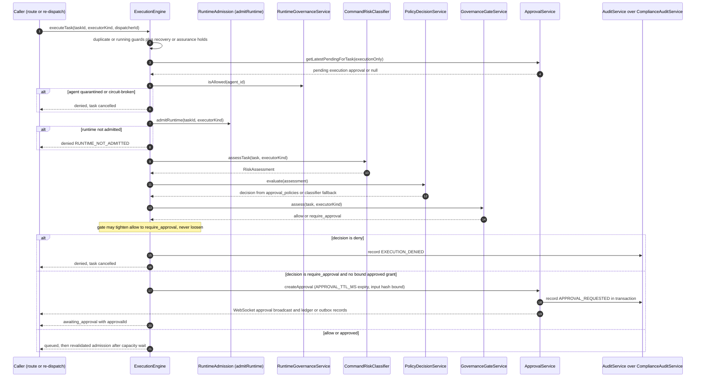

# Governance Pipeline: Risk to Policy, Gate, Approval, ToolBroker & Audit Chain

Every task dispatch in `packages/server` passes through the same governance spine
before an executor is allowed to start, and every individual tool call a caller
mediates passes through a separate default-deny capability broker. The spine runs
inside `ExecutionEngine.executeTask()`
(packages/server/src/execution/execution-engine.ts) and composes these controls, in
order:

1. **Runtime admission** — `admitRuntime()` checks the repo-held
   `RUNTIME_ADMISSIONS` ledger (`execution/runtime-admission.ts`): registered is not
   admitted — a runtime@version must carry an evidence-backed assessment, decided
   deterministically (a critical-gate FAIL can never be outweighed by passes
   elsewhere), before any policy work is spent on the dispatch.
2. **CommandRiskClassifier** — turns task text or an explicit shell command into a
   `RiskAssessment` (risk level + recommended decision); unknown commands are
   fail-closed at `require_approval`.
3. **PolicyDecisionService** — evaluates enabled rows of `approval_policies` against
   that assessment, honoring blocked-tool lists and ReDoS-guarded match patterns.
4. **GovernanceGateService** — an optional, env-armed layer that can only *tighten*
   an `allow` to `require_approval` when the executing agent's OpenMythos benchmark
   score is below a floor. It never loosens.
5. **ApprovalService** — the approval lifecycle (configurable TTL defaulting to 1
   hour, transaction-wrapped create/decide, data-layer self-approval ban), goal/run
   linking via `loopApprovalLink`, and authority-ledger plus event-outbox side
   records.

Alongside the spine sit two orthogonal gates: **AuthorityGateService** (a
fail-closed goal-start gate for the LoopDaemon reading `authority_events`) and
**ToolBroker** (per-tool-call default-deny evaluation issuing durable, scoped
capability tokens — opt-in for callers that mediate tool calls explicitly, not
something CLI executors enforce internally).

Every meaningful transition in the pipeline — requested, granted, denied, expired —
is appended to the hash-chained `audit_events` log through the AuditService façade
over ComplianceAuditService, and optionally anchored externally by
AuditAnchoringService.

## Gate sequence in executeTask (preflight)

`executeTask()` consults the controls in a fixed order, and the order itself is a
security property: cheap structural holds run before any policy work, and every gate
failure is persisted as an event and/or audit row before the method returns or throws.

*The decision flow every task dispatch traverses; the same classify → policy → gate
pipeline re-runs verbatim after any concurrency-capacity wait and on every
fallback-executor admission.*

Concretely, inside `executeTask()`:

1. **Duplicate/running guards** — in-memory `activeSessions`/`pendingExecutions` and a
   durable `running` status check (execution-engine.ts L258-L270).
2. **Recovery-hold checks** — `metadata.execution_recovery_hold === true` set by
   startup reconciliation throws `EXECUTION_RECOVERY_REQUIRED` (L279-L281), and
   `metadata.deep_agent_assurance_hold === true` throws `DEEP_AGENT_ASSURANCE_HOLD`
   (L283-L285).
3. **Pending approval check** — `approvalService.getLatestPendingForTask(taskId,
   { executionOnly: true })` throws "Task is awaiting approval" if an execution-gate
   approval is pending (L287-L290).
4. **Runtime-governance allow check** — a quarantined or circuit-breaker-tripped
   agent (`runtimeGovernance.isAllowed`) cancels the task and returns `denied`
   (L292-L303; packages/server/src/services/runtime-governance-service.ts#L138-L141).
5. **Loop/agent/attribution asserts** — operator-paused loop runs
   (`LOOP_OPERATOR_PAUSED`), unavailable assigned agents, and invalid skill
   attribution are refused before any executor lookup (L305-L311).
6. **Runtime admission** — `admitRuntime(taskId, executorKind)`; an unadmitted
   runtime returns `denied` as `RUNTIME_NOT_ADMITTED` *before* any risk or policy
   work is spent (L319-L321; the check itself at L841-L862).
7. **Risk classification** — `riskClassifier.assessTask(parsedTask, executorKind,
   process.cwd(), riskAssessmentText)` (L328), persisted to `risk_assessments` and
   broadcast as `RISK_DETECTED` by `persistRiskAssessment`.
8. **Policy evaluation** — `policyDecisionService.evaluate(assessment)` (L329);
   without a matching policy the classifier's `recommended_decision` is the fallback.
9. **Gate tightening** — `governanceGate.assess(...)`; on `require_approval` with a
   current `allow`, the decision is replaced and GOVERNANCE evidence captured
   (L332-L352).
10. **Outcomes** — `deny` cancels the task, captures POLICY_DECISION evidence,
    records `EXECUTION_DENIED`, and returns `denied` (L354-L387);
    `require_approval` without a valid grant creates the approval, moves the task to
    `awaiting_approval`, broadcasts `EXECUTION_PAUSED_FOR_APPROVAL`, and records
    `EXECUTION_PAUSED` (L389-L432); otherwise the task is queued (L436).

Admission is revalidated end-to-end after the `runtimeConcurrencySemaphore` capacity
wait (L482-L526): the task input hash must be unchanged, loop-pause and agent-
availability asserts re-run, and risk classification, policy evaluation, and gate
assessment run again — a tighter decision after the wait aborts with
`EXECUTION_POLICY_DENIED` / `EXECUTION_APPROVAL_STALE` rather than dispatching on
stale authority. `fallbackAdmitted()` (L864-L870) applies the same
classify → evaluate → approved-grant test to every fallback executor.

## Runtime admission — registered is not admitted

`execution/runtime-admission.ts` holds the `RUNTIME_ADMISSIONS` ledger in the repo, so
an assessment changes only through review — a runtime never attests itself (task
metadata, runtime output and runtime logs are not read). Each assessment names the
pinned `runtime_version`, the eight gates (licensing, reproducibility, interface,
containment, lifecycle, evidence, supply_chain, gym_evidence), and the eight
authority owners. `decide()` is deterministic (L48-L71): a FAIL on a critical gate
(licensing, reproducibility, supply_chain), self-attestation, RUNTIME/SHARED
ownership of any authority, or a `capability_gap: NONE` always wins; anything merely
`NOT_PROVEN` yields `HOLD` (or `LEGACY_ADMITTED` for incumbents with an explicit,
expiring migration plan), and a `PASS` without `evidence_refs` is demoted to
`NOT_PROVEN`. `checkAdmission()` additionally binds the admission to the observed
binary version (from Djimitflo's own contract probe, never the runtime's output) and
to `expires_at`; the engine's `admitRuntime()` records every decision on the task —
with `RUNTIME_ADMISSION_MODE=shadow` recording the denial but letting the run
proceed as the operator's rollback (execution-engine.ts L841-L862).

## Stage 1 — CommandRiskClassifier

`CommandRiskClassifier` (packages/server/src/services/command-risk-classifier.ts) is a
pure, stateless pattern-based classifier.

- `classify(command)` screens raw commands against ordered regex tiers
  (L9-L12: `LOW_PATTERNS`, `MEDIUM_PATTERNS`, `HIGH_PATTERNS`, `CRITICAL_PATTERNS`):
  critical patterns (e.g. `~/.ssh`, `/etc/`, `rm -rf /`, `DROP TABLE`, pipe-to-shell,
  crypto/ransomware markers) recommend `deny`; a redirect resolved outside the
  configured workspace is also `deny` (`writesOutsideWorkspace`, L44-L50, L137-L152);
  high-tier mutation patterns (`rm`, `chmod`, `sudo`, `git reset --hard`,
  docker-socket curls) and medium-tier patterns recommend `require_approval`; low-tier
  read-only patterns (`pwd`, `ls`, `git status`, test/lint/typecheck) recommend
  `allow`.
- **Unknown commands are fail-closed:** with no pattern hit the classifier returns
  MEDIUM risk recommending `require_approval`, never `allow` (L73-L75).
- `assessTask()` (L78-L135) starts from the task's stored risk level, bumps on
  sensitive keywords in the title/description (`delete`, `deploy`, `production`,
  `secret`, `credential`, `ssh`, `aws`), treats `review_only` as low risk, raises the
  baseline for local opencode execution, and — if `task.metadata.requested_command`
  is present — defers entirely to `classify()` for that command. Any `CRITICAL`
  outcome forces `deny`.

## Stage 2 — PolicyDecisionService

`PolicyDecisionService.evaluate()`
(packages/server/src/services/policy-decision-service.ts#L25-L52) loads enabled
policies from `approval_policies` ordered by `priority DESC, created_at DESC` and
takes the **first** matching policy as the decision source. Matching checks
`action_type` (with a `tool_call` ↔ `mcp_tool_call` alias), the risk-level set, an
optional `match_pattern` compiled through `ReDoSGuard` (dangerous patterns compile to
`null` and never match), and allowed/blocked tool lists against
`assessment.metadata.tool`. A matched policy that blocks the specific tool overrides
its own decision to `deny`; with no match the result is the classifier's
`recommended_decision`.

When call-site context (`{ task, executorKind }`) is supplied, `evaluate()` also runs
its internal GovernanceGateService and folds the verdict in — again only tightening
`allow` → `require_approval` (L47-L51). The engine's own flow calls `evaluate()`
**without** context and applies the gate explicitly instead (so both paths converge
on the same semantics).

## Stage 3 — GovernanceGateService (optional, tighten-only)

`GovernanceGateService` (packages/server/src/services/governance-gate-service.ts) is
**default-off** (`GOVERNANCE_GATE_ENABLED=true` to arm) and consults
`openmythos_eval_runs` for benchmark evidence about the executing agent:

- Evidence lookup order: the task's `agent_id`, then `nightly:<model>` from
  `GOVERNANCE_GATE_MODEL_MAP` (`kind=model` pairs), then any completed run whose
  metadata `subject_model` matches (L100-L117).
- **No evidence → allow.** The gate only acts on measured behavior (L115-L117).
- If the latest of up to 3 recent completed runs scores below `floor()`, the verdict
  is `require_approval` with a human-readable reason; a trend over the last runs
  marks `improving`/`stable`/`declining`, and three consecutive below-floor declining
  runs set `flagRetirement` (evidence only — nothing is auto-retired) (L119-L141).
- The gate never turns `deny` or `require_approval` back into `allow`; consumers
  apply it exclusively as an `allow → require_approval` upgrade.

**Operational trap (documented in the service header):** `GOVERNANCE_GATE_FLOOR`
defaults to `3`, calibrated for a 0–5 score scale, while observed
`openmythos_eval_runs.overall_score` values in production span roughly 0–95. A
former clamp to ≤5 was removed because it made any realistic floor impossible to
configure; today `floor()` accepts any finite non-negative number and only falls back
to `3` on invalid input (L58-L66). **Set the floor explicitly (e.g. 30–40, based on
your own score distribution) when arming the gate** — with the default on a 0–95
distribution it catches only near-zero/degenerate runs. Behavior across these cases
is pinned by packages/server/src/__tests__/governance-gate.test.ts.

A separate **GovernanceGuardService**
(packages/server/src/services/governance-guard-service.ts) applies the same idea to
skill *deployment* rather than task execution: it runs an OpenMythos benchmark check
for a skill (categories picked by a structured tool taxonomy), blocking deploy when
the run is evidence-incomplete or scores `< BLOCK_THRESHOLD` (3.0/5.0) and warning
below `WARN_THRESHOLD` (4.0/5.0), emitting `governance:guard:blocked|warning|approved`
on the swarm event bus (L74-L147). `GOVERNANCE_GUARD_MODE=disabled` turns it off;
`warn` is the default. It is not on the execution spine.

## ToolBroker — per-tool capability boundary

`ToolBroker` (packages/server/src/services/tool-broker.ts) governs individual tool
calls, independent of the task-level spine:

- `evaluateToolCall()` rate-limits per principal (sliding 60 s window of 100 plus a
  per-second burst of 10, throwing `RateLimitExceeded`, L124-L160), assesses per-tool
  risk from the data classification and tool-name heuristics (L276-L287), evaluates
  `mcp_tool_call` policies, escalates to `require_approval` when the risk level meets
  or exceeds `require_approval_above_risk` (default HIGH) — only when the policy
  decision was `allow` — and enforces separation of duties (L184-L212).
- **Default-deny:** with no matching policy the broker's `default_decision: 'deny'`
  becomes the classifier recommendation, so unknown tools are refused (L72-L81).
- **Separation of duties** (maker–checker): by default, a principal with more than 5
  `allow` decisions on the same task within one hour can no longer self-allow
  further tool calls on it (L207-L212, L289-L299).
- On `allow` it issues a **capability token** (`cap-<uuid>`) scoped to
  `<category>:<tool>`, the task, and the principal, persisted in
  `tool_broker_capability_tokens` with a 15-minute default TTL. Every decision —
  allow, deny, or approval — is persisted to `tool_broker_decisions` with an
  immutable `dec-<uuid>` decision id (L219-L235, L301-L335, L367-L383).
- `validateCapabilityToken()` is checked at the effect boundary: tool, task, **and
  presenting principal** must match and the token must be unexpired (expired tokens
  are deleted), so a durable token cannot be used as a bearer token (L244-L257).
  `reevaluateOnParameterChange()` invalidates the original token and re-runs the full
  evaluation when call parameters change (L263-L274).

**Honest gap (header-documented):** ToolBroker *evaluates* calls for callers that opt
in; it is not on the executor runtime path. CLI executors do not mediate their
internal tools through the broker, so constructing it inside `ExecutionEngine` does
not enforce per-tool policy for executor-internal calls — callers that want the
boundary must call `evaluateToolCall()`/`validateCapabilityToken()` themselves.

## ApprovalService lifecycle and invariants

`ApprovalService` (packages/server/src/services/approval-service.ts) owns the
`approvals` table lifecycle. Its invariants are the core of the pipeline:

- **Configurable expiry, fail-closed:** `createApproval()` stamps
  `expires_at = now + approvalTtlMs()` (L93). `APPROVAL_TTL_MS` configures the TTL —
  default 1 hour, clamped to 5 minutes … 7 days on valid input; an expired approval
  still never executes anything (L29-L32; pinned by
  packages/server/src/__tests__/approval-ttl.test.ts). Expiry is lazy — realized on
  read or on a decision attempt (below).
- **Pending-query semantics:** `getLatestPendingForTask(taskId, { executionOnly })`
  (L71-L88) first runs an **expiry sweep** — every `pending` row whose `expires_at`
  is missing or already past is moved to `expired` (with its audit row, publish, and
  ledger record) before any read. With `executionOnly: true` it filters out
  `metadata.manual_action === true` reviews via
  `COALESCE(json_type(metadata,'$.manual_action'), 'null') != 'true'` — `json_type`
  deliberately distinguishes the server-owned boolean `true` from strings/numbers —
  applied **before** `ORDER BY created_at DESC LIMIT 1`, so a newer manual review
  cannot hide an older execution gate. The engine's pending check
  (execution-engine.ts L287) always passes `executionOnly: true`.
- **Transaction-wrapped create/decide:** `createApproval()` writes the approval row
  and its canonical `APPROVAL_REQUESTED` audit entry in one
  `db.transaction().immediate()`; if the audit insert fails, the approval row rolls
  back with it (L95-L142; `decideApproval` does the same for the status UPDATE and
  its `APPROVAL_GRANTED`/`APPROVAL_DENIED` audit, L184-L245 — both pinned by
  packages/server/src/__tests__/approval-atomicity.test.ts). Only after commit does
  creation schedule the off-by-default Telegram push (`pushApproval`, delayed
  `TELEGRAM_PUSH_DELAY_MS` so a lane rule that auto-approves first is skipped), then
  broadcast `APPROVAL_REQUESTED` over WebSocket and call `recordDecision()`
  (L143-L153); a failed notification is only `console.warn`'d, never a domain failure
  (L312-L319).
- **`decideApproval` ordering of checks:** inside its immediate transaction it
  requires a boolean `approved` (else `INVALID_APPROVAL_DECISION`, thrown before the
  transaction), loads the row (404), rejects an already-`expired` row with
  `APPROVAL_EXPIRED`, rejects any non-`pending` row as "Approval already processed"
  — the double-process/double-decide guard — then realizes TTL expiry: if
  `expires_at` is missing or past, `expireApprovalRecord()` persists `expired` plus
  its audit **inside the same transaction**, commits, and only then publishes
  `APPROVAL_EXPIRED`, records a ledger `DENY`, and throws `APPROVAL_EXPIRED` — so the
  refusal is durable evidence, written exactly once (L184-L198, L246-L255; test
  "persists expired decision refusal and its audit once, outside the throwing
  transaction"). Only a still-pending, unexpired row reaches the decision UPDATE.
- **Self-approval is forbidden at the data layer:** `decideApproval` throws
  `SELF_APPROVAL_FORBIDDEN` when `decidedBy === approval.requested_by`, independent
  of any route-level permission check (L199-L204). Status transitions to `approved`
  or `denied` set `decided_at`/`decided_by`/`decision_reason` (and
  `approved_at`/`denied_at`/`denial_reason`) via a guarded
  `WHERE id = ? AND status = 'pending'` update (L208-L231).
- **Expired approvals unstick their tasks:** realizing expiry cancels a task still
  in `awaiting_approval` (guarded, so a task that moved on is untouched), with its
  own audit row — mirroring what a denial does (L287-L308).

### Goal linking and approval inheritance (D4)

`createApproval()` merges `loopApprovalLink()` into the approval's metadata at
creation (approval-service.ts L39-L50, L122): from the worker task's
`metadata.loop_run_id` / `lease_id` it snapshots `goal_id` and `improvement_id` so
the `approval → loop run → goal → improvement` join no longer depends on a mutable
task row. It is empty for non-loop tasks and fail-soft (never throws).

Because a stored approval is bound to one task, a retry or evolve sibling does **not**
inherit a human approval by default. `inheritableApproval()`
(packages/server/src/services/approval-inheritance.ts, called from
`services/loop-daemon.ts` L422) opts in (`APPROVAL_INHERIT_ENABLED=true`) only when
**all** hold against an earlier *human* approval of a maker on the **same run**:
identical `executionInputHash`, same-or-lower `risk_level`, the same goal and
declared file scope, the same executorKind / executionMode / workspacePath, and a
decision fresh within `APPROVAL_INHERIT_TTL_MS` (default 2 h). Automated
(`autonomy:*`) and earlier inheritance (`inherit:*`) deciders never qualify, and the
caller records the inheritance with `decided_by = 'inherit:<original id>'`. A second,
engine-side escape — `LOOP_REVIEWER_APPROVAL_INHERIT=true` — lets read-only
checker/security-checker tasks inherit their loop run's human-approved, unexpired
maker approval under the same strict conditions
(execution-engine.ts L1551-L1587).

### Approvals are bound to the exact execution input

An approval is not a reusable grant. `ExecutionEngine.hasApprovedStart()`
(execution-engine.ts L1535-L1549) only honors an approval for the same
`executorKind` whose `expires_at` is still in the future, whose metadata is **not**
a manual action, and whose stored `executionInputHash` equals a fresh hash of the
task's dispatch-relevant bytes (title, description, priority, risk, mode, agent,
repository, tags, instructive metadata; runtime output/recovery stamps excluded,
L1521-L1533). Any task edit, expiry, or executor-kind change forces a new approval —
pinned by packages/server/src/__tests__/execution-approval-binding.test.ts. After a
granted approval, `handleApprovalDecision` resumes by re-entering `executeTask()`,
where the full preflight runs again.

Every lifecycle step also calls `recordDecision()` (approval-service.ts L159-L165),
which appends a best-effort, never-blocking event to the append-only
`authority_events` ledger (sequenced per `correlationId` = task id, with a sha-256
payload digest; packages/server/src/services/authority-ledger-service.ts#L24-L41)
and enqueues a `djimitflo.approval.*` domain event in `event_outbox` — the outbox
insert is a no-op unless `EVENT_PUBLISH_ENABLED=true`, and an `EventOutboxService`
drain publishes pending rows to the external bus (`DJIMIT_EVENT_BUS_URL`)
(packages/server/src/services/event-outbox-service.ts#L13-L24). `recordDecision`'s
`actorType()` maps the decider to `human` only for a real user row, `agent:…` to
`agent`, and everything else (including `autonomy:*` rule deciders and `system`) to
`service` — so automated approvals can no longer masquerade as human in the ledger
(L172-L178).

## AuthorityGateService — the goal-start gate

`authorityGateForGoal()` (packages/server/src/services/authority-gate.ts) is a
goal-start gate for the LoopDaemon, orthogonal to the per-task spine but reading the
same `authority_events` ledger. `AUTHORITY_GATE=off` (default) is a no-op; `on`
observes (emits a DENY event but allows); `enforce` is *fail-closed* — a goal without
a `PLAN_APPROVED`/`DEPLOYED` + `policy_decision = 'ALLOW'` record in
`authority_events` is refused, and even a missing `authority_events` table or a gate
error refuses (L23-L121). Every refusal is appended to `authority_events` (with a
sha-256 payload digest and per-correlation sequence) before being returned, so the
denial itself is durable evidence.

## Boundary controls — write doors and outbound egress

Two controls sit at the trust boundary rather than on the task spine:

- **Write-door escalation guard.** AUTHZ-F6 (pinned by
  packages/server/src/__tests__/write-door-escalation.test.ts) closes two write doors
  where a principal reached authority it does not hold: `PUT
  /self-improve/telegram-identities/:id` (the mapped Telegram account acts as the
  mapped user when the bot mints that user's JWT, so a `PLATFORM_ADMIN` could have
  mapped its own Telegram id to an `ADMIN` user and approved executions through the
  bot) now rejects cross-authority mappings with `TELEGRAM_MAPPING_ESCALATION`, and
  `POST /segml/federation/receive` (fleet-wide peer-pattern writes formerly reachable
  with any `read:evidence` VIEWER) now requires the stricter scope. See
  [Roles & Permissions](/openwiki/concepts/roles-and-permissions.md).
- **Outbound egress.** `utils/outbound-guard.ts` wraps the process-global `fetch`
  and refuses any request to a host in `OUTBOUND_DENY_HOSTS` (comma-separated
  hostnames/IPs) *before a socket is opened*, throwing `OUTBOUND_DENIED` (L10-L47);
  it is installed at server start by `packages/server/src/index.ts` L62-L65 under the
  operator rule that the VPS never calls the workstation (the workstation only
  pulls), with refusals shadow-logged to `policy_violations`. It covers Node's global
  `fetch` only — not child processes; the network-level guarantee is a Tailscale ACL
  / host firewall. A *shadow-only* mirror lives in
  `services/egress-classification.ts`: it classifies each recorded `llm_model_calls`
  row by destination (`local` / `eu_hosted` / `us_cloud` / `unknown`) and reports what
  a stricter V2 routing rule (`private_only`, `on_premise_only`) *would* block —
  nothing is wired to block or reroute a call today (L58-L126).

## Two-layer audit: AuditService façade over an append-only canonical log

Auditing has two layers over a single physical store:

- **AuditService** (packages/server/src/services/audit-service.ts) is the façade all
  the services above call. `record()` maps the rich `AuditEventCreateInput` shape
  onto a canonical `ComplianceAuditService.appendEntry()` call, deriving `outcome`
  from the event type (`denied`/`violation` → denied, `failed`/`error` → failure,
  else success) and defaulting actor to `system`. Its `query()` reads the same
  `audit_events` table for the API.
- **ComplianceAuditService**
  (packages/server/src/services/compliance-audit-service.ts) is the canonical writer.
  `appendEntry()` chains every entry to its predecessor: `previousHash` is the hash
  of the latest entry (or `'genesis'`), `hash` is a sha-256 over canonical JSON with
  deeply sorted keys, and `chain_sequence` is `MAX+1`. **Honesty note:** this
  "immutable" log is *trigger-level append-only* — SQLite triggers on `audit_events`
  and its compatibility view raise an error on UPDATE/DELETE (and on a `hash` or
  `previous_hash` change), but nothing stops a privileged process from dropping the
  table or editing the file; `verifyChain()` is the integrity check that rechecks
  linkage and recomputed hashes, and `generateReport()` folds chain integrity,
  governance-certification coverage, human-approval coverage, and
  runtime-governance status into NORA/SOC2/ISO27001 reports.
- **AuditAnchoringService** (packages/server/src/services/audit-anchoring.ts) is the
  optional external anchor: it computes a Merkle root over the chain's hashes and
  delivers it to a configured webhook or SIEM (Splunk/Elastic/generic payloads) with
  exponential-backoff retries and a dead-letter queue persisted in
  `audit_anchor_deliveries`. A `confirmed` status means the remote endpoint accepted
  the POST — not independent WORM retention or remote Merkle verification — and
  retry timers are process-local (header).

## Failure semantics at a glance

- Fail-closed defaults: unknown commands classify MEDIUM/require_approval; unknown
  tools default to `deny`; no governance-gate evidence means allow but the gate never
  loosens policy; an unadmitted runtime is refused before any policy work; expired
  approvals count as `DENY` in the ledger; the goal authority gate in `enforce` mode
  refuses on a missing table or a gate error.
- Durable-before-notify: approval and audit state commit in one immediate
  transaction; broadcasts, Telegram push, ledger, and outbox writes are post-commit
  and best-effort (a failed broadcast never undoes a committed decision).
- Freshness is enforced, not assumed: approval grants are bound to an input hash and
  a 1-hour expiry (configurable), the goal/run link is snapshotted at creation, and
  the whole classify → policy → gate pipeline re-runs after any capacity wait before
  a provider process starts.
- Scope limits the guarantee: ToolBroker evaluates calls for opting-in callers only —
  it is not an executor-internal runtime guard; the outbound guard covers only
  process-global `fetch`, not child-process network egress (that is what the
  runtime-admission `containment` gate marks NOT_PROVEN for opencode).

## Related pages

- [Roles & Permissions](/openwiki/concepts/roles-and-permissions.md) — who may call
  the approval decision routes (`approve:task`), task visibility filters, and the
  role/governance model this pipeline's checks sit on top of.
- [Approval Decision Flow](/openwiki/workflows/approval-decision-flow.md) — the
  human-facing approve/deny UX on top of `handleApprovalDecision`.
- [Maker–Checker Loop](/openwiki/workflows/maker-checker-loop.md) — the loop-run
  approval, goal linking, and reviewer-inheritance flow this pipeline gates.
