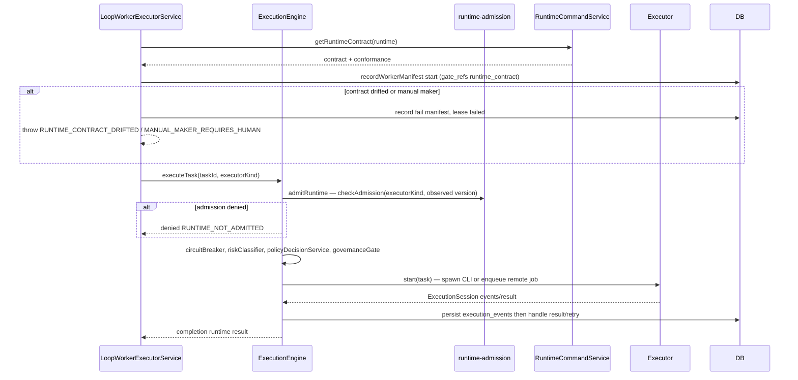

# Agent Runtimes & Executor Adapters

The server executes tasks by adapting external agent CLIs behind one uniform contract.
`execution/types.ts` defines the boundary — one `ExecutorKind` taxonomy, one
`TaskExecutor` interface, one `ExecutionSession` handle — and the `ExecutionEngine`
registers, selects, admits, guards, and supervises every implementation. Two
runtime-specific executors (Atomic, remote maker) join the eight CLI/chat runtimes in
the default registry; the production Dockerfile pins the corresponding binaries. A
runtime's being registered is only the first gate: before any task dispatch the engine
runs an evidence-backed **runtime admission** check that a registered runtime may not
run at all outside its admitted version. Everything the rest of the system learns
about a run — events, result, failure classification, cancellation — flows through
the contract types, so adding a runtime means implementing the contract, registering
it, pinning its binary, and adding an admission record, never touching the
orchestration spine.

## ExecutorKind taxonomy and registration

`ExecutorKind` enumerates every runtime the server can name
(`execution/types.ts:10`):

```ts
export type ExecutorKind =
  'mock' | 'opencode' | 'codex' | 'claude' | 'hermes' | 'gemini' | 'editor' | 'pi'
  | 'atomic' | 'remote' | 'docker' | 'deep-agent' | 'custom';
```

The `ExecutionEngine` constructor always registers **ten** default executors — `mock`,
`opencode`, `codex`, `claude`, `hermes`, `gemini`, `editor`, `pi`, `atomic`, and
`remote` — and registers `deep-agent` only when the operator sets
`DJIMIT_DEEP_ENABLED=true`, also instantiating the `DeepAgentContractIssuer` at that
point (execution-engine.ts constructor, L162-L176). Two kinds are **never** registered:
`docker` exists only as the `kind` reported by `DockerSandboxExecutor` when the engine
wraps another executor at dispatch time, and `custom` is the extension slot for
out-of-tree implementations registered via `registerExecutor(executor)`, which indexes
by `executor.kind`. Dispatchers pass the desired `executorKind` to `executeTask()`;
the engine looks it up, checks `executor.canExecute(task)`, and routes through the
pre-execution governance spine described in
[Governance Pipeline](./governance-pipeline.md) before any process starts.

Executors are keyed by `kind` in a `Map`; re-registering a kind replaces the adapter.

## TaskExecutor, ExecutionSession, and the result/failure contract

The adapter interface is deliberately small (`types.ts:122-140`):

- `kind: ExecutorKind` — identity used for registration, circuit-breaker state, and
  metadata.
- `start(task, options?) → Promise<ExecutionSession>` — spawn/admit the run and return
  a live handle. The engine, not the executor, holds admission policy.
- `canExecute(task) → boolean` — a cheap capability probe. Most adapters return
  `true`; `deep-agent` uses it to enforce contract binding.
- `buildCommand?(task, options?) → { command, args }` — the exact CLI invocation.
  Optional but required for Docker sandbox wrapping: the sandbox re-hosts the command
  without re-implementing argument construction.

`ExecutionSession` (types.ts:81-117) is the engine's live view of a run:

- `events: AsyncIterable<ExecutionEventCreateInput>` — every event the engine
  persists to `execution_events` and broadcasts.
- `result: Promise<ExecutionResult>` — resolves once with terminal status
  (`completed` | `failed` | `cancelled`), captured stdout/stderr, an optional
  `ExecutionFailure`, artifacts, and metrics.
- `closed?: Promise<void>` — resolves only when the owned OS child **and its stdio
  streams** close. The engine awaits `closed` before handling results or retries so a
  "finished" task never leaves a live provider process behind. Every spawn-path
  adapter registers `runtimeProcessClosed(child)` immediately after spawn because
  `exit`/`error` do not imply stream closure.
- `exit?: { code: number | null; signal: string | null }` — the one field the older
  page summary missed: the child's own exit recorded on its `close` event (before
  `closed` resolves), absent when no child ran. `LoopWorkerExecutorService.toRuntimeResult`
  prefers this `processExitCode` over the status-derived 0/1 when reporting a lease's
  `runtime_exit_observed` (loop-worker-executor-service.ts:662-679). `ExecutionResult`
  also carries `exitCode`/`signal` mirrored there (types.ts:51-53).
- `cancel()`, and optional `pause()`/`resume()` — cancellation is mandatory;
  pause/resume is advertised but not implemented by the built-in adapters.

`ExecutionFailure` (`code`, `message`, `retryable`, `sideEffectsPossible`,
`failureDomain`) separates "the provider erred" from "the world may already have
changed": the engine's `normalizeFailure` sets `retryable` from a provider-transient
regex only when `sideEffectsPossible` is false, and `nextRetryExecutor()` refuses any
retry when `attempt >= maxRetries`, `!failure.retryable`, or
`failure.sideEffectsPossible` — a failure after possible side effects is never
retried (execution-engine.ts:806-834).

## The ten default adapters

All eight language-model runtimes spawn a CLI with `stdio: ['ignore','pipe','pipe']`
(atomic additionally writes the goal to stdin), parse stdout into
`ExecutionEventCreateInput`s, and decide the final result from exit code plus
structured-event awareness. `mock` is an in-process deterministic fake; `remote`
never spawns a local process at all (below). Per-executor env vars
(`<RUNTIME>_EXECUTION_TIMEOUT_MS`, `<RUNTIME>_SKIP_PERMISSIONS`,
`<RUNTIME>_OUTPUT_FORMAT`, model vars like `DJIMITFLO_CODEX_MODEL` /
`DJIMITFLO_CLAUDE_MODEL`) configure the adapter at construction; per-call
`ExecutorOptions` override them.

| Kind | Binary (env override) | Skip-permissions flag | Notes on CLI contract |
|---|---|---|---|
| `mock` | — (in-process) | — | Deterministic fake event stream for tests and local dev. |
| `opencode` | `opencode` (`OPENCODE_BIN_PATH`) | `--auto` | `run [--format json] [--dir CWD] [--model] [--agent]`; NDJSON `step_start`/`tool_use`/`text`/`step_finish` with nested `part`. Token/cost from each `step_finish` feeds both usage metrics and the token brake below. |
| `codex` | `codex` (`CODEX_BIN_PATH`) | `--dangerously-bypass-approvals-and-sandbox` | `exec [--json] [--cd CWD] [--model] [-c model_reasoning_effort=…] [--sandbox]`; `turn/turn/item.*` NDJSON plus legacy `step-*`/`tool`/`text`; `turn.completed` `usage.input_tokens + output_tokens` summed into the result. |
| `claude` | `claude` (`CLAUDE_BIN_PATH`) | `--dangerously-skip-permissions` | `-p <prompt> --output-format json`; worktree comes from spawn `cwd` (no `--cd` flag). |
| `hermes` | `hermes` (`HERMES_BIN_PATH`) | `--yolo` | Uses the programmatic `chat -q <prompt> --oneshot --quiet` surface, **not** `-z`, because `-z` bypasses approvals entirely — Djimitflo stays the approval boundary. |
| `gemini` | `gemini` (`GEMINI_BIN_PATH`) | `-y` | `-p <prompt> -o json [-m <model>]`; same line-JSON + heuristic pattern as Claude. |
| `editor` | `cline` (`CLINE_BIN_PATH`) | `--auto-approve true` | The runtime is named `editor`; the binary is `cline`. Worktree via `-c`. |
| `pi` | `pi` (`PI_BIN_PATH`) | `--no-approve` (default on via `PI_NO_APPROVE`) | `pi --mode json -p --no-session`; NDJSON `session`/`agent_start`/`tool_execution_*`/`turn_end`. Pi has no permission popups — Djimitflo's policy engine is the sole boundary, so `PI_TOOLS`, `PI_OFFLINE=1`, `PI_SKIP_VERSION_CHECK=1`, `PI_TELEMETRY=0` matter. |
| `atomic` | `atomic-agent` (`ATOMIC_AGENT_BIN_PATH`) | `--no-approval` (only with a skip-permission-approved run) | Gym-only maker species (plan C5). `atomic-agent run --cwd <dir> --max-steps N` reads the goal on **stdin**; plain text on stdout, the diff is the only evidence. The model is an OpenAI-compatible provider (default Ollama Cloud, key from `OLLAMA_API_KEY` unless `ATOMIC_AGENT_API_KEY_ENV` names a different var) written into a Djimitflo-owned state dir (`DJIMITFLO_ATOMIC_STATE_DIR`) before each run, so the operator's own `~/.atomic-agent` is never touched. |
| `remote` | — (no local binary) | n/a | Plan I3 workstation pull maker: the lease's `model` names `<host>/<species>` (e.g. `workstation/atomic@llama-router`). The base commit must be an ancestor of `origin/main`; the executor enqueues the job on `RemoteMakerQueue`, polls until the host returns a patch, and applies it via `git apply` in the worktree. Runs are bounded by `REMOTE_MAKER_TIMEOUT_MS` (work, default 30 min) and `REMOTE_MAKER_QUEUE_TIMEOUT_MS` (wait, default 45 min). |

### Shared runtime plumbing

Every spawn-path adapter uses the same helpers:

- `runtime-process.ts` — `runtimeProcessClosed()` records the `close` promise per
  child in a `WeakMap`; `stopRuntimeProcess()` sends `SIGTERM`, escalates to
  `SIGKILL` after 5 s, and resolves only when the process actually closes, so
  cancel/timeout never leak a half-dead child.
- `executor-env.ts` — `buildExecutorEnv()` builds the child environment from an
  allowlist (`PATH`, locale vars, `*_API_KEY`, model vars, `*_BIN_PATH`, …) plus
  `RUNTIME_ENV_PASSTHROUGH` extras, so server secrets stay out of spawned CLIs by
  default (executor-env.ts:6-33). The `ATOMIC_AGENT_API_KEY_ENV`-named key is passed
  through explicitly because it may sit outside the `*_API_KEY` allowlist (e.g.
  `SOCIAL_COMPAT_API_KEY`), and a `SUBSCRIPTION_ENV_MARKER` on the env switches the
  build to `subscriptionChildEnv()`: every `*_API_KEY` and the provider base URLs are
  dropped, and only the login belonging to the named runtime (Claude's OAuth token,
  `CODEX_HOME`) is re-added (subscription-env.ts:14-28).
- `captureExecutorOutput()` — keeps a rolling 5 MiB tail of stdout/stderr for the
  final result even when events were streamed incrementally.
- `structured-runtime-event.ts` — a shared normalizer mapping
  `tool_use`/`tool_result`/`error`/`text`-shaped JSON chunks from `claude`,
  `gemini`, `editor`, `codex`, `opencode`, and `pi` into `TOOL_CALL` /
  `TOOL_RESULT` / `ERROR` / `LOG` events with token-usage metadata
  (structured-runtime-event.ts:18-39).

## DockerSandboxExecutor: a wrapping isolation layer

`DockerSandboxExecutor` is **not** a runtime — it takes an inner `TaskExecutor`,
asks it for `buildCommand()`, and re-hosts that invocation inside a throwaway
container. The engine creates it in `startExecutionAttempt()` when
`task.metadata.sandbox.enabled === true`, overriding image/cpu/memory/network from
`sandbox.*` metadata on top of `DEFAULT_SANDBOX_CONFIG` (execution-engine.ts:629-642).
It reports `kind: 'docker'` regardless of the wrapped executor, delegates
`canExecute` to the inner executor, and fails closed with
`DOCKER_SANDBOX_INNER_COMMAND_UNAVAILABLE` when the inner executor has no
`buildCommand`. Before starting it probes `docker --version` and fails with
`DOCKER_SANDBOX_UNAVAILABLE` if the daemon/CLI is absent; the host worktree is
bind-mounted `rw` at `/workspace` and the inner command is rebuilt with
`workingDirectory: '/workspace'`. Security invariants enforced and asserted by
`docker-sandbox-executor.test.ts`: non-root user (`--user 1000:1000`), `--cap-drop
ALL`, `no-new-privileges:true`, read-only root filesystem with a 64 MiB tmpfs `/tmp`,
network isolation by default (`networkMode: 'none'`), CPU/memory limits, a
digest-pinned image requirement (`@sha256:`) guarded by
`DOCKER_SANDBOX_SKIP_DIGEST_CHECK`, and automatic `docker run --rm` cleanup with an
explicit `docker rm -f` on completion/cancel. A wall-clock timeout
(`DOCKER_TIMEOUT_MS`, default 10 min) terminates the container with SIGTERM→SIGKILL.
Deep-agent tasks refuse sandboxing outright — it is controlled by the sovereign
runtime, not by Djimitflo wrapping it in Docker.

## deep-agent: the opt-in contract-gated runtime

`DeepAgentExecutor` is registered only under `DJIMIT_DEEP_ENABLED=true`. Unlike the
CLI adapters it is gated on an explicit signed contract, not on task text:
`canExecute(task)` is true only when `task.metadata.deep_agent_contract` exists, its
`identity.task_id` equals this task, and the capabilities carry the
`no-tool-canary` profile; `start()` throws `DEEP_AGENT_CONTRACT_INVALID_FOR_TASK`
otherwise. The engine adds this contract at admission time via
`DeepAgentContractIssuer.issue(...)` and immediately strips it from durable task
metadata so the contract is per-attempt provenance. Two transports: a local spawn of
`<runtimeRoot>/.venv/bin/python -m djimit_deep run-no-tool` under
`DJIMIT_DEEP_RUNTIME_ROOT` (Ed25519-verified via
`DJIMIT_DEEP_FEDERATION_PUBLIC_KEY`), and a remote POST to `DJIMIT_DEEP_URL`
+ `/v1/execute` that only accepts HTTP loopback or literal Tailscale IPv4 origins
(capped at 1 MiB). It **fails closed** on any non-zero exit, timeout, oversized
response, or unparseable status, and it **never falls back and never gets a
fallback**: the engine refuses a fallback when the circuit breaker is open on
`deep-agent`, and `nextRetryExecutor()` returns `null` for a failed deep-agent
attempt (execution-engine.ts:813) — a contract-gated run is intentionally terminal.

## Runtime admission: a registered runtime is not an admitted one

Before the engine spends any policy work on a task it calls
`admitRuntime(taskId, executorKind)` (execution-engine.ts:320 and again at the
attempt boundary, execution-engine.ts:626, so every fallback attempt is re-admitted
and a fallback chain cannot bypass admission). The observed version comes only from
Djimitflo's own contract probe of the binary in `runtime_contract_probes` (probed
at or after engine boot) — never from task metadata or the runtime's output.
`checkAdmission()` (execution/runtime-admission.ts:91-108) looks up the in-repo
ledger `RUNTIME_ADMISSIONS` and, per version-bound record, computes a deterministic
verdict: any critical-gate `FAIL` (`licensing`, `reproducibility`, `supply_chain`),
self-attestation, or `authority.*` owned by `RUNTIME`/`SHARED` yields `REJECT`;
unproven gates yield `HOLD` (or `LEGACY_ADMITTED` when a legacy migration record
exists); only an in-date, version-matching `ADMIT`/`CONDITIONAL`/`LEGACY_ADMITTED`
record for the runtime lets the task proceed. A drift — an admitted version like
`opencode 1.18.10` matched against a probed `1.19.0` — is denied as runtime drift;
a refusal is denied as `RUNTIME_NOT_ADMITTED` and recorded as a high-severity
`runtime_admission` policy violation. `RUNTIME_ADMISSION_MODE=shadow` is the
operator's rollback: the denial is recorded but not enforced. The ledger lives in the
repo so an assessment changes only through review; the negative control
(`openhuman`, REJECT, licences/licensing/submodule supply chain F gates) and the
positive control (`opencode 1.18.10`, LEGACY_ADMITTED with explicit unproven
containment and a `2026-12-31` migration expiry) are the two ends of the
envelope (runtime-admission.ts:151-208). `expiringAdmissions()` feeds the stall
watch so an expiring assessment stops work loudly rather than silently
(runtime-admission.ts:111-113).

## OpenCode token brake and step-progress events

`OpenCodeExecutor` does three things beyond echoing stdout that other adapters do
not:

1. **Token brake.** Every `step_finish.part.tokens.total` updates a running
   `tokenSum` (the sum over steps, since each step re-sends its context). When
   `OPENCODE_MAX_RUN_TOKENS` is set and the sum crosses it, the executor calls
   `stopRuntimeProcess(child)` and fails the run with a `token budget exceeded`
   error — the brake fires *during* the run, not at the post-run token gate
   (opencode-executor.ts:114-117, 197-207).
2. **Step-progress events.** `step_finish` never means the task finished: the
   AI-SDK finish reason (`stop`/`length`/`content-filter`/`tool-calls`/`error`)
   is mapped to a `continuation`/`final`/`abnormal`/`error`/`unrecognized`
   `step_outcome` and always emitted as a non-terminal LOG (or ERROR for an
   `error` outcome); only the process exit decides the terminal
   `TASK_COMPLETED`/`TASK_FAILED` event, so the event stream cannot say
   completed while the result is failed (opencode-executor.ts:442-465, 645-655).
3. **Verification-aware result.** `tool_use` events whose tool is a
   `build_check`/`lint`/`test`/`typecheck` (or a `bash` whose command matches
   `tsc|eslint|vitest|jest|pytest|cargo test|go test|npm test`) and whose state is
   `error`/`failed`/`rejected`/`cancelled`, or whose output reports
   `success: false`/non-zero `exitCode`/`verdict: fail`/`failed_count > 0`, are
   recorded as verification failures. An exit-0 run with any verification failure
   still resolves `status: 'failed'` with `code: VERIFICATION_FAILED`,
   `retryable: false`, `sideEffectsPossible: true` — Djimitflo refuses to call a
   green-looking run a pass when the checks inside it failed
   (opencode-executor.ts:344-381, 669-688).

## skip-permissions: the operator-armed final boundary

The CLI permission-bypass flags (`--auto`,
`--dangerously-bypass-approvals-and-sandbox`, `--yolo`, `--auto-approve true`,
`--dangerously-skip-permissions`, atomic's `--no-approval`) all remove the
provider's own approval prompts, and they are guarded twice:

1. Per-executor env arm switches (`OPENCODE_SKIP_PERMISSIONS`, `CODEX_SKIP_PERMISSIONS`,
   `CLAUDE_SKIP_PERMISSIONS`, `CLINE_SKIP_PERMISSIONS`, `GEMINI_SKIP_PERMISSIONS`).
2. `resolveExecutorSkipPermissions(requested)` — the engine only forwards
   `skipPermissions: true` to an adapter when the operator set
   `RUNTIME_ALLOW_SKIP_PERMISSIONS=true`:

   ```ts
   return requested === true && process.env.RUNTIME_ALLOW_SKIP_PERMISSIONS === 'true';
   ```

A task may *request* `metadata.skipPermissions = true`; without the operator env the
engine never honours it. Atomic applies the same rule via its `skipPermissions`
option before adding `--no-approval`. This guard lives at the executor boundary so
direct task execution cannot accidentally enable an unsandboxed CLI — never bypass
it in new code.

## Circuit breaker and fallback chain

Two services share resilience:

- **`CircuitBreakerService`** tracks a per-`ExecutorKind` `CLOSED → OPEN →
  HALF_OPEN → CLOSED` machine. `recordFailure` opens the circuit after
  `CIRCUIT_BREAKER_THRESHOLD` (default 3) consecutive failures in a 60 s window;
  while `OPEN`, `canExecute` returns false until `CIRCUIT_BREAKER_RECOVERY_MS`
  (default 30 s) elapses into `HALF_OPEN`; `recordSuccess` closes after 2 consecutive
  successes. The engine records failures on spawn/admission errors and `failed`
  results, successes on `completed` results — the breaker reflects what the provider
  did, not the final task verdict.
- **`FallbackChainService`** maps each `ExecutionMode` (`fast | standard |
  controlled | restricted`) to an ordered provider list — `standard` tries
  `claude → codex → gemini`, `restricted` is claude-only — and `getNextAvailable()`
  walks the chain after the current kind, skipping open breakers.
  `maxRetries` comes from `ExecutionModePolicyService` per mode (`fast:1`,
  `standard:2`, `controlled:3`, `restricted:0`), so even a retryable failure does
  not chain-hop in restricted mode. Fallbacks are themselves re-admitted through
  `fallbackAdmitted()` *and* through `admitRuntime()` at the attempt boundary
  before they start, and every hop is persisted as a
  `Retrying with fallback executor <kind>` event carrying `failureCode`,
  `failureDomain`, `retryable`, and `sideEffectsPossible`.

## Loop runtime contract probing

Before any loop worker spawns a CLI, `LoopWorkerExecutorService` (executeMaker at
L170-L197, executeChecker at L353-L375) resolves the runtime contract via
`LoopService.getRuntimeContract(runtime)`, which delegates to
`RuntimeCommandService.getRuntimeContract()` (runtime-command-service.ts:149-217).
The service returns a **static `manual`** contract (always `ok`, `proof_class:
static`) and a **static `mock`** contract (always `ok`, `deterministic in-process`),
short-circuits `remote` to the `REMOTE_MAKER_ENABLED` flag (there is no local binary
to probe), and otherwise runs per-runtime probes of the form `<bin> --version`
plus a `--help` style call (`codex exec --help`, `opencode run --help`, `cline
--help`, `pi --help`, `atomic-agent run --help`) with
`LOOP_RUNTIME_PROBE_TIMEOUT_MS` (default 2 s). A contract is `drifted` when the
required `json`/`cwd`/`headless` flags are missing from the help output; `atomic`
has a blank `json_flag` because the CLI produces plain text (the diff is the evidence).
`withConformance()` stamps a sha256 `contract_hash` over
`{runtime, command, version, cwd_flag, json_flag, checks}` plus the named checks
`runtime_available`, `contract_not_drifted`, `structured_events`,
`usage_accounting`, `bounded_lifecycle` (with `manual`/`mock` proven
`proof_class: static`, probed runtimes `proof_class: runtime_probe`)
(runtime-command-service.ts:219-244). Contracts are cached per `runtime::command`
key for `LOOP_RUNTIME_CONTRACT_CACHE_MS` (default 5 s, clamped 500 ms–60 s) and
each probe is persisted to the `runtime_contract_probes` table
(runtime-command-service.ts:149-217, 29-41) — that table is itself the version
evidence the engine's admission check reads. `LoopService.getRuntimeContracts()`
(loop-service.ts:1395-1408) exposes `manual`, `mock`, `codex`, `opencode`,
`claude`, `gemini`, `editor`, `pi` at `GET /loops/runtime-contracts`
(loops.ts:91-93) — note the exposed set intentionally omits `atomic` and `remote`,
which is why `/swarms/runtime-readiness` treats only `codex`/`opencode` as
production runtimes.

Both worker paths then behave identically: they record a `start` worker manifest
(`recordWorkerManifest`, `gate_refs: ['runtime_contract']`) capturing the contract
plus capacity/budget snapshots, and when `!contract.available || contract.status
!== 'ok'` they record a `fail` manifest with `blocked_reasons:
['runtime_contract_drift']`, mark the lease failed with
`failure_reason: runtime_contract_unavailable_or_drifted`, and throw
`RUNTIME_CONTRACT_DRIFTED` — no provider process is ever spawned against a drifted
contract. `manual` is gated before contract probing: `executeMaker` refuses manual
leases with `MANUAL_MAKER_REQUIRES_HUMAN` (loop-worker-executor-service.ts:144-147),
and a manual checker can only be dispatched with an explicit non-manual runtime
(`CHECKER_RUNTIME_REQUIRED`, loop-worker-executor-service.ts:345-348).

## Dispatch and lifecycle end-to-end



Sequence from lease manifest through contract probe, admission, governance, spawn,
and event persistence. Loop worker execution passes `executeViaEngine`, which
inserts a real `tasks` row first so the engine's governance spine, circuit breaker,
and admission all see the same dispatch it would for a standalone task
(loop-worker-executor-service.ts:543-620).

`executeViaEngine` (loop-worker-executor-service.ts:543-620) is the bridge: it
reuses a prior `execution_task_id` when the engine-side task already exists
(surfacing `LOOP_WORKER_EXECUTION_RECOVERY_REQUIRED` when a server-restart hold is
still set, or `LOOP_WORKER_APPROVAL_REQUIRED` / `LOOP_WORKER_EXECUTION_IN_PROGRESS`
for the approval/running states), otherwise it inserts a `tasks` row tagged
`['loop-worker', role, runtime]` with the worktree prompt, nested-spawn env,
`subscription_auth` marker env, and a get-or-create `<runtime>-<role>` agent
identity — then hands it to `ExecutionEngine.executeTask()`. This keeps every
loop worker on the same governance spine, circuit breaker, admission, and event
store as a direct task: a "maker lease" is from the engine's point of view just a
task.

## Production worker surface and readiness

The runtime image (stage 2 of the Dockerfile, node:22-bookworm-slim) also copies
`packages/ransomware-module/src` and `packages/ransomware-module/package.json`
(Dockerfile L35-L36, L50) so the workspace builds with the rest in the builder
stage and is shipped in the production image; it then installs, in deterministic
order:

1. `gh` CLI as a static per-arch `.deb` pinned by `ARG GH_CLI_VERSION=2.102.1`
   (downloaded from `github.com/cli/cli` releases, `dpkg -i`, verified with
   `gh --version`) for `GithubPrReviewService`, which shells out to `gh pr diff` /
   `gh api` for PR review comments and Check Runs (Dockerfile L69-L77).
2. `atomic-agent` as a release tarball pinned by `ATOMIC_AGENT_VERSION=0.6.5`
   **and** per-arch `ATOMIC_AGENT_SHA256_X64` / `ATOMIC_AGENT_SHA256_ARM64`
   checksums (`sha256sum -c` during the build, symlinked to
   `/usr/local/bin/atomic-agent`, verified with `atomic-agent --version`)
   (Dockerfile L79-L89).
3. The three provider CLIs `npm install --global @openai/codex@0.146.0
   opencode-ai@1.18.10 @anthropic-ai/claude-code@2.1.282`, verified up front with
   `git --version && codex --version && opencode --version && claude --version`
   (Dockerfile L91-L94).

The rationale for the pins is probe reproducibility: `runtime_contract` probes hash
the binary's `--version` output and the admission check compares it to the
version-bound ledger record, so an unpinned `latest` install would make both probe
evidence and drift detection non-deterministic.

At runtime the operator-facing probe is `GET /swarms/runtime-readiness[?runtime=…]`
(routes/swarm-knowledge.ts:26-51), which:

- treats only `codex` and `opencode` as production runtimes (anything else is
  blocked with `non_mock_supported_runtime_required`),
- checks loop runtime contracts for binary availability/version,
- verifies provider credentials (`OPENAI_API_KEY`/`CODEX_API_KEY` or a live
  `codex login status`; `DJIMITFLO_OPENCODE_MODEL` plus `OPENCODE_CONFIG_CONTENT`
  or `OPENCODE_CONFIG` for opencode), and
- reports `ready`/`blocked_reasons` per runtime **without starting any worker**
  (`starts_workers: false`).

This keeps the deployable surface at or above what `/swarms/runtime-readiness`
accepts: pinned, probed, admitted runtimes rather than whatever happens to be on
`PATH`.

## Related pages

- [Governance Pipeline](./governance-pipeline.md) — the policy/approval spine every
  executor start passes through after admission.
- [Loop Lifecycle](./loop-lifecycle.md) — where the runtime-contract gate sits in
  the run state machine for makers and checkers.
- Configuration reference — the `*_BIN_PATH`, `*_EXECUTION_TIMEOUT_MS`,
  `RUNTIME_*`, `LOOP_RUNTIME_*`, `REMOTE_MAKER_*`, `DOCKER_*`, and
  `DJIMITFLO_*_MODEL` env vars enumerated here.
- Task execution lifecycle — how `executeTask()` reaches `startExecutionAttempt()`.
- Test strategy — the executor contract and admission tests under
  `packages/server/src/__tests__/` (`execution-engine.test.ts`,
  `runtime-admission.test.ts`, `docker-sandbox-executor.test.ts`).
