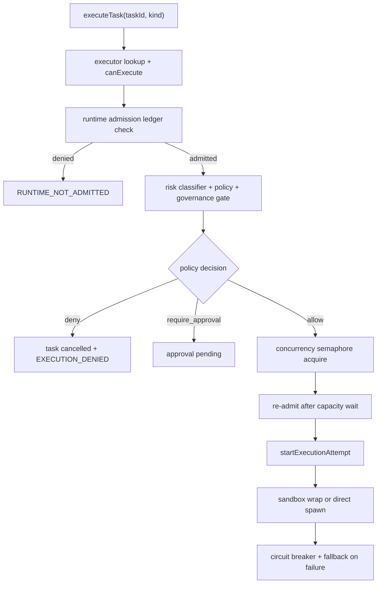

# Agent Runtimes & Executor Adapters

The server executes tasks by adapting external agent CLIs behind one uniform contract.
`packages/server/src/execution/types.ts` defines the boundary — one `ExecutorKind`
taxonomy, one `TaskExecutor` interface, one `ExecutionSession` handle — and the
`ExecutionEngine` registers, selects, **admits**, guards, and supervises every
implementation. Everything the rest of the system knows about a run (events, result,
failure classification, cancellation) flows through these types, so adding a new runtime
means implementing the contract, registering it, **and winning an admission record**, not
touching the orchestration spine.

## ExecutorKind taxonomy and registration

`ExecutorKind` enumerates every runtime the server can name (types.ts L10):

```ts
export type ExecutorKind =
  'mock' | 'opencode' | 'codex' | 'claude' | 'hermes' | 'gemini' | 'editor' | 'pi'
  | 'atomic' | 'remote' | 'docker' | 'deep-agent' | 'djimitsec' | 'custom';
```

The `ExecutionEngine` constructor registers **eleven** default executors — `djimitsec`,
`mock`, `opencode`, `codex`, `claude`, `hermes`, `gemini`, `editor`, `pi`, `atomic`, and
`remote` — and registers `deep-agent` only when the operator sets
`DJIMIT_DEEP_ENABLED=true`, also creating the `DeepAgentContractIssuer` at that point
(execution-engine.ts L179–L194). Two kinds are **never** registered standalone:
`docker` appears only as the `kind` a `DockerSandboxExecutor` reports when it wraps
another executor at dispatch time, and `custom` is the extension slot for out-of-tree
implementations registered via `registerExecutor(executor)`, which indexes by
`executor.kind` into a `Map` (re-registration silently replaces the previous adapter).

Dispatchers pass the desired `executorKind` to `executeTask()`; the engine looks it up,
checks `executor.canExecute(task)`, and routes through the pre-execution governance spine
described in [Governance Pipeline](./governance-pipeline.md) — **and through runtime
admission** — before any process starts.



*Dispatch from `executeTask` down to a spawned or sandboxed process: admission is checked at
first request, again after the capacity wait, and on every fallback hop.*

## TaskExecutor, ExecutionSession, and the result/failure contract

The adapter interface is deliberately small (`types.ts` L122–L140):

- `kind: ExecutorKind` — identity used for registration, circuit-breaker state, and
  metadata.
- `start(task, options?) → Promise<ExecutionSession>` — spawn/admit the run and return a
  live handle. The engine, not the executor, holds admission policy.
- `canExecute(task) → boolean` — capability probe. Most CLI adapters return `true`;
  `deep-agent` and `djimitsec` use it to enforce their input contract.
- `buildCommand?(task, options?) → { command, args }` — the exact CLI invocation. This
  optional method is what makes Docker sandbox wrapping possible: the sandbox needs to
  re-host the command without re-implementing argument construction.

`ExecutionSession` is the engine's live view of a run (types.ts L81–L117):

- `events: AsyncIterable<ExecutionEventCreateInput>` — a streaming event source. The
  engine's `processEventStream()` persists each event to `execution_events` and broadcasts
  it over WebSocket; a stream that outlives `EXECUTION_EVENT_STREAM_TIMEOUT_MS` (default 5
  minutes) is truncated with a `STREAM_TRUNCATED` event.
- `result: Promise<ExecutionResult>` — resolves once with the terminal status
  (`completed` | `failed` | `cancelled`), captured stdout/stderr, optional
  `ExecutionFailure`, artifacts, and metrics.
- `closed?: Promise<void>` — resolves only after the owned OS child *and its stdio
  streams* close. The engine awaits `closed` before handling results, retries, or cancels
  so a "finished" task never leaves a live provider process behind. This is why the CLI
  adapters register `runtimeProcessClosed(child)` immediately after spawn: exit/error
  alone do not imply stream closure.
- `exit?: { code, signal }` — the OS child's own exit, recorded on `close` before
  `closed` resolves. The engine merges it into the completion it hands back
  (`execution.completion`) and into the `tasks.metadata.executionResult` that a resumed
  loop worker reads back, so a timeout or token brake resolves the result first while the
  child's own exit code is still visible to the lease gates.
- `cancel()`, and optional `pause()`/`resume()` — cancellation is mandatory; pause/resume
  is advertised but not implemented by the built-in adapters.

`ExecutionResult.failure` is an `ExecutionFailure` — `code`, `message`, plus two
safety-critical booleans: `retryable` (may the engine try another provider?) and
`sideEffectsPossible` (did the failure happen after the provider might have mutated the
world?). A thrown failure is carried as `ExecutionFailureError`. When the engine normalizes
an unknown error it sets `retryable` by matching the message against a provider-transient
regex (`timeout | ECONN | 429 | 5xx | rate limit | exit code …`) and, crucially, forces
`retryable=false` whenever `sideEffectsPossible` is true: `nextRetryExecutor()` refuses
any retry if `attempt >= maxRetries`, `!failure.retryable`, or
`failure.sideEffectsPossible`.

## Runtime admission: registered is not admitted

A registered executor is not an admitted one. `packages/server/src/execution/
runtime-admission.ts` holds a **repo-committed ledger** (`RUNTIME_ADMISSIONS`) of
evidence-backed assessments, one per runtime@version, covering eight gates (licensing,
reproducibility, interface, containment, lifecycle, evidence, supply_chain, gym_evidence),
an authority map, a child-agents declaration, a capability-gap statement, an optional
`legacy` migration status, and an `expires_at`.

- `decide()` is deterministic: a critical-gate `FAIL` (licensing, reproducibility,
  supply_chain), self-attestation, or runtime-owned authority is always `REJECT`; unproven
  evidence with a `legacy` block is `LEGACY_ADMITTED`; unproven without legacy is `HOLD`;
  clean with conditions is `CONDITIONAL`; otherwise `ADMIT`. A `PASS` with empty
  `evidence_refs` is degraded to `NOT_PROVEN`.
- `checkAdmission(runtimeId, observedVersion)` also enforces expiry and pins:
  a version-bound admission must match the version Djimitflo's own probe observed,
  else the run is denied with `runtime drift …`.
- `ExecutionEngine.admitRuntime()` reads the observed version from the freshest
  `runtime_contract_probes` row for that executor since engine boot, evaluates the
  ledger, **records the decision on the task as an event**, and writes a
  `runtime_admission` policy violation on every refusal. `RUNTIME_ADMISSION_MODE=shadow`
  is the operator's rollback: the denial is recorded but the run proceeds.
- Admission is re-checked on every dispatch path — first call, after the asynchronous
  concurrency-semaphore wait, and on every fallback hop — so a fallback chain is never an
  admission bypass.

The ledger holds a positive control (opencode@1.18.10 as the legacy incumbent maker),
legacy entries for every registered runtime, and a negative control: `openhuman`,
rejected on licence/reproducibility/fit grounds, proving the ledger can say no.

## The default adapters

The eleven always-on adapters implement `TaskExecutor` and differ in binary, argument
surface, and parsing strategy. The CLI ones spawn with `stdio: ['ignore','pipe','pipe']`
(except atomic, which needs stdin for the goal), parse stdout into
`ExecutionEventCreateInput`s, and decide the final result from exit code with
structured-event awareness where the CLI provides it:

| Kind | Binary (env override) | Skip-permissions flag | Notes on CLI contract |
|---|---|---|---|
| `djimitsec` | — (HTTP, not a CLI) | — (caller control fields rejected) | Fixed operator-configured repository scanner. `DJIMITSEC_SCAN_MODE` off/shadow/execute; scans via a pinned origin, token file, and implementation digest. Never executes a prompt. |
| `mock` | — (in-process) | — | Deterministic fake event stream for tests and `docker`-less development. |
| `opencode` | `opencode` (`OPENCODE_BIN_PATH`) | `--auto` | `run [--format json] [--dir] [--model] [--agent]`; NDJSON `step_start`/`tool_use`/`text`/`step_finish` with nested `part`. `step_finish` parts accumulate `tokenUsage`/`costDollars` metrics on the `ExecutionResult`; a run that exits 0 with a failed verification step resolves `failed` with code `VERIFICATION_FAILED` (`retryable: false`, `sideEffectsPossible: true`). `OPENCODE_MAX_RUN_TOKENS` arms a mid-run token brake (`OPENCODE_BRAKE_CACHE_READ_WEIGHT` scales cache reads). |
| `codex` | `codex` (`CODEX_BIN_PATH`) | `--dangerously-bypass-approvals-and-sandbox` | `exec [--json] [--cd] [--model] [-c model_reasoning_effort=…] [--sandbox]`; accepts `thread/turn/item.*` NDJSON plus legacy `step-*`/`tool`/`text`; sums `turn.completed` `usage.input_tokens + output_tokens` into the result `tokenUsage` metric. |
| `claude` | `claude` (`CLAUDE_BIN_PATH`) | `--dangerously-skip-permissions` | `-p <prompt> --output-format json`; line-JSON then heuristic fallback. Worktree comes from spawn `cwd` (no `--cd`). |
| `hermes` | `hermes` (`HERMES_BIN_PATH`) | `--yolo` | Uses the programmatic `chat -q <prompt> --oneshot --quiet` surface instead of `hermes -z`, because `-z` bypasses approvals entirely — Djimitflo stays the approval boundary. |
| `gemini` | `gemini` (`GEMINI_BIN_PATH`) | `-y` | `-p <prompt> -o json [-m <model>]`; same line-JSON + heuristic pattern as Claude. |
| `editor` | `cline` (`CLINE_BIN_PATH`) | `--auto-approve true` | `editor` is the runtime name; the binary is `cline`. Worktree via `-c`. |
| `pi` | `pi` (`PI_BIN_PATH`) | `--no-approve` (default on via `PI_NO_APPROVE`) | `pi --mode json -p --no-session`; NDJSON `session`/`agent_start`/`tool_execution_*`/`turn_end`. Pi has no permission popups — djimitflo's policy engine is the sole boundary, so `PI_TOOLS`, `PI_OFFLINE=1`, `PI_SKIP_VERSION_CHECK=1`, `PI_TELEMETRY=0` matter for sensitive runs. |
| `atomic` | `atomic-agent` (`ATOMIC_AGENT_BIN_PATH`) | `--no-approval` (only when an operator-armed run sets `skipPermissions`) | Gym maker on a local/self-hosted model. `run --cwd --max-steps`: goal on **stdin**, plain text on stdout (the diff is the evidence). Writes a Djimitflo-owned provider JSON block into `DJIMITFLO_ATOMIC_STATE_DIR` (default Ollama Cloud, `kimi-k3`) before each run. |
| `remote` | — (queued) | — | Pull-based maker on a compute host (`workstation/atomic@llama-router` style lease model). Enqueues the job in `RemoteMakerQueue`, waits for the host to claim and finish it, applies the returned patch into the local worktree with `git apply`. The base commit must already be on `origin/main` so the host can fetch it. |

Non-CLI defaults (`djimitsec`, `remote`, deep-agent) still return the same
`ExecutionSession` shape; they just source the run from an internal queue or an HTTP
worker instead of a spawned binary.

### Shared runtime plumbing

Every CLI adapter shares the same runtime-plumbing helpers:

- `runtime-process.ts` — `spawnRuntime()` is the single spawn point.
  `runtimeProcessClosed(child)` records the `close` promise per child in a `WeakMap`;
  `stopRuntimeProcess()` sends `SIGTERM`, escalates to `SIGKILL` after 5 s
  (`graceMs`), and resolves only when the process actually closes (so cancel/timeout
  never leak a half-dead child). With `RUNTIME_PROCESS_GROUP_KILL=on` (POSIX only),
  `spawnRuntime` sets `detached: true` so each runtime is the leader of its own process
  group; the stop path then signals the whole group, an exit hook takes live groups down
  with the server, and a 2 s (`RUNTIME_GROUP_EXIT_GRACE_MS`) post-exit timer SIGKILLs any
  descendants still holding the pipe so `close` can fire. Default is off: handle-only kill.
- `executor-env.ts` — `buildExecutorEnv()` builds the child environment from an allowlist
  (`PATH`, locale, `*_API_KEY`, model vars, `*_BIN_PATH`, `DJIMITFLO_CONTROL_URL`, …)
  plus `RUNTIME_ENV_PASSTHROUGH` extras, so server secrets never reach spawned CLIs by
  default. When the task carries a subscription marker, all billing keys are stripped and
  the login is added only for the named executor.
- `captureExecutorOutput()` — keeps a rolling 5 MiB tail of stdout/stderr for the final
  result even when events were streamed incrementally.
- `structured-runtime-event.ts` — a shared normalizer that maps
  `tool_use`/`tool_result`/error/text-shaped JSON chunks from `claude`, `gemini`,
  `editor`, `codex`, `opencode`, and `pi` into `TOOL_CALL` / `TOOL_RESULT` / `ERROR` /
  `LOG` execution events with token-usage metadata when present.

Per-executor env vars (`<RUNTIME>_EXECUTION_TIMEOUT_MS`, `<RUNTIME>_SKIP_PERMISSIONS`,
`<RUNTIME>_OUTPUT_FORMAT`, model vars such as `DJIMITFLO_CODEX_MODEL` /
`DJIMITFLO_CLAUDE_MODEL`) configure the adapter at construction; per-call
`ExecutorOptions` override them.

## DockerSandboxExecutor: a wrapping isolation layer

`DockerSandboxExecutor` is **not** a runtime itself — it takes an *inner* `TaskExecutor`,
asks it for its `buildCommand()` invocation, and re-hosts that invocation inside a
throwaway Docker container. The engine creates it in `startExecutionAttempt()` when
`task.metadata.sandbox.enabled === true`, overriding image/cpu/memory/network/bind-mounts
from `sandbox.*` metadata on top of `DEFAULT_SANDBOX_CONFIG`. It reports `kind: 'docker'`
regardless of the wrapped executor, delegates `canExecute` to the inner executor, and
requires the inner to implement `buildCommand` — otherwise it fails closed with
`DOCKER_SANDBOX_INNER_COMMAND_UNAVAILABLE`.

Security invariants (all asserted by `docker-sandbox-executor.test.ts`):

- **Non-root user** — `--user 1000:1000` by default (`DOCKER_SANDBOX_USER`).
- **Drop all Linux capabilities** — `--cap-drop ALL`.
- **`no-new-privileges`** — enforced via `--security-opt no-new-privileges:true`.
- **Read-only root filesystem** + a bounded **`tmpfs` `/tmp` (64 MiB)**.
- **Network isolation by default** — `networkMode: 'none'` (`DOCKER_NETWORK_MODE`), with
  `bridge`/`host` opt-in.
- **Resource limits** — `--cpus` (`DOCKER_CPU_LIMIT`, default `1.0`) and `--memory`
  (`DOCKER_MEMORY_LIMIT`, default `512m`).
- **Digest-pinned image required** — `config.image` must contain `@sha256:`.
  `ensureImageIntegrity()` throws with remediation instructions unless the operator
  explicitly sets `DOCKER_SANDBOX_SKIP_DIGEST_CHECK=true` (logged warning; **not
  recommended for production**, since tag mutability is a supply-chain hole). Set
  `DOCKER_SANDBOX_IMAGE` to the pinned digest.
- **Automatic cleanup** — `docker run --rm` plus an explicit `docker rm -f` on
  completion/cancel; a `DOCKER_BIN_PATH` override locates the CLI.

Before starting, `start()` probes `docker --version` and fails with
`DOCKER_SANDBOX_UNAVAILABLE` if the daemon/CLI is absent. The host working directory is
bind-mounted `rw` at `/workspace` and the inner command is rebuilt with
`workingDirectory: '/workspace'`, so the inner adapter produces paths valid inside the
container. A wall-clock timeout (`DOCKER_TIMEOUT_MS`, default 10 min) terminates the
container with `SIGTERM` → `SIGKILL` after 5 s, resolving to exit code `124`.

Deep-agent tasks refuse sandboxing outright: sandboxing for `deep-agent` is controlled by
its sovereign runtime, not by djimitflo wrapping it in Docker.

## deep-agent: the opt-in contract-gated runtime

`DeepAgentExecutor` is registered only when `DJIMIT_DEEP_ENABLED=true`. Unlike the CLI
adapters it is gated on an explicit signed contract, not on task text:

- `canExecute(task)` — true only if `task.metadata.deep_agent_contract` exists, its
  `identity.task_id` equals this task, and its capabilities specify the
  `no-tool-canary` profile. `start()` throws `DEEP_AGENT_CONTRACT_INVALID_FOR_TASK`
  otherwise. The engine adds this contract at admission time via
  `DeepAgentContractIssuer.issue(parsedTask, dispatcherId)` and immediately strips it from
  the durable task metadata so the contract is per-attempt provenance.
- **Two transports**:
  - *Local*: spawns `<runtimeRoot>/.venv/bin/python -m djimit_deep run-no-tool` under
    `DJIMIT_DEEP_RUNTIME_ROOT`, feeding the contract over stdin (Ed25519-verified via
    `DJIMIT_DEEP_FEDERATION_PUBLIC_KEY`, or the canary key).
  - *Remote*: POSTs the contract to `DJIMIT_DEEP_URL` + `/v1/execute`, but only if the URL
    is an HTTP **loopback or literal Tailscale IPv4 origin** — anything else throws.
    Responses are capped at 1 MiB.
- **Fails closed**: non-zero exit, timeout, oversized response, or an unparseable final
  status yields `status: 'failed'` with `Contract-gated Deep Agents canary failed closed`.
- **Assurance hold on success**: a completed deep-agent run does not mark the task
  completed. The engine instead sets `deep_agent_assurance_hold` and moves the task to
  `awaiting_approval` with reason `EVE_V_ADAPTER_REQUIRED`, because executor success is
  not promotion authority.
- **Never falls back and never gets fallback**: the engine refuses a fallback when the
  breaker is open on `deep-agent`, and `nextRetryExecutor()` returns `null` for a failed
  deep-agent attempt — a contract-gated run is intentionally terminal. The same
  fixed-runtime rule now also applies to `djimitsec` (below).

## djimitsec: the fixed scanner, not a prompt runtime

`DjimitSecExecutor` (`kind: 'djimitsec'`) is Djimitflo's fixed, operator-configured
repository-scanning worker reached over loopback/HTTPS. It is deliberately **not** a
prompt runtime:

- It runs only when `DJIMITSEC_SCAN_MODE=execute` (off/shadow refuse via `canExecute`).
  Its configuration is a JSON file read through `O_NOFOLLOW` with uid/mode/nlink checks
  (`privateScanText`), holding a fixed `origin`, `tokenFile`, `repositoryIds`,
  `implementationDigest`, and `timeoutMs`. A task carrying `metadata.djimitsecScan` is
  pinned to this executor by `executeTask` (`DJIMITSEC_EXECUTOR_REQUIRED`), and the
  executor refuses generic execution controls — model, environment, workingDirectory,
  timeoutMs, skipPermissions, sandbox, reasoningEffort, codexSandbox — with
  `DJIMITSEC_CALLER_EXECUTION_OPTIONS_DENIED`.
- The scan input is a fixed `repositoryId` + `commit` pair; before dispatch, `prepare()`
  health-checks the worker's `/health` (version + implementation digest must match) and
  writes its own `runtime_contract_probes` row so `admitRuntime()` sees the scanner as
  probed.
- `start()` does a single POST `/scan`; if that POST's outcome is ambiguous it issues one
  read-back `GET /runs/:id` rather than resubmitting. A `held`/`running`/unparseable
  state, a cancelled state that never confirmed, or any HTTP error resolves
  `failed` with `DJIMITSEC_SCAN_HELD` (`retryable: false`, `sideEffectsPossible: true`) —
  automatic replay/fallback is forbidden. Cancellation that cannot confirm the remote run
  leaves the task in a `djimitsec_cancellation_unconfirmed` recovery hold.
- The scanner's answer is an observation (`verified: false`), never a security verdict;
  nothing here promotes code.

## atomic and remote: the gym makers

Two adapters exist to run gym/self-hosted makers rather than interactive CLIs:

- `AtomicExecutor` shells out to the pinned `atomic-agent` binary. Before each run it
  rewrites the provider block inside a Djimitflo-owned state dir (`config set …`), feeds
  the goal on stdin, and emits plain-text output; `--no-approval` is passed only when an
  operator-armed `skipPermissions` run asks for it.
- `RemoteMakerExecutor` (kind `remote`) is a pull model: it enqueues a job
  (host, species, base commit, prompt) onto `RemoteMakerQueue`, polls until the host marks
  it done, then applies the returned patch to the local worktree. Claims time out after
  `REMOTE_MAKER_TIMEOUT_MS` (default 30 min); an unclaimed job fails after
  `REMOTE_MAKER_QUEUE_TIMEOUT_MS` (default 45 min). A result whose lease is no longer
  active is abandoned, never applied.

Both are loop-only species in practice: they appear in the loop runtime contract set
(`getRuntimeContract('atomic'|'remote')`) so `RuntimeCommandService` can probe (atomic)
or feature-flag-check (remote via `REMOTE_MAKER_ENABLED`) them.

## skip-permissions: operator-armed final boundary

Individual CLI flags (`--auto`, `--dangerously-bypass-approvals-and-sandbox`, `--yolo`,
`--auto-approve true`, `--dangerously-skip-permissions`) remove the provider's own
approval prompts. That power is guarded twice:

1. Per-executor env defaults (`OPENCODE_SKIP_PERMISSIONS`, `CODEX_SKIP_PERMISSIONS`,
   `CLAUDE_SKIP_PERMISSIONS`, `CLINE_SKIP_PERMISSIONS`, `GEMINI_SKIP_PERMISSIONS`).
2. **The final-boundary guard** — `resolveExecutorSkipPermissions(requested)` in
   execution-engine.ts:

```ts
return requested === true && process.env.RUNTIME_ALLOW_SKIP_PERMISSIONS === 'true';
```

   A task may *request* `metadata.skipPermissions = true`, but the engine only forwards
   `skipPermissions: true` to the adapter when the **operator** set
   `RUNTIME_ALLOW_SKIP_PERMISSIONS=true`. This guard lives at the executor boundary so
   direct task execution cannot accidentally enable an unsandboxed CLI even when task
   metadata asks for it — **never bypass it in new code.**

## Circuit breaker and fallback chain

Provider resilience is split across two services:

**`CircuitBreakerService`** keeps per-`ExecutorKind` state `CLOSED → OPEN → HALF_OPEN →
CLOSED`:

- `recordFailure` opens the circuit after `CIRCUIT_BREAKER_THRESHOLD` consecutive
  failures (default 3) inside a 60 s sliding window.
- While `OPEN`, `canExecute(kind)` returns `false` until
  `CIRCUIT_BREAKER_RECOVERY_MS` (default 30 s) elapses, then one probe is allowed in
  `HALF_OPEN`.
- `recordSuccess` in `HALF_OPEN` needs 2 consecutive successes to close again.
- The engine records failures on spawn/admission errors and on `failed` results, and
  successes on `completed` results — so the breaker reflects what the provider did, not
  the final task outcome.

**`FallbackChainService`** maps each `ExecutionMode` (`fast` | `standard` | `controlled` |
`restricted`) to an ordered provider list — `standard`, for example, tries
`claude → codex → gemini`, while `restricted` is `claude` only. `getNextAvailable()`
walks the chain after the current kind, skipping breakers that are open. Custom chains
can be injected via the constructor or `setChain()`.

`maxRetries` comes from `ExecutionModePolicyService` per mode (`fast:1`, `standard:2`,
`controlled:3`, `restricted:0`), so even a retryable failure does not chain-hop in
`restricted` mode. Fallbacks are themselves re-admitted through the policy gate
(`fallbackAdmitted`) **and the runtime admission ledger** before they start, and every
hop is persisted as a `Retrying with fallback executor <kind>` event carrying
`failureCode`, `failureDomain`, `retryable`, and `sideEffectsPossible`. The two fixed
runtimes — `deep-agent` and `djimitsec` — are excluded from this behavior: an open
breaker there throws `Fixed runtime circuit breaker is open; fallback is forbidden`,
and `nextRetryExecutor` returns `null` on their failure.

## Runtime contract checks and lease → runtime binding

Before any loop worker spawns a CLI, `LoopWorkerExecutorService` (executeMaker /
executeChecker) probes the binary through `LoopService.getRuntimeContract(runtime)` —
delegated to `RuntimeCommandService`, which runs `<bin> --version` plus a `--help`-style
probe per runtime (e.g. `codex exec --help`, `opencode run --help`) and marks the
contract `drifted` when required flags (`--json`/`--format`, cwd flag, headless flag) are
missing from the help output. Contracts are conformance-hashed (`withConformance` emits
sha256 `contract_hash` + named checks `runtime_available`, `contract_not_drifted`,
`structured_events`, `usage_accounting`, `bounded_lifecycle`), cached for
`LOOP_RUNTIME_CONTRACT_CACHE_MS` (default 5 s), and persisted to the
`runtime_contract_probes` table. The probe set covers `codex`, `opencode`, `claude`,
`gemini`, `editor`, `pi`, and `atomic`; `manual`, `mock`, and `remote` have static
contracts (`remote`'s is gated on `REMOTE_MAKER_ENABLED`). Both worker paths then:

1. record a `start` worker manifest (`recordWorkerManifest`, `gate_refs:
   ['runtime_contract']`) capturing the contract plus capacity/budget snapshots, and
2. if `!contract.available || contract.status !== 'ok'`, record a `fail` manifest with
   `blocked_reasons: ['runtime_contract_drift']`, mark the lease failed with
   `failure_reason: runtime_contract_unavailable_or_drifted`, and throw
   `RUNTIME_CONTRACT_DRIFTED` — no provider process is ever spawned against a drifted
   contract.

The `manual` runtime is always "available" but is gated before contract probing:
`executeMaker` refuses `manual` leases with `MANUAL_MAKER_REQUIRES_HUMAN` (manual runtime
requires human execution), and manual checkers can only be dispatched with an explicit
non-manual runtime (`CHECKER_RUNTIME_REQUIRED`).
`LoopService.getRuntimeContracts()` exposes the contract set (`manual`, `mock`, `codex`,
`opencode`, `claude`, `gemini`, `editor`, `pi`) over `GET /loops/runtime-contracts`, and
the mock executor's deterministic in-process contract (`available: true, status: 'ok'`,
`proof_class: static`) is what loop tests and `docker`-less development ride on. See
[Loop Lifecycle](./loop-lifecycle.md) for where these checks sit in the run state machine.

### Binding leases to the engine

For non-mock runtimes, both maker and checker dispatch use `executeViaEngine()`: the
service materializes a real `tasks` row (`loop-worker-<lease>-<id>`), records the lease's
`execution_task_id`, and calls `ExecutionEngine.executeTask(taskId, runtime)`. When the
session is admitted the engine back-fills the lease metadata (`requested_runtime`,
`effective_runtime`, `effective_model`) and registers the lease in
`RuntimeLeaseRegistry` — its `stop` callback cancels the engine session if the live
session is still the current one. That single registry is how an operator stop on a lease
stops the provider process, whether the lease path spawned it directly
(`executeRuntimeCommand`) or through the engine. `awaiting_approval` and in-progress
states leave the lease back at `prepared` (`LOOP_WORKER_APPROVAL_REQUIRED`,
`LOOP_WORKER_EXECUTION_IN_PROGRESS`) rather than running.

### Maker uid separation

`MAKER_UID_SEPARATION` (default **off**) probes what an in-container maker's process
context can reach, once per lease, before the CLI starts (`shadow`), and in `on` refuses
to start a maker whose context can write the control-plane DB (or its directory) or read
the server's environ, failing closed on probe error or any unknown answer. The Dockerfile
reserves uid/gid 1002 `maker` for the follow-up run-as-maker work; until then `on`
refuses every in-container maker. Remote makers are exempt — they never spawn on this
host.

## Production worker surface and readiness

The production Dockerfile pins the three provider CLIs the worker image ships —
`npm install --global @openai/codex@0.146.0 opencode-ai@1.18.10
@anthropic-ai/claude-code@2.1.282` — and build-time-verifies all three binaries
(`git --version && codex --version && opencode --version && claude --version`) up front
("Versions are pinned for reproducible probes"). Two adjacent layers install the other
runtime-bearing tools the image needs:

- the `gh` CLI as a static `.deb` pinned via `ARG GH_CLI_VERSION=2.102.1` (downloaded
  per-arch from `github.com/cli/cli` releases, installed with `dpkg`, verified with
  `gh --version`) because `GithubPrReviewService` shells out to `gh` for PR review
  comments and Check Runs; and
- Atomic Agent as a release tarball pinned by version **and per-arch sha256**
  (`ATOMIC_AGENT_VERSION=0.6.5`, `ATOMIC_AGENT_SHA256_X64/ARM64`, verified with
  `sha256sum -c` before extraction) and symlinked as `atomic-agent`.

The rationale for the pins is probe reproducibility: `runtime_contract` probes hash the
binary's `--version` output and the admission ledger binds some runtimes to exact
versions, so an unpinned `latest` install would make probe evidence, admission, and drift
detection non-deterministic. The image also reserves uid/gid 1002 `maker` (no home, no
shell) for the maker-uid-separation follow-up.

At runtime the operator-facing probe is `GET /swarms/runtime-readiness[?runtime=…]`
which:

- only treats `codex` and `opencode` as production runtimes (anything else is blocked
  with `non_mock_supported_runtime_required`),
- checks the loop runtime contracts for binary availability/version,
- verifies provider credentials (`OPENAI_API_KEY`/`CODEX_API_KEY` or a live
  `codex login status` for codex; `DJIMITFLO_OPENCODE_MODEL` plus opencode config for
  opencode), and
- reports `ready` / `blocked_reasons` per runtime without starting any worker
  (`starts_workers: false`).

This keeps the deployable surface at or above what the `/swarms/runtime-readiness`
contract accepts: pinned, probed, certified runtimes rather than whatever happens to be
on `PATH`.

## Related pages

- [Governance Pipeline](./governance-pipeline.md) — the policy/approval spine every
  executor start passes through after admission.
- [Loop Lifecycle](./loop-lifecycle.md) — where the runtime contract checks, worker
  manifests, and maker uid separation sit in the run state machine.
- [Maker–Checker Loop](../workflows/maker-checker-loop.md) — how maker leases, verifier
  leases, and their runtime bindings interact.
- Security model — operator-armed skip-permissions, env allowlists, and runtime
  container isolation (see `/openwiki/concepts/security-model.md`).
- [Configuration reference](../operations/configuration-reference.md) — the `*_BIN_PATH`,
  `*_EXECUTION_TIMEOUT_MS`, `DOCKER_*`, `RUNTIME_*`, `MAKER_UID_SEPARATION`,
  `DJIMITSEC_*`, and admission env vars enumerated here.
- Test strategy — the executor contract tests under `packages/server/src/__tests__/`
  (`execution-engine.test.ts`, `runtime-admission.test.ts`, `runtime-process-group.test.ts`,
  `opencode-executor.test.ts`, `maker-uid-separation.test.ts`, `djimitsec-executor.test.ts`,
  `remote-maker.test.ts`, `runtime-command.test.ts`, …).
