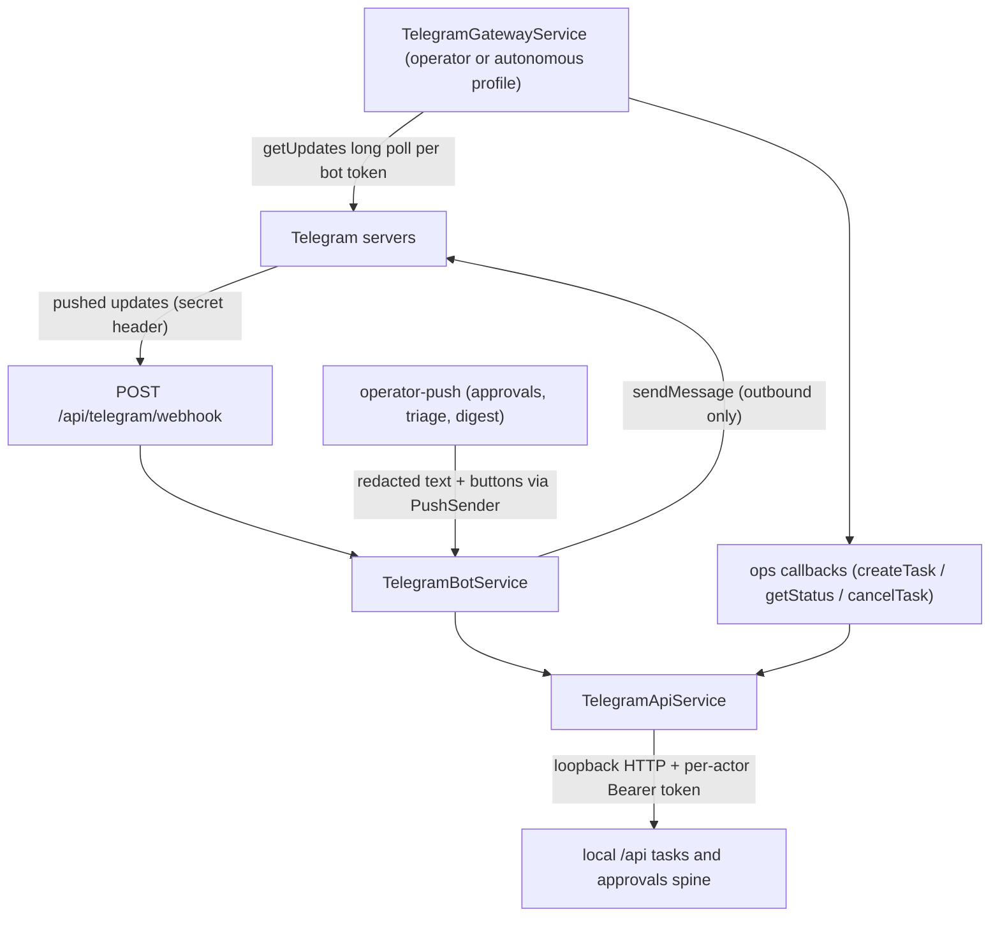

# Telegram Bot Gateway & Webhook Route

Djimitflo exposes **two independent Telegram surfaces** that share configuration
conventions but never share transport code, and the shared rule underneath both:
*Telegram is an authenticated API client, not another task/approval writer* (the
`TelegramApiService` header). Neither surface writes tasks, approvals, or
telemetry directly.

1. **The long-polling gateway** (`packages/telegram`, package
   `@djimitflo/telegram`): a multi-bot grammY long poller started in-process by
   the server in operator-capable runtime profiles, guarded by filesystem
   leases so only one process polls a given bot token.
2. **The webhook route** (`packages/server/src/routes/telegram.ts`): a
   single-bot HTTP webhook mounted at `/api/telegram`, where Telegram pushes
   updates to a public URL (`TELEGRAM_WEBHOOK_URL`) authenticated by a shared
   secret header; it doubles as the operator-push channel (approval alerts,
   one-tap triage, daily digest).

Both surfaces resolve Telegram senders to DjimFlo users through an explicit
allowlist + mapping (there are two distinct mechanisms — env `userMap` for
chat commands, the D3 `telegram_identities` table for buttons), and both reach
the task API exclusively through `TelegramApiService`. Every mutation is a
loopback HTTP call carrying a freshly minted per-actor Bearer token into the
ordinary `/api` task and approval routes, so ownership, audit events, and
separation-of-duties rules apply unchanged (see
[Approval Decision Flow](/openwiki/workflows/approval-decision-flow.md)).

## The polling gateway (`@djimitflo/telegram`)

`TelegramGatewayService` (`packages/telegram/src/index.ts`) is a private
workspace package whose only runtime dependency is grammY; grammY itself is
dynamically imported inside `startAll()`, so merely importing the module loads
nothing. It is constructed with an array of `TelegramBotConfig` entries —
`{token, machineId, agentType, hostIp, name, allowedUsers?, userMap?}` — plus
an `ops` object of three async callbacks: `createTask(prompt, machineId,
actorUserRef)`, `getStatus(machineId, actorUserRef)`, and the optional
`cancelTask(taskId, actorUserRef)`.

### Server wiring

In `packages/server/src/index.ts` (L421–L439) the gateway starts **only when
`operatorRuntime` is true** — i.e. the `operator` or `autonomous` profile,
never the default `api` profile
(`runtimeProfileEnablesOperator`,
`packages/server/src/config/runtime-profile.ts` L13–L15) — and only when
`TELEGRAM_BOTS_CONFIG` is set; otherwise a log line notes the gateway is
disabled. The env value is parsed as a JSON array, each entry's `allowedUsers`
and `userMap` falling back to the `TELEGRAM_ALLOWED_USERS` /
`TELEGRAM_USER_MAP` parsers shared with the webhook route, and
`TelegramGatewayService` is dynamically imported from `@djimitflo/telegram`
and constructed with a `TelegramApiService` pointed at the loopback base
`http://127.0.0.1:${PORT}/api`. The instance is retained (index.ts L210) so
the SIGTERM handler can `stopAll()` it (L499–L501) — without that, a restart
sees `EEXIST` on the lease files and skips polling (see
[Runtime Profiles](/openwiki/architecture/runtime-profiles.md)). Init and
`startAll()` failures are logged and swallowed: a broken Telegram setup never
blocks boot.

### Lease protocol

Each config acquires a per-token lease file before polling:

- The lease path is `<leaseDir>/<sha256(token).hex[0:16]>.lock`, so the raw
  bot token never touches the filesystem. `leaseDir` defaults to
  `DJIMIT_TELEGRAM_LEASE_DIR` or `os.tmpdir()/djimit-telegram-leases`.
- Acquisition uses `fs.openSync(path, 'wx')` — atomic create-or-fail. The
  payload records `machineId`, `name`, a host id (sha256 of `os.hostname()`,
  12 hex chars), pid, and start timestamp.
- A 30-second unref'd heartbeat `utimesSync`s all held leases (armed by
  `startAll()` only once at least one lease is held); the TTL is 2 minutes, so
  a live owner never looks expired while a crashed owner's lease becomes
  reclaimable after at most two minutes.
- On `EEXIST`, takeover is two-tiered: (1) **host-qualified dead-pid probe** —
  if the recorded host matches this host and the recorded pid is dead
  (`process.kill(pid, 0)` → `ESRCH`; `EPERM` still counts as alive), the lease
  is unlinked and re-acquired — cross-host pid probes are meaningless in
  separate pid namespaces, so no pid check runs there; (2) **TTL expiry** — a
  lease whose mtime is older than the TTL is reclaimed regardless of host or
  payload readability, so a truncated lease written by a crashed writer can
  never wedge polling forever. An `ENOENT` between `EEXIST` and `statSync` is
  treated as a release and immediately retried.
- If acquisition still fails, `startAll()` retries with backoff
  (2 s, 5 s, 15 s, 30 s, 60 s) to ride out an overlapping restart, then warns
  and skips that bot.
- Per-bot init failure removes that bot's lease file so one bad token doesn't
  strand a lease; `stopAll()` clears the heartbeat, `Promise.allSettled`s every
  `bot.stop()`, and unlinks all leases.

### Authorization and commands

A grammY middleware runs before every command handler and enforces the
whole contract in one place: the sender id must be present, must be in
`allowedUsers`, **and** must map through `userMap` to a non-blank actor string
— anything else gets '⛔ Telegram user is not authorized and linked to a
DjimFlo account.' and is dropped. The comment at the middleware states the
invariant: *a bot token identifies the transport, never the requesting user.*
Commands are deliberately narrow — `/start`, `/status`, `/task
<beschrijving>`, `/cancel <task_id>` — where `/task` forwards the prompt and
the config's `machineId` to `ops.createTask`, binding the task to that bot's
machine; `/cancel` without a wired `cancelTask` op surfaces
`TASK_CANCELLATION_UNAVAILABLE`. Because a polling bot owns the update stream,
Telegram's 409 "another getUpdates consumer" conflict is handled as
first-class: both `bot.catch` and the `bot.start()` rejection log a warning
and keep the process alive rather than crashing.

## The webhook route (`/api/telegram`)

`createTelegramRoutes(db, auth?, _wsService?, api?)` mounts at `/telegram`
under `/api` with **no mount-level middleware** — the webhook authenticates
itself, and any blanket guard at `/` or `/telegram` would break Telegram's
calls (the mount table deliberately leaves this prefix open
(`routes/index.ts` L206); see
[HTTP/WebSocket API Surface](/openwiki/integrations/exposed-surface.md)). The
mount constructs its own `TelegramApiService` against the loopback base, so
the webhook surface works even when the polling gateway is not running.

### Env parsing and readiness

Three exported pure functions define the configuration contract:

- `parseTelegramAllowedUsers(value)` — comma-separated numeric ids; blanks and
  non-numeric entries are dropped (`Number.isFinite` filter).
- `parseTelegramUserMap(value)` — a JSON object of Telegram-id → user ref.
  Non-object/array JSON and any entry whose key is not an all-digit string or
  whose value is a blank/non-string is discarded; parse failure yields `{}`.
- `telegramConfigStatus(env, configured, db?)` — reports `{configured, ready,
  allowed_user_count, webhook_configured, linked_identity_count,
  approver_identity_count, missing_env, blocking}`. The readiness contract
  changed with TG-2: chat commands are linked by `TELEGRAM_USER_MAP`, but the
  Approve/Deny/Triage **buttons** are authorised only by the D3
  `telegram_identities` table, so `ready` now requires (a) all four of
  `TELEGRAM_BOT_TOKEN`, a non-empty allowed-user list,
  `TELEGRAM_WEBHOOK_URL`, and `TELEGRAM_WEBHOOK_SECRET` (env-side), **and**
  (b) `approverIdentityCount(db)` > 0 — at least one `telegram_identities` row
  whose user is active and whose role holds `approve:task` (a missing table on
  an old schema counts as zero). Without a database handle the approver count
  is `null` and is treated as zero, failing `ready` closed. `missing_env`
  names all five unset vars (including `TELEGRAM_USER_MAP`), while `blocking`
  excludes that var and instead names the missing D3 approver row in prose.
  The report is count-and-name only — token, URL, secret, user refs and raw
  Telegram ids are never in the payload, so the status endpoint cannot leak
  credentials.

On router creation, `TelegramBotService.configure()` runs only when
`TELEGRAM_BOT_TOKEN` is present.

**Push channel wiring.** A configured webhook bot is also registered with
`setPushSender(bot)` and `startOperatorDigest(db)` (routes/telegram.ts
L83–L85), making this bot the canonical outbound channel for operator-push
(`services/operator-push.ts`): per-approval Approve/Deny/Open pushes behind
`TELEGRAM_PUSH_ENABLED`, one-tap triage pushes behind the
`TELEGRAM_PUSH_ENABLED`-gated sub-flag `TELEGRAM_TRIAGE_ENABLED`, and a
15-minute tick serving the daily digest (`OPERATOR_DIGEST_ENABLED`,
`OPERATOR_DIGEST_HOUR`) and durable retry of failed pushes
(`pushPendingApprovals`). Deduplication, per-recipient retry state under a
shared hourly cap (`TELEGRAM_PUSH_MAX_PER_HOUR`), wrapping-midnight quiet
hours (`TELEGRAM_QUIET_HOURS`), and per-day digest logs live in the
`telegram_push_log` / `operator_digest_log` tables; every outbound text is
run through `redactSecrets()` before it leaves the process. A runbook drift
test keeps these flags documented (docs/runbooks). These pushes are exactly
why readiness requires a D3 approver: an unanswered-approval push is only
useful if someone can actually press the button.

### Endpoints

**`POST /api/telegram/webhook`** fails closed at three gates before any body
handling:

1. bot not configured → `503`;
2. `TELEGRAM_WEBHOOK_SECRET` unset → `503` (a public webhook with no secret
   must never process updates);
3. `X-Telegram-Bot-Api-Secret-Token` header ≠ secret → `401`.

Only then is the body passed to `bot.handleWebhook()`, which returns `{ok:
true}` on success and `500` on internal error.

**`GET /api/telegram/status`** requires auth (or passes through when no auth
middleware was supplied, as in tests) and returns `telegramConfigStatus()`.

### `TelegramBotService` behavior

`handleWebhook()` dispatches a `callback_query` payload straight to
`handleCallback()` (button taps, below); for plain messages it validates the
payload shape (safe-integer chat/from ids, string text) and then applies the
three-step identity ladder **before** any command runs:

1. sender id ∈ `allowedUsers`, else '⛔ You are not authorized';
2. sender linked via `userMap` to a user ref resolved at `configure()` time
   against `users.id` *or* `users.email`, else '⛔ Telegram identity is not
   linked to a DjimFlo user';
3. the linked DjimFlo account is still `is_active`, else '⛔ DjimFlo account
   is disabled or no longer linked'.

Commands (`/start`, `/status`, `/loops`, `/agents`, `/dennis`, `/dennis_task`,
`/mission`, `/help`, `/approve`, `/reject`, `/task`, `/cancel`; the
`@botname` suffix is stripped during parsing) split into two kinds:

- **Read-only DB summaries** (`/status`, `/loops`, `/agents`, `/mission`,
  `/dennis`) query SQLite directly — loop/agent/worker counts, Dennis
  readiness snapshot — and cannot mutate anything (loop start/stop is
  explicitly not exposed).
- **Mutations** go through the optional `TelegramApiService`: `/task` posts a
  `local`-mode pending task with machine `telegram-webhook`; `/cancel` calls
  the task cancel route; `/approve` and `/reject` (the latter maps to
  `/approvals/:id/deny`) hit the approval routes, and a
  `SELF_APPROVAL_FORBIDDEN` response is translated to the Dutch 'Je kunt je
  eigen aanvraag niet goedkeuren.' — separation of duties survives Telegram.
  `/dennis_task` additionally permission-checks `create:task`, ensures the
  `dennis-agent` row exists, and creates a `dry_run`-only task pinned to
  Dennis with approval-gated metadata. If no `api` was injected, every
  mutation answers `TELEGRAM_API_UNAVAILABLE`.

### Buttons, callbacks, and triage

Operator-push messages carry inline-keyboard buttons whose `callback_data` is
only a kind + id under Telegram's 64-byte limit (anything longer is left to
the dashboard). `handleCallback()` handles three payload families:

- **Approvals** (`ap:<id>`, `dn:<id>`, `rs:<id>:<reason>`): authorised by
  **both** allowlist membership **and** `mayApproveViaTelegram` — a D3
  `telegram_identities` row whose user is active and whose role holds
  `approve:task`. `dn:` first opens a fixed-reason picker (DENY_REASONS: out
  of scope / too risky / wrong change / not now) and `rs:` applies the deny.
  The decision itself goes through the normal approval API as the mapped
  user, so `SELF_APPROVAL_FORBIDDEN` and every server-side rule still apply;
  an `APPROVAL_ALREADY_PROCESSED` response is re-read from the DB and answered
  with who decided and when.
- **Triage** (`pl:<id>:o|w` D5 pre-screen labels; `mp:<id>` / `mr:<id>` memory
  candidate promote/reject): authorised like approvals but each with the
  permission the corresponding web route demands (`write:governance` for
  labels, `approve:task` for memory), gated at execution time on
  `triageEnabled()`, id-validated before anything runs, and executed through
  the same API routes the `/decisions` page calls — a promote records the
  mapped user as the human approver.
- Anything else (oversized data, malformed payload) is answered `invalid`.

Every allow/deny judgment is written to the `judgments` table under
`telegram_access`, and a failed audit write must never convert a deny into an
allow or crash the gateway. The `telegram_identities` table ships empty and is
maintained by an operator on `/decisions`; viewers on that page see Telegram
ids only, never the email/role behind them (decision-audit-integrity tests).
The D3 table (services/telegram-identity.ts) therefore owns *who is behind a
Telegram message* for buttons: only an explicit row identifies anyone, the
mapped user's RBAC role is the only source of permissions, and chat/group/bot
membership grants nothing.

Outbound delivery is one-way and fire-and-forget: `sendMessage()` POSTs
MarkdownV2 to `api.telegram.org/bot<token>/sendMessage` with a 15 s timeout,
pre-escaping MarkdownV2 metacharacters, and `broadcastAlert()` /
`requestApproval()` / `requestTriage()` fan text out to the allowlist — a
failing recipient does not stop the others, recipients already in
`progress.skip` are not sent again, and `deliverToAll()` throws once at the
end if any recipient failed. Because the request URL embeds the credential,
**all fetch errors are collapsed to `TELEGRAM_DELIVERY_FAILED`** — raw errors
could smuggle the token into logs — and secrets handling here stays aligned
with the secret-patterns service, as verified by the delivery-rejection
tests.

## `TelegramApiService` — the authenticated chain

The constructor enforces `TELEGRAM_API_MUST_BE_LOCAL`: the base URL must be
`http:` on `127.0.0.1`/`localhost`/`[::1]` with no embedded credentials, so a
mapped user's Bearer token can never be forwarded to a remote origin.
`requireActor(ref, permission?)` resolves the actor by id or email, rejects
disabled/unlinked accounts (`AUTH_DISABLED_OR_UNLINKED`), and enforces RBAC
(`FORBIDDEN`). `request()` mints a fresh JWT per call
(`auth.generateToken(user)`) and fetches with `redirect: 'error'` and a 15 s
timeout; non-2xx responses surface the server's error code (empty bodies
parse as `{}`). The `createTask`, `getStatus`, and `cancelTask` fields are
exactly the `ops` shape the polling gateway consumes, so the same chain test
exercises both surfaces.

The net effect, proven end-to-end in `telegram-api-chain.test.ts`: wrong
webhook secret → 401; unknown/unlinked/unpermitted sender → zero tasks; an
allowed `/task` creates a pending task owned by the mapped user with a
`task.created` audit event and WebSocket broadcast; the owner cannot self-
approve; an approver-role user approves and the mock execution completes; a
viewer gets `FORBIDDEN`; only the owner can cancel a running task; a disabled
account stops creating tasks immediately.

## Failure semantics and operational notes

- **Duplicate pollers** are prevented by the lease file, not by Telegram
  409s: a second process (or a restart before SIGTERM cleanup) sees `EEXIST`,
  retries with backoff, then skips that bot with a warning. Reclaim paths are
  same-host dead-pid takeover and 2-minute TTL expiry; the 30 s heartbeat
  keeps a healthy owner fresh.
- **Gateway or webhook misconfiguration never blocks the server.** Missing
  `TELEGRAM_BOTS_CONFIG` logs and continues; gateway init failures warn;
  the webhook 503s until configured; per-bot init failure is contained to
  that bot and cleans up its lease.
- **Restart correctness depends on SIGTERM** calling `stopAll()` (heartbeat
  cleared, bots stopped, leases unlinked) — wired in
  `packages/server/src/index.ts` L499–L501. Without it the next boot must
  wait out retries or the TTL.
- All Telegram variables (`TELEGRAM_BOTS_CONFIG`, `TELEGRAM_BOT_TOKEN`,
  `TELEGRAM_ALLOWED_USERS`, `TELEGRAM_USER_MAP`, `TELEGRAM_WEBHOOK_URL`,
  `TELEGRAM_WEBHOOK_SECRET`, `DJIMIT_TELEGRAM_LEASE_DIR`) are tabulated in the
  [Configuration Reference](/openwiki/operations/configuration-reference.md)
  with defaults and danger ratings. The operator-push delivery knobs
  (`TELEGRAM_PUSH_ENABLED`, `TELEGRAM_PUSH_MAX_PER_HOUR`,
  `TELEGRAM_QUIET_HOURS`, `TELEGRAM_TRIAGE_ENABLED`,
  `TELEGRAM_TRIAGE_MAX_PER_PUSH`, `OPERATOR_DIGEST_ENABLED`,
  `OPERATOR_DIGEST_HOUR`) are documented in the self-improvement operations
  runbook, guarded by the runbook-flags drift test.

## Focused tests

- `packages/telegram/src/index.test.ts` — lease lifecycle in a temp
  `leaseDir`: duplicate-token `EEXIST` skip, same-host dead-pid takeover,
  live-pid non-takeover, TTL-expiry takeover regardless of host, truncated
  lease reclaimed after TTL but not while fresh, heartbeat armed by
  `startHeartbeat()` and cleared by `stopAll()`.
- `packages/telegram/src/transport.test.ts` — real grammY update handling:
  unknown and unlinked senders never reach `ops`; `/task@fixture_bot` and
  `/status` forward `(text, machineId, actor)` exactly.
- `packages/server/src/__tests__/telegram-api-chain.test.ts` — the full
  webhook → loopback API → owned task → independent approval → mock execution
  chain; loopback-only base URL enforcement; Telegram delivery rejections
  surfaced without credentials; secret-gated webhook reachable through the
  full router without making diff/status routes public.
- `packages/server/src/__tests__/public-boundaries.test.ts` — missing
  `TELEGRAM_WEBHOOK_SECRET` fails closed with 503.
- `packages/server/src/__tests__/live-canvas.test.ts` (Telegram section) —
  env parsing, readiness output excludes secrets, disabled-account and
  role-downgrade behavior, Dennis dry-run task creation.
- `packages/server/src/__tests__/tg2-telegram-context.test.ts` — readiness
  stays false until a D3 row maps an active user holding `approve:task`;
  viewer or inactive mappings do not count; pushed approval text carries
  lane/proposal/files/why-risk redacted and ≤ 1000 chars; already-decided
  approvals are not pushed.
- `packages/server/src/__tests__/operator-push.test.ts` — approval pushes off
  by default; dedupe/hourly-cap/quiet-hours; failed deliveries retried only
  to the recipients that missed them; digest once per day at the hour with
  next-tick retry after a failure.
- `packages/server/src/__tests__/telegram-triage.test.ts` — one-tap triage
  refused for unknown/unpermitted senders and while
  `TELEGRAM_TRIAGE_ENABLED` is off; payload validation; labels recorded as
  `operator_label` judgments by the mapped user; memory promote records that
  user as human approver; template-duplicate candidates are never pushed.
- `packages/server/src/__tests__/telegram-identity.test.ts` — D3 table ships
  empty and denies unknown/invalid/inactive ids with a `telegram_access`
  audit each time; `approve:task` is required to approve; a throwing audit
  write keeps the deny.
