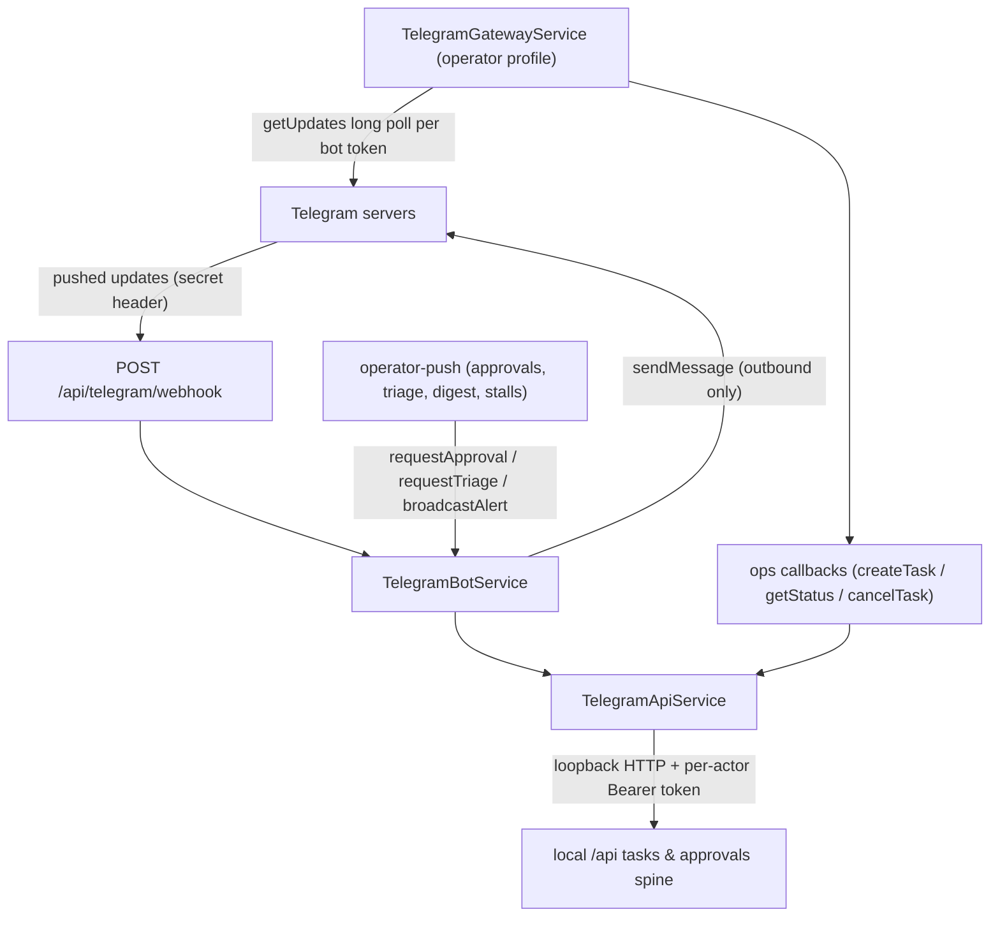

# Telegram Bot Gateway & Webhook Route

Djimitflo exposes **two independent Telegram surfaces** that share configuration
conventions but never share transport code:

1. **The long-polling gateway** (`packages/telegram`, package
   `@djimitflo/telegram`): a multi-bot grammY long poller started in-process by
   the server in operator-capable runtime profiles, guarded by filesystem
   leases so only one process polls a given bot token.
2. **The webhook route** (`packages/server/src/routes/telegram.ts`): a
   single-bot HTTP webhook mounted at `/api/telegram`, where Telegram pushes
   updates to a public URL (`TELEGRAM_WEBHOOK_URL`) authenticated by a shared
   secret header. This webhook bot is also the canonical **push channel**:
   `routes/telegram.ts` registers it as the `PushSender` for the operator-push
   service the moment it is configured.

Both surfaces resolve Telegram senders to DjimFlo users through an explicit
allowlist + user map (chat commands), and reach the task API exclusively
through `TelegramApiService`, whose own header comment states the architecture:
*Telegram is an authenticated API client, not another task/approval writer.*
Neither surface writes tasks, approvals, or telemetry directly — every
mutation is a loopback HTTP call carrying a freshly minted per-actor Bearer
token into the ordinary `/api` task and approval routes, so ownership, audit
events, and separation-of-duties rules apply unchanged (see
[Approval Decision Flow](/openwiki/workflows/approval-decision-flow.md)).

*Both inbound transports converge on the same allowlist gate, and all mutations
flow as authenticated loopback calls; outbound pushes go the other way through
the webhook bot.*

## The polling gateway (`@djimitflo/telegram`)

`TelegramGatewayService` (`packages/telegram/src/index.ts`) is a standalone
workspace package (private, `"type": "module"`, built with `tsc` to
`dist/index.js`, runtime source at `src/index.ts`) whose only runtime
dependency is grammY, dynamically imported inside `startAll()` so merely
importing the module loads nothing. It is constructed with an array of
`TelegramBotConfig` entries — `{token, machineId, agentType, hostIp, name,
allowedUsers?, userMap?}` — plus an `ops` object of three async callbacks:
`createTask(prompt, machineId, actorUserRef)`,
`getStatus(machineId, actorUserRef)`, and the optional `cancelTask(taskId,
actorUserRef)`.

### Server wiring

In `packages/server/src/index.ts` (L413–L431) the gateway starts **only when
`runtimeProfileEnablesOperator()` is true** — i.e. the `operator` or
`autonomous` profile, never the default `api` profile
(`packages/server/src/config/runtime-profile.ts` L13–L15) — and only when
`TELEGRAM_BOTS_CONFIG` is set; otherwise a log line notes the gateway is
disabled. The env value is parsed as a JSON array, each entry's `allowedUsers`
and `userMap` falling back to the `TELEGRAM_ALLOWED_USERS` /
`TELEGRAM_USER_MAP` parsers shared with the webhook route, and
`TelegramGatewayService` is dynamically imported and constructed with a
`TelegramApiService` pointed at the loopback base
`http://127.0.0.1:${PORT}/api`. The instance is retained so the SIGTERM
handler can `stopAll()` it — without that, a restart sees `EEXIST` on the
lease files and skips polling (see
[Server Runtime](/openwiki/architecture/server-runtime.md)). Init and
`startAll()` failures are logged and swallowed: a broken Telegram setup never
blocks boot.

### Lease protocol

Each config acquires a per-token lease file before polling:

- The lease path is `<leaseDir>/<sha256(token).hex[0:16]>.lock`, so the raw
  bot token never touches the filesystem. `leaseDir` defaults to
  `DJIMIT_TELEGRAM_LEASE_DIR` or `os.tmpdir()/djimit-telegram-leases`.
- Acquisition uses `fs.openSync(path, 'wx')` — atomic create-or-fail. The
  payload records `machineId`, `name`, a host id (sha256 of `os.hostname()`,
  12 hex chars), pid, and start timestamp.
- A 30-second unref'd heartbeat `utimesSync`s all held leases; the TTL is 2
  minutes, so a live owner never looks expired while a crashed owner's lease
  becomes reclaimable after at most two minutes.
- On `EEXIST`, takeover is two-tiered: (1) **host-qualified dead-pid probe** —
  if the recorded host matches this host and the recorded pid is dead
  (`process.kill(pid, 0)` → `ESRCH`; `EPERM` still counts as alive), the lease
  is unlinked and re-acquired — cross-host pid probes are meaningless in
  separate pid namespaces, so no pid check runs there; (2) **TTL expiry** — a
  lease whose mtime is older than the TTL is reclaimed regardless of host or
  payload readability, so a truncated lease written by a crashed writer can
  never wedge polling forever. An `ENOENT` between `EEXIST` and `statSync` is
  treated as a release and immediately retried.
- If acquisition still fails, `startAll()` retries with backoff
  (2 s, 5 s, 15 s, 30 s, 60 s) to ride out an overlapping restart, then warns
  and skips that bot.
- Per-bot init failure removes that bot's lease file so one bad token doesn't
  strand a lease; `stopAll()` clears the heartbeat, `Promise.allSettled`s every
  `bot.stop()`, and unlinks all leases.

### Authorization and commands

A grammY middleware runs before every command handler and enforces the
whole contract in one place: the sender id must be present, must be in
`allowedUsers`, **and** must map through `userMap` to a non-blank actor string
— anything else gets '⛔ Telegram user is not authorized and linked to a
DjimFlo account.' and is dropped. The comment at the middleware states the
invariant: *a bot token identifies the transport, never the requesting user.*
Commands are deliberately narrow — `/start`, `/status`, `/task
<beschrijving>`, `/cancel <task_id>` — where `/task` forwards the prompt and
the config's `machineId` to `ops.createTask`, binding the task to that bot's
machine; `/cancel` without a wired `cancelTask` op surfaces
`TASK_CANCELLATION_UNAVAILABLE`. Because a polling bot owns the update stream,
Telegram's 409 "another getUpdates consumer" conflict is handled as
first-class: both `bot.catch` and the `bot.start()` rejection log a warning
and keep the process alive rather than crashing. The gateway does not push:
only the webhook bot delivers outbound operator messages.

## The webhook route (`/api/telegram`)

`createTelegramRoutes(db, auth?, _wsService?, api?)` mounts at `/telegram`
under `/api` with **no mount-level middleware** — the webhook authenticates
itself, and any blanket guard at `/` or `/telegram` would break Telegram's
calls (the mount table deliberately leaves this prefix open; see
[HTTP/WebSocket API Surface](/openwiki/integrations/exposed-surface.md)). The
mount also constructs its own `TelegramApiService` against the loopback base
so the webhook surface works even when the polling gateway is not running.

On router creation, when `TELEGRAM_BOT_TOKEN` is present the router configures
`TelegramBotService` **and** registers it as the operator-push channel:
`setPushSender(bot)` plus `startOperatorDigest(db)`. With no token, neither
happens and every push path stays inert.

### Env parsing and readiness

`TELEGRAM_WEBHOOK_URL` and `TELEGRAM_WEBHOOK_SECRET` hold the public callback
URL and the shared secret Telegram must send in a header; their semantics are
enforced by the endpoint gates below. The remaining contract is defined by
three exported functions plus one D3 readiness probe:

- `parseTelegramAllowedUsers(value)` — comma-separated numeric ids; blanks and
  non-numeric entries are dropped (`Number.isFinite` filter).
- `parseTelegramUserMap(value)` — a JSON object of Telegram-id → user ref.
  Non-object/array JSON and any entry whose key is not an all-digit string or
  whose value is a blank/non-string is discarded; parse failure yields `{}`.
- `telegramConfigStatus(env, configured, db?)` — reports `{configured, ready,
  allowed_user_count, webhook_configured, linked_identity_count,
  approver_identity_count, missing_env, blocking}`. `ready` requires **two
  layers**: the env layer (`TELEGRAM_BOT_TOKEN`, a non-empty allowed-user
  list, `TELEGRAM_WEBHOOK_URL`, `TELEGRAM_WEBHOOK_SECRET`) **and** at least
  one approver identity — a `telegram_identities` row whose active user holds
  `approve:task` (`approverIdentityCount(db)` counts exactly those; no
  database or a missing table on an old schema reads as 0/unknown). The
  `blocking` list explains what is missing: any absent env var except
  `TELEGRAM_USER_MAP`, or "no approver identity — add it on /decisions
  (Telegram identities); TELEGRAM_USER_MAP does not authorise buttons". The
  report is count-and-name only — token, URL, secret, and mapped user refs
  are never included, so the status endpoint cannot leak credentials.

The approver-identity requirement is deliberate (comment tagged TG-2): the
status used to report `ready` from env alone while every Approve/Deny button
press was refused, because buttons are authorised only by the D3 table.

### Endpoints

**`POST /api/telegram/webhook`** fails closed at three gates before any body
handling:

1. bot not configured → `503`;
2. `TELEGRAM_WEBHOOK_SECRET` unset → `503` (a public webhook with no secret
   must never process updates);
3. `X-Telegram-Bot-Api-Secret-Token` header ≠ secret → `401`.

Only then is the body passed to `bot.handleWebhook()`, which returns `{ok:
true}` on success and `500` on internal error.

**`GET /api/telegram/status`** requires auth (or passes through when no auth
middleware was supplied, as in tests) and returns
`telegramConfigStatus(process.env, bot.isConfigured(), db)` — including the
live `approver_identity_count` from the database.

### `TelegramBotService` behavior: chat commands

`handleWebhook()` validates the payload shape (safe-integer chat/from ids,
string text), dispatches `callback_query` updates to the one-tap button
handler, and then applies the three-step identity ladder **before** any chat
command runs:

1. sender id ∈ `allowedUsers`, else '⛔ You are not authorized to use this
   bot.';
2. sender linked via `userMap` to a user ref resolved at `configure()` time
   against `users.id` *or* `users.email`, else '⛔ Telegram identity is not
   linked to a DjimFlo user';
3. the linked DjimFlo account is still `is_active`, else '⛔ DjimFlo account
   is disabled or no longer linked'.

Commands (`/start`, `/status`, `/loops`, `/agents`, `/dennis`, `/dennis_task`,
`/mission`, `/help`, `/approve`, `/reject`, `/task`, `/cancel`; the
`@botname` suffix is stripped during parsing) split into two kinds:

- **Read-only DB summaries** (`/status`, `/loops`, `/agents`, `/mission`,
  `/dennis`) query SQLite directly — loop/agent/worker counts, Dennis
  readiness snapshot — and cannot mutate anything (loop start/stop is
  explicitly not exposed).
- **Mutations** go through the optional `TelegramApiService`: `/task` posts a
  `local`-mode pending task with machine `telegram-webhook`; `/cancel` calls
  the task cancel route; `/approve` and `/reject` (the latter maps to
  `/approvals/:id/deny`) hit the approval routes, and a
  `SELF_APPROVAL_FORBIDDEN` response is translated to the Dutch 'Je kunt je
  eigen aanvraag niet goedkeuren.' — separation of duties survives Telegram.
  `/dennis_task` additionally permission-checks `create:task`, ensures the
  `dennis-agent` row exists, and creates a `dry_run`-only task pinned to
  Dennis with approval-gated metadata. If no `api` was injected, every
  mutation answers `TELEGRAM_API_UNAVAILABLE`.

### One-tap buttons and the D3 identity table

`callback_query` updates take a stricter path than chat commands: the
`TELEGRAM_USER_MAP` link that got the operator into the chat is **not** what
authorizes a button press. `handleCallback()`:

1. rejects oversize or malformed `callback_data` (Telegram's 64-byte limit,
  `CALLBACK_DATA_MAX_BYTES`, enforced before parsing);
2. resolves the sender through `mayApproveViaTelegram(db, telegramUserId)`
  from `services/telegram-identity.ts` — an explicit row in the D3
  `telegram_identities` table (telegram user id → Djimitflo user), the mapped
  user must exist and be `is_active`, and their RBAC role must hold
  `approve:task` — and still requires the sender in `allowedUsers`; anything
  else is refused with '⛔ Not allowed: this Telegram account is not mapped to
  a user who may approve.' and never touches the API. Every decision, allow
  or deny, is audited as a `telegram_access` judgment row whose failure can
  never turn a deny into an allow or crash the gateway.
3. Buttons carry only a kind and an id (`ap:`/`dn:`/`rs:` for approvals,
  `pl:`/`mp:`/`mr:` for triage) — no content — and the action runs through
  `api.request(actor.userId, …)` as the mapped user, so
  `SELF_APPROVAL_FORBIDDEN` and every other server rule still apply. `dn:`
  first asks for a fixed deny reason (Out of scope / Too risky / Wrong change
  / Not now), then `rs:` executes the `/approvals/:id/deny` call. An
  `APPROVAL_ALREADY_PROCESSED` error is answered with who decided and when.

Triage callbacks (`handleTriageCallback`) follow the same pattern with
per-kind permissions: `pl:` (pre-screen labels) requires `write:governance`,
`mp:`/`mr:` (memory review) require `approve:task`; both additionally check
`triageEnabled()` and answer 'Triage via Telegram is switched off
(TELEGRAM_TRIAGE_ENABLED). Use the dashboard.' when off.

The `telegram_identities` table ships empty: the operator adds ids through
`PUT /api/self-improve/telegram-identities/:telegramId` (`manage:config`),
which treats mapping as delegation — the caller may only map to a user whose
role holds no permission the caller lacks (`TELEGRAM_MAPPING_ESCALATION`),
because a mapped Telegram account acts as that user.

### Outbound delivery and the operator push

Outbound delivery is one-way and fire-and-forget: `sendMessage()` POSTs
MarkdownV2 to `api.telegram.org/bot<token>/sendMessage` with a 15 s timeout,
pre-escaping MarkdownV2 metacharacters, and `broadcastAlert()` /
`requestApproval()` fan text out to the allowlist via `deliverToAll` — a
failing recipient does not stop the others, per-recipient progress records who
already received the message, and the loop throws after all attempts if any
recipient failed. Because the request URL embeds the credential, **all fetch
errors are collapsed to `TELEGRAM_DELIVERY_FAILED`** — raw errors could
smuggle the token into logs — and secrets handling here stays aligned with
the secret-patterns service, as verified by the delivery-rejection tests.

`services/operator-push.ts` turns this sender into the operator channel; all
four streams are **off by default** and never throw:

- `pushApproval()` — wired into `ApprovalService.createApproval()`; one
  message per *new pending* approval with Approve / Deny / Open buttons when
  `TELEGRAM_PUSH_ENABLED=true`, after a `TELEGRAM_PUSH_DELAY_MS` delay
  (default 15 s) so an approval a lane rule auto-approves right after
  creation is skipped as `decided`. Dedupe, retry state and per-recipient
  delivery live in the durable `telegram_push_log` table; quiet hours
  (`TELEGRAM_QUIET_HOURS`, UTC `HH-HH`) and an hourly cap
  (`TELEGRAM_PUSH_MAX_PER_HOUR`, default 6) apply.
- `pushStall()` — one informational alert per new stall detected by stall
  watch, same gate/hours/cap counted separately; a stalled push dropped by
  quiet hours or the cap is not retried.
- `pushTriage()` — when `TELEGRAM_TRIAGE_ENABLED=true` (requires the push
  flag), one-tap messages for memory candidates awaiting review (human
  decisions) and unlabelled D5 pre-screen rejections (optional labelling),
  capped by `TELEGRAM_TRIAGE_MAX_PER_PUSH` (default 3) per tick and the
  hourly cap counted apart from approvals.
- `maybeSendDigest()` — when `OPERATOR_DIGEST_ENABLED=true`, one daily digest
  at `OPERATOR_DIGEST_HOUR` (UTC, default 7) with counts and `/decisions`
  links, tracked one row per day in `operator_digest_log` so a failed send is
  retried on a later tick.

All push text is run through `redactSecrets` and trimmed to ids, counts and
short snippets (`≤ 400` chars of memory-candidate content); `pushPendingApprovals()`
retries failed or stale-pending approval deliveries. A shared 15-minute
scheduler tick (`startOperatorDigest`, registered as `operator_digest` and
reported to the scheduler registry) drives digest, triage, and approval
retries, and is armed when any of the three flags is on.

## `TelegramApiService` — the authenticated chain

The constructor enforces `TELEGRAM_API_MUST_BE_LOCAL`: the base URL must be
`http:` on `127.0.0.1`/`localhost`/`[::1]` with no embedded credentials, so a
mapped user's Bearer token can never be forwarded to a remote origin.
`requireActor(ref, permission?)` resolves the actor by id or email, rejects
disabled/unlinked accounts (`AUTH_DISABLED_OR_UNLINKED`), and enforces RBAC
(`FORBIDDEN`). `request()` mints a fresh JWT per call
(`auth.generateToken(user)`) and fetches with `redirect: 'error'` and a 15 s
timeout; non-2xx responses surface the server's error code. The `createTask`,
`getStatus`, and `cancelTask` fields are exactly the `ops` shape the polling
gateway consumes, so the same chain test exercises both surfaces.

The net effect, proven end-to-end in `telegram-api-chain.test.ts`: wrong
webhook secret → 401; unknown/unlinked/unpermitted sender → zero tasks; an
allowed `/task` creates a pending task owned by the mapped user with a
`task.created` audit event and WebSocket broadcast; the owner cannot self-
approve; an approver-role user approves and the mock execution completes; a
viewer gets `FORBIDDEN`; only the owner can cancel a running task; a disabled
account stops creating tasks immediately.

## Failure semantics and operational notes

- **Duplicate pollers** are prevented by the lease file, not by Telegram
  409s: a second process (or a restart before SIGTERM cleanup) sees `EEXIST`,
  retries with backoff, then skips that bot with a warning. Reclaim paths are
  same-host dead-pid takeover and 2-minute TTL expiry; the 30 s heartbeat
  keeps a healthy owner fresh.
- **Gateway or webhook misconfiguration never blocks the server.** Missing
  `TELEGRAM_BOTS_CONFIG` logs and continues; gateway init failures warn;
  the webhook 503s until configured; per-bot init failure is contained to
  that bot and cleans up its lease.
- **Restart correctness depends on SIGTERM** calling `stopAll()` (heartbeat
  cleared, bots stopped, leases unlinked) — wired in
  `packages/server/src/index.ts` L491–L493 inside the graceful-shutdown
  handler. Without it the next boot must wait out retries or the TTL.
- **Env-only Telegram config is necessary but not sufficient for buttons.**
  `TELEGRAM_USER_MAP` gets chat commands working; one-tap approvals and
  triage additionally need a `telegram_identities` row for an active user
  with the right permission, and `GET /api/telegram/status` will say so in
  `blocking` until then.
- All Telegram variables (`TELEGRAM_BOTS_CONFIG`, `TELEGRAM_BOT_TOKEN`,
  `TELEGRAM_ALLOWED_USERS`, `TELEGRAM_USER_MAP`, `TELEGRAM_WEBHOOK_URL`,
  `TELEGRAM_WEBHOOK_SECRET`, `DJIMIT_TELEGRAM_LEASE_DIR`, plus the push/digest
  flags `TELEGRAM_PUSH_ENABLED`, `TELEGRAM_PUSH_MAX_PER_HOUR`,
  `TELEGRAM_PUSH_DELAY_MS`, `TELEGRAM_QUIET_HOURS`, `TELEGRAM_TRIAGE_ENABLED`,
  `TELEGRAM_TRIAGE_MAX_PER_PUSH`, `OPERATOR_DIGEST_ENABLED`,
  `OPERATOR_DIGEST_HOUR`) are tabulated in the
  [Configuration Reference](/openwiki/operations/configuration-reference.md)
  with defaults and danger ratings.

## Focused tests

- `packages/telegram/src/index.test.ts` — lease lifecycle in a temp
  `leaseDir`: duplicate-token `EEXIST` skip, same-host dead-pid takeover,
  live-pid non-takeover, TTL-expiry takeover regardless of host, truncated
  lease reclaimed after TTL but not while fresh, heartbeat armed by
  `startHeartbeat()` and cleared by `stopAll()`.
- `packages/telegram/src/transport.test.ts` — real grammY update handling:
  unknown and unlinked senders never reach `ops`; `/task@fixture_bot` and
  `/status` forward `(text, machineId, actor)` exactly.
- `packages/server/src/__tests__/telegram-api-chain.test.ts` — the full
  webhook → loopback API → owned task → independent approval → mock execution
  chain; loopback-only base URL enforcement; Telegram delivery rejections
  surfaced without credentials; secret-gated webhook reachable through the
  full router without making diff/status routes public.
- `packages/server/src/__tests__/operator-push.test.ts` — push defaults send
  nothing; dedupe/cap/quiet-hours per stream; durable retry and per-recipient
  delivery; one-tap callback authorization (unmapped and viewer-role senders
  refused, mapped approver acts through the API, self-approval refused);
  digest timing and retry.
- `packages/server/src/__tests__/tg2-telegram-context.test.ts` — readiness
  requires a D3 approver identity (`TELEGRAM_USER_MAP` alone is not ready),
  and push messages carry lane/proposal/file/run context, redacted.
- `packages/server/src/__tests__/public-boundaries.test.ts` — missing
  `TELEGRAM_WEBHOOK_SECRET` fails closed with 503.
- `packages/server/src/__tests__/live-canvas.test.ts` (Telegram section) —
  env parsing, readiness output excludes secrets, disabled-account and
  role-downgrade behavior, Dennis dry-run task creation.
