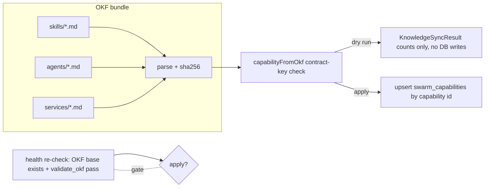

# Knowledge Runtime Operations

The knowledge runtime is the set of services that keep DjimFlo's knowledge
substrate usable and honest. Its center of gravity is
`KnowledgeRuntimeService` (`packages/server/src/services/knowledge-runtime-service.ts`),
the single server-side owner of the durable, human-reviewable **Open Knowledge
Format (OKF)** bundle: it resolves which directory is the canonical OKF base,
runs an operator-managed Python validator against it, projects the markdown
files into the `swarm_capabilities` registry, and reports health and drift.
Around it sit the embedding providers and `VectorMemoryService` (semantic
memory with self-learning re-ranking), the knowledge-gap recorder that turns
loop failures and expert abstentions into gap judgments, the read-only MCP
`okf_*` browsing tools, and the claim bus behind `/api/knowledge`. This page
covers each of those surfaces plus scheduled maintenance. For the learning
closure that *produces* knowledge from completed loops, see the
[learning-closure section](/openwiki/workflows/maker-checker-loop.md#run-completion-draft-pr-hand-off-and-learning-closure)
of the maker–checker workflow and the
[Loop Domain Model](/openwiki/concepts/loop-lifecycle.md); for the MCP server
itself, see [MCP Server Integration](/openwiki/integrations/mcp-server.md).

## OKF bundle layout

An OKF bundle is a directory of six fixed folders
(`OKF_FOLDERS` in the service):

| Folder | Contents | Sync projection |
|--------|----------|-----------------|
| `skills/` | Executable procedure skills (e.g. `packages/knowledge/skills/python-fix.md`) | `skill:<slug>` capability |
| `agents/` | Specialist-agent profiles | `specialist:<slug>` capability + specialist panel profiles |
| `services/` | Service descriptors | `service:<slug>` capability |
| `memory/` | Memory sources | counted only |
| `repos/` | Repo knowledge | counted only |
| `models/` | Model cards | counted only |

Each file is markdown with a `---` frontmatter block; the service parses a small
scalar/list subset (no nested YAML). Every file is hashed with SHA-256 of the
raw bytes; the first 12 hex chars become the projected capability **version**,
so any edit to a skill file is detected as drift. Files named `index.md` are
skipped when enumerating a folder.

## Canonical path resolution and the packages/knowledge guard

`KnowledgeRuntimeService.resolveCanonicalOkfBase()` decides the OKF base:

1. If the `OKF_BASE` env var is set, it is resolved to an absolute path and
   used as-is. Otherwise the base defaults to `<repo-root>/knowledge`
   (`CANONICAL_OKF_PATH`) — the repo-level `knowledge` directory, which on
   developer machines is typically a symlink to an external data bundle (the
   test suite notes it is "absent in CI", and smoke tests are skipped when the
   symlink does not resolve). The health report exposes the symlink target of
   the canonical path when it is one.
2. **Legacy guard:** `packages/knowledge` (`LEGACY_PACKAGES_KNOWLEDGE`) — the
   checked-in seed of skill files — is a legitimate *seed*, but it is *not* the
   canonical runtime base. If the resolved candidate realpath equals the
   `packages/knowledge` realpath, resolution throws
   `KNOWLEDGE_RUNTIME_PACKAGES_KNOWLEDGE_NOT_CANONICAL`.
3. Unless called with `allowMissing` (used by read-only consumers like the
   specialist-profile reader and `OkfKnowledgeUpdater`), a missing candidate
   throws `KNOWLEDGE_RUNTIME_OKF_BASE_MISSING`.

Two additional path rules police the boundary: `isWithinOkfRoot()` realpaths a
candidate and requires it to be at or under the canonical root, and
`validateOkfPath()` throws `KNOWLEDGE_RUNTIME_OKF_PATH_ESCAPE` for anything
outside — so request-supplied paths can never address files outside the bundle.

## The validate_okf gate

Nothing in the server trusts OKF content structurally. Before any sync *apply*,
the bundle must pass an **operator-managed trusted validator**:

- `OKF_VALIDATOR_PATH` may point at an absolute path to a trusted Python
  validator script. A *relative* value is rejected outright (fail status, no
  command executed). If unset, the service falls back to
  `tools/validate_okf.py` in the directory **next to the bundle** (i.e. the
  validator is tooling that lives beside the data; data bundles need not
  carry it).
- If the script does not exist, validation fails with status `fail` and a
  `blocked_reasons` entry — there is no silent downgrade to "skipped".
- The validator runs as `python3 -B <script>` via `execFileSync` (no shell),
  with `OKF_BASE` set to the **realpath of the actual bundle**,
  `PYTHONDONTWRITEBYTECODE=1`, a 10-second timeout, and `SIGKILL` on timeout,
  in a working directory derived from the script's grandparent. A non-zero
  exit, timeout, or spawn error yields `fail` with captured stdout/stderr.
- **Missing or failed validation blocks sync apply** (`syncCapabilities`
  throws `KNOWLEDGE_RUNTIME_OKF_VALIDATION_FAILED` unless it is a dry run —
  and `'skipped'` is not good enough: apply requires an explicit `pass`).
  Dry-run previews remain available so operators can see what a sync *would*
  do while the validator is broken.
- Passing validation means the bundle is structurally accepted by the trusted
  checker; it is **not certification** of the knowledge itself (per the README
  environment-variable contract and the service's own comments, e.g. in
  `bindImprovementEvaluation` where "structural evaluation starts measurement;
  it never implies applied … outcomes, nor promotion or merge authority").

## Capability sync: OKF markdown → `swarm_capabilities`

`syncCapabilities({ dry_run?, apply? })` projects the bundle into the database.
`apply: true` forces a real run; otherwise `dry_run` defaults to true.

*Sync pipeline: all three projected folders are parsed and hashed, every file
becomes a capability row, and only an apply run that passed the validation
gate writes to the registry.*

For each parsed file the service derives a capability row:

- **Identity:** `id` is `skill:<slug>`, `specialist:<slug>`, or
  `service:<slug>`; `kind` maps by folder (`skill` / `specialist_agent` /
  `memory_source`); `version` is the content hash prefix, so upserts are keyed
  on content, not timestamps.
- **Contract keys** — the six frontmatter fields every capability must carry:
  `allowed_actions`, `forbidden_actions`, `required_evidence`, `risk_ceiling`,
  `eval_threshold`, `removal_strategy` (`CONTRACT_KEYS`). Each missing key adds
  a `missing_<key>` entry to the capability's `blocked_reasons`, which is also
  stored in metadata and counted in the sync result.
- **Status discipline:** a file with a complete contract syncs as
  `status: 'validated'` with `eval_score: 0.8`; an incomplete file syncs as
  `status: 'candidate'` with `eval_score: 0.2` and conservative fallbacks
  (`allowed_actions: ['advisory_only']`, `forbidden_actions: ['route_live_workers']`,
  `required_evidence: ['contract_completion_required']`). Incomplete
  capabilities are still registered — they exist, but visibly blocked, with a
  default removal strategy of "Disable capability until OKF contract is
  completed."
- **Normalization:** `risk_ceiling` must be one of `low|medium|high|critical`
  (anything else counts as missing and defaults to `low`); `eval_threshold`
  is clamped to `[0, 1]`, default `0.75`; list fields accept either
  `[a, b]` frontmatter lists or comma-separated strings.
- **Traceability:** metadata records `okf_path`, the full `okf_hash`,
  `okf_folder`, `source: 'okf'`, a `body_excerpt` (first 240 chars), and — when
  present — `agent_skill_id` / `agent_skill_version` /
  `agent_skill_content_hash` / `agent_skill_manifest_hash`, linking the
  capability to an installed runtime skill. `latest_validation_report` points
  back at the file's bundle-relative path.
- **Idempotent upsert:** apply inserts or replaces all columns
  `ON CONFLICT(id)` in `swarm_capabilities`; a second dry run after apply
  reports everything `unchanged` because versions match.

The sync loop reads only `skills`, `agents`, and `services`; `memory`, `repos`,
and `models` folders contribute to health counts but are not projected.

The focused test `knowledge-capability-sync.test.ts` pins this contract: a
dry run creates zero DB rows; apply upserts complete files as `validated` and
incomplete files as `candidate` with the right `blocked_reasons`; a failing
validator leaves the registry empty even when the dry run reported creations.

## Health and drift report

`health()` is read-only (the smoke test asserts the canonical symlink's mtime
does not change) and folds everything an operator needs into one
`KnowledgeRuntimeHealth` payload:

- `okf_base`, `canonical_candidate` (always `<repo-root>/knowledge`),
  `symlink_target`, `exists`.
- `validate_okf`: `status` (`pass | fail | skipped`), the exact `command`
  template executed, and captured `stdout`/`stderr`.
- `counts`: per-folder file counts plus `total`.
- `drift` — the reconciliation between disk and registry:
  - `okf_skill_count` vs `registered_skill_capability_count` (rows with
    `kind = 'skill'` in `swarm_capabilities`);
  - `missing_registry_entries`: OKF skill slugs with no registered capability
    (matched via metadata `okf_path` basename or the `skill:` id prefix);
  - `stale_registry_entries`: registered skills whose stored version no longer
    equals the current file hash prefix;
  - `packages_knowledge_is_canonical`: true when the resolved base realpaths
    to `packages/knowledge` — always a configuration error;
  - `projection_status`: currently reported as `'unknown'` (the
    `'fresh' | 'stale'` grading is reserved).
- `valid`: `exists && validate_okf.status === 'pass' && no blocked reasons`.
- `blocked_reasons` (deduplicated) and action-oriented `next_safe_actions`:

| Condition | blocked_reason | next_safe_actions |
|-----------|----------------|-------------------|
| `OKF_BASE` missing / unresolved | `KNOWLEDGE_RUNTIME_OKF_BASE_MISSING` | Set OKF_BASE or restore repo knowledge symlink |
| Validator missing/failed/relative | `KNOWLEDGE_RUNTIME_OKF_VALIDATION_FAILED` | Fix OKF validation before applying capability sync |
| Resolved base is `packages/knowledge` | `KNOWLEDGE_RUNTIME_PACKAGES_KNOWLEDGE_NOT_CANONICAL` | (fix base, then validate) |
| Registry missing or stale skills | `KNOWLEDGE_RUNTIME_CAPABILITY_SYNC_REQUIRED` | Run capability sync dry-run, then apply after review |
| Healthy, in sync | — | Promote approved memory candidates; reindex projections dry-run |

### HTTP surface

Knowledge routes are decomposed into
`packages/server/src/routes/swarm-knowledge.ts`, mounted inside the swarm
router (tested at `/swarms/...`, under `/api/swarms` in the composed app):

- `GET /knowledge/runtime` (`read:evidence`) — the health payload above.
- `POST /knowledge/sync` (`write:swarm_action`) — `syncCapabilities(body)`;
  dry-run by default, `{ apply: true }` to write.
- `GET /runtime-readiness` (`read:evidence`) — agent-runtime contracts, not OKF.

Service errors are mapped to HTTP codes: missing base → 404, legacy path →
409, validation failure → 422, missing loop id → 400. The platform deep-health
aggregator `GET /health/deep` (`routes/health.ts`) folds the runtime in as the
`knowledgeRuntime` check: `exists === false` or validation not `pass` marks it
`error` (with `validate_okf.stderr` as the message) and flips the overall
response to 503; a passing-but-drifting runtime reports `ok` with the blocked
reasons joined as the message.

A separate router, `createKnowledgeRoutes` in
`packages/server/src/routes/knowledge.ts` (mounted at `/api/knowledge`), fronts
the in-process `KnowledgeBus` for claim traffic between federated DjimFlo
instances and is unrelated to the OKF runtime: `POST /api/knowledge/publish`
(`write:claim`, per-router rate limit) validates and publishes a typed claim
(`capability_gap` claims create candidate capabilities, `help_request` claims
ask for a nested maker spawn), `GET /api/knowledge/subscribe/:capabilityId`
opens an SSE stream of claims (`:capabilityId=all` subscribes to everything),
and `GET /api/knowledge/events` returns the most recent rows from
`swarm_claims` (limit 1–500, default 50).

### Scheduled maintenance

There is no HTTP route that *requires* a sync: `KnowledgeMaintenanceService`
(`packages/server/src/services/knowledge-maintenance-service.ts`) runs plain
scheduled checks when `KNOWLEDGE_MAINTENANCE_ENABLED === 'true'` (default
interval `KNOWLEDGE_MAINTENANCE_INTERVAL_MS` or 15 min, with a ledger keyed on
UTC day/ISO week so restarts never repeat jobs). Its daily `okf_sync_drift`
job runs a **dry-run** `syncCapabilities` and turns `created + updated > 0`
into a labelled work item ("OKF drift: N capability file(s) out of sync with
the registry") for human review; the weekly `okf_lint` job walks the resolved
base flagging empty or frontmatter-less markdown. Findings become work items;
only fixes to knowledge need a maker and human approval.

## Embeddings and vector memory

The server has two embedding layers that share the Ollama defaults but are
distinct code paths:

- **`embedding-provider.ts`** is the env-configured factory used by embedding
  tooling (the `cluster-proposals` script): `createEmbeddingProvider` defaults
  to an `OllamaEmbeddingProvider` (`ollama:<model>`, `EMBEDDING_MODEL` or
  `OLLAMA_EMBED_MODEL` default `nomic-embed-text`,
  `http://127.0.0.1:11434`, 30 s timeout), with an
  `openai-compatible` alternative that *requires* `EMBEDDING_BASE_URL` and
  `EMBEDDING_API_KEY` and throws on any unsupported `EMBEDDING_PROVIDER`.
  Every request is wrapped in `measured(...)` so one model-call-ledger row is
  written per embedding request (the model is recorded, never the input
  text), and every returned vector is validated as a non-empty finite number
  array.
- **`ollama-embedding-provider.ts`** is the default provider injected into
  `VectorMemoryService` (implementing the shared `EmbeddingProvider`
  `name` + `embed` contract): it prefers the newer `/api/embed` endpoint and
  retries once with `/api/embeddings` on a 404, throws
  `EMBEDDING_TEXT_REQUIRED` for blank input and
  `EMBEDDING_PROVIDER_ERROR:<status>` / `EMBEDDING_PROVIDER_INVALID_RESPONSE`
  on failures, and reads its config from `OLLAMA_URL`/`OLLAMA_HOST`,
  `OLLAMA_EMBED_MODEL`, and `EMBEDDING_TIMEOUT_MS` (5 s default here).

`VectorMemoryService` (`packages/server/src/services/vector-memory-service.ts`)
is the provider-backed vector memory. The server wires one instance at boot
(`src/index.ts`) and hands it to `ReasoningBankService`; the apex router
(`routes/apex.ts`) builds another for its HTTP surface — because they are
separate in-memory instances, cross-instance and cross-process staleness is
handled by making the **SQLite row the source of truth**: `getMemory`
re-reads `vector_memories` first and evicts cache entries whose row
disappeared (another instance, the background TTL purge worker, retention),
and `liveEntries()` reconciles the in-memory index against durable rows on
every search, cluster, and stats call so cached memories never outlive their
rows.

Behavior worth knowing operationally:

- **Hybrid search:** `search()` blends dense cosine similarity, a BM25 sparse
  score, and a Thompson-sampling bandit bonus as
  `0.6 * dense + 0.2 * sparse + 0.2 * bandit`, filtered by `minScore`
  (default 0.5). `recordFeedback(memoryId, reward)` is the learning loop:
  rewards ≥ 0.5 grow the bandit's Beta successes, lower rewards grow failures
  (prior 1/1), and every reward row is persisted in `vector_feedback` and
  replayed at boot.
- **Dimension discipline:** embeddings whose length differs from the query
  vector are resampled, unless `VECTOR_STRICT_DIM` makes `vectorStrictDim()`
  true — then mismatched entries are skipped (and the mismatch is counted via
  `dimsMatch`). Rows stored by another provider (or none) are re-embedded by
  the current provider on access (`reindexLegacyMemories`), so switching
  models converges the corpus instead of corrupting it.
- **Bounds and expiry:** content-addressed ids (`mem-<sha12>`), an embedding
  cache of the last 500 texts, a hard cap of 10 000 in-memory entries with
  least-recently-accessed eviction (10% at a time, deleting the durable rows
  too), per-memory TTL enforced at read time, and a background worker that
  deletes rows whose TTL has elapsed.
- **HTTP surface** (`routes/apex.ts`, under `/api/apex`):
  `POST /memory/store` (`write:claim`), `GET /memory/search`,
  `GET /memory/clusters`, and `GET /memory/stats` (all `read:evidence`), with
  a bounded 1–100 limit on search.

## Knowledge gaps from failures and abstentions

`knowledge-gaps.ts` (batch K2) closes a specific leak: before it, recurring
maker failures and resolver abstentions left no trace in the knowledge base.
With `KNOWLEDGE_GAP_MODE=shadow` (default `off` — record-only when on), two
recorders run:

- **Failure recurrence** — the `LoopDaemon` calls `recordFailureGaps(db)` on
  every daemon pass whose run outcome was **not** verified (step 9a''' of run
  completion). Production maker failure signatures (`failureUnits` from
  `intelligence-metrics`) recurring ≥ `MIN_RECURRENCES` (3) times in
  `WINDOW_DAYS` (14) are recorded **once per signature per window** as a
  `knowledge_gap` judgment (signature, lane, gate, error class, up to 20
  changed files, up to 5 example runs). Runs already attributed
  `reviewer_failure` / `environment_failure` by outcome attribution are left
  out of the count.
- **Expert abstention** — `recordAbstentionGap` is called from the expert
  resolution paths (`routes/swarms.ts` and `expert-council-service.ts`) when a
  resolver abstains with reason `no_capability_match`, recording one gap per
  term set per window (signature = sha256 over the sorted question tokens, so
  paraphrases collapse).

Every recorded gap also calls `CapabilityAcquisitionService.emitCapabilityGap`,
which registers a `knowledge-gap:<signature>` **candidate** skill capability;
skill candidates are never auto-promoted, so a gap creates an inventory entry,
never an executable capability. Both recorders are fail-soft (`try/catch` with
a console warn) so gap recording can never break the daemon or a resolution
call. Downstream, `openKnowledgeGaps` feeds only two consumers:
interest-feedback's shadow-mode `gap_trial_candidates` list (gaps may compete
for the gap trial slot under the same yield gate, but their terms are never
published into the profile) and the evolution-evidence `knowledge_gaps`
section via `knowledgeGapEvidence` — which reports status `insufficient` with
nulls (not zeros) while the mode is off.

## Loop outcomes → knowledge: learning closure (retired) and the updater

Loop runs feed the knowledge base along three distinct paths, each with
different trust semantics:

1. **`closeLoop`** (`POST .../evolution/close-loop`, `write:governance`, in
   `swarm-governance.ts`) revalidates the run's terminal status, completed
   maker/checker/security-checker leases with accepted review evidence, gates
   (at least one pass, none failed), and trace/checkpoint/manifest evidence
   counts — on any shortfall it returns a `blocked` closure enumerating
   `blocked_reasons` and writes nothing. **New closures are retired** (batch
   M1, code comment "the loop-learning closure is retired"): passing
   revalidation with no prior record now returns
   `['loop_learning_closure_retired']`, so no new eval/reflection/memory
   candidate is written. Stored closures are still replayed — revalidated on
   every call so cancelled or evidence-losing runs flip back to `blocked` —
   and are re-bound to `verified` self-improvement records as structural
   evaluation evidence (status moves to `evaluating`; the comments are
   explicit that this never implies applied outcomes or promotion/merge
   authority).
2. **`recordFailureGaps`** (previous section) is the failure path: unverified
   runs become knowledge gaps, independent of gate status.
3. **`OkfKnowledgeUpdater`** (`packages/server/src/services/okf-knowledge-updater.ts`)
   is the success-side write path: after a swarm judge verdict that is neither
   `contradicted` nor `unverifiable`, it creates or appends to
   `concepts/<slug>.md` under the canonical base (resolved with
   `allowMissing`) and logs the action in an `okf_knowledge_updates` ledger
   table. Any failure returns `false` silently — concept authoring never
   blocks the pipeline.

Adjacent consumer: **`readOkfSpecialistProfiles()`** projects `agents/` files
with the stricter profile contract (`profile_id`, `required_evidence`,
`forbidden_claims`, `output_schema` all present) into specialist-panel
profiles.

## MCP `okf_*` tools

Separately from the server runtime, `packages/mcp-server/src/tools/okf.ts`
registers five **read-only** tools for file-based knowledge-graph traversal
inside MCP clients. `registerOkfTools` is imported from `./tools/okf.js` and
mounted on the raw `server` in the single `registerTools` registrar —
the second `register-tools.ts` registrar no longer exists, and because the
tools read no database they are registered *unlabelled* (no
`data_as_of`/`is_production` stamp, unlike the DB-backed families wrapped by
`labelDbTools`):

- `okf_search` — keyword search over title/content/type with an optional type
  filter (`Agent, Service, Skill, Model, Repo, Concept, Memory, Run`),
  limit ≤ 50.
- `okf_get` — fetch one concept by bundle-relative path, with parsed
  frontmatter and `[[wiki-style]]` links. `resolveOkfConceptPath` rejects
  absolute paths, `..` escapes, and symlinks that resolve outside the base.
- `okf_related` — BFS traversal of `[[...]]` markdown links up to depth 3
  (per-call, capped 1–3).
- `okf_validate` — standalone conformance check: required frontmatter fields
  (`type, title, description, timestamp, tags`) and broken-link detection;
  reports `PASS`/`FAIL`. This is independent of the server-side
  `validate_okf` gate.
- `okf_status` — file counts, frontmatter coverage, link totals.

**Path resolution differs from the server.** The MCP `resolveOkfBase()` honours
`OKF_BASE`, then tries a sibling `djimitflo-knowledge/okf/` directory relative
to the compiled module or `cwd`, and throws if no candidate exists — it has no
`packages/knowledge` legacy guard and never runs Python validation. Treat the
MCP tools as a read-only browsing surface over whatever bundle they resolve
to; the governance-bearing operations (sync apply, health gating) live only in
the server. Note also their loader walks the *entire* bundle tree (skipping
only `FRONTMATTER_AUDIT.md`), whereas the server enumerates only the six known
folders.

## Operator checklist

1. Point `OKF_BASE` at the actual bundle (or restore the repo-root `knowledge`
   symlink). Never repoint it at `packages/knowledge` — the runtime refuses it
   by design, and `packages_knowledge_is_canonical` in the drift report makes
   the misconfiguration visible.
2. Ensure a trusted `validate_okf.py` sits beside the bundle in `tools/`, or
   set `OKF_VALIDATOR_PATH` to an **absolute** path. Plan for absence: with no
   validator, health reports `fail` and apply syncs are blocked until fixed.
3. `POST /knowledge/sync` with default (dry-run) body; review
   `created/updated/blocked`; apply with `{ apply: true }`. A healthy steady
   state is `blocked: 0` and empty `missing_registry_entries`.
4. Watch `GET /knowledge/runtime` (or `/health/deep`'s `knowledgeRuntime`
   check) for `KNOWLEDGE_RUNTIME_CAPABILITY_SYNC_REQUIRED` and the
   maintenance work items from `okf_sync_drift` / `okf_lint`.
5. If you want failures to teach the system, set `KNOWLEDGE_GAP_MODE=shadow`
   and watch the evolution-evidence `knowledge_gaps` section and the
   `knowledge-gap:*` candidate capabilities; nothing is recorded in default
   `off` mode.
6. For semantic memory, keep the Ollama embedding model warm (default
   `nomic-embed-text`); switching providers re-embeds legacy rows lazily on
   access rather than in a migration.
7. Remember: validator pass = structural acceptance only. Certification of the
   knowledge a capability grants comes from evals, checker evidence, and
   governance — not from sync succeeding.
