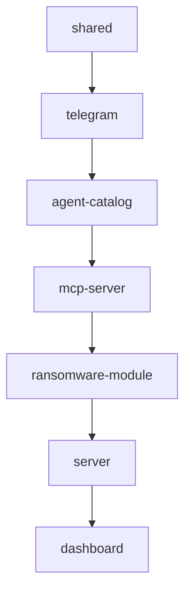

# Local Development, Build & Test Commands

DjimFlo is an npm-workspaces TypeScript monorepo (`packages/*`) with an
Express + SQLite backend, a React + Vite dashboard, and satellite packages
(MCP server, Telegram gateway, agent catalog, ransomware module). This page is
the runbook for getting a working local checkout, running and testing it, and
operating the container build.

## Prerequisites

| Requirement | Version | Notes |
|-------------|---------|-------|
| Node.js | `>=22.0.0 <25.0.0` | Enforced via root `engines`; the Dockerfile's default base image is `node:22-bookworm-slim` |
| npm | `>=9.0.0` | Enforced via root `engines` |
| Python 3 + `make` + `g++` | any recent | Required when `better-sqlite3` has no prebuilt binary and must compile its native addon during `npm ci` |
| bash | any recent | Required to run the root `npm test` pipeline's shell selftests even for Node-only changes |
| git + node (test fakes stub the network) | any recent | Several script selftests shell out to git and stub `docker`/`ssh`/`curl` on a throwaway `PATH` |
| Docker | any recent | Only needed for sandboxed execution and the container workflow |

`.npmrc` sets `legacy-peer-deps=true`, so installs already account for legacy
peer-dependency behavior.

```bash
git clone <repo>
cd djimitflo
npm install
```

`npm install` at the root installs all workspace dependencies in one pass.

## Repository Layout

```
packages/
├── shared/             # Shared types, roles, auth (built first)
├── server/             # Express + better-sqlite3 backend (main package)
├── dashboard/          # React 19 + Vite 8 + Tailwind CSS 4 frontend
├── mcp-server/         # MCP server (stdio + HTTP transports)
├── telegram/           # Telegram bot gateway (grammy)
├── agent-catalog/      # Agent profile import/normalize/compile
├── ransomware-module/  # Anti-ransomware detection module
└── knowledge/          # Knowledge storage (runtime-generated, not an npm workspace target of build/test)
```

## Running in Development

```bash
npm run dev            # server + dashboard in parallel (npm-run-all --parallel)
npm run dev:server     # backend only
npm run dev:dashboard  # frontend only
```

- `dev:server` runs `tsx watch src/index.ts` in `@djimitflo/server`, so the
  backend restarts on file changes. Dev defaults: `HOST=localhost`,
  `PORT=3001`, CORS origin `http://localhost:5173`.
- `dev:dashboard` runs `vite` on port `5173` and proxies `/api` (HTTP) and
  `/ws` (WebSocket) to `http://localhost:3001`, so the dashboard works against
  the local backend without extra config.

Server configuration lives in `packages/server/.env.example` (copy to `.env`
and adjust). Key dev-time variables: `DB_PATH` (defaults to
`<repo>/.data/djimitflo.sqlite`, resolved by `resolveDbPath`),
`JWT_SECRET` (dev falls back to a built-in secret with a warning; production
refuses to start without it), `AUTH_BOOTSTRAP_ADMIN_EMAIL` /
`AUTH_BOOTSTRAP_ADMIN_PASSWORD` (first-run admin bootstrap, only when the
users table is empty), and `DJIMITFLO_RUNTIME_PROFILE` (`api` default;
`operator` and `autonomous` additionally enable maintenance loops, the loop
daemon, and self-modification services).

## Building

```bash
npm run build          # full monorepo build in dependency order
npm run build:server   # @djimitflo/server only
npm run build:dashboard
npm run clean          # remove dist, node_modules, and stray compiled files
```

The root `build` script is an explicit `&&` chain, not a topological auto-order:
`shared → telegram → agent-catalog → mcp-server → ransomware-module → server →
dashboard`. Any step failing aborts the rest. The build order matters because
downstream packages compile against the `dist/` of their workspace
dependencies — workspace packages are consumed through their built entrypoints
(e.g. `@djimitflo/shared` exports `./dist/index.js` and its type declarations;
the only exception is the dashboard's Vite config, which aliases
`@djimitflo/shared` to the shared package's `src/`).



*Root `npm run build` workspace order (explicit chained script in the root `package.json`).*

For production serving, `npm run start --workspace=@djimitflo/server` (alias
`npm run build:server` then run) executes `node dist/index.js`; the server then
serves the built dashboard from `DASHBOARD_PATH` instead of the Vite dev
server.

## Testing

```bash
npm run test                # full pipeline, see below
npm run test:changed        # build shared+agent-catalog, then --changed vitest across five workspaces
npm run test:mutation           # Stryker mutation run over curated critical spans
npm run test:mutation:grounded  # mutation-gain check for one file/test pair (env-driven)
npm run test --workspace=@djimitflo/server -- <file>   # single server test file
npx vitest run              # inside any one workspace: that workspace's suite
```

The root `npm run test` is much broader than "run vitest everywhere". Its exact
pipeline, in chained-`&&` order, is a battery of script-level selftests, then
prerequisite builds, then workspace vitest:

1. `bash scripts/deploy-vps.selftest.sh` — pure-function checks of the VPS
   deployer (`scripts/deploy-vps.sh`) against fixture compose files: the
   compose rewrite must swap image/commit/mounts to the new commit, refuse
   no-op rewrites, `chown` before recreate, and keep a rollback path.
2. `bash scripts/wiki-delta-emitter.selftest.sh` — throwaway-git-repo check
   that the wiki delta emitter baselines on first run, stays silent when
   unchanged, honors `--dry-run`, and publishes one `wiki.page.changed` event
   listing only changed `.md` pages.
3. `node scripts/live-identity-evidence.test.mjs` — identity/provenance
   verification logic used by `assurance:live` (commit, instance ID, loopback
   vs configured database identity).
4. `node scripts/integration-probes.test.mjs` — stubbed-`fetch` tests of the
   external integration probes (e.g. Context7 MCP discovery
   contract/version checks).
5. `node scripts/gen-agent-docs.mjs --check` then `node scripts/gen-agent-docs.test.mjs`
   — `--check` verifies the generated workspace files (`TOOLS.md`,
   `HEARTBEAT.md`, `config-defaults.generated.ts`) are not stale (exits 1 on
   drift or a line-budget breach); the `.test.mjs` suite unit-tests the parsers
   and renderers (EVOLUTION_FLAGS, runbook default tables, noteScheduler
   schedulers) with static parsing only.
6. `node scripts/gym-worker.mjs --selfcheck`, `node scripts/gym-worker.test.mjs`,
   and `node scripts/gym-worker-research.test.mjs` — the gym worker's
   selfcheck plus runner/git-safety tests (`docker` replaced by a fake on
   `PATH`) and the WEB_RESEARCH job tests (search, model and Djimitflo API
   injected as fakes; no network).
7. `node scripts/kb-sync.test.mjs` — kb-sync against a fake Djimitflo server
   (a page reported `pending` is re-sent, bounded per run).
8. `node scripts/mutation-gain.test.mjs` — OPS-001: mutation-gain fails closed
   when the baseline cannot be measured (a fake `npx stryker run` writes the
   report or fails per run, in a throwaway git repo).
9. `node scripts/skills/oracle-gate.test.mjs` and
   `node scripts/skills/oracle-gate-replay.test.mjs` — the skill-lane
   `oracle-gate` (runs a goal's declared acceptance command plus the daemon's
   deterministic checks, prints one `ORACLE_GATE` verdict line) and its replay.
10. `node scripts/ci-workflows.test.mjs` — release-enforcement lint over
    `.github/workflows`: a required check must come from a job that cannot be
    `skipped` (skipped counts as passed for branch protection) and must test
    the exact PR head commit.
11. `node scripts/host-scripts-dry-run.test.mjs` — dry-run-by-default guard for
    host-mutating shell scripts: every such script defaults to a dry run,
    acts only on explicit `--apply`, and exits non-zero on an unknown flag
    (runs each script in a sandbox with ssh/git/gh/docker/curl stubbed).
12. `node scripts/benchmark-run.test.mjs` — the benchmark runner reproduces the
    image ENTRYPOINT (relative `./docker-entrypoint.sh`) and `DJIMITFLO_BUILD_SHA`
    handling so `docker run -w /tmp` does not fail to start.
13. `npm run build --workspace=@djimitflo/shared && npm run build --workspace=@djimitflo/agent-catalog`
    — prerequisites compiled before workspace tests run.
    `tsx`-executed server code is type-stripped at runtime, so these built
    `dist/` outputs are what the test imports actually resolve.
14. `npm run test --workspaces --if-present` — vitest per workspace.
15. `npm run test:skill-packages` — `node --test skills/*/*.test.mjs`, the skill
    packages' own suite.

Vitest configuration: the root `vitest.config.mts` selects the `jsdom`
environment with no setup files (tests stub `localStorage`/`fetch`
themselves); the dashboard's `vite.config.ts` also sets `jsdom` + `globals`.
Dashboard and shared use `vitest run --passWithNoTests`.

### Mutation testing

Two Stryker lanes complement the unit suites:

- `npm run test:mutation` runs `stryker run` against `stryker.config.js`: a
  curated set of critical code spans (approval-service decision guards,
  tool-broker, docker-sandbox-executor abort handling, runtime-governance
  baseline-score bounds and no-write validation boundary) mutated with
  `StringLiteral`/`ObjectLiteral` excluded, executed through the vitest runner
  with `vitest.mutation.config.ts` (a node-environment config limited to six
  named server test files) and score thresholds `high: 85, low: 75, break: 70`.
- `npm run test:mutation:grounded` runs `scripts/mutation-gain.mjs`, the "does
  my new test actually kill more mutants" lane. It requires two env vars:
  `MUTATE_FILE` (source file to mutate) and `MUTATE_TEST` (the test file under
  evaluation). It runs Stryker twice via `stryker.service.config.mjs` — once
  against the committed `HEAD:` version of the test (written to a temporary
  `.mutation-baseline.test.ts`), once against the working-tree test — computes
  each mutation score, and passes (exit 0) when `after ≥ before +
  MUTATE_MIN_GAIN` (default 10 points) or `after ≥ 90`. With either env var
  unset it prints `mutation-gain: skipped` and exits 0 so hosts can list it in
  loop-daemon check scripts unconditionally. It also **fails closed** (OPS-001):
  an unreadable `HEAD`, a baseline Stryker run that errors or produces no valid
  mutants, or a failed working-tree run are never reported as a 0 score — only a
  test file genuinely absent at `HEAD` starts from 0; every outcome prints one
  JSON line with a `status` and a null score when unknown.
  - `stryker.service.config.mjs` mutates exactly `MUTATE_FILE`, reports JSON
    to `MUTATE_REPORT` (default a tmpdir file), and points the vitest runner
    at `vitest.service-mutation.config.ts` — a node-environment config whose
    `include` is solely `[process.env.MUTATE_TEST]`, so only the test file
    under scrutiny runs against the mutants (30s timeout).

### Type-check and lint

```bash
npm run type-check
npm run lint
```

- `type-check` first builds `shared`, `agent-catalog`, `mcp-server`, and
  `ransomware-module` (their `dist/*.d.ts` are the type resolution targets for
  downstream workspaces), then runs `type-check` (usually `tsc --noEmit`)
  across all workspaces with `--if-present`.
- `lint` runs `eslint .` per workspace with `--if-present`.

Both follow the CONTRIBUTING gate: `npm run type-check && npm run lint && npm
test` must be clean before a PR.

## Database: Migrate & Seed

Both run through `tsx` against the live TypeScript sources — no build step
needed, but `@djimitflo/shared` types are imported by the seed script, so run a
build (or at least `npm run build --workspace=@djimitflo/shared`) first in a
fresh checkout.

```bash
npm run db:migrate --workspace=@djimitflo/server   # tsx src/database/migrate.ts
npm run db:seed --workspace=@djimitflo/server      # tsx src/database/seed.ts
```

- `db:migrate` executes `runMigrations` directly against
  `resolveDbPath()` (`DB_PATH`, else `DJIMITFLO_DB`, else
  `<repo>/.data/djimitflo.sqlite`). Migrations are additive
  `CREATE TABLE IF NOT EXISTS` / column-add operations plus MCP-server seeding,
  safe to re-run. The migrate module only self-executes when it is the direct
  entry point (`require.main === module` **and** `argv[1]` matches
  `migrate.[cm]?[jt]s`): a bundled operator script (where every module is
  `require.main`, e.g. a holdout-freeze dry run) must never migrate the
  `DB_PATH` database as a side effect. Normal server startup calls
  `initializeDatabase()` which applies the same schema — the script exists for
  standing up a database without booting the API.
- `db:seed` populates the empty database with mock agents (CodeReviewer,
  TestRunner, DeploymentBot, …) and related rows for local UI/API testing.

Neither command is required before `npm run dev` in the default profile: the
server initializes the schema on boot and the bootstrap admin covers login.

## Docker Operation

The `Dockerfile` is a two-stage build whose base image is an overridable `ARG
NODE_IMAGE=node:22-bookworm-slim`: `scripts/deploy-vps.sh` passes the digest it
resolved this tag to (`node@sha256:…`) so the deploy build uses exactly the
base its receipt records, while a plain `docker build` (CI) uses the tag. Both
stages first pin apt resilience (`Acquire::Retries`, bounded HTTP/HTTPS
timeouts, `ForceIPv4`) because the Debian mirror previously stalled forever mid
build.

- **Builder** (`${NODE_IMAGE} AS builder`): installs `python3`/`make`/`g++` so
  `better-sqlite3` can compile its native addon when no prebuilt binary exists,
  copies all package manifests first for layer caching, runs `npm ci`
  (strictly from `package-lock.json`, so the lockfile hash in the build receipt
  describes what was built and an out-of-sync lock fails the build), copies
  sources, then runs the same `npm run build` chain used locally.
- **Runner** (`${NODE_IMAGE} AS runner`): upgrades the base image and installs
  exactly `ca-certificates git python3-minimal curl procps libatomic1` via apt.
  It then pins and installs the `gh` CLI as a static `.deb` from the GitHub CLI
  release (`ARG GH_CLI_VERSION=2.102.1`, downloaded per
  `dpkg --print-architecture`, verified with `gh --version`) — the server's own
  PR-review service shells out to it for PR comments and Check Runs
  (`GithubPrReviewService`). Next it installs the Atomic Agent gym-maker
  runtime as a version+sha256-pinned release tarball (`ARG
  ATOMIC_AGENT_VERSION=0.6.5` with per-arch sha256, `sha256sum -c` verified,
  symlinked to `/usr/local/bin/atomic-agent`, probed with `atomic-agent
  --version`). It pins the global agent-cli runtimes to keep the production
  worker surface equal to what `/swarms/runtime-readiness` accepts:
  `npm install --global @openai/codex@0.146.0 opencode-ai@1.18.10
  @anthropic-ai/claude-code@2.1.282`, immediately probed with `git --version &&
  codex --version && opencode --version && claude --version` so a missing or
  broken runtime fails the image build. It creates the non-root runtime
  identity (`groupadd -g 1001 djimitflo` / `useradd -u 1001 -g djimitflo -m -s
  /bin/bash djimitflo`) and `mkdir -p /data && chown djimitflo:djimitflo /data`.
  Only then come the dependency layers: production-only `npm ci --omit=dev`,
  with the compiled `better-sqlite3` smoke-tested via an in-memory open before
  the build toolchain (`make`/`g++`) is purged; npm itself is pinned to
  12.0.2 with targeted dependency patches (brace-expansion, ip-address, tar,
  undici) copied into its global tree. Built artifacts are copied from the
  builder stage along with the runtime-read content the server resolves
  relative to `dist/` (agent-catalog schema, `specs/`, `openspec/changes`, the
  explainer corpus, the negative-evidence registry, usage-plan limits, and the
  finding-fix gate plus its pinned ESLint toolchain at `/opt/finding-fix-eslint`
  via `FINDING_FIX_ESLINT_FROM`). A reserved `maker` uid/gid 1002 (no home, no
  shell, not in the djimitflo group) is created for maker-UID separation before
  the heavy layers that would otherwise bust the cache. Build provenance is
  baked as env vars from the `VCS_REF`/`BUILD_TIME`/`BUILD_SOURCE` build args
  (`DJIMITFLO_COMMIT_SHA`, `DJIMITFLO_BUILD_COMMIT`, `DJIMITFLO_BUILD_SHA`,
  `DJIMITFLO_BUILD_TIME`, `DJIMITFLO_BUILD_SOURCE`) plus the lockfile hash
  (`DJIMITFLO_BUILD_LOCK_SHA256` from `LOCKFILE_SHA256`) and the base image
  reference (`DJIMITFLO_BUILD_BASE_IMAGE` from `NODE_IMAGE`), declared *after*
  the expensive layers so a per-build arg does not invalidate their cache, and
  so `/health` reports the built revision rather than a mutable runtime env.
  The image ends with `EXPOSE 3001`, a `/health` healthcheck, `USER djimitflo`,
  `VOLUME /data`, `ENTRYPOINT ["./docker-entrypoint.sh"]`, `CMD ["node",
  "packages/server/dist/index.js"]`.

`docker-entrypoint.sh` behavior: prints version/port/host/db/dashboard info,
creates `/data` and `${BACKUP_DIR:-/data/backups}` if missing, hard-fails when
`NODE_ENV=production` and `JWT_SECRET` is unset, then `exec "$@"` (the
`CMD`, replacing the shell with the node process so signals reach it).

```bash
cp .env.docker.example .env.docker    # edit: JWT_SECRET, bootstrap admin, CORS, event bus
docker compose up -d --build
```

`docker-compose.yml` declares a single `djimitflo` service: builds from
`Dockerfile`, publishes `${DJIMITFLO_HOST_PORT:-3001}:3001`, loads env from
`.env.docker`, mounts the named volume `djimitflo-data` at `/data` (SQLite
database at `/data/djimitflo.sqlite`, backups at `/data/backups`), restarts
unless stopped, and healthchecks `http://localhost:3001/health` every 30s with
a 10s start period. Without compose:

```bash
docker build -t djimitflo:latest .
docker run -p 3001:3001 -v djimitflo-data:/data djimitflo:latest
```

The `/data` volume is the persistence contract: the database, backups, and the
knowledge directories created at image build survive container replacement
only because they live on the volume (or under `/app/packages/knowledge`,
which the image pre-creates and chowns to the non-root user).

### Configuration template

`.env.docker.example` is the container config template. Beyond
the dev variables it adds container-specific values: `DB_PATH=/data/djimitflo.sqlite`,
`DASHBOARD_PATH=/app/packages/dashboard/dist`, `BACKUP_DIR=/data/backups`,
`DJIMITFLO_HOST_PORT`, EventBus ingest (`DJIMIT_EVENT_BUS_URL`,
`DJIMIT_EVENT_STREAM`), and a mandatory `JWT_SECRET` (the entrypoint enforces
it in production). Its OpenCode section predates the pinned global
`opencode-ai` install in the current Dockerfile (the binary is now on `PATH`
in the image); `OPENCODE_BIN_PATH` and the other `OPENCODE_*` tunables still
work as overrides for either a mounted binary or a non-default executor
configuration.

## Failure Modes & Gotchas

- **Wrong Node version** — `engines` rejects anything outside 22–24 at install
  time (and `better-sqlite3` prebuilds are pinned to the image's Node 22 ABI in
  Docker).
- **Missing native toolchain** — `npm ci`/`npm install` fails on
  `better-sqlite3` compilation without `python3`/`make`/`g++`; the Dockerfile
  installs and then purges them for exactly this reason.
- **Stale `dist/` in watch mode / tests** — `tsx watch` type-strips at runtime,
  so edits to `@djimitflo/shared` do not propagate to the server's imports
  until `shared` is rebuilt; root `test` and `type-check` rebuild the
  prerequisite packages themselves for this reason.
- **Production container without `JWT_SECRET`** — `docker-entrypoint.sh`
  exits 1 before node starts.
- **Root `npm run test` requires bash, git, and node** even for pure Node work,
  because the shell selftests and the script-level `.test.mjs` battery run
  before any vitest suite (most stub the network/`docker` on a fake `PATH`, but
  they still shell out to `git` and `node`).
- **`test:mutation:grounded` without env vars is a silent no-op** — it must be
  invoked with both `MUTATE_FILE` and `MUTATE_TEST` set (or via a loop-daemon
  check harness that sets them), otherwise it prints
  `mutation-gain: skipped` and exits 0.
