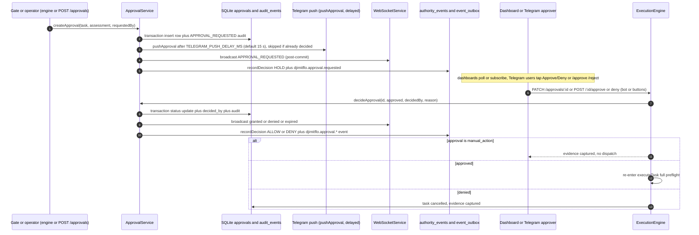

# Approval Request & Decision Flow

An approval is a durable row in the `approvals` table (schema in
packages/server/src/database/schema.ts) that moves through exactly one
lifecycle: `pending` → `approved` | `denied` | `expired` (`ApprovalStatus` in
packages/shared/src/types/common.ts#L80-L86). `ApprovalService`
(packages/server/src/services/approval-service.ts) owns that table and every
transition; routes, the dashboard, and Telegram are just three operator surfaces
that read the rows and call `ExecutionEngine.handleApprovalDecision()`. The
pipeline context that *creates* most requests is documented in
[Governance Pipeline](/openwiki/concepts/governance-pipeline.md); this page
covers the request → decide → record chain that operators see.

## Where requests come from

A request enters the table through `createApproval()` from three directions:

1. **Execution gates** — `ExecutionEngine.executeTask()` hits a
   `require_approval` policy verdict, calls `createApproval()` with the risk
   assessment, policy id, and an `executionInputHash` in metadata, then moves
   the task to `awaiting_approval` and broadcasts
   `EXECUTION_PAUSED_FOR_APPROVAL` (execution-engine.ts L389-L425). These
   approvals authorize resuming a paused dispatch.
2. **Manual action reviews** — `POST /api/approvals` (mounted with
   `requireAuth` at packages/server/src/routes/index.ts#L144, handled in
   routes/approvals.ts L36-L62) lets an operator with `create:task` attach a
   human-review request to an existing task they can modify. These carry
   `metadata.manual_action: true` and **never gate execution**: a decision only
   records evidence (execution-engine.ts L884-L893) and cannot dispatch a task.
3. **Other services** — the Dennis agent calls the same `createApproval()` for
   its gated dry-run proposals (dennis-agent-service.ts L590), and autonomy lane
   rules decide approvals with `autonomy:*` decider labels.

Every request gets an `expires_at` of `now + approvalTtlMs()` — 1 hour by
default, configurable via `APPROVAL_TTL_MS` and clamped to 5 minutes … 7 days
(approval-service.ts L24-L32, pinned by approval-ttl.test.ts) — and a
`requested_by` maker: `input.requestedBy`, else the task's
`owner_user_id`/`created_by`, else `'system'` (L123). For loop-worker tasks the
creation also folds a `loopApprovalLink()` into the approval's metadata —
`loop_run_id`, `lease_id`, `goal_id`, `improvement_id` derived from the task
metadata and the `loop_runs`/`goals` tables, with caller metadata winning — so
the approval → goal → outcome join survives the task row being pruned
(L39-L50, L122; approval-goal-link.test.ts L34-L45).

## Creation is transactional; decisions are atomic

`createApproval()` runs the row insert **and** its canonical `APPROVAL_REQUESTED`
audit record inside one `db.transaction().immediate()` (L95-L142); if the audit
insert fails, the approval rolls back with it. Only after the commit does it
schedule the Telegram push, broadcast `APPROVAL_REQUESTED` over the WebSocket,
and call `recordDecision()` with a `HOLD` verdict (L143-L153).

`decideApproval(id, approved, decidedBy, reason)` enforces the non-negotiables
(L180-L259), wrapped in the same kind of immediate transaction:

- **Validation & status guard** — `approved` must be a boolean
  (`INVALID_APPROVAL_DECISION`); a missing row throws `Approval not found`; a
  non-pending row throws `APPROVAL_EXPIRED` or `Approval already processed`.
- **Expiry check first** — if `expires_at` is missing/unparseable or already
  past, the service persists the expired record **inside** that decision
  transaction and throws `APPROVAL_EXPIRED` only after the commit
  (L195-L198, L246-L255).
- **Self-approval is forbidden at the data layer** — `decidedBy ===
  approval.requested_by` throws `SELF_APPROVAL_FORBIDDEN` regardless of what
  any route-level permission allowed (L199-L204). This closes the maker/admin
  gap left by the role table; see
  [Roles & Permissions](/openwiki/concepts/roles-and-permissions.md).
- **The status transition is compare-and-swap** — the UPDATE carries
  `WHERE id = ? AND status = 'pending'`, so two simultaneous deciders cannot
  both win; the loser sees `Approval already processed` (L208-L231).
- **`decided_by` is persisted** — the row records `decided_by`,
  `decided_at`, `decision_reason`, plus the legacy `approved_by`/`denied_at`
  fields, and the matching `APPROVAL_GRANTED`/`APPROVAL_DENIED` audit entry is
  written in the same transaction (L205-L244).

After the commit, and only then, the service broadcasts the corresponding
`APPROVAL_GRANTED` / `APPROVAL_DENIED` / `APPROVAL_EXPIRED` event and calls
`recordDecision()` with `ALLOW` or `DENY`. A broadcast failure is logged, never
a domain failure (L312-L320). The atomicity suite
(packages/server/src/__tests__/approval-atomicity.test.ts) pins exactly one
`approval_expired` audit row and one publish, even when a decision attempt
itself realizes the expiry.

## Expiry is lazy, and it unsticks tasks

There is no sweeper cron. Expiry is **realized on demand**:

- `getLatestPendingForTask()` expires every stale `pending` row for the task
  before answering the caller, each through `expireApproval()` → broadcast +
  `DENY` ledger record (L71-L88). When `executionOnly: true` is passed it
  filters out `manual_action` reviews via a JSON predicate **before** `LIMIT`,
  so a newer manual review cannot hide an older execution gate (L79-L86).
- `decideApproval()` turns a decision attempt against a stale row into the
  persisted expiry described above (L195-L198).

`expireApprovalRecord()` does one more thing that matters operationally: while
cancelling an expired approval it also moves its task out of
`awaiting_approval` to `cancelled` — guarded so a task that already moved on is
untouched — and writes a `task_cancelled_after_approval_expiry` audit row
(L272-L310). This fixes the "task stuck in awaiting_approval forever" bug the
code comment documents, because the ApprovalCard only renders decision buttons
for `pending` rows.

## Every step lands in the authority ledger and the outbox

`recordDecision()` (L159-L165) is best-effort — it never blocks the approval
it is describing — and writes two records per lifecycle step:

1. **`authority_events`** via `recordAuthorityEvent()` — an append-only ledger
   of "who authorised what". Rows are sequenced per `correlation_id` (the task
   id), carry a sha-256 payload digest, and classify the actor as `human`,
   `agent`, or `service` by an `agent:` prefix rule plus a users-table probe:
   only an actor that matches a real `users.id` or `users.email` is `human`;
   `autonomy:*` rule deciders, `inherit:*` inherited approvals, `system`, and
   unknown labels are `service` (approval-service.ts L167-L178 — a prod fix
   after 194 `autonomy:*` rows were recorded as human;
   authority-ledger-service.ts L24-L41). The service emits `HOLD` on request,
   `ALLOW`/`DENY` on decision, and `DENY` with state
   `EXECUTION_APPROVAL_EXPIRED` on expiry. Recording silently returns `null` if
   the `authority_events` table has not been provisioned (it now lives in the
   migrations; the guard stays for older databases).
2. **`event_outbox`** via `enqueueEvent()` — a `djimitflo.approval.*` domain
   event (`requested`, `approved`, `denied`, `expired`) so the rest of the
   ecosystem can follow the decision without a second work ledger. The insert
   is a no-op unless `EVENT_PUBLISH_ENABLED=true`; an `EventOutboxService`
   drain then publishes pending rows to `DJIMIT_EVENT_BUS_URL` with optional
   bearer token, retrying failed rows up to 10 attempts
   (event-outbox-service.ts L12-L68).

The atomicity suite proves the ordering invariant: publishes happen only after
their transaction commits, and a failed post-commit notification never undoes
the decision (approval-atomicity.test.ts L98-L123).

## Operator surfaces

*The full create → decide chain; Telegram push, ledger/outbox writes, and the
WebSocket broadcast are strictly post-commit.*

### REST

The router (packages/server/src/routes/approvals.ts) exposes:

- `GET /api/approvals` and `GET /api/approvals/:id` — list/detail. Non-privileged
  users are filtered through `AuthorizationService.getApprovalTaskVisibilityWhere`
  and `canAccessApprovalTask`, so `checker`/`viewer` roles get an empty queue and
  a 404 on a row they cannot read (L94-L157; HTTP-verified in
  approvals-http.test.ts L68-L100).
- `POST /api/approvals` — manual-action review creation (`create:task`,
  L36-L62, noted above).
- `PATCH /api/approvals/:id`, `POST /api/approvals/:id/approve`,
  `POST /api/approvals/:id/deny` — decision endpoints gated by
  `requirePermission('approve:task')`. All three forward to
  `ExecutionEngine.handleApprovalDecision`, taking `decidedBy` from the JWT
  subject (falling back to `'system'`). Domain errors are mapped:
  `INVALID_APPROVAL_DECISION` → 400, `SELF_APPROVAL_FORBIDDEN` and
  `Approval already processed` → 409, `APPROVAL_EXPIRED` → 410 (L73-L87,
  L159-L257).
- `POST /api/approvals/:id/cancel` — a direct `pending → expired` write (no
  engine involvement), returning 409 when the row is already decided, and
  recording an attributed `approval_cancelled` audit entry (L260-L285).

The role/visibility matrix is pinned by
packages/server/src/__tests__/approvals-http.test.ts: every role can list, but
only admin/approver-style roles clear `approve:task`, and a viewer cannot even
*read* another task's approval. Responses are enriched with
`approvalContext()` — goal, proposal, worker runtime, and a prompt preview when
the task belongs to an autonomous loop run (approval-context.ts L20-L43) — so a
loop-worker approval no longer looks identical to any other task.

### Dashboard

Two React surfaces sit on the same REST API:

- **`usePendingApprovals`** (packages/dashboard/src/hooks/usePendingApprovals.ts)
  powers the app-shell badge, banner, and tab title. It polls
  `getAllApprovals('pending')` every 30 s, filters out rows whose
  `expires_at` is already past client-side, and refreshes immediately whenever
  any card fires the `APPROVALS_CHANGED` window event. `Layout` renders
  `PendingApprovalsBanner` (with an "expires in N min" urgency switch at 15
  minutes) on every page except `/decisions` itself, and shows the pending
  count as a badge on the `/decisions` nav item (Layout.tsx L79-L84, L147,
  L196).
- **`ApprovalQueuePage`** (packages/dashboard/src/pages/ApprovalQueuePage.tsx)
  is the queue itself, embedded as the "Approvals" section of the `/decisions`
  inbox (DecisionsInboxPage.tsx L141). It has status tabs
  (pending/approved/denied/all), a request-id guard so a slower tab response
  cannot clobber a newer one, and subscriptions to all four approval WebSocket
  events (`APPROVAL_REQUESTED`, `.GRANTED`, `.DENIED`, `.EXPIRED`) that re-run
  the current tab's query. Each row renders an `ApprovalCard`, which shows
  risk/status, the `approval.context` block, an expiry countdown, and Approve /
  Deny buttons only for `pending` rows, only when the user holds the
  `approve:task` action permission via `useCan` (others see a
  needs-permission hint). Deny opens a dialog with fixed reason options (Out of
  scope / Not enough evidence / Too risky / Duplicate / Other plus optional
  details) instead of `window.prompt`, and a decision dispatches
  `APPROVALS_CHANGED` (ApprovalCard.tsx L20-L61, L131-L153).

### Telegram

Telegram is an authenticated API client, not another task/approval writer
(`TelegramApiService` header, packages/server/src/services/telegram-api-service.ts).
It works on approvals in both directions:

- **Push** — `createApproval()` schedules `pushApproval()` after
  `TELEGRAM_PUSH_DELAY_MS` (default 15 s, `0` sends immediately; the timer is
  unref'd so it never keeps the process alive). The delay (TG-2) lets a lane
  rule auto-approve first: when the push fires it re-reads the row and skips
  anything no longer `pending` as `'decided'`, so operators are not paged for
  approvals that resolved themselves. The push itself is off unless
  `TELEGRAM_PUSH_ENABLED=true`, deduped per approval id in
  `telegram_push_log`, subject to `TELEGRAM_QUIET_HOURS` and a per-hour cap
  (`TELEGRAM_PUSH_MAX_PER_HOUR`, default 6), and never throws — the approval
  itself never depends on Telegram (approval-service.ts L143-L147;
  operator-push.ts L113-L132). The message carries Approve / Deny / Open
  inline buttons plus a loop-context block (lane, proposal, files, why)
  assembled by `approvalContext()` in operator-push.ts L62-L100.
- **Decisions** — tapping **Approve** / **Deny** (or a `rs:` reason button
  from the deny picker: Out of scope / Too risky / Wrong change / Not now)
  hits `TelegramBotService.handleCallback()`, which requires an allowlisted,
  active, D3-mapped user whose role holds `approve:task`
  (`mayApproveViaTelegram`), then calls `POST /approvals/:id/approve|deny`
  through `TelegramApiService` as that user — so `SELF_APPROVAL_FORBIDDEN` and
  every other server rule still apply. An `APPROVAL_ALREADY_PROCESSED` reply
  (e.g. a tap after a lane rule auto-approved) is rendered as "Already
  decided by …", and `SELF_APPROVAL_FORBIDDEN` as "⛔ You cannot approve your
  own request." (telegram-bot-service.ts L240-L287). The text commands
  `/approve <id>` and `/reject <id>` post to the same endpoints and render a
  Dutch self-approval refusal (L466-L499).
- `TelegramApiService.request()` itself resolves the mapped DjimFlo user,
  mints a short-lived JWT for that user, and calls loopback-only internal
  endpoints — the constructor throws `TELEGRAM_API_MUST_BE_LOCAL` for any
  non-`127.0.0.1`/`localhost`/`[::1]` URL (telegram-api-service.ts L4-L33).
  The webhook route validates `X-Telegram-Bot-Api-Secret-Token` against
  `TELEGRAM_WEBHOOK_SECRET` before touching the bot (routes/telegram.ts
  L89-L110).

The end-to-end chain is exercised by
packages/server/src/__tests__/telegram-api-chain.test.ts: webhook →
authenticated local API → task create → engine `executeTask` →
`awaiting_approval` → Telegram `/approve` persists `decided_by` and the task
runs to completion, while a self-`/approve` from the maker and an `/approve`
from a `viewer` are both refused.

## Invariants and failure semantics

- **Atomic create/decide.** Status, audit, and (on expiry) the task cancel live
  or roll back together; a competing decider on another connection sees either
  `database is locked` during the write or the already-committed result
  (approval-atomicity.test.ts L135-L160).
- **No self-approval, ever.** `requested_by` vs `decided_by` is enforced in the
  service, so a permission-table oversight or a stolen admin token still cannot
  make the maker the approver.
- **Expiry is a denial.** Both realizations write `APPROVAL_EXPIRED` audit,
  broadcast `APPROVAL_EXPIRED`, and record `EXECUTION_APPROVAL_EXPIRED` +
  `DENY` in the ledger — and the task does not linger in `awaiting_approval`.
- **Broadcast is best-effort; records are canonical.** The committed row +
  audit chain are the authority; a disconnected socket only costs a log line.
  The Telegram push is likewise advisory: delayed, deduped, capped, and skipped
  if the approval was already decided.
- **Humans provably human.** The authority ledger only labels an actor `human`
  when the decider matches a real user row, so autonomy rule deciders never
  masquerade as operators in the "who authorised what" record.
- **Mutation-tested.** The `decideApproval` guard block
  (approval-service.ts L122-L145 is the configured range in
  stryker.config.js L5-L13, alongside ToolBroker's capability-token checks and
  the runtime-governance score bounds — see
  [Test Strategy](/openwiki/testing/test-strategy.md)). The atomicity, TTL, and
  goal-link suites keep the expiry, TTL-clamping, and loop-linkage semantics
  honest.

## Related pages

- [Governance Pipeline](/openwiki/concepts/governance-pipeline.md) — how
  risk/policy/gate evaluation decides *that* an approval is required and how a
  granted start is rebound to the input hash.
- [Roles & Permissions](/openwiki/concepts/roles-and-permissions.md) — the
  `approve:task` gate and task-visibility filters every surface above relies on.
- [Telegram Bot](/openwiki/integrations/telegram-bot.md) — bot configuration,
  identity mapping, and the non-approval command surface.
- [Maker-Checker Loop](/openwiki/workflows/maker-checker-loop.md) — the wider
  separation-of-duties lifecycle this approval flow enforces.
- [Test Strategy](/openwiki/testing/test-strategy.md) — where the atomicity,
  HTTP contract, and mutation-gate suites fit in `npm test`.
