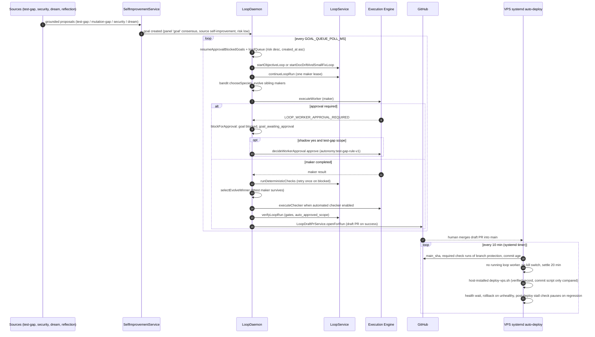

# Autonomous Goal → Daemon → Earned-Autonomy Pipeline

The `ParallelLoopDaemon` (`LoopDaemon`, packages/server/src/services/loop-daemon.ts) is the
always-on engine at the center of the baseline window's autonomy program. It polls a goal
queue, decomposes and dispatches goals through the maker–checker loop machinery, parks goals
that are waiting on human approval, chooses maker runtimes by measured outcome (bandit and
evolve lanes), records the run's result back into the learning layer, and hands certified work
to a human as a draft pull request. A systemd-timed `scripts/auto-deploy.sh` on the VPS then
deploys a merged, CI-green `main` once it has settled and no loop worker is running — always
through the operator-reviewed copy of `deploy-vps.sh` installed on the host, never the script
in the commit being deployed.

The whole pipeline is *earned autonomy*: every expansion is gated behind an off-by-default
flag and a measured track record (shadow rule → proven lane → auto-approve). The pieces are
wired together in `bootstrap/autonomous-services.ts` and `index.ts`, which start the daemon,
the test-gap source, the dream-state source, the self-improvement auto-review scheduler and
the Commons proposal review service when the runtime profile enables autonomy
(packages/server/src/index.ts#L105-L114, packages/server/src/bootstrap/autonomous-services.ts#L109-L156).

## Goal sources: the improvement funnel feeds the queue

Goals the daemon picks up are created by an improvement funnel, not typed in by a human.
Proposals (`self_improvements` rows, status `proposed → scheduled → executing →
verified/regressed/…`) are generated by several deterministic or learned sources
(packages/server/src/services/self-improvement-service.ts):

- **Test-gap source** (`TestGapSourceService`, packages/server/src/services/test-gap-source-service.ts):
  scans `packages/server/src/services` for live services no test imports (`discoverTestGaps`),
  exported functions no test names (`discoverExportGaps`, lane J3), and services whose
  same-named test lets Stryker mutants survive (`discoverMutationGaps`, lane M2) — "live"
  means named by `importedServices` (N12a), so the lane never spends runs testing dead code.
  Each found gap becomes a fully grounded proposal (target file, acceptance command, artifact
  path, budget) via `generateFromGroundedGap`, capped per day and in flight
  (`TEST_GAP_MAX_PER_DAY` default 2, minus the `TEST_GAP_REQUEUE_RESERVE` requeue slots;
  `TEST_GAP_MAX_IN_FLIGHT` default 2; mutation lane 1 in flight, `MUTATION_GAP_MAX_PER_DAY`
  default 2). Default off:
  `TEST_GAP_SOURCE_ENABLED` / `TEST_GAP_EXPORTS_ENABLED` / `MUTATION_GAP_ENABLED`, with
  sibling lanes (`TEST_GAP_PACKAGES_ENABLED`, `TEST_GAP_DASHBOARD_ENABLED`, node:test gaps in
  registered extra repos) inside the same caps
  (packages/server/src/services/test-gap-source-service.ts#L51-L385).
- **Reflection** (`generateFromReflection`), **build errors** (`generateFromBuildErrors`),
  **gap analysis** (`generateFromGaps`, from `CuriosityService.scanForGaps`) and **dream
  state** (`generateFromDreamCause`): the dream state replays recent failed loop runs,
  classifies each failure cause once (shadow judgment), consolidates recurring causes into
  engineering-rule memory candidates and grounded fix proposals
  (packages/server/src/services/dream-state-service.ts#L131-L202).
- **Security scanning** (`AutonomousGoalGenerator.generateFromSecurityFindings` →
  `SelfImprovementService.generateFromSecurityFindings`): high/critical scan findings are routed
  through the same specialist-panel review gate as every other proposal instead of bypassing
  it (autonomous-goal-generator.ts#L79-L110).

Every proposal is reviewed by a specialist panel; when the panel reaches a `goal` consensus,
`SelfImprovementAutoReviewScheduler` (or a human `approveImprovement`) authorizes it
(`agentApproveIfReady`), and `AutonomousGoalGenerator.generateImprovement` inserts a goal row
linked by `improvement_id` with `metadata.source = 'self-improvement'`
(packages/server/src/services/self-improvement-auto-review-scheduler.ts#L173-L179,
packages/server/src/services/autonomous-goal-generator.ts#L34-L77). Risk class comes from the
proposal *type* (`security → high`, everything else `low`), not from priority — a deliberate
fix after the test-gap lane's own success pushed its proposals out of the objective-mode gate
(autonomous-goal-generator.ts#L57-L66). `ImprovementFunnelService.compute()` aggregates the
whole chain (per-source conversion, judgment agreement, panel calibration, cost per verified
change) so "where does it leak" is one read-only call
(packages/server/src/services/improvement-funnel-service.ts#L6-L58).

## The tick: queue → authority gate → objective-mode dispatch

`tick()` runs every `GOAL_QUEUE_POLL_MS` (default 5000 ms)
(packages/server/src/services/loop-daemon.ts#L265-L384):

1. `pruneWorktrees()`, `resumeApprovalBlockedGoals()` (see below) and
   `settleDependencyBlockedGoals` for goals parked on unmet dependencies.
2. `loadQueue()` selects goals in `created`/`decomposed` status, ordered by risk class
   descending (`critical > high > medium > low`) then `created_at` ascending
   (loop-daemon.ts#L518-L538).
3. Up to `getAvailableSlots()` goals are started concurrently
   (`GOAL_MAX_CONCURRENT`, default 4; active goals persist in `system_state` across restarts).
   Every dispatch is recorded as a versioned `selection_propensity` shadow judgment (DI-001:
   candidate set, chosen goal, deterministic p = 1) so task selection stays auditable
   (loop-daemon.ts#L152-L181).
4. Each goal passes the **authority gate** (`authorityGateForGoal`): fail-closed in
   `AUTHORITY_GATE=enforce` mode, observe-only in `on`, default `off` — a goal without a
   PLAN_APPROVED/DEPLOYED ALLOW row is denied (and an `authority_deny` event emitted)
   (packages/server/src/services/authority-gate.ts#L23-L109).
5. **Objective-mode dispatch decision** — the gate between a goal's own objective driving a
   real maker/checker cycle and the safe doc-drift no-op
   (packages/server/src/services/objective-loop-gate.ts):
   - `SELF_IMPROVEMENT_OBJECTIVE_LOOP_ENABLED=true` (default off);
   - the goal qualifies: `metadata.source === 'self-improvement'` *and* `risk_class === 'low'`;
   - per-tick cap `SELF_IMPROVEMENT_OBJECTIVE_LOOP_MAX_PER_TICK` (default 1, ceiling 3) not
     reached. A qualifying goal that only loses the cap is *deferred to the next tick*, not
     dropped into the no-op — a wrong `no_change` lesson that used to be learned this way.
   Every self-improvement goal's decision is emitted as a `convergence` bus event
   (`objective_mode_decision`) so the blind spot that let 10/10 goals silently no-op cannot
   recur (loop-daemon.ts#L329-L359).

`executeGoal` then runs the goal end-to-end (loop-daemon.ts#L546-L1101):

- `created` goals are scheduled (`ResourceScheduler.canSchedule`, defers with a
  `goal_deferred` convergence event) and decomposed (`GoalDecomposer.decomposeGoalToDAG`).
- The loop is started: `startObjectiveLoop({ goal_id, repository_path })` for objective mode
  (a real git checkout — the goal's registered extra repo or `LOOP_DAEMON_REPOSITORY_PATH`,
  since the container's cwd is not a repository; a naming-unregistered repo throws
  `REPO_NOT_REGISTERED`), `startDocDriftAndSmallFixLoop({ goal_id })` otherwise; a goal resumed
  after approval instead re-opens its existing run (`getLoopRun(resume_run_id)`)
  (loop-daemon.ts#L576-L591).
- With no findings the goal completes immediately ("nothing to fix"); otherwise
  `continueLoopRun(run.id, { max_assignments: 1, max_maker_workers: 1, runtime? })` creates one
  prepared maker lease (+ manual checker lease). `LOOP_DAEMON_MAKER_RUNTIME` is the operator's
  explicit maker-runtime choice, objective mode only — without it a maker lease used to be
  created `manual` and every daemon goal died with `MANUAL_MAKER_REQUIRES_HUMAN`
  (loop-daemon.ts#L616-L642).

## Maker species selection: bandit (E12) and evolve siblings (E13)

Before the maker runs, two complementary selection mechanisms can rewrite *which* runtime
fills the lease — both by measured outcome, never by config alone:

**Bandit (E12, `runtime-bandit.ts`).** When `LOOP_BANDIT_ENABLED=true` and the run is not a
resumed evolve sibling, `chooseSpecies` Thompson-samples over `skill_outcomes` for
`loop-maker:<loopName>:<runtime>` (one row per run) — with the bandit on it chooses *over*
`LOOP_DAEMON_MAKER_RUNTIME` too, which stays on the lease as the fallback when the bandit makes
no choice (Y1). The first `LOOP_BANDIT_SPECIES` entry is the incumbent; a challenger with fewer
than `PROMOTE_AFTER` (20) outcomes gets at most `LOOP_BANDIT_MAX_SHARE` (default 10 %) of runs,
so a weak newcomer costs little and a strong one earns full traffic. Zeros that are not the
species' fault (infra failures, no-change runs, makers that passed every gate and only lost
evolve on rank) are excluded from the stats (RX-3). The choice is recorded on the lease metadata
(`bandit`) and a `bandit_selected` event carries the posterior and max-share so the choice's
propensity is reconstructable (RX-15); an unavailable runtime degrades to `bandit_skipped`
(packages/server/src/services/runtime-bandit.ts#L23-L53, loop-daemon.ts#L644-L666).

**Evolve (E13, `evolve-selection.ts`).** When `LOOP_EVOLVE_ENABLED=true` and the goal is
eligible — a test-gap or mutation-gap proposal, or goal metadata `evolve: true` — up to two
extra species from `LOOP_EVOLVE_SPECIES` are run as sibling makers on the same objective
(never the species the bandit already chose as the first maker — that would run the same work
twice, Y1): each a `retryLoopRun(run.id, { sibling: true, runtime })` lease that supersedes the
first maker, executed and checked the same way. `selectEvolveWinner` ranks all contenders in
code (`evolve-fitness-service.ts`): hard gates first (exit 0, deterministic checks pass, diff
within budget), **and the winner must have touched the goal's artifact** — a sibling that
edited docs instead of the requested test did not do the work (prod fix). Among survivors the
ranking is mutation score, then smaller diff, then fewer tokens. The winner stays the only
non-superseded maker and goes on to the reviewers; losers are superseded, their reviewer leases
cancelled, every other *prepared* maker of the run is superseded too, and each loss recorded as
a `skill_outcomes` row (N7 lineage: a loser that finished is an outcome, so the bandit sees the
full head-to-head). With no eligible maker the run fails exactly like a single-maker run
(`evolve_no_winner` event)
(packages/server/src/services/evolve-selection.ts#L15-L156,
packages/server/src/services/evolve-fitness-service.ts#L20-L41).

A sibling maker, being a maker, needs its own approval — in an auto-approved lane (J5) it is
auto-approved with the same one-file scope via `autoApproveSibling`; anywhere else the sibling
inherits only under `inheritableApproval`'s strict rule (D4), and a sibling that still needs a
human approval parks the whole goal on that approval (Y0b: the approval used to arrive after
the proposal was already labelled regressed) (loop-daemon.ts#L427-L452, #L761-L810).

## Execute, check, retry

The maker executes with a timeout and diff cap tuned per lane (`daemonMakerTimeoutMs`): the
mutation lane — detected by `mutationCheckEnv` returning `MUTATE_FILE`/`MUTATE_TEST` — gets the
600 s executor maximum and 400 diff lines (strengthening a thin test legitimately grows it);
other lanes `LOOP_MAKER_TIMEOUT_MS` (default 300 s, cap 600 s) and 200 lines (dead-code,
finding-fix and advisory lanes size their own caps)
(loop-daemon.ts#L55-L63, #L695-L709). Deterministic checks (`runDeterministicChecks` with
`daemonCheckOptions`) run a scoped script set (`LOOP_DAEMON_CHECK_SCRIPTS`, e.g.
`test:changed,lint,type-check`; `LOOP_DAEMON_CHECK_TIMEOUT_MS`, default 120 s, cap 600 s; an
extra repo's checks come from `EXTRA_REPO_CHECKS_<SLUG>`); for a mutation-gap run the
`test:mutation:grounded` check runs `scripts/mutation-gain.mjs`, which passes when the
working-tree test gains ≥ 10 mutation-score points (or reaches 90) over the committed test. A
`blocked` result retries the maker once via `retryLoopRun` — a retry needs its own approval and
inherits it only under the strict rule — and checks are best-effort for the daemon
(loop-daemon.ts#L46-L53, #L711-L741).

## Approval parking and resume (and the J5 auto-approve)

The execution engine asks a human before a worker runs. For the daemon that is a *wait*, not a
failure — previously goals were failed and their approvals expired unseen
(loop-daemon.ts#L386-L424):

- `LOOP_WORKER_APPROVAL_REQUIRED` from `executeWorker` (maker or evolve sibling) or
  `executeChecker` (checker/security_checker) routes to `blockForApproval`: the goal is set to
  `status='blocked'` with `metadata.awaiting_approval = {approval_id, run_id, lease_id,
  since}`, and a `goal_awaiting_approval` loop event is recorded.
- Every blocked approval gets a **shadow decision** (plan E3):
  `recordAutoApproveShadow` writes one `auto_approve_shadow` judgment per approval — "yes" only
  when the change is test-only, not high-risk/security, and its class (loop × test-only ×
  risk) already has ≥ 3 verified outcomes and no regression — so agreement with the operator's
  real decision is measurable in the funnel before anything is ever auto-approved. Shadow
  bookkeeping is fail-open and never affects the loop
  (packages/server/src/services/autonomy-shadow-service.ts#L15-L50).
- **J5 (`LOOP_AUTO_APPROVE_TEST_GAP`)**: when the shadow rule says yes *and*
  `testGapAutoApproveScope` returns a scope — the goal comes from the test-gap source and its
  artifact is a single new file under `packages/server/src/__tests__/` — the scope is pinned
  onto the lease (`metadata.auto_approved_scope`) *before* approving, then
  `decideWorkerApproval(approvalId, true, 'autonomy:test-gap-rule-v1', reason)` decides the
  approval through the engine that paused it. The M2 lane (`LOOP_AUTO_APPROVE_MUTATION_GAP`)
  shares the one-test-file scope but additionally requires ≥ 1 verified, human-approved run in
  the mutation lane first. An `ORACLE_LANES_AUTO_APPROVE=true` oracle lane is approved on the
  same one-file scope even when rule-v1 says no (Z4 operator decision, `autonomy:oracle-lane-v1`;
  the rule's verdict is still recorded). Checker, deterministic checks and the human merge stay;
  the `auto_approved_scope` verification gate hard-fails the run if the maker touched anything
  but that file (autonomy-shadow-service.ts#L52-L71, loop-daemon.ts#L406-L420,
  packages/server/src/services/loop-verification-service.ts#L115-L126).

`resumeApprovalBlockedGoals()` runs at the top of every tick (loop-daemon.ts#L455-L503):

- approval still `pending` → keep waiting;
- `approved` → inside a transaction, re-verify ownership (the goal, run and lease still match
  the approval's task, neither goal nor run is `operator_paused`), refuse to resume an
  unresumable run or a cancelled worker (held with `goal_continuation_held` instead), wait until
  the approval's task reaches `completed`/`failed`, then requeue the goal as `decomposed` with
  `metadata.resume_run_id` so the next dispatch continues the *same* run with its
  already-prepared maker lease instead of starting a new one;
- `denied`/`expired` → mark the goal `failed`, record a `goal_failed` event with reason
  `approval <status>`, feed the outcome to `CommonsProposalReviewService.recordGoalOutcome`,
  and emit a failed `loop_completed` bus event so the cognitive layer sees the episode.

## Verify, learn, hand off

After reviewers finish (a still-`running` checker/security checker defers verification to the
pass that finishes it — verifying early would record a false `regressed`), `verifyLoopRun`
evaluates the deterministic gates (`maker_completion`, `diff_threshold_all_makers`,
`checker_verdict`, `tests_lint_typecheck`, `security_checker_verdict` for high risk,
`auto_approved_scope`, …). Completion (goal/run status, draft PR) applies the strict
every-gate-`pass` rule (`gatePassesStrict`); what learners record follows `allGatesPassed`,
under which a skipped gate (e.g. security review on a non-high-risk run) is neutral
(loop-daemon.ts#L915-L931, loop-verification-service.ts#L94-L150).

**Automated reviewers are a deliberate, flag-gated autonomy expansion.** Checker leases are
created with `runtime: 'manual'` — code review is human by design. With
`LOOP_DAEMON_AUTOMATED_CHECKER_ENABLED=true`, the daemon dispatches the prepared checker with
the *same runtime the maker attempt used* (self-review, not an independent reviewer), and with
`LOOP_DAEMON_AUTOMATED_SECURITY_CHECKER_ENABLED=true` the security checker likewise; both use
`daemonReviewerTimeoutMs` (default 300 s, cap 900 s). A maker that already failed (or ran
remote with no local reviewer runtime named) skips the dispatch with a `checker_dispatch_skipped`
record instead of a cascade failure; a reviewer whose runtime gave out (timeout/token budget)
gets one retry lease under `LOOP_REVIEWER_RETRY_ENABLED`, and under the
`LOOP_REVIEWER_STRATEGY=bounded` challenger the security checker is not dispatched at all once
the checker has no decisive verdict (its gate cannot pass). A dispatch error is recorded as
`checker_dispatch_failed`, never swallowed (loop-daemon.ts#L812-L913).

Every executed run then feeds the learning layer, success or fail (loop-daemon.ts#L933-L1101):

- a `loop_completed` bus event per run (the cognitive layer learns only from these;
  `recordEpisode` dedupes on `loopRunId`);
- `SelfImprovementService.recordOutcome` on the linked proposal: `verified` when the
  `allGatesPassed` outcome holds, else `verificationFailureOutcome` — a gate that only lacks
  evidence (`unknown`, none failed) is `infra_failed`, an Ollama subscription-outage fallback
  is `infra_failed`, otherwise `runOutcomeOnFailure` classifies the maker lease: a maker that
  timed out or hit `maker_runtime_exit_zero`/`runtime_contract` is `infra_failed` (it never
  produced an evaluable change, so the proposal keeps no verdict), `regressed` otherwise
  (loop-daemon.ts#L65-L89, #L948-L952);
- one `skill_outcomes` row per run keyed `loop-maker:<loopName>:<runtime>` (extra-repo runs
  prefixed `repo:<slug>:`) with success, tokens, duration, genome/strategy identity and
  failing-gate evidence refs — the heritability signal (E10) the bandit and the skill-evolution
  engine select on (loop-daemon.ts#L963-L1024);
- `CommonsProposalReviewService.recordGoalOutcome(goalId, 'completed'|'failed', detail)`
  un-sticks the proposal (a bounded infra-failure retry re-schedules it) and writes memory
  candidates;
- on success, `LoopDraftPrService.openForRun` (G4, `LOOP_AUTO_DRAFT_PR_ENABLED`, once per run)
  commits the winner's worktree changes (never `node_modules` symlinks or lockfile install
  noise), pushes to the maker branch of the goal's own repo — never blindly `GITHUB_REPOSITORY`
  (B2) — and opens a **draft** PR: the merge stays human
  (packages/server/src/services/loop-draft-pr-service.ts#L32-L74);
- `KnowledgeRuntimeService.closeLoop` attempts the learning closure; a blocked closure records
  a `learning_closure_blocked` event.

The goal is then marked `completed`/`failed` and the run `completed`/`blocked`, and a blocked
run's still-prepared leases are cancelled (`cancelPreparedLeasesOfBlockedRun`, reason
`cascade:run_blocked`) so they stop counting as live. Any unrecovered error fails the goal,
records `goal_failed`, emits a failed `loop_completed`, and reports via `recordGoalOutcome`
(loop-daemon.ts#L1037-L1087).

## The deploy half: CI-gated, install-gated systemd auto-deploy

Merged improvements reach production through `scripts/auto-deploy.sh`, run on the VPS by the
systemd units `scripts/systemd/djimitflo-auto-deploy.{service,timer}` (a oneshot service under
an `flock` lock, fired every 10 minutes, 5 minutes after boot). Before anything else the script
requires the deploy root itself to be trusted — root-owned and not group/other-writable, no
symlink on the path — and every write into `$ROOT/data` goes through the same `safe_fs` checks.
The script deploys `main` only when **all** probes hold (scripts/auto-deploy.sh):

1. **Kill switch**: `$DEPLOY_ROOT/AUTO_DEPLOY_DISABLED` (`touch /srv/djimitflo/AUTO_DEPLOY_DISABLED`) → exit.
   A post-deploy regression check or a changed deploy script *writes this file itself* with the
   reason, so the pause is visible and self-documenting.
2. **MAIN_SHA ≠ CURRENT_SHA**: `git ls-remote` of `refs/heads/main` against the
   `DJIMITFLO_COMMIT_SHA` recorded in the live `compose.yml`.
3. **Required CI green**: the required status checks of main's branch protection are read live
   from the public branch summary (`context` plus producing `app_id`); deploy requires the
   *newest* run of every required context on that commit, by that app, to be `completed` with
   conclusion `success` — a `skipped`/`neutral` required check never ran and holds the deploy
   (forensic: a skip once passed), and a same-named success from another app is not a stand-in.
   Non-required checks that fail or hang are logged as info only (`AUTO_DEPLOY_IGNORE_CHECKS`
   omits them, default `update` — prod: a Dependabot workflow failure held main for ~10 h while
   every required check was green). Unreadable required checks hold the deploy, fail-closed.
4. **Settle**: the commit's committer date is at least `AUTO_DEPLOY_SETTLE_MIN` (default 20)
   minutes old, so a merge train becomes one deploy. A held-back sha (waiting on CI or settle)
   is recorded once as a `waiting` event in `deploy-log.jsonl`, which the stall watch reports
   as `deploy:behind_main` after 2 h (re-20261030 C6: main once waited ~16 h with no log).
5. **No running loop worker**: a read-only SQLite query inside the running container counts
   `worker_leases status='running'` *plus* `tasks status='running' AND id LIKE 'loop-worker-%'`
   (an approved maker resumes inside the engine while its lease still says `prepared`, so the
   task count closes that blind spot).

Every probe (`MAIN_SHA`, `CURRENT_SHA`, `CHECKS`, `REQUIRED`, `COMMIT`, `LEASES`, `STALLS`,
`RESTARTS`, `DEPLOY_GATE`, `DEPLOY`) is overridable via an evaluated `AD_<NAME>` env var, which
is what makes the decision logic testable without a VPS (`auto-deploy.test.ts`).

**S2: the deploy script is never the one in the commit being deployed.** A root-executed deploy
script from a merged commit would make merge rights root, so `auto-deploy.sh` runs the
operator-installed copy `/usr/local/lib/djimitflo/deploy-vps.installed.sh`
(install via `scripts/install-deploy-script.sh <sha> --apply`, which records the source commit
and its sha256). The installed copy and its record are trusted only when they and every
directory above them are root-owned and not writable by group or others; each is read once into
a private temp dir, hashed against its install record, and executed from there (a swap after
the check reaches nothing). The commit's own `scripts/deploy-vps.sh` is fetched from
raw.githubusercontent *only to compare*: when it differs from the installed record — or the
installed copy no longer matches it — auto-deploy writes the kill-switch file with the reason
and pauses until the operator reviews and reinstalls (scripts/auto-deploy.sh#L190-L221).

**P2: a deploy is watched once, after the fact.** Once per commit, `AUTO_DEPLOY_VERDICT_MIN`
(default 15) minutes after a deploy, `post_deploy_check` diffs the stall report against the
baseline recorded at deploy time: a container restart or a *new* structural stall (default
`AUTO_DEPLOY_REGRESSION_STALLS=panel|goals`; provider/host noise only logged) pauses auto-deploy
with the reason in the kill-switch file. Rollback itself stays a human decision
(scripts/auto-deploy.sh#L164-L189).

`deploy-vps.sh --local` (scripts/deploy-vps.sh#L150-L251) then, as root: refuses to act outside
a trusted deploy root; prunes old builds, keeping a week of build cache and refusing to build
without ≥ 6 GB free disk (8 GB floors a full prune); fetches the exact commit into a fresh
root-only dir, verifies `FETCH_HEAD` is that commit and exports `git archive` — the build input
is never the container's writable runtime-source clone; builds `djimitflo:main-<short>` pinned
to the base image's registry digest with a bounded build timeout, writes a write-once build
receipt (commit, lockfile/Dockerfile hashes, base digest, source tree, image id) and verifies
it; checks out `runtime-source-<short>` at the SHA (via `src_git`, which runs git as the
clone's owner with hooks and file-transport off) and `chown -R 1001:1001`s it for
objective-mode worktrees; backs up `compose.yml` and rewrites image, `DJIMITFLO_COMMIT_SHA` and
the runtime-source mount; `docker compose up -d --force-recreate djimitflo`; and polls health
for 60 s — **on unhealthy, or once healthy when the running image is not the receipt's, it
restores the compose backup and recreates the previous container** (rollback, exit 1). The
script is single-host with no blue/green: a failed health check means ~20 s of downtime before
rollback, an accepted trade-off documented in the header.

## Pipeline at a glance

The tick-to-deploy pipeline: sources feed proposals, the daemon runs goal → maker → checker → verification → draft PR, and a CI-gated, install-gated systemd timer deploys a settled, worker-free main and watches it once after the fact.

## Operational levers and failure semantics

| Flag | Default | Effect |
| --- | --- | --- |
| `GOAL_QUEUE_POLL_MS` / `GOAL_MAX_CONCURRENT` | 5000 / 4 | Daemon poll interval and concurrent-goal cap |
| `SELF_IMPROVEMENT_OBJECTIVE_LOOP_ENABLED` / `_MAX_PER_TICK` | off / 1 (≤ 3) | Objective-mode dispatch of low-risk self-improvement goals |
| `LOOP_DAEMON_MAKER_RUNTIME` | unset | Explicit maker runtime for objective mode; the bandit's fallback |
| `LOOP_BANDIT_ENABLED` / `LOOP_BANDIT_SPECIES` / `LOOP_BANDIT_MAX_SHARE` | off / — / 0.1 | Thompson species selection over `skill_outcomes` |
| `LOOP_EVOLVE_ENABLED` / `LOOP_EVOLVE_SPECIES` | off / ≤ 2 extra makers | Evolve siblings on test-gap/mutation-gap goals |
| `LOOP_REVIEWER_RETRY_ENABLED` / `LOOP_REVIEWER_STRATEGY` | off / — | One retry for a runtime-failed reviewer / `bounded` skips security once the checker has no verdict |
| `AUTONOMY_SHADOW_ENABLED` | off | Record the shadow auto-approve judgment per approval |
| `LOOP_AUTO_APPROVE_TEST_GAP` / `LOOP_AUTO_APPROVE_MUTATION_GAP` / `ORACLE_LANES_AUTO_APPROVE` | off | J5/M2/Z4 one-test-file auto-approval |
| `LOOP_DAEMON_AUTOMATED_CHECKER_ENABLED` / `..._SECURITY_CHECKER_ENABLED` | off | Maker-runtime self-review by the checker / security checker |
| `LOOP_AUTO_DRAFT_PR_ENABLED` (+ `GITHUB_REPOSITORY`/`GITHUB_TOKEN`) | off | G4 draft-PR handoff of certified runs |
| `LOOP_DAEMON_CHECK_SCRIPTS` / `LOOP_DAEMON_CHECK_TIMEOUT_MS` | all / 120 s (≤ 600 s) | Scoped deterministic checks |
| `LOOP_MAKER_TIMEOUT_MS` / `LOOP_REVIEWER_TIMEOUT_MS` | 300 s / 300 s (≤ 600/900 s) | Maker and reviewer timeouts (mutation lane fixed at 600 s) |
| `TEST_GAP_SOURCE_ENABLED` / `TEST_GAP_EXPORTS_ENABLED` / `MUTATION_GAP_ENABLED` | off | Deterministic proposal lanes (2/day, 2 in flight; mutation 1 in flight) |
| `AUTO_DEPLOY_SETTLE_MIN` / `AUTO_DEPLOY_REGRESSION_STALLS` / `AUTO_DEPLOY_IGNORE_CHECKS`, kill switch `/srv/djimitflo/AUTO_DEPLOY_DISABLED` | 20 / `panel\|goals` / `update` / absent | Deploy settle window, post-deploy pause detectors, non-gating checks, emergency stop |

Failure semantics the operator can rely on:

- **`infra_failed` vs `regressed`**: a gate with no evidence, an Ollama subscription fallback,
  or a maker that timed out or never produced an evaluable change counts `infra_failed` — the
  proposal gets no verdict and the guardrail does not count it against the lane; only an
  evaluated-and-rejected change is `regressed` (loop-daemon.ts#L65-L89).
- **Approval is a wait**: pending → blocked goal; denied/expired → failed goal and recorded
  outcome; approved+terminal task → resume on the same run under re-verified ownership, never a
  duplicate maker; an operator pause (`metadata.operator_paused`) holds even an approved
  continuation.
- **Fail-closed gates, fail-open learning**: shadow judgments, skill outcomes, funnel records
  and learning closures are all best-effort — none may break the daemon — while capability
  gating (authority gate, objective-mode gate, J5 scope, required-CI and install-record deploy
  gates) denies/pauses by default.
- **No automatic merge or deploy escalation**: the loop only ever prepares reviewed worktrees
  and a draft PR; the merge is human; the deploy is gated on required CI, settling, an idle
  worker pool and an operator-installed deploy script, rolls back on an unhealthy start, and a
  post-deploy stall regression pauses the pipeline itself.

## Focused tests

- `packages/server/src/__tests__/loop-daemon-objective-mode.test.ts` — dispatch branching:
  objective mode gated on flag + source + risk, per-tick cap defers rather than no-ops,
  `LOOP_DAEMON_REPOSITORY_PATH` and `LOOP_DAEMON_MAKER_RUNTIME` plumbing.
- `packages/server/src/__tests__/loop-daemon-approval-wait.test.ts` — parking/resume: blocked
  (not failed) with `awaiting_approval` + `goal_awaiting_approval`; still-pending waits;
  approved+terminal resumes the same run; denied/expired fails with reason.
- `packages/server/src/__tests__/j5-test-gap-auto-approve.test.ts` — J5 scope gating, daemon
  auto-approves with pinned `auto_approved_scope`, mutation-gap lane requires its own flag and
  a verified human-approved run first.
- `packages/server/src/__tests__/autonomy-shadow.test.ts` — shadow rule (≥ 3 verified, no
  regression, test-only, not high-risk/security), recorded once per approval, funnel agreement
  with the operator's decision.
- `packages/server/src/__tests__/runtime-bandit.test.ts` and `evolve-selection.test.ts` /
  `evolve-fitness.test.ts` — challenger capping/promotion, unfair-zero exclusion, eligibility
  (test-gap/mutation-gap or `evolve: true`), winner selection (hard gates + on-target →
  mutation score → diff → tokens), loser lineage and reviewer cancellation.
- `packages/server/src/__tests__/loop-daemon-checker-dispatch.test.ts`,
  `loop-daemon-check-options.test.ts`, `loop-daemon-failure-logging.test.ts` — automated
  checker/security dispatch and approval waits, check scoping/timeouts and
  `runOutcomeOnFailure`, failure event recording.
- `packages/server/src/__tests__/auto-deploy.test.ts` — every probe overridden: deploys only
  when required CI is green per context+app (skip is not pass) + settled + no worker + no kill
  switch; holds with a reason for each unsafe condition; S2 install-record gating; P2
  post-deploy pause; waiting/deploy events in `deploy-log.jsonl`.
- `packages/server/src/__tests__/improvement-funnel.test.ts` — funnel aggregation: per-source
  conversion, judgment agreement, panel calibration, cost per verified change.

## Related pages

- [Loop lifecycle: runs, leases, worktrees & recovery](../concepts/loop-lifecycle.md) — the loop domain model and verification gates this daemon drives
- [Maker–checker loop execution](./maker-checker-loop.md) — the per-run machinery (worktrees, diff caps, verdicts, learning closure)
- [Approval request & decision flow](./approval-decision-flow.md) — the operator-facing approval lifecycle the daemon parks on
- [Configuration reference](../operations/configuration-reference.md) — environment flags in the wider operations context
- [Test strategy](../testing/test-strategy.md) — how the deterministic checks fit the repo's test pyramid
