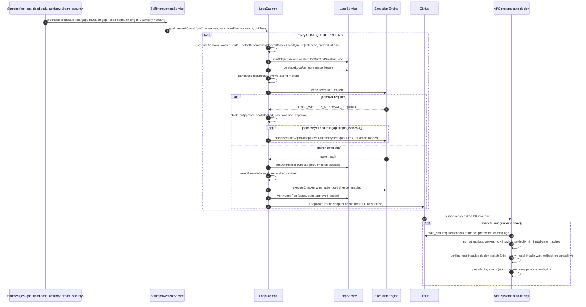

# Autonomous Goal → Daemon → Earned-Autonomy Pipeline

The `ParallelLoopDaemon` (`LoopDaemon`, packages/server/src/services/loop-daemon.ts) is the
always-on engine at the center of the baseline window's autonomy program. It polls a goal
queue, decomposes and dispatches goals through the maker–checker loop machinery, parks goals
that are waiting on human approval, chooses maker runtimes by measured outcome (bandit and
evolve lanes), records the run's result back into the learning layer, and hands certified work
to a human as a draft pull request. A systemd-timed `scripts/auto-deploy.sh` on the VPS then
deploys a merged, CI-green `main` once it has settled and no loop worker is running.

The whole pipeline is *earned autonomy*: every expansion is gated behind an off-by-default
flag and a measured track record (shadow rule → proven lane → auto-approve). Everything else
stays human: the specialist panel that turns a proposal into a goal, the code-review checker
lease (created `runtime: 'manual'`), the merge, and the deploy-script install. The pipeline
sources feed from `bootstrap/autonomous-services.ts`, started when the runtime profile enables
autonomy (packages/server/src/bootstrap/autonomous-services.ts).

## Goal sources: the improvement funnel feeds the queue

Goals the daemon picks up are created by an improvement funnel, not typed in by a human.
Proposals (`self_improvements` rows, status `proposed → scheduled → executing →
verified/regressed/…`) are generated by several deterministic or learned sources
(packages/server/src/services/self-improvement-service.ts):

- **Test-gap source** (`TestGapSourceService`, packages/server/src/services/test-gap-source-service.ts):
  scans `packages/server/src/services` for live services no test imports (`discoverTestGaps`),
  exported functions no test names (`discoverExportGaps`, lane J3), other Node workspaces
  (`discoverPackageGaps`, `TEST_GAP_PACKAGES_ENABLED`) and node:test extra repos
  (`discoverNodeTestGaps`, `EXTRA_REPOS_ENABLED`), and services whose same-named test lets
  Stryker mutants survive (`discoverMutationGaps`, lane M2). Each found gap becomes a fully
  grounded proposal (target file, acceptance command, artifact path, budget) via
  `generateFromGroundedGap`, capped per day and in flight. Default off:
  `TEST_GAP_SOURCE_ENABLED` / `TEST_GAP_EXPORTS_ENABLED` / `MUTATION_GAP_ENABLED`
  (packages/server/src/services/test-gap-source-service.ts).
- **Dead-code lane** (`DeadCodeSourceService`): conservative proposals to remove unused source
  files and route groups (usage telemetry ≥ 14 days, oracle `scripts/dead-code-gate.mjs`).
  Its maker diff cap in the daemon is 2 000 lines; a removal is mostly deleted lines and the
  gate bounds what may be added. Default off: `DEAD_CODE_LANE_ENABLED`
  (packages/server/src/services/dead-code-source-service.ts).
- **Finding-fix lane** (`FindingFixSourceService`, FINDING_FIX_DIFF_MAX 60) and **advisory
  exposure** (`AdvisoryExposureService`, ADVISORY_DIFF_MAX 1 000 lockfile lines): one
  ESLint-pack finding fix or one dependency bump per proposal, each with its own grounded
  oracle; their diff caps flow into `executeGoal` (loop-daemon.ts#L697-L698). Default off:
  `FINDING_FIX_LANE` / `ADVISORY_EXPOSURE_MODE`.
- **Reflection** (`generateFromReflection`), **build errors** (`generateFromBuildErrors`),
  **gap analysis** (`generateFromGaps`, from `CuriosityService.scanForGaps`) and **dream
  state** (`generateFromDreamCause`): the dream state replays recent failed loop runs,
  classifies each failure cause once (shadow judgment, `failure_cause`), consolidates
  recurring causes into engineering-rule memory candidates and grounded fix proposals
  (packages/server/src/services/dream-state-service.ts#L138-L209).
- **Security scanning** (`AutonomousGoalGenerator.generateFromSecurityFindings`): high/critical
  scan findings are routed through the same specialist-panel review gate as every other
  proposal instead of bypassing it (packages/server/src/services/autonomous-goal-generator.ts#L90-L110).

Every proposal is reviewed by a specialist panel; when the panel reaches a `goal` consensus,
`SelfImprovementAutoReviewScheduler` (or a human `approveImprovement`) authorizes it
(`agentApproveIfReady`), and `AutonomousGoalGenerator.generateImprovement` inserts a goal row
linked by `improvement_id` with `metadata.source = 'self-improvement'`. With
`SELF_IMPROVEMENT_GOAL_ON_APPROVE=true` the proposal becomes a goal at once instead of waiting
for the hourly `generateFromSelfImprovements` sweep
(packages/server/src/services/self-improvement-auto-review-scheduler.ts#L171-L181).
Risk class comes from the proposal *type* (`security → high`, everything else `low`), not
from priority — a deliberate fix after the test-gap lane's own success pushed its proposals
out of the objective-mode gate (autonomous-goal-generator.ts#L57-L70).
`ImprovementFunnelService.compute()` aggregates the whole chain (per-source conversion,
judgment agreement, panel calibration, cost per verified change) so "where does it leak" is
one read-only call (packages/server/src/services/improvement-funnel-service.ts).

## The tick: queue → gates → objective-mode dispatch

`tick()` runs every `GOAL_QUEUE_POLL_MS` (default 5000 ms)
(packages/server/src/services/loop-daemon.ts#L264-L383):

1. `pruneWorktrees()`, `resumeApprovalBlockedGoals()` and `settleDependencyBlockedGoals()`.
2. `loadQueue()` selects goals in `created`/`decomposed` status, ordered by risk class
   descending (`critical > high > medium > low`) then `created_at` ascending
   (loop-daemon.ts#L517-L537).
3. Up to `getAvailableSlots()` goals are started concurrently (`GOAL_MAX_CONCURRENT`, default
   4; active goals persist in `system_state` across restarts). A goal still executing in this
   process or parked on an unmet `depends_on_goal_keys` dependency is not dispatched
   (loop-daemon.ts#L255-L257, L278-L284). Every dispatch writes one `selection_propensity`
   shadow judgment (DI-001: candidate set, chosen goal, p=1, the deterministic
   `loadQueue` policy id/version) so task selection is reconstructable off-policy
   (loop-daemon.ts#L157-L175, L361).
4. Each goal passes the **authority gate** (`authorityGateForGoal`): fail-closed in
   `AUTHORITY_GATE=enforce` mode, observe-only in `on`, default `off` — a goal without a
   PLAN_APPROVED/DEPLOYED ALLOW row is denied (and a DENY event emitted)
   (packages/server/src/services/authority-gate.ts#L23-L109, loop-daemon.ts#L288-L310).
5. **Objective-mode dispatch decision** — the gate between a goal's own objective driving a
   real maker/checker cycle and the safe doc-drift no-op
   (packages/server/src/services/objective-loop-gate.ts):
   - `SELF_IMPROVEMENT_OBJECTIVE_LOOP_ENABLED=true` (default off);
   - the goal qualifies: `metadata.source === 'self-improvement'` *and* `risk_class === 'low'`;
   - per-tick cap `SELF_IMPROVEMENT_OBJECTIVE_LOOP_MAX_PER_TICK` (default 1, ceiling 3) not
     reached. A qualifying goal that only loses the cap is *deferred to the next tick*, not
     dropped into the no-op — a wrong `no_change` lesson that used to be learned this way.
   Every self-improvement goal's decision is emitted as a `convergence` bus event
   (`objective_mode_decision`) so the blind spot that let 10/10 goals silently no-op cannot
   recur (loop-daemon.ts#L314-L358).

`executeGoal` then runs the goal end-to-end (loop-daemon.ts#L545-L1092):

- `created` goals are scheduled (`ResourceScheduler.canSchedule`, defers with
  `waiting_for_resources`; `RESOURCE_SCHEDULER_MODE=shadow` records the observed-capacity
  decision without changing it) and decomposed (`GoalDecomposer.decomposeGoalToDAG`)
  (loop-daemon.ts#L553-L568).
- The loop is started: `startObjectiveLoop({ goal_id, repository_path })` for objective mode
  (a real git checkout — `LOOP_DAEMON_REPOSITORY_PATH`, since the container's cwd is not a
  repository), `startDocDriftAndSmallFixLoop({ goal_id })` otherwise; a goal resumed after
  approval instead re-opens its existing run (`getLoopRun(resume_run_id)`). A goal whose
  proposal names another repo (`repo:<slug>`) runs in that checkout and never in djimitflo's
  when the repo is not registered (loop-daemon.ts#L575-L588, loop-service.ts#L522-L588).
- With no findings the goal completes immediately ("nothing to fix"); otherwise
  `continueLoopRun(run.id, { max_assignments: 1, max_maker_workers: 1, runtime? })` creates one
  prepared maker lease (+ manual checker lease). `LOOP_DAEMON_MAKER_RUNTIME` is the operator's
  explicit maker-runtime choice, objective mode only — without it a maker lease used to be
  created `manual` and every daemon goal died with `MANUAL_MAKER_REQUIRES_HUMAN`
  (loop-daemon.ts#L615-L628).

## Maker species selection: bandit (E12) and evolve siblings (E13)

Before the maker runs, two complementary selection mechanisms can rewrite *which* runtime
fills the lease — both by measured outcome, never by config alone:

**Bandit (E12, `runtime-bandit.ts`).** When `LOOP_BANDIT_ENABLED=true` and there is no pending
sibling or resumed completed maker, `chooseSpecies` Thompson-samples over `skill_outcomes` for
`loop-maker:<loopName>:<runtime>` (one row per run). When the bandit is on it also chooses
over an explicit `LOOP_DAEMON_MAKER_RUNTIME`, which stays on the lease as the fallback. The
first `LOOP_BANDIT_SPECIES` entry is the incumbent; a challenger with fewer than
`PROMOTE_AFTER` (20) outcomes gets at most `LOOP_BANDIT_MAX_SHARE` (default 10 %) of runs, so
a weak newcomer costs little and a strong one earns full traffic. A run the maker is not
responsible for (infra failure, no-change, evolve rank loss — `UNFAIR_ZERO_SQL`) is not
counted as a loss, and with `OUTCOME_ATTRIBUTION_ENABLED` neither is a reviewer/environment
loss (runtime-bandit.ts#L13-L52, loop-daemon.ts#L643-L665). Never on a resumed evolve sibling:
its species is the point of the sibling. The choice is recorded on the lease metadata
(`bandit`) and a `bandit_selected` event; an unavailable runtime degrades to `bandit_skipped`.

**Evolve (E13, `evolve-selection.ts`).** When `LOOP_EVOLVE_ENABLED=true` and the goal is
eligible — a test-gap or mutation-gap proposal, or goal metadata `evolve: true` — up to two
extra species from `LOOP_EVOLVE_SPECIES` are run as sibling makers on the same objective: each
a `retryLoopRun(run.id, { sibling: true, runtime })` lease that supersedes the first maker,
executed and checked the same way. A sibling of the same runtime+model the first maker
already used (or chose by bandit) is not spawned, and the effort controller's `off` arm
(`EFFORT_SIBLING_RANDOMISE`) suppresses the sibling by goal-id hash as a measured control
(loop-daemon.ts#L745-L755). `selectEvolveWinner` ranks all contenders in code
(`evolve-fitness-service.ts`): hard gates first (exit 0, deterministic checks pass, diff
within budget *and touching the goal's grounding artifact*), then mutation score, then
smaller diff, then fewer tokens, then earliest finisher; with `GRADED_CONTEST_MODE=act` a
gate-passing maker's SI-A kill share outranks that order. The winner stays the only
non-superseded maker and goes on to the reviewers; losers are superseded, their reviewer
leases cancelled, and each loss recorded as a `skill_outcomes` row (`success: 0`) so the
bandit sees the full head-to-head (N7). With no eligible maker the run fails exactly like a
single-maker run (`evolve_no_winner` event)
(packages/server/src/services/evolve-selection.ts#L50-L155,
packages/server/src/services/evolve-fitness-service.ts).

A sibling maker, being a maker, needs its own approval — in an auto-approved lane (J5) it is
auto-approved with the same one-file scope via `autoApproveSibling` (N6), and anywhere a
retry/sibling's predecessor was approved under the strict inheritance rule
(`approval-inheritance.ts`) `inheritApproval` approves it (D4)
(loop-daemon.ts#L425-L451). A sibling that still ends up needing a human approval is not a
failed sibling: `APPROVAL_REQUIRED` propagates, the goal parks on it, and the resumed run
ranks that sibling against the first pass's makers instead of spawning new ones (Y0b)
(loop-daemon.ts#L763-L803).

## Execute, check, retry

The maker executes with a timeout and diff cap tuned per lane (`daemonMakerTimeoutMs`): the
mutation lane — detected by `mutationCheckEnv` returning `MUTATE_FILE`/`MUTATE_TEST` — gets the
600 s executor maximum and 400 diff lines (strengthening a thin test legitimately grows it);
other lanes `LOOP_MAKER_TIMEOUT_MS` (default 300 s, cap 600 s) and 200 lines, except dead-code
(2 000), finding-fix (60) and advisory (1 000) which carry their lane's own cap
(loop-daemon.ts#L58-L62, L691-L704). Deterministic checks (`runDeterministicChecks` with
`daemonCheckOptions`) run a scoped script set (`LOOP_DAEMON_CHECK_SCRIPTS`, e.g.
`test:changed,lint,type-check`; an extra repo uses its own `EXTRA_REPO_CHECKS_<SLUG>`, never
djimitflo's; `LOOP_DAEMON_CHECK_TIMEOUT_MS`, default 120 s, cap 600 s); for a mutation-gap run
the `test:mutation:grounded` check runs `scripts/mutation-gain.mjs`, which passes when the
working-tree test gains ≥ 10 mutation-score points (or reaches 90) over the committed test. A
`blocked` result retries the maker once via `retryLoopRun`; checks are best-effort for the
daemon (loop-daemon.ts#L47-L52, L706-L735).

## Approval parking and resume (and the J5 auto-approve)

The execution engine asks a human before a worker runs. For the daemon that is a *wait*, not a
failure — previously goals were failed and their approvals expired unseen
(loop-daemon.ts#L385-L423):

- `LOOP_WORKER_APPROVAL_REQUIRED` from `executeWorker` (maker or evolve sibling) or
  `executeChecker` (checker/security_checker) routes to `blockForApproval`: the goal is set to
  `status='blocked'` with `metadata.awaiting_approval = {approval_id, run_id, lease_id,
  since}`, and a `goal_awaiting_approval` loop event is recorded.
- Every blocked approval gets a **shadow decision** (plan E3): `recordAutoApproveShadow`
  writes one `auto_approve_shadow` judgment per approval — "yes" only when the change is
  test-only, not high-risk/security, and its class (loop × test-only × risk) already has ≥ 3
  verified outcomes and no regression — so agreement with the operator's real decision is
  measurable in the funnel before anything is ever auto-approved. Shadow bookkeeping is
  fail-open and never affects the loop (autonomy-shadow-service.ts#L19-L50).
- **J5 (`LOOP_AUTO_APPROVE_TEST_GAP`)**: when the shadow rule says yes *and*
  `testGapAutoApproveScope` returns a scope — the goal comes from the test-gap source and its
  artifact is a single new file under `packages/server/src/__tests__/` — the scope is pinned
  onto the lease (`metadata.auto_approved_scope`) *before* approving, then
  `decideWorkerApproval(approvalId, true, 'autonomy:test-gap-rule-v1', reason)` decides the
  approval through the engine that paused it. The M2 lane (`LOOP_AUTO_APPROVE_MUTATION_GAP`)
  shares the one-test-file scope but additionally requires ≥ 1 verified, human-approved run in
  the mutation lane first. Checker, deterministic checks and the human merge stay; the
  `auto_approved_scope` verification gate hard-fails the run if the maker touched anything but
  that file (autonomy-shadow-service.ts#L58-L70,
  packages/server/src/services/loop-verification-service.ts#L152-L157).
- **Z4 (`ORACLE_LANES_AUTO_APPROVE`)**: rule-v1 says no to the whole class after any
  regression, so oracle-lane makers all went to the human; with this flag on, a rule-'no'
  maker approval whose one-test-file scope holds is auto-approved as
  `autonomy:oracle-lane-v1` *and the rule's verdict is still recorded*
  (loop-daemon.ts#L405-L418).

`resumeApprovalBlockedGoals()` runs at the top of every tick (loop-daemon.ts#L453-L502):

- approval still `pending` → keep waiting;
- `approved` → wait until the approval's task reaches a terminal state (`completed`/`failed`).
  The resume is guarded by an immediate transaction: ownership (this goal/run/lease/task),
  neither side operator-paused, run resumable, worker not cancelled — otherwise the goal holds
  as `continuation_hold` with a recorded reason instead of resurrecting stopped or reassigned
  work. A clean resume requeues the goal as `decomposed` with `metadata.resume_run_id` so the
  next dispatch continues the *same* run with its already-prepared maker lease instead of
  starting a new one (loop-daemon.ts#L462-L492);
- `denied`/`expired` → mark the goal `failed`, record a `goal_failed` event with reason
  `approval <status>`, feed the outcome to `CommonsProposalReviewService.recordGoalOutcome`,
  and emit a failed `loop_completed` bus event so the cognitive layer sees the episode
  (loop-daemon.ts#L494-L501).

## Verify, learn, hand off

After reviewers finish (a still-`running` checker/security checker defers verification to the
pass that finishes it — verifying early would record a false `regressed`), `verifyLoopRun`
evaluates the deterministic gates (`maker_completion`, `diff_threshold_all_makers`,
`checker_verdict`, `tests_lint_typecheck`, `security_checker_verdict` for high risk,
`auto_approved_scope`, …) and `allGatesPass` decides completion; `allGatesPassed` (P0-8: a
*skipped* non-high-risk security review counts as a pass) is the learner-facing outcome
(loop-daemon.ts#L908-L924, loop-types.ts#L48-L64).

**Automated reviewers are a deliberate, flag-gated autonomy expansion.** Checker leases are
created with `runtime: 'manual'` — code review is human by design. With
`LOOP_DAEMON_AUTOMATED_CHECKER_ENABLED=true`, the daemon dispatches the prepared checker with
the *same runtime the maker attempt used* (self-review, not an independent reviewer), and with
`LOOP_DAEMON_AUTOMATED_SECURITY_CHECKER_ENABLED=true` the security checker likewise; both use
`daemonReviewerTimeoutMs` (default 300 s, cap 900 s), a dispatch error is recorded as
`checker_dispatch_failed` rather than swallowed, and a reviewer whose runtime gave out
(`LOOP_REVIEWER_RETRY_ENABLED`) gets one fresh lease before the gates are read. A maker that
already failed does not cascade into a reviewer (`checker_dispatch_skipped`), a remote winner
does not force a remote reviewer, and with `LOOP_REVIEWER_STRATEGY=bounded` a checker without a
decisive verdict keeps the security checker from spending tokens on a run that cannot pass
(loop-daemon.ts#L97-L111, L827-L906).

Every executed run then feeds the learning layer, success or fail (loop-daemon.ts#L926-L1091):

- a `loop_completed` bus event per run (the cognitive layer learns only from these;
  `recordEpisode` dedupes on `loopRunId`);
- `SelfImprovementService.recordOutcome` on the linked proposal: `verified` when all gates
  pass, else `verificationFailureOutcome` / `runOutcomeOnFailure` — `infra_failed` when the
  maker timed out, hit `maker_runtime_exit_zero`/`runtime_contract` or nothing negative was
  observed (a gate 'unknown' only), `no_change` when the maker never changed anything,
  `regressed` otherwise. `verified` also overrides an earlier `regressed` — a later passing
  verification of the same work is the truer outcome (loop-daemon.ts#L73-L88, L941-L945,
  self-improvement-service.ts#L583-L588);
- one `skill_outcomes` row per run keyed `loop-maker:<loopName>:<runtime>` (prefixed
  `repo:<slug>:` for an extra repo) with success, tokens, duration and failing-gate evidence
  refs — the heritability signal (E10) the bandit and the skill-evolution engine select on
  (loop-daemon.ts#L956-L1014);
- `CommonsProposalReviewService.recordGoalOutcome(goalId, 'completed'|'failed', detail)`
  un-sticks the proposal (a bounded infra-failure retry re-schedules it) and writes memory
  candidates;
- on success, `LoopDraftPrService.openForRun` (G4, `LOOP_AUTO_DRAFT_PR_ENABLED`) commits the
  winner's worktree changes (never `node_modules` symlinks or lockfile install noise), pushes
  to the maker branch and opens a **draft** PR with the reviewer verdicts in the body. The PR
  goes to the repo the goal's proposal named, and freshness (`evidence-freshness`) and
  open-draft caps (`LOOP_DRAFT_PR_THROTTLE_MODE`) can hold it
  (packages/server/src/services/loop-draft-pr-service.ts#L24-L115). The merge stays human
  (or, separately flag-gated, the earned `LOOP_AUTO_MERGE_TEST_ONLY` lane).

The goal is then marked `completed`/`failed` and the run `completed`/`blocked`. Any
unrecovered error fails the goal, records `goal_failed`, emits a failed `loop_completed`, and
reports via `recordGoalOutcome` (loop-daemon.ts#L1049-L1091).

## The deploy half: CI-gated systemd auto-deploy

Merged improvements reach production through `scripts/auto-deploy.sh`, run on the VPS by the
systemd units `scripts/systemd/djimitflo-auto-deploy.{service,timer}` (a oneshot service under
an `flock` lock, fired every 10 minutes, 5 minutes after boot). The script deploys `main` only
when **all** probes hold (scripts/auto-deploy.sh):

1. **Kill switch**: `$DEPLOY_ROOT/AUTO_DEPLOY_DISABLED` (`touch /srv/djimitflo/AUTO_DEPLOY_DISABLED`) → exit.
2. **MAIN_SHA ≠ CURRENT_SHA**: `git ls-remote` of `refs/heads/main` against the
   `DJIMITFLO_COMMIT_SHA` recorded in the live `compose.yml`.
3. **CI green on the required contexts of main's branch protection** (read live; unreadable =
   waiting, never a remembered list): every required check's newest run on that commit
   completed with `success` — skipped/neutral/missing is *not* a pass, and the producer
   `app_id` is part of a check's identity so another app's same-named success never stands in.
   Non-required checks that fail or run are logged as info only (a Dependabot workflow red
   once held main for ~10 h while every required check was green) (auto-deploy.sh#L147-L160,
   L288-L323).
4. **Settle**: the commit's committer date is at least `AUTO_DEPLOY_SETTLE_MIN` (default 20)
   minutes old, so a merge train becomes one deploy.
5. **No running loop worker**: a read-only SQLite query inside the running container counts
   `worker_leases status='running'` *plus* `tasks status='running' AND id LIKE 'loop-worker-%'`
   (an approved maker resumes inside the engine while its lease still says `prepared`, so the
   task count closes that blind spot) (auto-deploy.sh#L158-L163).
6. **Deploy-script gate (S2)**: auto-deploy runs as root, so the deploy script it executes is
   the host-installed copy in a root-owned dir (`/usr/local/lib/djimitflo`), read once into a
   private workdir and hashed against its install record — never `scripts/deploy-vps.sh` of
   the commit being deployed, which is fetched only to compare. When they differ (or the
   installed copy no longer matches its record, or nothing is installed) auto-deploy *pauses
   itself* with the reason in the kill-switch file until the operator runs
   `scripts/install-deploy-script.sh <sha> --apply`; merging a deploy-script change never
   reaches root without that step (auto-deploy.sh#L190-L221).

Every probe (`MAIN_SHA`, `CURRENT_SHA`, `CHECKS`, `REQUIRED`, `COMMIT`, `LEASES`, `DEPLOY`,
`DEPLOY_GATE`) is overridable via an evaluated `AD_<NAME>` env var, which is what makes the
decision logic testable without a VPS (`auto-deploy.test.ts`). The deploy itself is
`deploy_commit`: the *verified private copy* of the host-installed `deploy-vps.sh` run with
`<SHA> --apply --local`.

**Before and around the deploy**, the same script trusts its workspace and watches the deploy
it made: a Python `safe_fs` helper walks every path as written (no symlink anywhere, no group-/
other-writable dir) before it touches `$ROOT` or the data mount the container writes; a
`waiting` event is recorded once per main sha the script holds back, and the stall watch
escalates a sha still waiting after 2 h; every run also writes `fleet-drift.json` (S3) —
deployed `infra/*.py` of hand-deployed fleet services vs. the running commit's git objects —
for `/health.fleet_drift`. `post_deploy_check` (P2), 15 min after a deploy and once per
commit, compares the current stalls and container restart count against the deploy baseline:
a *new* blocking stall (default panel/goals) or any restart writes the reason into the
kill-switch file and pauses auto-deploy; rollback itself stays a human decision
(auto-deploy.sh#L18-L139, L164-L189, L223-L234).

`deploy-vps.sh --local` (scripts/deploy-vps.sh) then: verifies the deploy root, `compose.yml`
and `build-receipts/` are root-owned and writable by no one else; prunes old builds and
refuses to build without ≥ 6 GB free disk; fetches the exact commit into a fresh root-only
dir (never the reused runtime-source clone) and verifies the fetched `FETCH_HEAD` and the
bound git tree; clones `runtime-source-<short>` at the SHA as the container's mount; builds
`djimitflo:main-<short>` against the *resolved digest* of the Dockerfile's base image and
writes a write-once **build receipt** binding commit, lockfile, Dockerfile, base-image digest,
source tree and the content-addressed image id — the image itself must declare the same
commit/lock/base envs, and the switch happens only after the receipt verifies;
`chown -R 1001:1001`s the checkout (the container user needs a writable `.git` for
objective-mode worktrees); backs up `compose.yml` and rewrites image, `DJIMITFLO_COMMIT_SHA`
and the runtime-source mount to the new commit; `docker compose up -d --force-recreate
djimitflo`; and polls the container health for 60 s — **on unhealthy, or on a healthy
container whose running image is not the receipt's, it restores the compose backup and
recreates the previous container** (rollback, exit 1). The script is single-host with no
blue/green: a failed health check means ~20 s of downtime before rollback, an accepted
trade-off documented in the header (deploy-vps.sh#L150-L251).

## Pipeline at a glance

The tick-to-deploy pipeline: sources feed proposals, the daemon runs goal → maker → checker → verification → draft PR, and a CI-gated systemd timer deploys a settled, worker-free main with a verified host-installed deploy script.

## Operational levers and failure semantics

| Flag | Default | Effect |
| --- | --- | --- |
| `GOAL_QUEUE_POLL_MS` / `GOAL_MAX_CONCURRENT` | 5000 / 4 | Daemon poll interval and concurrent-goal cap |
| `SELF_IMPROVEMENT_OBJECTIVE_LOOP_ENABLED` / `_MAX_PER_TICK` | off / 1 (≤ 3) | Objective-mode dispatch of low-risk self-improvement goals |
| `LOOP_DAEMON_MAKER_RUNTIME` | unset | Explicit maker runtime for objective mode; the bandit still chooses over it |
| `LOOP_BANDIT_ENABLED` / `LOOP_BANDIT_SPECIES` / `LOOP_BANDIT_MAX_SHARE` | off / — / 0.1 | Thompson species selection over `skill_outcomes` |
| `LOOP_EVOLVE_ENABLED` / `LOOP_EVOLVE_SPECIES` | off / ≤ 2 extra makers | Evolve siblings on test-gap/mutation-gap goals |
| `EFFORT_SIBLING_RANDOMISE` | off | Effort controller: goal-id-hash `off` arm suppresses the evolve sibling |
| `AUTONOMY_SHADOW_ENABLED` | off | Record the shadow auto-approve judgment per approval |
| `LOOP_AUTO_APPROVE_TEST_GAP` / `LOOP_AUTO_APPROVE_MUTATION_GAP` / `ORACLE_LANES_AUTO_APPROVE` | off | J5/M2 one-test-file auto-approval; Z4 oracle-lane scope auto-approval |
| `LOOP_DAEMON_AUTOMATED_CHECKER_ENABLED` / `..._SECURITY_CHECKER_ENABLED` | off | Maker-runtime self-review by the checker / security checker |
| `LOOP_REVIEWER_RETRY_ENABLED` / `LOOP_REVIEWER_STRATEGY` | off / — | One retry of a timed-out reviewer; bounded skips the security spend |
| `LOOP_AUTO_DRAFT_PR_ENABLED` (+ `GITHUB_REPOSITORY`/`GITHUB_TOKEN`) | off | G4 draft-PR handoff of certified runs |
| `LOOP_DAEMON_CHECK_SCRIPTS` / `LOOP_DAEMON_CHECK_TIMEOUT_MS` | all / 120 s (≤ 600 s) | Scoped deterministic checks |
| `LOOP_MAKER_TIMEOUT_MS` / `LOOP_REVIEWER_TIMEOUT_MS` | 300 s / 300 s (≤ 600/900 s) | Maker and reviewer timeouts (mutation lane fixed at 600 s) |
| `TEST_GAP_SOURCE_ENABLED` / `TEST_GAP_EXPORTS_ENABLED` / `TEST_GAP_PACKAGES_ENABLED` / `MUTATION_GAP_ENABLED` | off | Deterministic proposal lanes |
| `DEAD_CODE_LANE_ENABLED` / `FINDING_FIX_LANE` / `ADVISORY_EXPOSURE_MODE` | off | Dead-code, finding-fix and advisory proposal lanes |
| `SELF_IMPROVEMENT_GOAL_ON_APPROVE` | off | Goal at panel approve instead of the hourly sweep |
| `AUTO_DEPLOY_SETTLE_MIN`, kill switch `/srv/djimitflo/AUTO_DEPLOY_DISABLED` | 20 / absent | Deploy settle window and emergency stop |

Failure semantics the operator can rely on:

- **`infra_failed` / `no_change` vs `regressed`** (A3/E2): a maker that timed out, never ran
  or only left gates without evidence counts `infra_failed`, one that changed nothing counts
  `no_change` — neither is a verdict on the proposal and the guardrail does not count it
  against the lane; only an evaluated-and-rejected change is `regressed` (loop-daemon.ts#L73-L88).
- **Approval is a wait**: pending → blocked goal; denied/expired → failed goal and recorded
  outcome; approved+terminal task → resume on the same run, never a duplicate maker. A resume
  whose run/lease/ownership no longer matches holds as `continuation_hold`, never a silent
  takeover.
- **Fail-closed authority gate**, **fail-open learning**: shadow judgments, skill outcomes,
  funnel records and learning closures are all best-effort — none may break the daemon — while
  capability gating (authority gate, objective-mode gate, J5 scope, the deploy-script install
  gate) denies by default.
- **No automatic merge or deploy**: the loop only ever prepares reviewed worktrees and a draft
  PR; the merge is human (or the separately gated, self-revoking `LOOP_AUTO_MERGE_TEST_ONLY`
  lane), and the deploy is CI-gated on main's *required* checks, settled, worker-free,
  deployed by a host-installed script the commit's copy can never impersonate, and
  rollback-on-unhealthy with a post-deploy regression pause.

## Focused tests

- `packages/server/src/__tests__/loop-daemon-objective-mode.test.ts` — dispatch branching:
  objective mode gated on flag + source + risk, per-tick cap defers rather than no-ops,
  `LOOP_DAEMON_REPOSITORY_PATH` and `LOOP_DAEMON_MAKER_RUNTIME` plumbing.
- `packages/server/src/__tests__/loop-daemon-approval-wait.test.ts` — parking/resume: blocked
  (not failed) with `awaiting_approval` + `goal_awaiting_approval`; still-pending waits;
  approved+terminal resumes the same run; denied/expired fails with reason.
- `packages/server/src/__tests__/j5-test-gap-auto-approve.test.ts` — J5 scope gating, daemon
  auto-approves with pinned `auto_approved_scope`, mutation-gap lane requires its own flag and
  a verified human-approved run first.
- `packages/server/src/__tests__/autonomy-shadow.test.ts` — shadow rule (≥ 3 verified, no
  regression, test-only, not high-risk/security), recorded once per approval, funnel agreement
  with the operator's decision.
- `packages/server/src/__tests__/runtime-bandit.test.ts` and `evolve-selection.test.ts` /
  `evolve-fitness.test.ts` — challenger capping/promotion, eligibility (test-gap/mutation-gap
  or `evolve: true`), winner selection (hard gates → mutation score → diff → tokens), loser
  lineage and reviewer cancellation.
- `packages/server/src/__tests__/loop-daemon-checker-dispatch.test.ts`,
  `loop-daemon-approval-wait.test.ts`, `loop-daemon-check-options.test.ts`,
  `loop-daemon-failure-logging.test.ts` — automated checker/security dispatch and approval
  waits, check scoping/timeouts and `runOutcomeOnFailure`, failure event recording.
- `packages/server/src/__tests__/auto-deploy.test.ts` — every probe overridden: deploys only
  when every required context is green (skip/neutral is not a pass, producer app bound), main
  settled, no worker, no kill switch; deploy-script gate (S2: changed commit copy pauses,
  untrusted or tampered install refused, swap after verification never executes); post-deploy
  regression pauses (P2); fleet drift record (S3); safe-fs path/symlink/refusal hardening.
- `packages/server/src/__tests__/improvement-funnel.test.ts` — funnel aggregation: per-source
  conversion, judgment agreement, panel calibration, cost per verified change.

## Related pages

- [Loop lifecycle: runs, leases, worktrees & recovery](../concepts/loop-lifecycle.md) — the loop domain model and verification gates this daemon drives
- [Maker–checker loop execution](./maker-checker-loop.md) — the per-run machinery (worktrees, diff caps, verdicts, learning closure)
- [Approval request & decision flow](./approval-decision-flow.md) — the operator-facing approval lifecycle the daemon parks on
- [Configuration reference](../operations/configuration-reference.md) — environment flags in the wider operations context
- [Test strategy](../testing/test-strategy.md) — how the deterministic checks fit the repo's test pyramid
