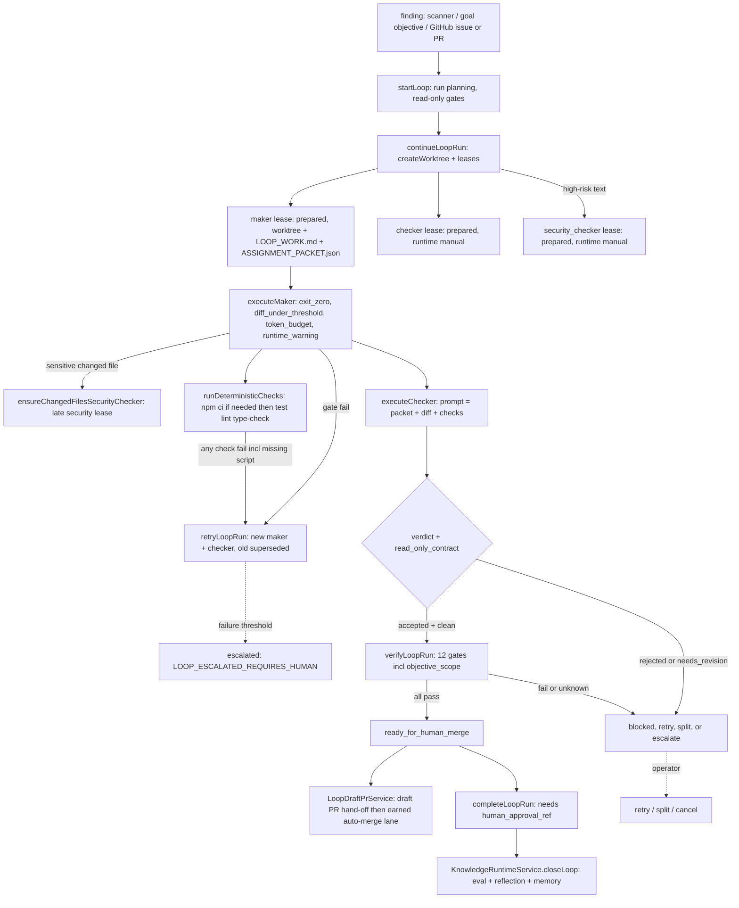

# Maker–Checker Loop Execution (Doc Drift / Self-Improvement / Issue Loops)

Every loop in DjimFlo runs the same closed-loop machinery regardless of what produced
the finding: a scanner, a goal's own objective, or a GitHub issue/PR webhook. A run
moves through `planning → running → verifying → ready_for_human_merge → completed`
(`LoopRunStatus`, packages/server/src/services/loop-types.ts#L15), with `blocked`,
`escalated`, `cancelled`, and `interrupted` as the failure/operator states. The loop
itself never merges: the `no_automatic_merge` gate is a structural constant that is
always `pass`, and `completeLoopRun()` is the only terminal transition — it re-verifies,
refuses a cancelled run (`LOOP_COMPLETION_CANCELLED`), any failed gate
(`LOOP_COMPLETION_BLOCKED:<name>`, `HIGH_RISK_SECURITY_CHECK_REQUIRED` for the security
gate), any `unknown` gate (`LOOP_COMPLETION_INSUFFICIENT_EVIDENCE:<name>`), and any
incomplete non-superseded lease, and throws `LOOP_HUMAN_APPROVAL_REQUIRED` without an
explicit `human_approval_ref` (loop-service.ts#L872-L976,
loop-verification-service.ts#L164-L168). The single, operator-armed relaxation of "a
human merges" is the *earned auto-merge* for test-only loop PRs described below — a
separate, revocable class with its own verified-head binding, not a loop gate.

LoopService is a facade; the real work lives in focused sub-services constructed in its
constructor (loop-service.ts#L389-L457):

| Sub-service | Owns |
|-------------|------|
| `LoopDiscoveryService` | Finding discovery per loop type |
| `LoopLifecycleService` | `continue` / `retry` / `split` — lease + worktree creation |
| `LoopWorkerExecutorService` | Maker and checker worker execution and gates |
| `LoopVerificationService` | Completion gates and certification |
| `LoopBudgetService` | Token/wall-clock budgets, failure-threshold escalation |
| `WorktreeManager` | Git worktree lifecycle |
| `KnowledgeRuntimeService` | Learning closure (`closeLoop`) |

The operator-facing API surface is `createLoopRoutes()` (packages/server/src/routes/loops.ts):
writes — `POST /loops/start`, `/runs/:id/continue|retry|split|verify|execute-maker|execute-worker|execute-checker|run-checks|stop`
(`create:task`), and `/runs/:id/checker-verdict|security-verdict|complete` (`approve:task`,
routes/loops.ts#L307-L360 — a verdict or completion is an approval, and the reviewer is the
authenticated user, never a request-body string). Reads — `GET /loops/draft-prs`,
`/dependency-lane`, `/auto-merge` (class state), plus `POST /auto-merge/re-enable` and
`/dependency-lane/re-enable` (`manage:config`, audited,
routes/loops.ts#L97-L157).

## Three finding sources, one pipeline

The loop fleet is not three implementations — it is three *finding sources* feeding one
maker→checker pipeline (README.md L58-L72):

1. **Doc Drift Loop** — `startLoop()` scans markdown for TODO/FIXME markers,
   `npm run <script>` references missing from every collected `package.json`, and broken
   relative links, plus draft-skill markers (loop-discovery-service.ts#L58-L113). The run
   starts read-only in `planning` (or immediately `completed` when nothing is found) with
   `read_only_discovery` / `no_automatic_merge` gates pre-stamped and a `plan_ready` /
   `no_change_required` outcome (loop-service.ts#L541-L650).
2. **Self-Improvement Loop** — a goal whose own objective becomes the finding.
   `startObjectiveLoop()` synthesizes one bound `self_improvement_objective` finding from
   the goal (and any linked `self_improvements` proposal) instead of running a scanner
   (`objective_mode` requires `goal_id`, loop-service.ts#L537-L561, L1476-L1524); the
   finding's file comes from the proposal's grounding artifact, and its metadata marks it
   `objective_mode`, which the verification `objective_scope` gate later enforces. `FixLoopService`
   offers the same targeted path for a caller-supplied file (`target_finding`). The
   `LoopDaemon` dispatch below is what decides a self-improvement goal gets this *real*
   cycle rather than the doc-drift no-op.
3. **GitHub Issue Loop** — `createGitHubWebhookRoutes` (packages/server/src/routes/github-webhooks.ts).
   An `issues` event only *imports* a work item into the integration inbox wrapped in a
   `BEGIN_EXTERNAL_CONTENT trust=untrusted` envelope with `execution_started: false` —
   arbitrary issue text is treated as a prompt-injection vector and never reaches a maker
   directly (github-webhooks.ts#L103-L128). A `pull_request` event, by contrast, creates a
   goal and auto-starts a `repo-maintenance-loop` run with `target_finding` pointed at a
   stable anchor file, because PR review is the CI-shaped path
   (github-webhooks.ts#L140-L189) — see *GitHub PR feedback loop* below.

Those sources converge on seven catalog contracts in `LOOP_CONTRACTS`
(loop-service.ts#L162-L268) — doc-drift, repo-maintenance, skill-quality,
mcp-connector-validation, security-regression, okf-synchronization,
overwatch-policy-drift — each declaring `actions_allowed`, `actions_forbidden`,
`stop_conditions`, `escalation`, and `verification`. The per-run plan stamps each
finding with `requires_human_approval_before_merge: true` and a named maker/checker
role pair (loop-service.ts#L1829-L1851).

## Finding → worktree → maker → checker → verdict



One loop run, its roles, and its gates. `stop_conditions` and `escalation` are
declared per contract; the escalation path (failure threshold exceeded) and the
approval-wait path are shown.

<!-- openwiki: mermaid parse failed and this diagram was converted to a text fence so it does not break rendering. Fix the diagram source and restore the mermaid fence. Parser error: Parse error on line 9: ...ps/start Routes->>Loop: startLoop obje Expecting '+', '-', '()', 'ACTOR', got 'loop' -->
```text
sequenceDiagram
  participant Op as Operator
  participant Routes as createLoopRoutes
  participant Loop as LoopService
  participant Exec as LoopWorkerExecutorService
  participant RT as Runtime child
  participant Verify as LoopVerificationService
  Op->>Routes: POST /loops/start
  Routes->>Loop: startLoop objective_mode or scanner
  Loop-->>Op: run planning with findings
  Op->>Routes: POST /runs/id/continue
  Routes->>Loop: continueLoopRun worktree + maker/checker leases
  Op->>Routes: POST /runs/id/execute-worker
  Routes->>Exec: executeMaker
  Exec->>RT: LOOP_WORK.md assignment in maker worktree
  RT-->>Exec: stdout stderr exit status
  Exec->>Loop: diff capture then gates exit_zero diff token warning
  Op->>Routes: POST /runs/id/run-checks
  Routes->>Loop: runDeterministicChecks test lint type-check
  Op->>Routes: POST /runs/id/execute-checker
  Routes->>Exec: executeChecker explicit runtime
  Exec->>RT: prompt with packet diff and check results
  RT-->>Exec: verdict JSON
  Exec->>Loop: gates exit_zero verdict read_only_contract
  Op->>Routes: POST /runs/id/verify
  Routes->>Verify: verifyLoopRun twelve gates
  Verify-->>Op: ready_for_human_merge or blocked
  Op->>Routes: POST /runs/id/complete human_approval_ref
```

One full maker→checker→verdict cycle driven through the operator API, as the daemon
replays it autonomously every tick.

### Worktree + lease creation (`continueLoopRun`)

`LoopLifecycleService.continueLoopRun()` is the single lease-creation path
(loop-lifecycle-service.ts#L27-L127). It refuses to continue a run that is
operator-paused, escalated, over token/wall-clock budget, or carrying a failed gate,
then for each selected finding (bounded by `max_assignments` and the maker budget):

- Creates an isolated git worktree under `.djimitflo-loop-worktrees/<runId>/<finding>`
  on branch `agent/loop/<runId>-<finding>` (`WorktreeManager.createWorktree`),
  snapshotting untracked source files with path-traversal guards and symlinking
  `node_modules`.
- Writes `.djimitflo/LOOP_WORK.md` and `.djimitflo/ASSIGNMENT_PACKET.json`
  (the packet declares `allowed_actions` / `forbidden_actions` /
  `expected_artifacts` / the contract's `stop_conditions` and `escalation`; the maker
  rules template forbids merge/push/deploy/secret/policy edits and pre-warns that
  lockfile noise is reverted, loop-service.ts#L296-L304, L2492-L2557).
  A sha256 of the packet plus a content-addressed daemon copy is recorded on insertion
  (`withAssignmentPacketProvenance`, loop-service.ts#L2761-L2774).
- Inserts a **maker** lease with the *requested* runtime (default `manual` — a model
  recommendation is never execution authority) and a **checker** lease that is
  *always* `runtime: 'manual'` (loop-lifecycle-service.ts#L57, L91-L96).
  A high-risk run or finding additionally gets a **security_checker** lease, also
  manual (loop-lifecycle-service.ts#L97-L104). `retryLoopRun()` re-creates the same
  triple for the retry maker and marks the old maker superseded
  (loop-lifecycle-service.ts#L166-L236).

Risk classification (`isHighRiskRun` / `highRiskReason`, loop-service.ts#L1753-L1786)
is multi-source: the run's `risk_class`, the linked goal's `risk_class`, a finding
marked `category: 'security'`, or sensitive keywords (auth/secret/token/policy/infra/…)
in the finding text — so a doc-drift TODO about a password becomes high-risk
automatically. Two additions complete the picture: `changedFilesRiskReason`
(loop-service.ts#L1793-L1796) classifies the files a maker *actually* changed, and the
verification takes the max of text risk and changed-files risk — it can only raise a
run to high, never lower it; and when a completed maker touched a sensitive path its
finding text did not flag, `ensureChangedFilesSecurityChecker()` creates the missing
manual security-checker lease after the fact with `risk_source: 'changed_files'` and a
`security_checker_required` event (loop-service.ts#L1811-L1822, called from the maker
path at loop-worker-executor-service.ts#L302).

## Maker execution and the diff cap

`LoopWorkerExecutorService.executeMaker()` is a wrapper whose catch fails any maker
lease it left stuck `running` (loop-worker-executor-service.ts#L114-L126); the work is
in `runMaker()` (L128-L324). It asserts the operator isn't paused and wall-clock budget
remains, resolves the prepared maker lease (failing closed with
`MANUAL_MAKER_REQUIRES_HUMAN` for a manual-runtime maker), records a `start` worker
manifest carrying the probed `RuntimeContract` plus capacity/budget snapshots, and marks
the lease `running`. Before a single token is spent it **fails closed on the runtime
contract**: if the probed runtime is unavailable or drifted, a `fail` manifest is
recorded, the lease is marked `failed` with `runtime_contract_unavailable_or_drifted`,
and `RUNTIME_CONTRACT_DRIFTED` is thrown (L186-L197). Because a deploy between lease
preparation and execution can unlink the worktree, the maker's worktree is
re-registered on its branch when needed and a `worktree_repaired` warning event is
recorded (L199-L203). After the runtime exits it captures stdout/stderr under the
evidence root and enforces the gates that actually bound a maker's blast radius
(L262-L268):

- `maker_runtime_exit_zero` — exit 0 and not timed out.
- `diff_under_threshold` — the worktree diff line count against `diff_max_lines`
  (request-tunable, default 200, hard clamp 1–2000, L249; a **test-only** change —
  every changed file under `__tests__/` or `*.test.*`/`*.spec.*` — may use the mutation
  lane's 400 lines via `TEST_ONLY_DIFF_MAX`, L66-L70, L247-L249, because a complete new
  test file legitimately exceeds 200).
- `token_budget` — per-worker / total / per-diff-line token budgets.
- `runtime_warning_gate` — blocking runtime warnings.
- `no_automatic_merge` — always pass; a structural invariant, not a measurement.

The diff being measured is computed carefully (L234-L249): a maker that rewrote
`package-lock.json` without touching `package.json` has the lockfile **restored as
install noise** first and a `maker_lockfile_restored` event is recorded; the
`changed_files` recorded on the lease are the tracked `git diff --name-only` plus
untracked files from `git ls-files --others --exclude-standard`, *excluding*
`package-lock.json` and anything under `.djimitflo/` (so the control files like
`LOOP_WORK.md` never count as maker output). The redacted, capped diff itself is stored
record-only under `MAKER_DIFF_CAPTURE=on` (`captureMakerDiff`, L292).
`diff_lines` and `changed_files` land in lease metadata, where verification later reads
them — including for the `auto_approved_scope` and `objective_scope` gates below. Two
dependency lanes can run *before* the maker: MAKER-DEPS-001 arm B runs the checks' own
install in the maker worktree first, and `MAKER_WARM_DEPS` provisions `node_modules`
from a lockfile-keyed cache (L204-L224).

`skip_permissions` is default-deny: honored only when
`RUNTIME_ALLOW_SKIP_PERMISSIONS=true` (loop-service.ts#L2020-L2023), and worker children
receive only an explicit env allowlist (`RUNTIME_ENV_PASSTHROUGH` extends it) — never
the server's own secrets (loop-service.ts#L2120-L2135). Real runtimes dispatch through
`ExecutionEngine` (`executeViaEngine`, loop-worker-executor-service.ts#L543-L620),
writing a durable `tasks` row keyed by `execution_task_id` on the lease; a task that
already reached a terminal state returns its stored result instead of re-running, and
`LOOP_WORKER_APPROVAL_REQUIRED` is a *wait*, not a failure (see Approvals below).

## Deterministic checks

`runDeterministicChecks()` (loop-service.ts#L1124-L1272) runs `test`, `lint`,
`type-check` (or a caller-supplied `scripts` list) via `npm run <script>` in the
maker worktree with a per-script `timeout_ms` (default 120 000, clamped
1 000–600 000) and a 5 MB output capture cap. When the worktree has a lockfile but no
`node_modules`, it first runs `npm ci --legacy-peer-deps --no-audit --no-fund` — each
deploy mounts a fresh clone, so checks used to exit 127 without vitest/eslint
(L1150-L1153, L2106-L2118). Per script it writes stdout/stderr logs under the evidence
root at `<evidenceRoot>/<runId>/checks/<leaseId>/` and records `pass` / `fail` into the
lease's `deterministic_checks` metadata. A script **absent from `package.json` is a
failed check with `reason: 'missing_script'`, never skipped** (B1: an empty check set
used to pass vacuously — verification's `tests_lint_typecheck` also requires at least
one recorded `pass`, loop-service.ts#L1158-L1171,
loop-verification-service.ts#L378-L387). Lane gates plug in beside the scripts: the
assertion-strength check of a test-writing maker's changed files
(`WEAK_ASSERTION_CHECK_MODE`) and the finding-fix lane's re-scan of the target file —
whose gate *error* is itself a failed check (L1195-L1206). A failing check flips the
maker lease to `failed`, moves the run to `blocked`, and feeds the stderr tail (last
1 000 chars per failing script, missing-script excluded) into the self-improvement
pipeline via `SelfImprovementService.generateFromBuildErrors()` — a deliberately
best-effort side effect wrapped so bookkeeping can never affect the checks result
(L1236-L1249). Under `EVIDENCE_FRESHNESS`, the checks also fingerprint every file they
*read* at the base commit into `evidence_read_set` (L1208-L1218) — the draft-PR path
later compares it against `main`.

## Checker (and security checker) verdicts

`executeChecker()` (loop-worker-executor-service.ts#L326-L483) dispatches the
reviewer. Key invariants enforced here:

- **Separation** — the checker lease must be `prepared`, must link to a *completed*
  maker, and gets its **own** worktree (branched from the maker's so the diff is
  present) which is compared by `realpath` against every other lease's worktree;
  sharing one throws `CHECKER_WORKTREE_NOT_INDEPENDENT` (L377-L391,
  loop-security-checker.test.ts#L167-L172).
- **Explicit runtime** — a `manual` lease is never silently run as mock;
  `CHECKER_RUNTIME_REQUIRED` is thrown without an explicit runtime, and a
  continuation must reuse the originally dispatched runtime
  (`CHECKER_RUNTIME_MISMATCH`, L345-L351, loop-security-checker.test.ts#L93-L96).
- **Packet integrity (§3d P0 #2)** — the reviewer's copy of the assignment packet lives
  in the maker's worktree, so the maker could rewrite it unseen. It is used only while
  it still hashes to the sha256 recorded at lease creation; otherwise the reviewer gets
  the daemon's content-addressed copy (or a `withheld` notice), and the mismatch is
  recorded as an `assignment_packet_tampered` event and a shadow policy-violation row
  (loop-service.ts#L2600-L2619).
- **Read-only contract** — after the run, `git status` on the checker worktree must be
  clean; a checker lockfile rewrite is restored (`checker_lockfile_restored`), and any
  other mutation flips `<role>_read_only_contract` to fail (L420-L450).
- **Verdict extraction, fail-closed** — the runtime's stdout is parsed for the LAST
  valid `accepted | needs_revision | rejected | insufficient_evidence` JSON object
  (with one repaired closing brace); anything absent or unrecognized is
  `insufficient_evidence`, and an explicit verdict is never re-interpreted
  (`parsedCheckerVerdict`, loop-service.ts#L2655-L2675). A TypeSafe second opinion
  (`checker_second_opinion`, judgments/checker-second-opinion.ts) runs in **shadow
  mode** — one confidence-gated verdict plus three atomic questions, used only to
  measure agreement with the real checker; it never affects a gate
  (loop-worker-executor-service.ts#L76-L78, L417-L419, L717-L727).

The verdict gates are `<role>_runtime_exit_zero`, `<role>_verdict` (only `accepted`
passes), and `<role>_read_only_contract`. The prompts (`CHECKER_INSTRUCTIONS`,
loop-service.ts#L354-L367) forbid editing/installing/building/re-running suites —
reviewers judge from the diff and the inlined check results — and both the checker and
security checker are told their verdict is **not human approval or permission to
merge**. Each dispatch also stamps a reviewer identity (`leaseIdentity`) on the lease,
and the F2 checker-family experiment (`CHECKER_FAMILY_RANDOMISE`,
checker-family.ts#L10-L31) randomises an oracle-lane goal's opencode checker by goal-id
hash between the maker-family default and a cross-family model (`CHECKER_CROSS_MODEL`),
recorded on the lease and goal with a `checker_family_arm` event — the security checker
is never touched and the experiment suspends to `fallback_suspended` during an outage
fallback (loop-daemon.ts#L822-L828).

## Verdict submission and accepted-review evidence

Manual review is a supported, explicit path with its own integrity rule (P0-4):
`submitCheckerVerdict` / `submitSecurityVerdict` require a `manual_attestation` of
reviewer + reason on a manual lease (`MANUAL_VERDICT_ATTESTATION_REQUIRED`), and the
recorded attestation for an authenticated caller is built from `req.user` — never a
free-text body string (`recordedAttestation`, loop-service.ts#L376-L387,
L1006-L1047, L1065-L1106; routes keep it behind `approve:task`,
routes/loops.ts#L306-L332). Submitting a verdict drives the run forward immediately:
`accepted` re-runs `verifyLoopRun()`, any non-accepted verdict feeds
`escalateIfFailureThresholdExceeded()` with reason `checker_verdict:<verdict>` /
`security_checker_verdict:<verdict>` (loop-service.ts#L1055-L1057, L1114-L1116).

Whether an accepted verdict counts is decided by `reviewEvidence()`
(loop-verification-service.ts#L330-L354): a *runtime* verdict passes only with full
runtime proof — lease `completed`, `exit_status === 0`, `timed_out === false`,
`runtime_verdict === 'accepted'`, not cancelled, `read_only_contract_passed === true`,
`runtime_adapter` matching the lease runtime, a valid runtime contract
(`available && status === 'ok'`), and an existing stdout log on disk (a log that has
since disappeared makes the gate `unknown`, not `fail`); a *manual* verdict passes only
with an attestation of `reviewer_type: 'human'` plus the user id the route took from
`req.user`, or a pre-cutoff legacy attestation labelled `legacy_unverified_identity`
(`MANUAL_ATTESTATION_IDENTITY_SINCE`, L34, L335-L341, L361-L369). A manual submission
therefore **cannot relabel a rejected runtime verdict as accepted**
(loop-security-checker.test.ts#L109-L165).

Reviewer timeouts are the production-calibrated knobs in loop-daemon.ts:
`daemonReviewerTimeoutMs()` honours `LOOP_REVIEWER_TIMEOUT_MS`, defaults to 300 000 ms
(accepted reviews took 45–119 s in prod on 2026-09-24; 2/7 hit the old fixed 120 s) and
clamps to a 900 000 ms ceiling (loop-daemon.ts#L85-L89).

## Verification gates and completion

`LoopVerificationService.verifyLoopRun()` (loop-verification-service.ts#L63-L242)
evaluates twelve completion gates. Gate status is three-valued: `fail` is a durable
observed failure, `unknown` is *insufficient evidence* (missing or unavailable — it
blocks certification but is never recorded as a failed invariant), `skipped` is
genuinely not applicable (loop-types.ts#L17-L21):

1. `run_not_cancelled` — a cancelled run can never be certified.
2. `maker_completion` — every *non-superseded* maker lease completed.
3. `maker_checker_separation` — at least one active checker per active maker.
4. `worktree_isolation` — every maker lease has an existing worktree on disk (a
   completed maker whose recorded worktree is gone is `unknown`, not `fail`).
5. `assignment_file_present` — every maker worktree still contains its
   `.djimitflo/LOOP_WORK.md` (or a readable historical one).
6. `diff_threshold_all_makers` — each completed maker stayed under its recorded
   `diff_max_lines`.
7. `checker_verdict` — every completed maker has an accepted checker verdict.
8. `tests_lint_typecheck` — each completed maker's deterministic checks all `pass` or
   `skipped`, **and at least one really ran and passed**.
9. `security_checker_verdict` — `skipped` unless high-risk (text risk **or**
   changed-files risk); then every completed maker needs an accepted security verdict.
10. `auto_approved_scope` — a maker auto-approved under the J5 test-gap lane may have
    changed **only** its single approved file.
11. `objective_scope` — an objective-mode maker may change only its finding's file
    (§3d P0 #4; absent on legacy runs with no `risk_inputs`, where a `skipped` gate
    would fail the daemon's every-gate-pass rule).
12. `no_automatic_merge` — structural constant.

Superseded makers (and their reviewers) are excluded from every gate so a fully
reviewed retry can certify without the failed original blocking it
(loop-verification-completion.test.ts#L100-L106). Whole gate *sets* are skipped when
not applicable: gym runs are graded by their own oracle, and a synthetic GitHub-PR
maker lease skips all change-loop artifact gates and the run keeps its status instead
of asserting merge-readiness (`inapplicableGates`, loop-verification-service.ts#L287-L301).
Gates are persisted to `gates_json`; failures write `block_reason: 'gate_failed'` with
per-gate reasons, missing evidence writes `block_reason: 'insufficient_evidence'` with
the unknown gates listed, and the status computes to `blocked` / `verifying` /
`ready_for_human_merge` (a cancelled or completed run keeps its terminal status).
`certifyLoopRun()` emits a `convergence` bus event when the run is
`ready_for_human_merge` or `completed` and `allGatesPassed` — note this counts
`skipped`, while the daemon's stricter completion rule requires every gate to literally
say `pass` (loop-verification-service.ts#L247-L256, loop-daemon.ts#L858-L862).
`completeLoopRun()` (loop-service.ts#L872-L976) is the only terminal transition — it
re-verifies, refuses a cancelled run (`LOOP_COMPLETION_CANCELLED`), any failing gate
(`LOOP_COMPLETION_BLOCKED:<gate>`, `HIGH_RISK_SECURITY_CHECK_REQUIRED` for the security
gate), any unknown gate (`LOOP_COMPLETION_INSUFFICIENT_EVIDENCE:<gate>`), or
incomplete non-superseded leases, and requires an explicit `human_approval_ref`
(loop-security-checker.test.ts#L75-L91, loop-verification-completion.test.ts#L91-L98).

Stop conditions come from two places: the contract-level `stop_conditions` /
`escalation` strings baked into each assignment packet, and the runtime stop
machinery — `escalateIfFailureThresholdExceeded()` (loop-budget-service.ts#L296-L323)
counts failed makers plus checker/security_checker verdicts of `needs_revision`,
`rejected`, or `insufficient_evidence` against a per-run threshold and sets status
`escalated`, after which `continueLoopRun` fails closed with
`LOOP_ESCALATED_REQUIRES_HUMAN` until an operator retries, splits, or cancels
(loop-service.ts#L1726-L1730, loop-lifecycle-service.ts#L169).

## Run completion, draft PR hand-off, and earned auto-merge

When all gates pass, three things happen at the boundary:

- **Draft PR (G4).** `LoopDraftPrService.openForRun()` (loop-draft-pr-service.ts#L20-L121)
  turns a `ready_for_human_merge` / `completed` run into a GitHub *draft* PR. It is
  default-off behind `LOOP_AUTO_DRAFT_PR_ENABLED`, requires
  `GITHUB_REPOSITORY` + `GITHUB_TOKEN`, is idempotent per run (`metadata.pr_url`), and
  records `draft_pr_failed` rather than throwing on any error. It pushes only the
  maker's real files (never `node_modules` symlinks or lockfile install noise) under a
  `djimitflo-loop` commit identity, passes the token only as a one-off
  `http.extraheader`, and commits to the goal's *registered repo* — an unregistered
  proposal repo or a worktree whose remote fails the slug check gets no PR. The pushed
  commit is recorded as `metadata.verified_head_sha` (P0-6: only the verified head may
  ever auto-merge). Before opening, a Batch-8 evidence-freshness check re-checks
  whether files the checks *read* changed on `main` (`enforce` skips opening and marks
  the run for re-check), and an open-draft throttle (`LOOP_DRAFT_PR_THROTTLE_MODE`,
  default off) can cap open loop drafts (loop-draft-pr-service.test.ts#L37-L62).
- **Earned auto-merge.** `runAutoMergeTick()` (loop-auto-merge.ts; every 15 min while
  `LOOP_AUTO_MERGE_TEST_ONLY=shadow|act`, default **off**) takes a verified run's draft
  PR the last step: eligible only when the proposal is `verified`, the run completed or
  ready with no failed/unknown gate, the PR is the loop's own (`loop:` title, loop
  author, head = the maker branch, base = `main`, matching repo), the head equals
  `verified_head_sha` or only GitHub's own verified update-branch merges on top of it,
  every changed file is a test file (none deleted), adds+deletes fit the maker's lane
  limit, the assertion-strength verdict is `pass`, no `CHANGES_REQUESTED` review
  exists, and a deterministic 10 % audit sample is excluded. Act mode then marks
  ready → updates the branch → waits for green checks → squash-merges with the verified
  `sha`, one step per tick, capped by `LOOP_AUTO_MERGE_MAX_PER_DAY` (default 10).
  A revert window that catches a revert commit, failed main checks at the merge commit,
  or settled merge-survival removal **revokes the class** (system state, audited) until
  an operator re-enables it through `POST /loops/auto-merge/re-enable`
  (loop-auto-merge.ts#L13-L35, L114-L198, loop-auto-merge-state.ts#L12-L31, L40-L78).
- **Learning closure.** `KnowledgeRuntimeService.closeLoop()`
  (knowledge-runtime-service.ts#L194-L331) runs in a single DB transaction. It first
  re-validates the run's current evidence: terminal reviewed status, not
  operator-paused, all non-superseded makers completed, accepted checker evidence per
  maker **plus no invalid review evidence on any active reviewer**, accepted security
  evidence for high-risk runs (text or changed-files risk), at least one passing gate
  and no unresolved ones, and non-empty trace spans / checkpoints / runner manifests.
  If any check fails it returns `status: 'blocked'` with reasons and creates nothing.
  Otherwise it runs a `loop-learning` eval, diffs the score against the previous eval
  for the same run, writes a `ReflectionCandidate` and an operational
  `MemoryCandidate`, creates a repair work item on regression
  (`repo-maintenance-loop`) or a skill-promotion work item on improvement
  (`skill-quality-loop`), persists one row in `loop_learning_closures`, and — via
  `bindImprovementEvaluation` — moves a linked verified `self_improvements` proposal to
  `evaluating` with `loop:/eval:/reflection:` evidence refs; a malformed evidence array
  throws and rolls the whole transaction back (#L333-L352,
  learning-closure-service.test.ts#L61-L139). It explicitly never marks a proposal
  `applied` or merges anything, and replaying a stored closure re-validates first, so a
  cancelled run keeps its historical records but they are not re-certified current.

## GitHub PR feedback loop

The `pull_request` webhook feeds the loop in both directions
([GitHub Webhooks](/openwiki/integrations/github-webhooks.md)): its goal + loop run is
bookkeeping, and `GithubPrReviewService.startReview()` posts the outcome back as a PR
comment and Check Run under the `djimitflo-review` status context
(github-pr-review-service.ts#L43-L120). Phase 1 (default) posts a synchronous
rule-based verdict; Phase 2 (`GITHUB_PR_REVIEW_RUNTIME`, off by default — an automatic
paid LLM call on every push is exactly the runaway-cost mode that retired the previous
bot) materializes a real worktree at the PR head and runs a real LLM checker through
`LoopService.executeChecker()` asynchronously. Because that status context is an
automated heuristic, the auto-merge lane never counts it toward green — a `djimitflo-review`
pending or failure holds a PR while a pass does not make it green
(loop-auto-merge-state.ts#L23-L31). That is also why the PR-review run's synthetic maker
lease keeps the change-loop artifact gates `skipped`: the PR is the patch, review is
the work (loop-verification-service.ts#L287-L301).

## The LoopDaemon: continuous autonomous execution

`LoopDaemon` (packages/server/src/services/loop-daemon.ts) wraps all of the above in
an always-on goal queue, polling at `GOAL_QUEUE_POLL_MS` (default 5 s) with bounded
concurrency (`GOAL_MAX_CONCURRENT`, default 4). Each tick prunes orphaned worktrees,
resumes approval-blocked goals, settles dependency-blocked goals, loads pending goals
risk-first (a deterministic, telemetry-logged selection policy), applies the fail-closed
`authorityGateForGoal`, and `executeGoal()` (loop-daemon.ts#L497-L1031) runs the full
chain per goal: decompose → start loop → continue (lease) → execute maker → run checks
(with one retry on `blocked`) → optional evolve siblings → optional automated checker →
verify → learn → update goal/run. Goals with no findings are completed as no-ops; an
objective-mode goal that only loses the per-tick cap *waits* instead of falling through
to the doc-drift no-op.

Maker execution is daemon-tuned (`daemonMakerTimeoutMs`, loop-daemon.ts#L49-L57): the
*mutation lane* (a goal whose `mutationCheckEnv` is non-empty) gets the executor
maximum of 600 s; other makers honour `LOOP_MAKER_TIMEOUT_MS` (default 300 s, capped
600 s). Lane-specific diff caps apply: mutation lane 400, dead-code lane 2 000 (mostly
deletions), finding-fix lane 30 (`FINDING_FIX_DIFF_MAX`), otherwise 200
(loop-daemon.ts#L630-L642). If the first `runDeterministicChecks` blocks the run, the
daemon performs **one** `retryLoopRun` — new maker, execute (inheriting a still-pending
approval only under the strict D4 rule), re-check (loop-daemon.ts#L645-L673). An
optional evolve lane (`LOOP_EVOLVE_ENABLED` + `LOOP_EVOLVE_SPECIES`,
test-gap/mutation-gap goals or `metadata.evolve`, evolve-selection.ts#L26-L37) spawns
up to two sibling makers of other runtime species on the same objective, runs each
through execute + checks, and `selectEvolveWinner` keeps the fittest as the only
non-superseded maker that goes on to the reviewers; a sibling whose runtime equals the
bandit-chosen primary's is skipped, and a sibling still waiting on a human approval is
propagated, not failed (loop-daemon.ts#L683-L741; see
[Autonomous Improvement Pipeline](/openwiki/workflows/autonomous-improvement-pipeline.md)).

The checker is the deliberate exception. Checker leases are always created manual —
code review requires a human by design — so the daemon **cannot** dispatch one unless
the operator arms `LOOP_DAEMON_AUTOMATED_CHECKER_ENABLED` (default off), an explicit
autonomy expansion confirmed as such after the 2026-09-20/21 "near-empty
`loop_learning_closures`" incident (the daemon created a checker lease but never ran
it, so `checker_verdict` could never pass and `closeLoop()` was never reached). When
armed, the reviewer dispatched is the newest *prepared* one **for the maker that goes
on** (`reviewerFor` — a retry's or the evolve winner's checker, never the superseded
one's), on whichever runtime the maker attempt actually used — with the outage-fallback
original runtime when applicable, and a local `LOOP_DAEMON_MAKER_RUNTIME` runtime when
the maker ran remote — at `daemonReviewerTimeoutMs()`; a completed reviewer is never
dispatched twice (`leaseDone`), a failed dispatch is recorded as
`checker_dispatch_failed` / `checker_dispatch_skipped`, never swallowed, and an
`APPROVAL_REQUIRED` parks the goal instead of failing it (loop-daemon.ts#L743-L844,
loop-daemon-checker-dispatch.test.ts#L105-L148). Two follow-ups bound the cost of a
reviewer that gives out: `LOOP_REVIEWER_RETRY_ENABLED` grants exactly **one** fresh
lease for a reviewer that timed out or hit its token budget (`reviewerRetryable` — a
reviewer that completed with a real rejection is never retried, loop-daemon.ts#L92-L98,
L779-L801), and `LOOP_REVIEWER_STRATEGY=bounded` skips the security checker entirely
once the checker (after its retry) has no decisive verdict, because the
`checker_verdict` gate then cannot pass — 9 such runs spent 3.97 M security tokens
(L100-L107, L830-L843). The security checker has its own flag
`LOOP_DAEMON_AUTOMATED_SECURITY_CHECKER_ENABLED`, and the F2 checker-family arm is
assigned at dispatch for oracle-lane goals.

Before verifying, the daemon checks whether any checker/security_checker lease is
still `running` — e.g. an approval-resumed pass — and if so records a
`verify_deferred` event and returns, letting the pass that owns the reviewer verify
when it finishes, rather than certifying now and recording a false `regressed`
(loop-daemon.ts#L846-L854).

Verification through learning is instrumented end to end: every executed run emits a
`loop_completed` bus event (the cognitive layer only learns from those) with the
outcome under certification's rule (`allGatesPassed`, so `skipped` counts), completion
itself keeps the stricter every-gate-`pass` rule, and outcomes are attributed once
before learner recording (`recordOutcomeAttribution`; `verificationFailureOutcome`
records timeout/exit/contract failures and unknown-only runs as `infra_failed`, never a
semantic regression). Linked `self_improvements` proposals get
`recordOutcome(verified | regressed | infra_failed | no_change)`, and one deduplicated
`skill_outcomes` row per run (`loop-maker:<loop>:<runtime>` keyed by run + lease) feeds
the skill-evolution engine, the runtime bandit and the model-call ledger, with failing
gates attached as `gate:<name>:<status>` evidence refs (loop-daemon.ts#L856-L934). Only
when all gates strictly pass does the daemon record the goal outcome `completed`, hand
off the draft PR, and call `KnowledgeRuntimeService.closeLoop()` — a blocked closure is
recorded as a `learning_closure_blocked` event (the one signal explaining near-empty
closures) rather than silently discarded (loop-daemon.ts#L939-L989). `startLoopAutoMerge`
runs its 15-minute tick independently of the daemon.

Approval gating is handled as a wait, not a failure: a worker returning
`LOOP_WORKER_APPROVAL_REQUIRED` parks the goal `blocked` with an `awaiting_approval`
record (`blockForApproval`, loop-daemon.ts#L366-L399 — when a shadow rule approves, an
`auto_approved_scope` is stamped on the lease *first* so verification can later hold
the diff to that one file), and `resumeApprovalBlockedGoals()` requeues it as
`decomposed` with `resume_run_id` once the human decision lands **and** the engine task
reached a terminal state — so the maker isn't run twice, `executeViaEngine` just
returns the stored result (loop-daemon.ts#L430-L454,
loop-worker-executor-service.ts#L553-L561). Denied or expired approvals fail the goal
with a `goal_failed` event, a proposal-outcome record, and a closing `loop_completed`
bus event. A resumed run continues the *same* run id and reuses its leases, skipping an
already-completed maker but running (and ranking) an approved evolve sibling.

## State, evidence, and observability

A loop run's durable state lives in `loop_runs` (status, `findings_json`,
`plan_json`, `gates_json`, `next_actions_json`, `metadata`) with worker leases in
`worker_leases`, an append-only event stream in `loop_events`, and on-disk evidence
under the evidence root — worker stdout/stderr logs, per-check output logs, assignment
packet copies, and a markdown `LOOP_STATE.md` state file per run.

The evidence root is resolved by `resolveEvidenceRoot()` (loop-service.ts#L143-L153)
— deliberately durable:

1. `LOOP_EVIDENCE_ROOT` (resolved to an absolute path) wins when set — the explicit
   operator override.
2. Otherwise, when `DB_PATH` is absolute, the root is
   `<dirname(DB_PATH)>/agent-evidence/agentic-control-loop-fleet` — i.e. **next to
   the database**, because DB_PATH lives on the persistent volume in prod. Prod
   2026-09-24 wrote evidence into the image's `/app/.data` and lost it on every
   deploy; verification checks the evidence files exist, so they must outlive the
   container (evidence-root.test.ts#L4-L8).
3. Otherwise (local dev) `<repo>/.data/agent-evidence/agentic-control-loop-fleet`.

Worktree pruning (`pruneOrphanedWorktrees`, loop-service.ts#L501-L503) removes
terminal-lease worktrees past a grace period (`LOOP_WORKTREE_MAX_AGE_HOURS`, 24 h)
while always keeping prepared/running ones, and `recoverInterruptedRuns()`
(loop-service.ts#L473-L477, LoopRecoveryService) marks runs orphaned by a crash as
`interrupted` and their leases `failed` so the fleet stops reporting them active
(leases with a genuinely live child are left alone). The daemon prunes on every tick.

## Related pages

- [Loop Lifecycle](/openwiki/concepts/loop-lifecycle.md) — the contract catalog and run/lease state model this page executes.
- [GitHub Webhooks](/openwiki/integrations/github-webhooks.md) — signature, idempotency, and inbox intake for the issue/PR entry points.
- [Knowledge Runtime](/openwiki/operations/knowledge-runtime.md) — the OKF capability registry that loop discovery reads and loop closures learn into.
- [Autonomous Improvement Pipeline](/openwiki/workflows/autonomous-improvement-pipeline.md) — the goal/daemon queue, objective-mode dispatch, bandit/evolve selection, and approval parking that feed `executeGoal`.
- [Runtime Executors](/openwiki/concepts/runtime-executors.md) — the ExecutionEngine and runtime adapters makers and checkers dispatch through.
