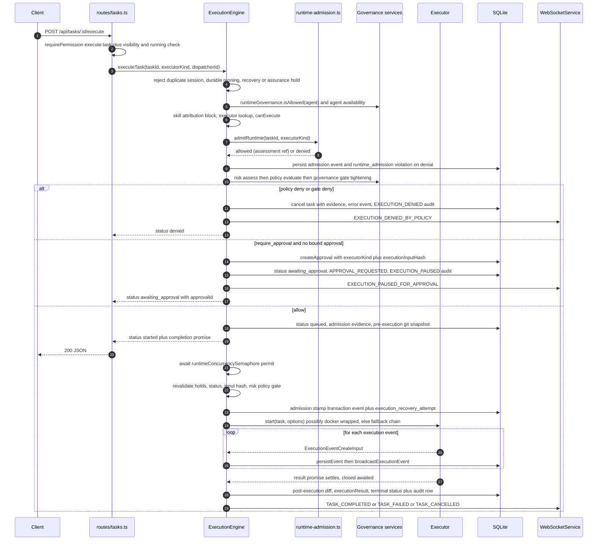

# Task Execution Lifecycle

This page traces one task from its REST intake through the `ExecutionEngine` dispatch
spine, the runtime executor session, the event stream, and the terminal audit row —
including the startup recovery pass that reconciles tasks the previous server process
left in `running`. The pre-execution governance spine is summarized here where it
interposes in dispatch; its full design is documented in
[Governance Pipeline](/openwiki/concepts/governance-pipeline.md), the executor
adapter contract in [Agent Runtimes & Executor Adapters](/openwiki/concepts/runtime-executors.md),
the approval lifecycle in [Approval Request & Decision Flow](/openwiki/workflows/approval-decision-flow.md),
and the server boot ordering in [Server Runtime & Startup Composition](/openwiki/architecture/server-runtime.md).

## Scope, components, and ownership

| Component | Role in the lifecycle |
|---|---|
| `routes/work-items.ts` + `services/work-item-service.ts` | Planning lane: durable `work_items` rows with risk scores and loop recommendations; `POST /api/work-items/:id/convert-to-goal` turns candidate/triaged work into a goal (which later dispatches tasks through loops). Never starts executors. |
| `routes/tasks.ts` | Direct lane: `POST /api/tasks` creates the executable task row; `POST /api/tasks/:id/execute` and `/cancel` reach the engine. |
| `execution/execution-engine.ts` | The single dispatch authority. `executeTask()` and `startExecutionAttempt()` own status transitions, capability permits, governance gates, fallback, sessions, event persistence, and recovery. |
| `execution/runtime-admission.ts` | Repo-held `RUNTIME_ADMISSIONS` ledger: a registered executor kind is not an admitted runtime@version. |
| `services/runtime-governance-service.ts` | Continuous per-agent behavioral monitoring; `isAllowed()` interposes before dispatch and again before every attempt. |
| `services/circuit-breaker-service.ts`, `services/fallback-chain-service.ts`, `services/execution-mode-policy-service.ts` | Provider health tracking, ordered executor fallback, and the per-mode retry budget. |
| `services/concurrency-semaphore.ts` | Process-wide runtime capacity cap (`RUNTIME_MAX_CONCURRENCY`, default 4). |

## Intake: two lanes into the same engine

**Planning lane (`/api/work-items`).** `WorkItemService.create()` (called by
`POST /api/work-items`, routes/work-items.ts L75-L85) normalizes a title, description,
`risk_class`, `value_score`/`confidence`, an optional `recommended_loop`, and assignment
hints into a `work_items` row whose lifecycle is
`candidate | triaged | planned | leased | blocked | done | discarded`
(work-item-service.ts L5-L7, L141-L184). Rows with `source: 'security_finding'` carry a
cryptographic identity fingerprint and extra state rules (no risk downgrades without
disposition evidence; terminal findings reopen only through scanner re-import;
work-item-service.ts L283-L332). `POST /:id/convert-to-goal` (L185-L198) transactionally
creates a goal with default constraints/acceptance criteria and marks the work item
`planned` — repeated conversion returns the existing goal instead of creating a second
one (L365-L371). Work items themselves never touch an executor: they flow into goals
and loop runs, which create tasks that reach the engine through the same
`executeTask()` path as everything else (see
[Maker–Checker Loop Execution](/openwiki/workflows/maker-checker-loop.md)).

**Direct lane (`/api/tasks`).** `POST /api/tasks` (requiring `create:task`;
routes/tasks.ts L141-L252) rejects a missing title/description and any
`metadata.environment` (executor environment is server-owned,
`EXECUTOR_ENVIRONMENT_RESERVED`), strips client-supplied `execution_recovery_*`
provenance keys, enriches the description with an advisory swarm-context snapshot
(degraded retrieval never blocks creation), inserts the row — default status
`pending`, mode `review_only` — records a `task.created` audit row inside the same
transaction, and broadcasts `TASK_CREATED`.

`PATCH /api/tasks/:id` (L255-L331) refuses to touch execution-state fields
(`status`, timestamps, `token_usage`, `execution_time_ms`) while the engine owns the
task — durable `running`, an active session, a `deep_agent_assurance_hold`, or an
`execution_recovery_hold` each return a 409 — and re-applies the reserved-metadata
filter while preserving server-owned bindings (`environment`, recovery stamps,
deep-agent assurance, and the canonical loop `lease_id`/`loop_run_id` taken from
`worker_leases`). `DELETE` refuses tasks with any audit-trail row
(`TASK_HAS_AUDIT_TRAIL`, L352-L354), making the task-to-audit chain non-erasable.

## Dispatch: `POST /api/tasks/:id/execute`

`POST /api/tasks/:id/execute` (routes/tasks.ts L434-L484) requires `execute:task`
and task-visibility authorization, then resolves the executor kind with the
precedence **request body `executor` → persisted `metadata.executor` → `'opencode'`**.
It refuses with `503 ENGINE_UNAVAILABLE` when the engine is absent and
`409 TASK_RUNNING` when an in-memory session already exists, then calls
`executionEngine.executeTask(id, executor, user.sub)`. `POST /api/tasks/:id/cancel`
(L487-L516) requires an active engine session and delegates to `cancelTask()`.

`executeTask()` (execution-engine.ts L252-L553) then walks an ordered admission
chain. Every failure here happens **before** any process starts:

1. **Replay and hold guards** — rejects when a session or pending capacity wait
   exists (`Task is already running`), when the durable status is already `running`
   (`TASK_RUNNING`, ownership must be reconciled first), when
   `metadata.execution_recovery_hold === true` (`EXECUTION_RECOVERY_REQUIRED`),
   when `metadata.deep_agent_assurance_hold === true`, or when a non-manual
   approval is still pending (L258-L290).
2. **Runtime governance** — `RuntimeGovernanceService.isAllowed(agent_id)` refuses
   quarantined or circuit-broken agents; a block cancels the task, persists an
   `error` execution event sourced `runtime-governance`, and returns
   `{ status: 'denied' }` (L292-L303; runtime-governance-service.ts L136-L141).
   `assertAssignedAgentAvailable()` separately refuses missing, retired, or
   non-`idle`/`active` agents (L582-L597).
3. **Skill attribution** — an unknown `metadata.skillId`, one not assigned to the
   task's agent, or several assignable skills without an explicit choice blocks the
   dispatch with a `policy_decision` evidence row and cancels the task (L1435-L1488).
4. **Runtime admission** — `admitRuntime()` (L336-L363 region, definition
   L841-L862) looks up the requested executor kind in the repo-held
   `RUNTIME_ADMISSIONS` ledger (runtime-admission.ts L151-L208), correlated with the
   version the contract probe observed **since this process booted**; task metadata
   and runtime output are never proof of version. Only `ADMIT`, `CONDITIONAL`, or an
   unexpired `LEGACY_ADMITTED` passes. Every check persists an execution event with
   the assessment `ref`, and every denial also writes a `runtime_admission` policy
   violation — `RUNTIME_ADMISSION_MODE=shadow` records the denial but lets the run
   proceed (the operator's rollback).
5. **Capability check** — `executor.canExecute(task)` (skipped for `deep-agent`,
   which is re-checked after its Federation contract is issued).

Only then does the [Governance Pipeline](/openwiki/concepts/governance-pipeline.md)
fire: `CommandRiskClassifier.assessTask()` → `PolicyDecisionService.evaluate()` →
`GovernanceGateService.assess()`, which can only *tighten* an `allow` to
`require_approval` when benchmark evidence flags the agent/model
(`GOVERNANCE_GATE_*` env-armed), never loosen (L327-L352). A `deny` cancels the task
with a critical `policy_decision` evidence row, an `error` execution event, an
`EXECUTION_DENIED` audit row, and an `EXECUTION_DENIED_BY_POLICY` broadcast. A
`require_approval` without a valid `hasApprovedStart()` creates an approval bound to
this exact dispatch (`metadata.executorKind` plus an `executionInputHash` over the
canonicalized task input, L1520-L1533 and L1535-L1549), moves the task to
`awaiting_approval`, emits `APPROVAL_REQUESTED`, pauses with an `EXECUTION_PAUSED`
audit row, and returns `{ status: 'awaiting_approval' }` — resume happens through
`handleApprovalDecision()`, which records the granted decision, audits
`EXECUTION_RESUMED`, and re-enters `executeTask()` with the approval's bound executor
kind (L891-L964).

An `allow` moves the task to `queued`, captures an admission evidence row, and — when
the task names a repository — snapshots git state for the post-execution diff
(L436-L450).

## Capacity wait and post-queue revalidation

Dispatch is asynchronous: if the admission chain returns `started`, the HTTP response
has already been sent while the task waits for a global runtime permit
(`runtimeConcurrencySemaphore`, `RUNTIME_MAX_CONCURRENCY` default 4;
concurrency-semaphore.ts L1-L50). Because that wait is unbounded, the engine
**revalidates everything after the permit is granted** (L482-L532): holds, durable
status still `queued`, an unchanged `executionInputHash`, and a fresh
risk → policy → governance-gate evaluation (a `deny` or stale approval now fails the
dispatch with a 409; the reassessment is persisted and evidenced from source
`queue-admission`). `deep-agent` tasks receive their signed Federation contract only
at this point, replacing any task-supplied contract before the capability re-check
(L527-L532).

## Executor session: start, stream, terminal handling

`startExecutionAttempt()` (L599-L735) is recursive so that a circuit-breaker-open or
failed start retries with the next fallback executor: every attempt re-checks
loop-pause and agent availability, the circuit breaker, fallback policy admission,
and runtime admission — a fallback chain is never a governance bypass (`deep-agent`
has no fallback). `metadata.sandbox.enabled` wraps the selected executor in a
`DockerSandboxExecutor` (forbidden for `deep-agent`, whose sandboxing is sovereign),
`RUNTIME_ALLOW_SKIP_PERMISSIONS=true` is required to honor task permission-bypass
requests (L80-L82), and metadata validation rejects malformed `model`,
`reasoningEffort`, or `codexSandbox` values.

Before the process starts, an admission transaction (L659-L668) persists an
`engine-admitted execution event whose metadata records
`{ source: 'execution-engine', phase: 'admitted', attempt_id, executorKind,
inProcess, sandboxed }` and stamps the same payload — plus the new event's id — onto
the task as `metadata.execution_recovery_attempt` while moving it to `running`. This
record is **provenance, not durable process ownership**, and it is what crash
recovery later trusts. Loop-leased tasks then bind the session via
`RuntimeLeaseRegistry` and record the *effective* runtime/model on the lease
(`requested_runtime` keeps the ask; P0-7, L679-L697).

The returned `ExecutionSession` (execution/types.ts L81-L117) exposes:

- `events: AsyncIterable<ExecutionEventCreateInput>` — consumed by
  `processEventStream()` (L1011-L1038), which persists each event to
  `execution_events` via `persistEvent()` and broadcasts it as
  `EXECUTION_EVENT` over the WebSocket. If the stream outlives
  `EXECUTION_EVENT_STREAM_TIMEOUT_MS` (default 300 000 ms), the engine persists a
  `stream.truncated` warning and breaks.
- `result: Promise<ExecutionResult>` — routed to `handleAttemptResult()` /
  `handleAttemptFailure()` (L737-L804), which record circuit-breaker success or
  failure on the executor kind that actually ran and decide any fallback: no retry
  when the failure is not retryable, may have had side effects, the attempt budget
  (`execution_mode` policy `maxRetries`) is exhausted, or the runtime is
  `deep-agent`.
- `cancel(): Promise<void>` — `cancelTask()` (L969-L992) marks the session cancelled,
  awaits cancellation, releases the capacity permit, sets the task `cancelled`, and
  broadcasts `TASK_CANCELLED`. Late-resolving results and stream handlers re-check
  `activeSessions.get(taskId) === session`, so a cancelled session's result can never
  overwrite the terminal state.
- Optional `pause()`/`resume()` hooks exist on the interface for adapters that
  support them; no built-in executor implements them.

Terminal handling (L1103-L1261) captures the post-execution diff before status
changes, writes `metadata.executionResult`, then branches: a completed `deep-agent`
run is held at `awaiting_approval` on `deep_agent_assurance_hold` pending independent
EVE-V assurance (executor success is not promotion authority); otherwise the task
lands at `completed` (execution time, token usage, evidence, `TASK_COMPLETED`
broadcast, memory sync, reasoning bank, and skill-outcome recording) or `failed`.
`updateTaskStatus()` (L1323-L1365) records the terminal `TASK_EXECUTED` /
`EXECUTION_FAILED` audit row — with before/after status and `user_id: 'system'` —
inside the same transaction as the status update, and broadcasts `TASK_UPDATED`.

*Sequence: one task dispatch from the REST boundary through admission, governance,
capacity wait, executor session, and the terminal audit row (recovery adds the
startup path described below).*

## Crash recovery: `recoverInterruptedTasks()`

`ExecutionEngine.recoverInterruptedTasks()` (execution-engine.ts L199-L247) runs
exactly once at server boot, right after engine construction
(index.ts L209-L217), under the single-server-per-DB model. It scans every task left
at durable status `running` and never replays work, never kills PIDs, and never
clears an uncertain hold: **lost JavaScript ownership is not proof an external CLI or
container stopped**.

For each orphaned task it correlates the protected `execution_recovery_attempt` stamp
with the latest engine-authored `admitted` execution event. Only when the stamp's
`event_id` and `attempt_id` match that row and both sides confirm
`executorKind: 'mock'`, `inProcess: true`, `sandboxed: false` is the outcome
`interrupted_in_process` — the task transitions to `failed` (the in-process mock
provably died with the server). Everything else — unknown metadata, malformed JSON,
user-forged stamps, real/fallback/sandboxed attempts — becomes `paused` with
`execution_recovery_hold: true` and outcome `unknown`, awaiting operator
reconciliation; `executeTask()` (L279-L281), state-mutating `PATCH`, `DELETE`, and
loop dispatch all refuse the task while the hold stands. Both paths write a
`TASK_FAILED`/`TASK_PAUSED` warning event, an `execution_reconciled_after_restart`
audit row with `automatic_replay: false`, and a warning `execution_summary` evidence
row — all inside one transaction — and broadcast `TASK_UPDATED`. Recovery is
idempotent (re-running it is a no-op once statuses move off `running`) and covers
`pending`/`queued` tasks only insofar as they were actually mid-dispatch with a
stamp. The semantics are pinned by
`__tests__/task-recovery.test.ts`:
held held/stale-stamp/forgery cases, the failed-mock case across a simulated restart,
the route-level 409s, and reserved-metadata stripping on create/patch.

Loop-managed tasks get an additional guard in `LoopWorkerExecutorService`: a worker
whose `execution_task_id` points at a held task fails with
`LOOP_WORKER_EXECUTION_RECOVERY_REQUIRED` without dispatching a second task, while a
completed task's stored `executionResult` is reused instead of replayed
(task-recovery.test.ts L123-L138).

## Configuration surface

| Variable | Effect |
|---|---|
| `RUNTIME_MAX_CONCURRENCY` (default 4) | Global runtime permit cap; queued dispatches are fully revalidated after the wait. |
| `RUNTIME_ADMISSION_MODE=shadow` | Records runtime-admission denials (with a policy violation) but lets the run proceed. |
| `RUNTIME_ALLOW_SKIP_PERMISSIONS=true` | Required before any task-metadata `skipPermissions` request is honored at the executor boundary. |
| `EXECUTION_EVENT_STREAM_TIMEOUT_MS` (default 300 000) | Wall-clock cap on a session event stream; expiry persists a `stream.truncated` warning and stops consumption. |
| `GOVERNANCE_GATE_ENABLED` / `GOVERNANCE_GATE_FLOOR` / `GOVERNANCE_GATE_MODEL_MAP` | Arms the benchmark floor that can tighten `allow` to `require_approval`. |
| `LOOP_REVIEWER_APPROVAL_INHERIT=true` | Lets read-only checker/security-checker tasks of a loop run inherit the run's human-approved, unexpired maker approval (opt-in; never retroactive). |
| `DJIMIT_DEEP_ENABLED=true` | Registers the `deep-agent` executor and its Federation contract issuer. |

## Focused tests

- `__tests__/execution-engine.test.ts` — executor registration, skip-permission
  gating, admission/approval scoping (`executionInputHash` binding, expired approval
  expiry → task cancellation, self-approval ban), governance-blocked and
  unavailable-agent dispatch refusals, capacity queuing and post-wait re-checks,
  deep-agent assurance hold / no-fallback / Federation contract overwrite,
  cancellation races, stream truncation, skill attribution, and governance-gate
  tightening.
- `__tests__/task-recovery.test.ts` — startup reconciliation: confirmed-mock failure,
  held unknown/forged/stale-stamp attempts, idempotency, hold enforcement on
  PATCH/DELETE/execute, and loop replay blocking with completed-result reuse.
- `__tests__/atomic-executor.test.ts` — a concrete adapter honoring the engine
  contract: `--no-approval` only under the server-armed skip-permissions flag,
  secrets passed via env names (never literals), worktree cwd and stdin goal.
- `__tests__/critical-routes.test.ts` and `__tests__/critical-http-contracts.test.ts` —
  route-factory import/mount integrity and the HTTP-level auth/approval contract
  (including `410 APPROVAL_EXPIRED`) behind which the lifecycle endpoints sit.
- `__tests__/integration-spine-*.test.ts` / `work-item-evidence-conversion.test.ts` —
  the work-item → goal → execution lane, including security-finding contract and
  conversion invariants.

## Related pages

- [Governance Pipeline](/openwiki/concepts/governance-pipeline.md) — the full risk → policy → gate → approval → ToolBroker → audit spine this page only summarizes.
- [Agent Runtimes & Executor Adapters](/openwiki/concepts/runtime-executors.md) — the `TaskExecutor`/`ExecutionSession` contract, adapters, sandboxing, circuit breaker, and fallback chains.
- [Approval Request & Decision Flow](/openwiki/workflows/approval-decision-flow.md) — what happens while a task sits in `awaiting_approval` and how decisions resume or cancel it.
- [Server Runtime & Startup Composition](/openwiki/architecture/server-runtime.md) — boot ordering, including where `recoverInterruptedTasks()` runs.
- [Maker–Checker Loop Execution](/openwiki/workflows/maker-checker-loop.md) — the loop/task path that consumes converted work items.
 path that consumes converted work items.
