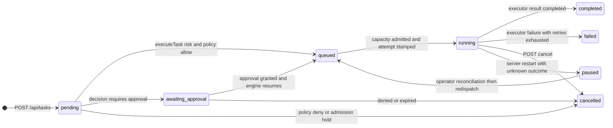
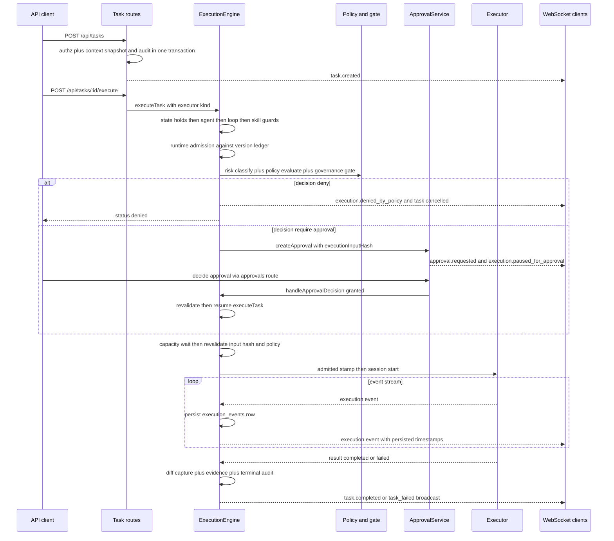

# Task Execution Lifecycle

A task is a row in the `tasks` table whose durable `status` column walks the
`TaskStatus` enum — `pending` → `queued` → `running` → `completed` / `failed`,
with `awaiting_approval`, `paused`, and `cancelled` as interruption states
(`packages/shared/src/types/common.ts#L6-L15`). Two layers own the journey: the
route module `createTaskRoutes()` (packages/server/src/routes/tasks.ts) owns
HTTP intake, validation, per-task authorization, and read surfaces, while
`ExecutionEngine` (packages/server/src/execution/execution-engine.ts) owns every
transition from dispatch onward. Each stage leaves durable rows — `execution_events`,
`risk_assessments`, `approvals`, `execution_evidence`, `audit_events` — and a
matching WebSocket broadcast, so a task's history is reconstructable from the
database alone.

*Task status lifecycle: the happy path runs left to right; every interruption branch is durable because external CLI processes outlive the JavaScript session that started them.*

## 1. Intake: POST /api/tasks

`createTaskRoutes` is mounted under `/api` behind the auth middleware in
`packages/server/src/routes/index.ts#L140`, and the router applies its own
600-requests-per-minute limiter on top of the API-wide cap
(`packages/server/src/routes/tasks.ts#L61-L66`).

Creation (`POST /`) requires the `create:task` permission — enforced by
`auth.requirePermission` — plus a non-empty `title` and `description`. The
request body chooses priority (`medium` by default), `risk_level` (`low` by
default), and `execution_mode` (`review_only` by default), and may bind the
task to an `agent_id`, `repository_id`, and `parent_task_id`
(`packages/server/src/routes/tasks.ts#L141-L170`).

Three intake behaviors matter downstream:

- **Swarm context becomes part of the immutable input.** The route asks
  `ContextInjectionService.injectContextSnapshot()` for advisory context from
  Qdrant, the OKF MCP bundle, DjimitKB, and episodic retrieval; the snapshot
  text is appended to the stored description and its `sha256`, `sources`, and
  provenance flags (`advisory: true`, `independently_reviewed: false`) are
  embedded in metadata *before* the row exists, because approvals later bind to
  a hash of exactly this input (`packages/server/src/routes/tasks.ts#L173-L210`,
  `packages/server/src/services/context-injection-service.ts#L88-L121`). If
  retrieval fails, creation still succeeds with an empty snapshot marked
  `degraded` — context is advisory, never a gate.
- **Server-owned metadata is stripped or rejected.** Request metadata keys
  starting with `execution_recovery_` are deleted and the `environment` key is
  rejected with `EXECUTOR_ENVIRONMENT_RESERVED`, so a client can neither forge
  recovery stamps nor inject executor process variables
  (`packages/server/src/routes/tasks.ts#L165-L167`, `#L211`).
- **Insert and audit are atomic.** The `INSERT` and the
  `AuditEventType.TASK_CREATED` record happen in one SQLite transaction; the
  `WebSocketEventType.TASK_CREATED` broadcast goes out only after commit
  (`packages/server/src/routes/tasks.ts#L213-L248`).

## 2. Task-scoped authorization

`AuthorizationService`
(packages/server/src/services/authorization-service.ts) is the single
ownership/permission authority for the route layer. Admins and platform admins
can do everything; other users are filtered to tasks where they are
`owner_user_id` or `created_by`:

- `GET /api/tasks` injects a visibility `WHERE` clause
  (`getTaskVisibilityWhere`), so non-admins never even learn other users' task
  ids from the list endpoint.
- `GET /:id`, `PATCH /:id`, `DELETE /:id`, `POST /:id/execute`, and
  `POST /:id/cancel` each load the task and then return **404, not 403**, when
  `canReadTask` / `canModifyTask` / `canExecuteTask` / `canDeleteTask` fails —
  existence is not disclosed to unauthorized callers
  (`packages/server/src/routes/tasks.ts#L122-L134`, `#L441-L444`).
- `canApproveForTask` additionally forbids the task **owner** from approving
  their own task — the HTTP half of separation of duties
  (`packages/server/src/services/authorization-service.ts#L39-L44`).

## 3. Dispatch: POST /api/tasks/:id/execute

The execute route (`packages/server/src/routes/tasks.ts#L434-L484`) requires
`execute:task`, resolves the executor kind from `req.body.executor` → persisted
`metadata.executor` → default `'opencode'`, rejects with `409 TASK_RUNNING` if
the engine already owns a session, and delegates to
`ExecutionEngine.executeTask()`. The response distinguishes `started`,
`awaiting_approval`, and `denied` (`ExecuteTaskResult`,
`packages/server/src/execution/execution-engine.ts#L68-L73`).

`executeTask()` then performs the synchronous **admission chain**
(`packages/server/src/execution/execution-engine.ts#L252-L352`):

1. **State guards** — refuse if a session or pending-execution entry exists, if
   the durable status is already `running` (must be reconciled, not
   redispatched), if `metadata.execution_recovery_hold` or
   `deep_agent_assurance_hold` is set, or if a pending execution approval
   already exists.
2. **Agent and loop admission** — the assigned agent must exist, be unretired,
   be in `idle`/`active` status, and pass `RuntimeGovernanceService.isAllowed`;
   a governance-blocked agent cancels the task outright and returns `denied`.
   `assertTaskLoopNotPaused` rejects dispatch when the owning loop run or goal
   is operator-paused.
3. **Skill attribution** — `blockInvalidSkillAttribution` cancels and denies a
   task whose `metadata.skillId` is unknown, unassigned to the agent, or
   ambiguous (agent has multiple skills and the task didn't pick one).
4. **Executor lookup and runtime admission** — the kind must be registered, and
   `admitRuntime()` must admit the runtime **at its probed version** against the
   in-repo `RUNTIME_ADMISSIONS` ledger (see §Runtime admission).
5. **Risk classification and policy** — see §Risk classification.
6. **Approval gate** — a `require_approval` verdict without a currently valid
   grant pauses the task (see §Approval gate).

Once admitted, the task moves to `queued`, an execution-summary evidence row is
recorded, a pre-execution git snapshot is captured for repository tasks
(`capturePreExecutionDiff`), and the optional `MetaOrchestrationService`
failure prediction is logged as warning evidence.

## 4. Risk classification and policy evaluation

`CommandRiskClassifier.assessTask()` produces a `RiskAssessment` from the task
row itself — stored `risk_level`, `execution_mode` (`review_only` collapses to
low-risk allow), sensitive keywords in title/description (escalating to HIGH
and `require_approval`), the `local-opencode` combination, and an explicit
`metadata.requested_command` classified against LOW/MEDIUM/HIGH/CRITICAL
command patterns; unknown commands default to MEDIUM with
`require_approval` (`packages/server/src/services/command-risk-classifier.ts#L78-L120`).

`PolicyDecisionService.evaluate()` then matches the assessment against enabled
rows of `approval_policies` (highest priority first, optional ReDoS-guarded
`match_pattern`, tool allow/block lists). No match falls back to the
classifier's `recommended_decision` (`packages/server/src/services/policy-decision-service.ts#L25-L45`).
`GovernanceGateService.assess()` can only **tighten** — an allow becomes
require_approval when the agent/model's OpenMythos benchmark score is below
the configured floor — never loosen; tightening is recorded as policy-decision
evidence (`packages/server/src/execution/execution-engine.ts#L332-L352`,
`packages/server/src/services/governance-gate-service.ts#L1-L30`).

Every assessment is persisted to `risk_assessments` and broadcast as
`WebSocketEventType.RISK_DETECTED` (`persistRiskAssessment`,
`packages/server/src/execution/execution-engine.ts#L1481-L1509`). A final
`deny` records critical evidence, persists an error event, audits
`EXECUTION_DENIED`, broadcasts `EXECUTION_DENIED_BY_POLICY`, and cancels the
task without any executor contact (`#L354-L387`).

## 5. Runtime admission ledger

Registration is not permission to run. `admitRuntime()`
(`packages/server/src/execution/execution-engine.ts#L832-L853`) reads the
runtime's **observed** version from the `runtime_contract_probes` table (only
probes from after this process booted count — an old probe may describe a
previous image), then `checkAdmission()` resolves the in-repo
`RUNTIME_ADMISSIONS` ledger
(`packages/server/src/execution/runtime-admission.ts#L91-L108`): critical-gate
FAIL (licensing, reproducibility, supply chain) is always REJECT; every
non-critical gate needs evidence, not claims; version-pinned admissions deny on
version drift. Every decision — pass, deny, or shadow — is persisted as an
execution event, and refusals are also recorded as `runtime_admission` policy
violations whether or not they are enforced. `RUNTIME_ADMISSION_MODE=shadow`
is the operator rollback: the denial is recorded and logged but the run
proceeds.

Admission is re-run for **every attempt**, including fallback executors, so a
fallback chain can never admit a runtime that failed its own gate
(`packages/server/src/execution/execution-engine.ts#L624-L626`).

## 6. Approval gate

When policy `require_approval` and no binding grant exists
(`hasApprovedStart`), the engine:

1. creates a `pending` approval via `ApprovalService.createApproval()` with the
   assessment, the matching policy id, and metadata `{ executorKind,
   executionInputHash }` — the hash binds the grant to exactly one execution
   input;
2. moves the task to `awaiting_approval` and persists an
   `APPROVAL_REQUESTED` execution event;
3. broadcasts `EXECUTION_PAUSED_FOR_APPROVAL` and audits `EXECUTION_PAUSED`;
4. returns `{ status: 'awaiting_approval', approvalId }` to the caller
   (`packages/server/src/execution/execution-engine.ts#L389-L432`).

`ApprovalService` (packages/server/src/services/approval-service.ts) owns the
`pending → approved | denied | expired` lifecycle. The TTL is
`APPROVAL_TTL_MS` (default 1 h, clamped 5 min – 7 days); expiry is realized
**lazily** when the approval is next read or decided, at which point an
`awaiting_approval` task is cancelled exactly as if the request had been
denied (`packages/server/src/services/approval-service.ts#L29-L32`,
`#L272-L310`). `decideApproval()` enforces the data-layer invariants: expired
approvals cannot authorize execution, an approval can be decided exactly once,
and the requester (`requested_by`) can never be the decider —
`SELF_APPROVAL_FORBIDDEN` (`#L180-L258`).

On a grant, `ExecutionEngine.handleApprovalDecision()` records
approval-decision evidence, persists `APPROVAL_GRANTED`, broadcasts
`EXECUTION_RESUMED_AFTER_APPROVAL`, audits `EXECUTION_RESUMED`, and re-enters
`executeTask()` (`packages/server/src/execution/execution-engine.ts#L882-L955`).
The full operator surface around this (dashboard queue, Telegram push,
authority ledger/outbox) is documented in
[Approval Request & Decision Flow](/openwiki/workflows/approval-decision-flow.md);
the gate's place in the wider pipeline is in
[Governance Pipeline](/openwiki/concepts/governance-pipeline.md).

## 7. Capacity wait and re-validation

After queueing, dispatch goes through `runtimeConcurrencySemaphore`
(`RUNTIME_MAX_CONCURRENCY`, default 4 concurrent executions;
`packages/server/src/services/concurrency-semaphore.ts`). While waiting, state
may have changed, so the engine **re-loads the task and re-validates
everything** before starting: loop pause, agent availability, recovery and
assurance holds, durable status still `queued`, and — crucially —
`executionInputHash(currentTask) === executionInputHash(parsedTask)`. It then
re-runs risk classification, policy evaluation, and the governance gate against
the *current* row and policies, recording `queue-admission` evidence; a now-deny
fails with `EXECUTION_POLICY_DENIED` and a stale approval fails with
`EXECUTION_APPROVAL_STALE`, both requiring a fresh explicit request
(`packages/server/src/execution/execution-engine.ts#L476-L526`). The
`executionInputHash` is a sha256 over the canonical JSON of the executor kind,
task id, title, description, priority, risk, mode, agent, parent, repository,
instruction profile, tags and metadata, excluding only runtime output and
recovery stamps (`#L1511-L1524`).

## 8. Execution attempts, fallback chain, sandbox

`startExecutionAttempt()` (`#L598-L726`) is where a task actually meets a
runtime:

- Before any external start, an **admission stamp** is persisted inside one
  transaction: an `execution_events` row with metadata
  `source: 'execution-engine', phase: 'admitted', attempt_id`, and the task's
  status flips to `running` with `metadata.execution_recovery_attempt` pointing
  at that event. This stamp is the provenance anchor crash recovery later
  correlates against (`#L656-L667`).
- The executor receives only server-validated options — model (string ≤ 200
  chars), reasoning effort (enum), codex sandbox mode, working directory, and
  `skipPermissions` only when *both* the metadata says true and
  `RUNTIME_ALLOW_SKIP_PERMISSIONS=true` (`resolveExecutorSkipPermissions`,
  `#L80-L82`). It returns an `ExecutionSession` — an object with an
  `AsyncIterable` of events, a `result` promise, optional `closed` promise for
  child-process teardown, and `cancel()`/`pause()`/`resume()`
  (`packages/server/src/execution/types.ts#L78-L112`). Executor adapters are
  covered in [Agent Runtimes & Executor Adapters](/openwiki/concepts/runtime-executors.md).
- `metadata.sandbox.enabled === true` wraps the executor in a
  `DockerSandboxExecutor` with operator-configured image, CPU/memory limits,
  network mode (`none` by default) and bind mounts. The `deep-agent` executor
  forbids sandboxing (the sovereign runtime owns isolation) and executes out of
  an in-memory-issued contract that is deliberately **stripped from the
  durable task metadata** before dispatch
  (`packages/server/src/execution/execution-engine.ts#L627-L641`, `#L527-L532`).
- **Circuit breaker + fallback**: `CircuitBreakerService` tracks per-executor
  failure thresholds (`CIRCUIT_BREAKER_THRESHOLD` default 3, recovery 30 s);
  an open breaker or retryable start failure routes through
  `FallbackChainService.DEFAULT_CHAINS` per execution mode (`fast` →
  opencode/gemini/claude, `standard` → claude/codex/gemini, `controlled` →
  claude/codex, `restricted` → claude only), bounded by the mode's
  `maxRetries` from `ExecutionModePolicyService` (fast 1, standard 2,
  controlled 3, restricted 0)
  (`packages/server/src/execution/execution-engine.ts#L615-L620`,
  `packages/server/src/services/fallback-chain-service.ts#L13-L18`,
  `packages/server/src/services/execution-mode-policy-service.ts#L24-L74`).
  Fallbacks re-pass policy admission (`fallbackAdmitted`) and are never chosen
  when the failure may have had side effects or is not retryable —
  `nextRetryExecutor` refuses any auto-retry whose `ExecutionFailure` has
  `sideEffectsPossible: true`, and `deep-agent` never falls back
  (`#L797-L809`).

## 9. Streaming, terminal handling, evidence, audit

From session start, `processEventStream()` consumes the session's async event
iterable: every event is persisted to `execution_events` **first**, then the
persisted row's canonical timestamps are re-read and broadcast as
`WebSocketEventType.EXECUTION_EVENT`, so WebSocket and REST
(`GET /api/tasks/:id/events`) consumers see the same record
(`packages/server/src/execution/execution-engine.ts#L1002-L1089`). A
stream-safety valve truncates the iteration after
`EXECUTION_EVENT_STREAM_TIMEOUT_MS` (default 300 000 ms) and records a warning
`STREAM_TRUNCATED` event instead of hanging forever
(`#L1003-L1018`).

On the wire, `WebSocketService.broadcastTaskEvent` filters every task-scoped
message through `AuthorizationService.canReadTask` against the *connected*
client's rebound credentials — token expiry, deactivated users, role changes
and dead sessions all close the socket — so execution output never crosses the
ownership boundary it would enforce over HTTP
(`packages/server/src/services/websocket-service.ts#L133-L155`,
`#L180-L199`).

Terminal handling (`handleExecutionComplete` / `handleAttemptResult` /
`handleExecutionError`, `execution-engine.ts#L728-L795`, `#L1094-L1252`):

- The semaphore permit is released, `metadata.executionResult` is stored, and
  the post-execution repository diff is captured **before** any status write —
  including on error, since partial side effects still need a record.
- **Completed**: status `completed` with `completed_at`, duration and token
  usage; execution-summary evidence; `TASK_COMPLETED` broadcast; then
  best-effort post-processing — `MemorySyncService.onTaskCompleted`,
  `ReasoningBankService.recordReasoning`, `SkillEvolutionEngine.recordOutcome`
  with the task's evidence ids, and `MetaOrchestrationService.recordOutcome`.
- **Failed**: status `failed`, error evidence, `TASK_FAILED` broadcast, skill
  outcome recorded as failure.
- **Cancelled**: `cancelTask()` marks the session cancelled, cancels the
  executor, releases the permit, sets status `cancelled`, and broadcasts
  `TASK_CANCELLED`; any late result from a cancelled or superseded session is
  ignored (`activeSessions.get(taskId) !== session`).
- Terminal status transitions are audited by `updateTaskStatus` itself with
  before/after status under `user_id: 'system'` — an engine transition is never
  attributed to a human (`#L1328-L1349`).
- The exception is deep-agent: a completed deep-agent run does **not** complete
  the task; it sets `deep_agent_assurance_hold`, moves the task back to
  `awaiting_approval`, and records evidence noting that executor success is not
  promotion authority until the EVE-V assurance adapter is installed
  (`#L1108-L1133`).

`EvidenceService.captureEvidence()` writes the cross-cutting
`execution_evidence` record (type, severity, source, structured details) at
every gate above, and `generateExecutionSummary()` materializes the
`execution_summaries` view — risk level, policy decision, approval status,
event/error/evidence counts — for reporting
(`packages/server/src/services/evidence-service.ts#L9-L36`, `#L107-L216`).
Task deletion is only possible for non-running tasks with no recovery hold and
**no audit trail** — a task with audit events is retained forever
(`packages/server/src/routes/tasks.ts#L346-L360`).

*End-to-end control flow: everything below executeTask is engine-owned, asynchronous after the HTTP response, and leaves a durable record per hop.*

## 10. Crash recovery: startup reconciliation

A durable `running` row outlives the JavaScript session that created it whenever
the server restarts. `ExecutionEngine.recoverInterruptedTasks()`
(`packages/server/src/execution/execution-engine.ts#L195-L247`) runs once at
startup (`packages/server/src/index.ts#L221-L224`) and reconciles under an
explicit principle: **lost JS ownership is not proof that an external CLI or
container has stopped** — never replay work, kill unknown PIDs, or clear an
uncertain hold.

For each task still `running` with no live session:

- The `execution_recovery_attempt` metadata stamp is correlated against the
  latest engine-authored `phase: 'admitted'` execution event, matching
  `event_id` and `attempt_id`. Only when both correlate, and both say
  `executorKind: 'mock'`, `inProcess: true`, `sandboxed: false` — a runtime
  that provably cannot survive process exit — is the task failed with outcome
  `interrupted_in_process`.
- Everything else — external executors, sandboxed attempts, malformed or
  user-forged stamps, requests that say "mock" but whose latest admission was
  a real fallback — moves to `paused` with `execution_recovery_hold: true` and
  outcome `unknown`.
- Either way, the transition commits a `TASK_FAILED`/`TASK_PAUSED` execution
  event, an `execution_reconciled_after_restart` audit entry with
  `automatic_replay: false`, and warning evidence in one transaction, then
  broadcasts `TASK_UPDATED`.

The hold is enforced everywhere: `executeTask` refuses with
`EXECUTION_RECOVERY_REQUIRED`, `PATCH` refuses execution-state fields, `DELETE`
refuses outright, and client metadata writes cannot clear or forge any
`execution_recovery_*` key (the PATCH route strips them and re-applies the
server's values). Only an operator reconciliation clears the hold; the behavior
is pinned by `packages/server/src/__tests__/task-recovery.test.ts`, which also
covers the stamp-vs-latest-admission correlation and loop-replay blocking.

## Operational knobs and invariants

| Knob | Default | Effect on the lifecycle |
|---|---|---|
| `RUNTIME_MAX_CONCURRENCY` | 4 | Global executor capacity semaphore |
| `RUNTIME_ADMISSION_MODE=shadow` | enforced | Record runtime-admission refusals without blocking |
| `APPROVAL_TTL_MS` | 3 600 000 (5 min–7 d clamp) | Pending-approval lifetime; expiry cancels the waiting task |
| `EXECUTION_EVENT_STREAM_TIMEOUT_MS` | 300 000 | Truncate a hung executor event stream |
| `RUNTIME_ALLOW_SKIP_PERMISSIONS=true` | off | Permit `metadata.skipPermissions` through to executors |
| `GOVERNANCE_GATE_ENABLED` / `_FLOOR` / `_MODEL_MAP` | off / 3 / empty | Benchmark-score tightening of allow → require_approval |
| `CIRCUIT_BREAKER_THRESHOLD` / `_RECOVERY_MS` | 3 / 30 000 | Per-executor failure circuit driving the fallback chain |
| `LOOP_REVIEWER_APPROVAL_INHERIT=true` | off | Let a run's read-only checkers inherit the maker's human approval |
| `DJIMIT_DEEP_ENABLED=true` | off | Register the deep-agent executor and its contract issuer |

Invariants worth keeping when changing this code:

1. **Approval grants are input-bound**: `executionInputHash` on the approval
   metadata must match the current task bytes, the approval must be unexpired,
   and re-validation after the capacity wait must confirm both state and hash
   before any provider starts.
2. **Self-approval is impossible**: enforced in HTTP authorization (owner
   cannot approve) and again in `decideApproval` at the data layer.
3. **Policy can only tighten after admission work begins**: the governance gate
   upgrades allow → require_approval; the capacity re-check can only fail
   harder than the synchronous pass.
4. **Persist before publish**: execution events hit SQLite before the
   WebSocket broadcast carries the *persisted* timestamps; insert, hold, and
   reconcile transitions are transactional with their audit and evidence.
5. **Recovery holds are server-owned**: no API write can set or clear an
   `execution_recovery_*` key, and redispatching a held task is a 409.
